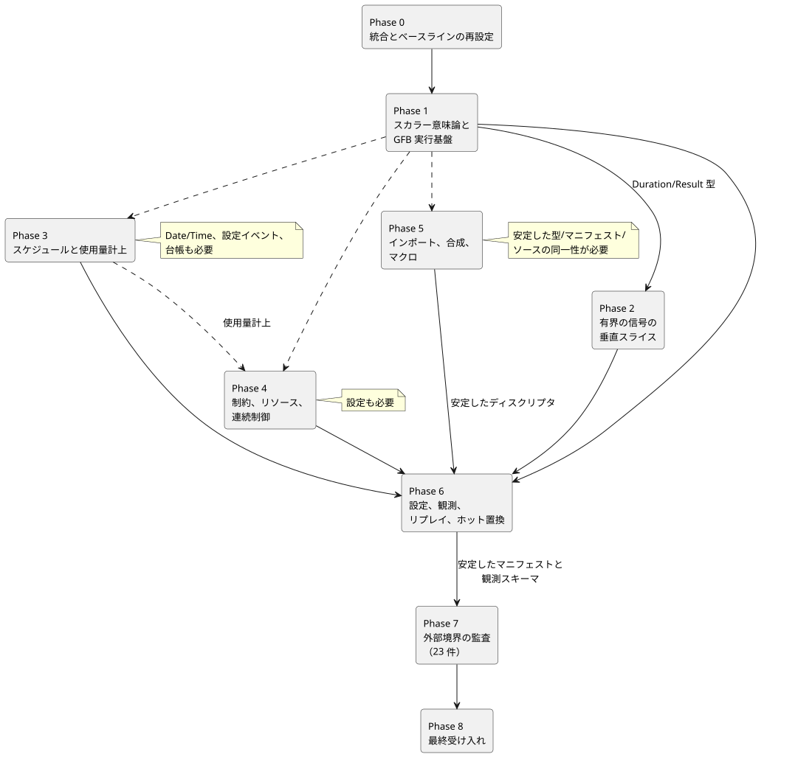

<!-- translation-source: tasks/reference-compliance-plan.en.md -->
[英語の原文](reference-compliance-plan.en.md)

# GhostFlow Reference 準拠の実装計画

この計画は、GhostFlow のコンパイラ**と**ランタイムが Language Reference の契約全体を、観測可能な証拠（エビデンス）を伴って実装するために必要な作業を追跡します。

**この文書の内容**

- [目標と完了基準](#目標と完了基準): 目標、3 つの完了条件、最新のゲート結果、および[最新のユーザー方針決定](#最新のユーザー方針決定)。
- [実装原則](#実装原則)と、共有ファイルの競合規則を含む[依存関係の構造](#依存関係の構造)。
- 各実装スライスの[現在の進捗](#現在の進捗)。
- [残り 27 件の CLI ケースの機能グループ](#残り-27-件の-cli-ケースの機能グループ)。
- [規定された 164 件のケースの実装境界監査](#規定された-164-件のケースの実装境界監査): 内部ケース 141 件と外部境界 23 件。
- [実装フェーズ](#実装フェーズ) 0〜8、[最初の 3 つの範囲限定の実装スコープ](#最初の-3-つの範囲限定の実装スコープ)、および[リスク](#リスクと緩和策)。

## 目標と完了基準

**目標。** コンパイラとランタイムが Language Reference の契約全体を実装し、その観測可能な証拠を残すことです。ユーザーは完了範囲にランタイムを明示的に含めました。したがって、実際の Rust/ネイティブ/WASM の実行意味論を、リポジトリのホストアダプタの契約とあわせて検証します。

現在のベースラインは、下に挙げる最後のフルゲートです。それ以前の実行履歴は `tests/reference/BASELINE.md` に保存されています。

**ゲート結果と進捗メモ**

以下の件数は、異なる時点で取得したスナップショットです（たとえば、診断カタログはメモによって 683 件とも 687 件とも報告されています）。各メモは、それが記述するリビジョンについてのみ有効です。

- **最後の batch16 ゲート。**
  - Node: 2,139 件 — 合格 1,947、失敗 28、TODO 164、スキップ 0。
  - Reference 実行可能ケース: 204 件 — 合格 177、失敗 27。失敗 ID は batch15 と同じです。
  - Rust コア 160、ネイティブパッケージ 28、WASM ABI 10 が合格しました。ネイティブ/WASM の成果物は再生成されました。Node ゲートが失敗したため、チュートリアルは実行されませんでした。
  - 証拠: `build/compiler-runtime-batch16-reference-results.json`、`build/compiler-runtime-batch16-full.log`、`build/compiler-runtime-batch16-verification.json`。
  - ゲート完了時点ではソースのハッシュは一致していました。その後のバージョンフィクスチャと Reference の方針変更により、*現在の*ハッシュの対応については主張しません。
  - GFB5 構造スライスの証拠: コア 160、ネイティブ 12、エンコーダ 8 + 影響を受けた 44、ブラウザ 3、言語横断ネイティブ 4、カタログ 5。ログは `build/schedule-core-green.log`、`build/gfb5-encoder-affected.log`、`build/gfb5-browser-green.log`、`build/gfb5-native-green.log`、`build/gfb5-catalog.log`。
  - 現在の診断カタログは 687 件です。正準の下位変換、スケジュールの実行、プロバイダ/リソース、リプレイは未完了です。

- **最後の batch15 ゲート。**
  - Node: 2,114 件 — 合格 1,923、失敗 27、TODO 164、スキップ 0。
  - Reference 実行可能ケース: 204 件 — 合格 177、失敗 27。27 件の失敗 ID は batch14 と一致し、新たな退行はありません。
  - Rust コア 142、ネイティブパッケージ 28、WASM ABI 10 が合格しました。ネイティブ/WASM の成果物は再生成されました。Node ゲートが失敗したため、チュートリアルは実行されませんでした。
  - 証拠: `build/compiler-runtime-batch15-reference-results.json`、`build/compiler-runtime-batch15-full.log`、`build/compiler-runtime-batch15-verification.json`。完了後、すべての検証ソースのハッシュは当時のソースと一致しました。
- **規定された 164 件**は CLI の実行テストではありません。既存の実行証拠の一部は `reference-evidence.md` にリンクされていますが、完全な対応付けと検証は未完了です。
- **Batch13** には、ネイティブパッケージ/フレーム付き CLI と、測定に基づく入れ子のウィンドウが含まれます。入れ子のコンパイラ/エンコーダのサポート、元のタイムスタンプ、独立した集約の重み、所有された証明、上流全体の high-water、epoch の無効化、メモリ上限、Rust のリプレイを実装しています。絶対値/期限切れ/遅延/変換の来歴（provenance）に関する 6 件のケースも、両方の WASM ホストで合格しました。この証拠は、すべての時間演算や永続的な移行の完了を確定するものではありません。
- **Batch14** には、元の値を保持する独立した時間的ゴーストリプレイと、両方の WASM アダプタ API が含まれます。現在のプログラムの記録、チェックポイント、入れ子の証明、フレーム ID を再現します。保持記録 1,024 件のロールオーバーと再試行の検証に合格しました。
  - Batch15 では、アクティベーション前の静的なリソース計画と、C/C−1 および N/N−1 のアクティベーション/リプレイ境界に対する独立した wasm32 オラクル検査を追加しました。長い tick 間隔でのネイティブ/WASM の状態/タイマーの検査にも合格しました。
  - 次は、残りのスケジュール/制御/合成の契約です。`true_for` と `after_event` の方針は `temporal-policy-decisions.md` で確定していますが、実装の証拠はまだ作成されていません。推定の証拠、永続的な移行、§6.8 の完全なブランチ同一性/what-if も残っています。
- batch13 の後に追加された**カタログ位置の修正**と、両方の WASM ホストの遅延エラー/同一サンプル再試行のテストは、後の batch14/15 のフルゲートに含まれました。それ以前の限定的な証拠は `build/window-derived-catalog-fix.log` と `build/window-derived-host-retry.log` に残っています。
- **追加の診断テスト 6 件が合格しました:** パーサーの呼び出し箇所に関するケース 4 件と、入れ子のウィンドウのバイト上限に関するケース 2 件です。診断/境界カタログは 687 件です。[時間的アダプタのリプレイ](temporal-adapter-replay-design.ja.md)は、Astra（コア/ABI）、Sol（JS アダプタと実際の WASM テスト）、Luna（ドキュメント）、root（統合/検証）によって提供され、限定的な検査と batch14 ゲートに合格しました。
- **batch15 の後:** DailySlots が重複した `timezone`/`selected` を受け付けてしまう問題を修正しました。Luna の RED ケース 4 件は、厳密なエラー種別、メッセージ、元の位置、および正常系の対照を網羅する GREEN ケース 5 件になりました。root の関連する退行テスト 231 件が合格しました。診断カタログは 683 件です。証拠: `build/compiler-schedule-duplicates-red.log`、`build/compiler-schedule-duplicates.log`、`build/schedule-duplicates-regression.log`。フルゲートは再実行していません。batch15 のハッシュは、この変更*前*のソースに対する証拠です。
- **次の実装: Rust が所有する Solar パルスの受け入れ（アドミッション）。** Sol/Astra の監査により、現在のネイティブ/WASM のパリティ（一致性）は JS が生成した due ビットをリプレイしているだけであり、Rust によるスケジュール評価やロールバックを証明していないことがわかりました。明示的なクロック/ギャップ/復旧、コンパイルされた `when`、プロバイダのファクト、所有された観測、リプレイを、実際の Runtime トランザクションに接続します。複数発生の方針は `temporal-policy-decisions.md` で確定していますが、実装の証拠は残っています。
- **クロックコンポーネント。** Sol の trusted-only `ScheduleClockGate` に関する限定的なケース 6 件と、root のコアスイート全体 148 件が合格しました。変わったのは、Luna が移動した同じコアテストのカタログロケータだけで、カタログのケース 5 件も合格しました。範囲と証拠は `tasks/schedule-clock-design.md` にあります。このゲートはまだソースのスケジュール、VM トランザクション、WASM ABI に接続されていないため、Reference の失敗の減少やスケジュールの完了として数えないでください。ワイヤーの草案にソースの SHA を挿入することは、コメントの変更では GFB が変わらないという契約と矛盾したため、削除しました。ソースの同一性は、検証済みの外部アクティベーションメタデータに保持されます。

**完了条件。** 次の 3 つがすべて成り立つ場合にのみ、完了を宣言します。

1. すべての実行可能ケースが、実際の `ghostc --check` とビルドの経路に合格する。
2. 内部で実装される規定ケース 141 件が、コンパイラ、コア、WASM ランタイム、またはリポジトリのホストアダプタにおける独立した実行テストにリンクされている。
3. 外部境界 23 件について、Driver、レンダラー、デプロイ/プロバイダの責務が言語実行の成功から分離され、それらの入力/出力/同一性/品質/リビジョンの証拠契約が監査されている。

残りの CLI の失敗だけを green にしても、Reference への完全な準拠は確定**しません**。コンパイルの成功は、ランタイムの意味論、物理的な適用、UI の表示を証明しません。

### 最新のユーザー方針決定

過去の進捗記録で未解決とされていた 3 つの質問すべてに回答が出ました。

| 質問 | 決定 |
|---|---|
| `true_for` | Driver が実際の観測を保証する連続区間のみを認めます。測定と測定の間を推定することはしません。 |
| `after_event` | 各開始イベントを独立に追跡し、それぞれの結果を区別します。 |
| 1 つの観測区間内での同一スケジュールの複数の発生 | すべてを取りこぼし（missed）として記録し、どれも実行しません。 |

`temporal-policy-decisions.md` と Reference の §3.5/§4.4 に基づいて TDD で進めます。方針が確定したことは、実装が完了したことを意味しません。

## 実装原則

- **正本ソース**は `docs/reference/*.md` と `tests/reference/cases/*.json` です。現在の実装に合わせて期待値を下げることは決してしません。
- **垂直スライス。** 各スライスは、可能な限り 3〜5 ファイルの垂直な経路に限定します。パーサー/型検査、マニフェスト、ランタイム、実際の観測テストをまとめて完成させます。
- **再利用を優先:** `tools/control.mjs`、`tools/gfb1.mjs`、`tools/source-trace.mjs`、`runtimes/wasm/control-runtime.mjs`、および `crates/ghostflow-core` の signal、scan、station、solar モジュール。
- **故障した tick のアトミック性。** 故障した tick は、状態、意図、タイマー、コントローラ/リソースの状態、ジャーナルの位置をアトミックに保持しなければなりません。
- **絶対的な期待値。** 同じ誤った答えを返すネイティブ/WASM のパリティでは不十分です。各バックエンドを Reference の絶対的な期待値と比較します。
- **変換後の来歴。** 最適化、下位変換、復元の後でも、ソースの文書/リビジョン、バイトコードのダイジェスト、ノード/依存関係の来歴を検証します。
- **ベースラインの再設定は 1 回。** 進行中のエージェントの変更がマージされた後に、ベースラインを 1 回だけ更新します。古い 44 件のリストを、変更のない作業キューとして使わないでください。

## 依存関係の構造

下の各層は、その上の層の上に構築されます。

```text
Reference の文法と意味的な型
    -> パーサー/型検査器と有界のリソースレポート
        -> マニフェストとソーストレースの契約
            -> GFB 検証器/下位変換
                -> Rust コアの状態機械
                    -> ネイティブ/WASM アダプタ
                        -> ホストの設定/プロバイダ/バインディングの契約
                            -> Driver/UI 境界の証拠
```

共有ファイルの競合規則:

- `tools/control.mjs` の各宣言ファミリーを編集するのは 1 つのエージェントだけです。
- GFB フォーマットの担当者が、`tools/gfb1.mjs`、`crates/ghostflow-core/src/lib.rs`、WASM 成果物の再ビルドへの変更を直列化します。必要に応じて、スキャンの変更はその担当者と調整します。
- `runtimes/wasm/control-runtime.mjs` のマニフェストスキーマは、コンパイラのマニフェスト生成側と同じスライスで変更します。
- ネイティブと WASM のリリース成果物は、コアの変更バッチの後に 1 回だけ再生成します。

## 現在の進捗

| スライス | ステータス | 担当 / 難易度 | 競合の境界 |
|---|---|---|---|
| GFB の短絡評価と `MIN % -1` | Batch3 に合格。コンパクトな定数エンコーディングと PC10 の実行を含む | Astra / 高 | `tools/gfb1.mjs`、`lib.rs`、GFB フォーマット、成果物の再ビルドの排他的所有 |
| Duration の境界とセンサ復旧の故障状態 | Batch3 に合格 | Luna / 中 | Duration の字句解析/型ブロックと `signals.rs` の結果を再利用 |
| `moving_average` のコンパイラ→マニフェスト→実際の WASM | ホストケース 14 件と関連する Reference ケース 2 件が合格（限定的）。batch3 の証拠は保持 | Luna / 中〜低 | EMA スライスが完了済みのセンサ変更を引き継ぐ |
| EMA のコンパイラ→マニフェスト→実際の WASM | Batch3 の Number/Percent と極値の退行に関する証拠。Temperature との接続は物理量スライスに属する | Sol / 中 | センサフィルタとホストのセンサ検証 |
| 動的な Int 変換 | Batch3 に合格。ネイティブ/WASM の変換、故障、ロールバックを含む | Astra / 高 | GFB3 オペコード 48〜53、安定した故障、アトミックなロールバック |
| 動的な Duration 算術 | ソース/ガードの接続が完了。batch3 に合格 | Astra コア + Sol ソース | ソースの型付き算術と GFB3 のガードを一緒に接続 |
| 物理量のカタログ/型/ランタイム | スライス完了。batch3 の証拠は保持 | Sol / 高。Astra が数値面をレビュー | すべての公開利用者にわたるソース/単位メタデータの対応 |
| タグ付き時間リテラル | コンパイラ/ランタイムが接続済み。batch4 に合格 | Sol ソース + Astra パッケージ + Luna ヘルパーテスト | Reference 全体の完了とは別 |
| Result 値と変換 | Batch6/7 の限定的なコンパイラ/ランタイム/来歴の証拠。ネイティブ Rust パッケージの正準リプレイに関する注意点が残る | Sol コンパイラ/ホスト + Astra コア | [実行記録の契約](result-provenance-design.ja.md)、ソースメタデータ、GFB3 オペコード 56 |
| Debounce の Bool/有限列挙型/Result | Batch7 に合格。センサごとの重複排除、実際のネイティブ/WASM、リプレイ、成果物の検証 | Sol コンパイラ/ホスト、Astra Rust/コードサイズ、Luna 診断、root 来歴 | [契約と残りの境界](debounce-design.ja.md)、[スキャントランザクション](sensor-atomicity-design.ja.md)。永続的な再起動とネイティブパッケージの正本ソースに関する注意点が残る |
| 測定ベースの hold_last | Batch9 のコンパイラ/ネイティブ/両方の WASM、Held の来歴、TTL、未来/重複排除/epoch/ロールバック/リプレイ、署名付き成果物の検査に合格 | Sol コンパイラ/テスト、Astra パッケージ/コードサイズ、Luna 来歴、root 統合 | [検証と残りの境界](hold-last-design.ja.md)。推定品質と永続的な継続性の復元が残る |
| Int の運用設定 | Batch10 のコンパイラ/マニフェスト/インタラクションディスクリプタと signed32 境界の証拠に合格。アトミックな LIVE §5.2 は未実装 | Sol コンパイラ/ホスト + root 統合 | ネイティブパッケージのソース/既定値の対応は未証明 |
| 時間的な Rust 基盤 | Rust の単体テスト 7 件とオラクルテスト 6 件が合格。コンパイラ/GFB/WASM ABI との統合は未完了 | Astra コア | [ウィンドウの証拠の設計](window-evidence-design.ja.md) |

## 残り 27 件の CLI ケースの機能グループ

| グループ | ケース数と ID | 必要な実装 | 再利用できる既存資産 | 観測可能な受け入れ | 依存関係 / 難易度 |
|---|---|---|---|---|---|
| スケジュール/プロバイダ/使用量計上の構文 | 11: `REF-03-024`, `032`, `036`, `038`, `042`, `045`, `050`, `057`, `059`, `060`, `062` | 共通のスケジュールポリシー、DailySlots/Periodic/Cron/Solar/Tide、TimeSlots、WorkCalendar、リソース/イベント/アカウントの構文と型付きの条件 | スケジュール/solar のホストアダプタ、station の台帳（レジャー）、発生のトレース、ソーストレース | マニフェストがすべての必須ポリシーとプロバイダの同一性を保持する。実際の交差/ギャップ/DST/プロバイダのベクトルが絶対的な結果と一致する | 日付/時刻、設定、プロバイダの契約 / 高 |
| 有界の信号と時間的証拠 | 2: `REF-04-025`, `026` | true-for/after-event。ウィンドウの集約/レートについて、リプレイと有界状態の証拠を改善 | Rust の signals、連続タイマー、ソースの依存関係、ControlRuntime のコンディショナ | 半開区間の境界、疎な/取りこぼされたスキャン、故障のリセット、チェックポイント、メモリ上限を実際の WASM で検証 | Duration/物理量/Result / 中〜高 |
| ケイパビリティ/制約/リソース/制御 | 7: `REF-04-035`, `044`, `045`, `050`, `058`, `061`, `063` | オプションのケイパビリティ照合、制約のフェーズ、有限集合の集約、調停ポリシー、目標/縮退/適応のディスクリプタ | 制約の不動点、station のリソースマネージャ、運用設定、インタラクションスキーマ | 要求意図/安全意図/適用済みの分離、一意の勝者、アトミックな予約、グローバル制約の迂回なし、提案のみの適応 | 物理量、Result、設定 / 高 |
| インポート/合成/マクロ | 7: `REF-06-010`, `023`, `101`, `102`, `103`, `105`, `106` | 固定された文書の閉包、ダイジェスト検証、インスタンス/型付きポートのグラフ、型付きの quote/splice 展開の上限 | 文芸的ソース（literate）の抽出器、ツールチェーンのダイジェストのバインディング、ポータブルなパッケージ検証器 | ダイジェスト/リビジョンの改ざんの拒否、重複したプロバイダの拒否、型付き展開の後に通常の検査器が実行される、再帰/上限の拒否 | ソースの同一性の契約 / 高 |

合計は 27 件です。次のケースは、それ以前に CLI の失敗キューから外れました。`REF-04-020` は batch7 で、`REF-04-031` は batch9 で、ウィンドウのケース `REF-04-027`/`028`/`029` は batch13 までに合格しました。CLI での合格と、残っているランタイムの受け入れとは区別しておいてください。

## 規定された 164 件のケースの実装境界監査

### 分類結果

| 分類 | 件数 | 扱い |
|---|---:|---|
| compiler/tooling | 22 | コンパイラ、ソーストレース、パッケージ/復元のテストを通じて実行の証拠を作成する |
| core/runtime | 93 | Rust/ネイティブ/WASM の絶対的な結果と、状態/ジャーナルの観測を通じて実行の証拠を作成する |
| repository host adapter | 26 | 決定的なスケジュール/設定/ケイパビリティ/プロバイダのアダプタ契約テストを通じて実行の証拠を作成する |
| 外部の driver/renderer | 7 | 適用/確認/配線の証拠契約を監査する。言語ランタイムの成功はこれらの代わりにならない |
| 外部の cabinet-view | 3 | ディスクリプタに基づく読み取り/書き込みの権限と、同一の検証意味論を監査する |
| design boundary | 7 | 新しいキーワード/グラフ/エフェクトのスコープが意図せず混在していないことのアーキテクチャ監査 |
| 外部の host/deployment/provider | 6 | OS、永続ストレージ、プロバイダのカバレッジ、設置のバインディングの証拠を監査する |
| **合計** | **164** | 内部実装 141 件、外部境界の監査 23 件 |

23 件の外部境界の正確なリストは次のとおりです。残りの規定ケース 141 件には、リポジトリ内部の実行の証拠が必要です。

- Driver 7: `REF-00-002`, `REF-04-010`, `REF-04-043`, `REF-04-053`, `REF-06-005`, `REF-06-006`, `REF-08-010`
- Cabinet-view 3: `REF-00-009`, `REF-05-019`, `REF-05-020`
- 設計 7: `REF-01-003`, `REF-01-055`, `REF-03-018`, `REF-06-001`, `REF-06-024`, `REF-08-001`, `REF-08-006`
- 外部の host/deployment/provider 6: `REF-06-018`, `REF-08-003`, `REF-08-004`, `REF-08-008`, `REF-08-013`, `REF-08-016`

### 内部実装の機能グループ

| グループ | 規定の根拠 | 実装場所と受け入れ | 難易度 |
|---|---|---|---|
| ソース/来歴/ツールチェーン | `REF-00-001`; `REF-01-004,017,018`; `REF-04-067`; `REF-05-028`; tooling スコープ `REF-06-003,007,011,015,025`, `REF-07-001,002,006-010`, `REF-08-002,005,011,017` | 改ざんテストを通じて、文書/成果物のダイジェスト、ノードの同一性、依存関係の読み取り、説明のリンクを検証する | 中 |
| 厳密な算術と tick の意味論 | `REF-01-062-064,067,079,080,086,093,094,098,099,102-105`; `REF-07-003-005` | ネイティブ/WASM の絶対値、短絡評価、古いスナップショット、拒否された tick の状態/意図/tick/ジャーナルのアトミック性 | 高 |
| センサの Result と有界のフィルタリング | `REF-00-007`; `REF-01-074,075,077`; `REF-04-003,005,011,012,016,019,023,024,030,032,065`; `REF-08-012` | 実際の WASM のサンプル同一性、N-1/N、厳密な stale の境界、復旧時の NotReady、品質の来歴、インスタンスの分離 | 中 |
| タイマー/ローリング/スケジュールの意味論 | `REF-00-006`; `REF-03-009,013,014,016,017,019-023,026,027,029,030,035,039,040,048,049`; 内部ホスト `REF-03-010,025,028,031,037,041,047` | 単調時間のスナップショット、半開区間の発生、ギャップ/巻き戻り/DST、安定したイベント ID、台帳の分割/予約をトレースで観測する | 高 |
| ケイパビリティ/制約/リソース/モード | `REF-00-008`; `REF-04-034,036,038,039,042,046-052,055-057,060,062`; 内部ホスト `REF-04-054,064,066` | 一意の戦略、false のみの不動点、単一の最終書き込み者、停止シーケンス、使用量計上のステージ、アトミックな設定/適応 | 高 |
| 設定/観測 | `REF-05-012-018,021-028,103-107`; `REF-08-009,014,015` | リビジョン/有効位置、アトミックなバッチ、オーバーレイの期限切れ、再起動/実行（run）の境界、スナップショット/イベント/アラーム/説明の同一性 | 中 |
| 合成/リプレイ/置換 | `REF-00-004,010`; `REF-06-002,004,008,009,012-017,019-022`; `REF-08-007` | インスタンスの分離、グラフの書き込み者の検証、同一コアでのリプレイ、入力を捏造しない、アトミックなホットスワップと状態の移行 | 高 |

各グループのカタログ ID を、実際のテスト名または証拠マニフェストに 1 対 1 でリンクします。既存のテストがすでに意味論を証明している場合は ID のリンクだけを追加し、テストを重複させないでください。

## 実装フェーズ

下のロードマップは、各フェーズがどのように依存し合っているかを示します。実線の矢印は明示的なフェーズ間の依存関係です。破線の矢印は、後のフェーズが Phase 1 の型と使用量計上の上に構築されることを示します。各フェーズは、フェーズ以外の依存関係もそれぞれの節に記載しています。



### Phase 0: 進行中の作業の統合とベースラインの再設定

**説明:** マージされた短絡評価/Int、Duration/センサ復旧、移動平均の変更を含む 1 つのリビジョンで、実際に残っているケースを再計算します。

**受け入れ:**

- Reference の合格/失敗 ID を、Reference 以外のテストの失敗と分離します。
- 限定的な結果をフルゲートの結果に格上げしません。
- 新たな失敗は、末端の失敗件数とは別に、根本原因ごとにグループ化します。

**検証:** `npm test` を 1 回実行します。失敗の分析に基づいて変更を行った場合は、影響を受けた限定的なテストだけを実行し、最終的な統合ゲートを予定します。

### Phase 1: スカラー意味論と GFB 実行基盤

**説明:** まず、短絡評価、厳密な Int、Date/Time、物理量の定数、Result 値の表現を確立します。

**受け入れ:**

- ネイティブと WASM のそれぞれが、Reference の絶対値と故障を満たす。
- 検証器が、無効なオペコード/型/スタックの形をロード前に拒否する。
- 下位変換と復元が、すべてのソース依存関係を保持する。

**依存関係:** Phase 0。**難易度:** 高。**モデル:** 主に Astra。範囲を限定したパーサーのスライスには Sol。

### Phase 2: 有界の信号の垂直スライス

**説明:** 移動平均、EMA、debounce、Result の変換、時間的証拠を、コンパイラ→マニフェスト→実際の WASM まで 1 つずつ接続します。

**受け入れ:**

- 状態を持つ各演算が、マニフェスト/リソースレポートでメモリ上限と非公開状態の所有を公開する。
- 故障、重複サンプル、繰り返しの tick、拒否された tick における状態遷移が Reference と一致する。
- コンパイラの受け付けとランタイムの意味論が、同じテストスライスで観測される。

**依存関係:** Phase 1 の Duration/Result 型。**難易度:** 中〜高。**モデル:** 既存エンジンとの接続には Luna。debounce/Result の統合には Sol。

### Phase 3: スケジュールと使用量計上

**説明:** 共通のスケジュールポリシーを 1 つのディスクリプタ契約として確立し、それを DailySlots、Periodic、Cron、Solar、カレンダー、潮汐へと拡張します。

**受け入れ:**

- すべてのスケジュールが、安定したスケジュール、発生（オカレンス）、プロバイダのリビジョンの同一性を生成する。
- 交差、ギャップ、巻き戻り、DST、フォールバック、ライブ更新の結果が、ネイティブ、WASM、ホストで同一の絶対的なトレースを生成する。
- リソース/イベント/使用量計上が、要求意図（requested）、安全意図（safe）、適用済み（applied）、確認済み（confirmed）の各段階を決して混同しない。

**依存関係:** Date/Time、設定イベント、台帳。**難易度:** 高。**モデル:** Astra。

### Phase 4: 制約、リソース、連続制御

**説明:** ケイパビリティの照合、制約のフェーズ、調停、モード遷移、目標/フォールバック/適応を、既存の station コアとインタラクションスキーマに接続します。

**受け入れ:**

- 同じ tick の要求は 1 つのスナップショットから予約され、一意の最終書き込み者だけが安全なターゲットを確定する。
- 拒否された tick では、コントローラ、リソース、設定の状態がすべてアトミックである。
- 説明が、要求、クランプ、調停、適用済み/確認済みの証拠を分離する。

**依存関係:** 物理量、Result、設定、使用量計上。**難易度:** 高。**モデル:** Astra。

### Phase 5: インポート、合成、マクロ

**説明:** まず固定された閉包と型付きグラフを実装します。次に、通常の検査器が実行される前に、有界の quote/splice を展開します。

**受け入れ:**

- 厳密なリビジョン/ダイジェストの不一致と、重複した書き込み者/プロバイダを、決定的な診断で拒否する。
- 状態、タイマー、設定、バインディング、来歴をインスタンスごとに分離する。
- マクロ展開が、型検査、再帰の上限、AST/リソースの上限を迂回しない。

**依存関係:** 安定した型/マニフェスト/ソースの同一性。**難易度:** 高。**モデル:** Astra。

### Phase 6: 設定、観測、リプレイ、ホット置換

**説明:** 既存の運用設定、一時的なオーバーレイ、インタラクションのスナップショット、リプレイ、ホットスワップのコードを、Reference の同一性モデルと統合します。

**受け入れ:**

- バッチ設定、期限切れ、復帰はアトミックなリビジョンイベントであり、古い期限切れがより新しい値を上書きしない。
- リプレイは、記録されていない値も物理的な効果も捏造しない。
- 失敗したホット置換は以前の Program を保持し、成功した置換は新しい成果物の同一性と実行（run）の境界を作成する。

**依存関係:** Phase 1〜5 にわたるディスクリプタの安定化。**難易度:** 中〜高。**モデル:** Sol。移行のコアは Astra がレビュー。

### Phase 7: 外部境界の監査

**説明:** 23 件の外部ケースについて、リポジトリが要求する証拠スキーマと責務を検証します。コンパイラの成功は、実際のデバイス動作や Cabinet-view を保証しません。

**受け入れ:**

- Driver/レンダラーの契約が、要求、適用済み、確認済み、品質、停止の証明、物理的な終端の証拠を分離する。
- Cabinet-view の契約が、ディスクリプタの型/権限/検証を変更せず、書き込み権限も作成しない。
- プロバイダ/デプロイの契約が、リビジョン、カバレッジ、失敗、永続的な同一性、オフラインでの運用可能性を規定する。

**依存関係:** 安定した内部マニフェストと観測スキーマ。**難易度:** 中。**モデル:** Sol が監査。実際のハードウェアの受け入れはユーザーの環境に属します。

### Phase 8: 最終受け入れ

**受け入れ:**

- すべての実行可能ケースが合格する。
- 内部の規定ケース 141 件すべてに、実行テスト/証拠のリンクがある。
- 外部ケース 23 件すべてに、境界の監査結果と、実行しない理由または実際の環境での証拠のいずれかがある。
- カタログ ID の欠落や重複がなく、古いロケータもない。
- ネイティブ/WASM の成果物が同じソースリビジョンから再生成され、フルの `npm test` が合格する。

## 最初の 3 つの範囲限定の実装スコープ

### Slice A — 移動平均の垂直経路（進行中）

**ファイルの所有:**

- `tools/control.mjs`: センサフィルタのパーサー/型/範囲とマニフェストの生成側
- `runtimes/wasm/control-runtime.mjs`: マニフェストの検証器とコンディショナ設定の受け渡し
- 既存のセンサホストテスト 1 つ: 実際の ControlRuntime WASM での N-1/N/N+1 と、0/偶数/範囲外

**受け入れ:** `REF-04-021`、`REF-04-068`。コンパイラの受け付け/拒否と、実際の WASM でのスライディング平均をあわせて検査します。Rust の `Filter::MovingAverage` は変更せずに再利用します。

### Slice B — EMA の垂直経路（Slice A の直後の Sol 候補）

**ファイルの所有:**

- `tools/control.mjs`: `ema(alpha:)` の定数/範囲の型付けとマニフェストのフィールド
- `runtimes/wasm/control-runtime.mjs`: EMA のマニフェスト検証と alpha の受け渡し
- 既存のセンサホストテスト 1 つ: 最初のサンプルによる初期化、alpha の境界、復旧前の NotReady

**受け入れ:** `REF-04-022`。alpha が `0`、`>1`、非有限値の場合の拒否を検証し、実際の WASM の漸化式を絶対値と照合します。Slice B は Slice A とファイルを共有するため、2 つを並行して実行することはできません。

### Slice C — Debounce の Bool/有限列挙型/Result（batch7 で完了）

**ファイルの所有:**

- `tools/control.mjs`: 宣言の型付け、正の Duration、生成される非公開の状態/クロックのディスクリプタ
- 既存の GFB 演算で下位変換します。新しいオペコードや上限の引き上げなしに、共通の 5 状態と物理ルートごとに 2 状態を使います。
- 実際のネイティブ/両方の WASM ABI、レガシー/フレーム付きのホスト、来歴、署名付きパッケージ、診断が検証されました。

**受け入れ:** `REF-04-020` と debounce 固有のテストが batch7 で合格しました。証拠は `build/compiler-runtime-batch7-full.log` です。スキャントランザクションの証拠は [sensor-atomicity-design.ja.md](sensor-atomicity-design.ja.md) に記載されています。永続的な再起動と、ネイティブパッケージの正本ソースのリプレイは未完了です。

Result の統合については batch6/7 の証拠を保持します。残りの時間的機能と合成の機能は、上記の実装キューに従います。

## リスクと緩和策

| リスク | 影響 | 緩和策 |
|---|---|---|
| 後の限定的な変更の後、44 件のベースラインが古くなる | 実装の重複や誤った完了件数 | Phase 0 で 1 つのリビジョンにおいてフルの結果を再生成する |
| パーサーは green だが、ランタイムの意味論が未実装のまま | 誤った準拠 | 状態を持つすべての受け付けについて、実際のネイティブ/WASM トレースでの受け入れを必須とする |
| 共有マニフェストが機能ごとに別々に肥大化する | 検証器/復元のずれ | 生成側、検証器、ソーストレース、テストを 1 つの垂直スライスにまとめる |
| GFB フォーマットの同時変更 | 成果物/検証器の不一致 | フォーマットの担当者は 1 人、再ビルドは 1 回、バイトヘッダ/バージョンの検査 |
| 規定された 164 件が TODO の件数としてのみ保持される | 全体目標の未達成 | ID→テスト/証拠のインデックスを、最終ゲートの必須成果物にする |
| 内部ランタイムが外部の物理/UI の要件を主張する | 責務境界の違反 | 23 件の外部ケースを別に監査し、物理的な確認は別の証拠として保持する |
