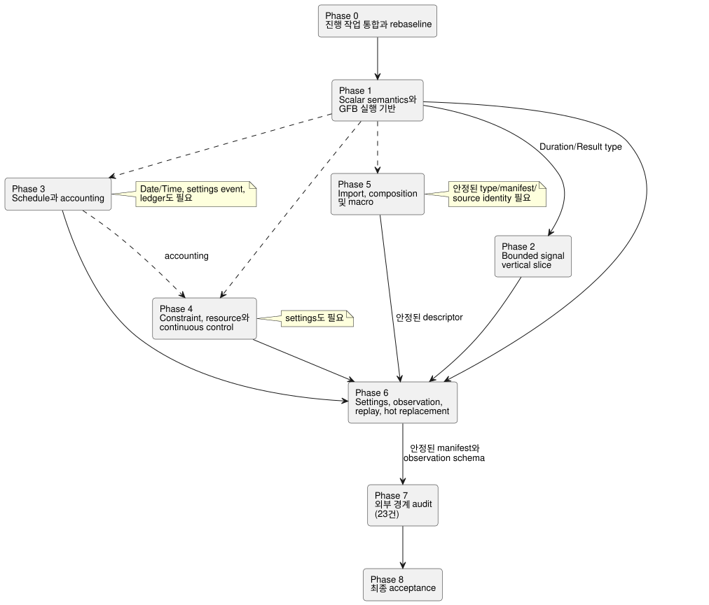

<!-- translation-source: tasks/reference-compliance-plan.en.md -->
[영문 원문](reference-compliance-plan.en.md)

# GhostFlow Reference 준수 구현 계획

이 계획은 GhostFlow compiler **와** runtime이 Language Reference 계약 전체를
구현하고 관찰 가능한 증거를 남기기 위해 필요한 작업을 추적합니다.

**이 문서의 내용**

- [목표와 완료 기준](#목표와-완료-기준): 목표, 세 가지 완료 조건, 최신 gate
  결과와 [최신 사용자 정책 결정](#최신-사용자-정책-결정).
- [구현 원칙](#구현-원칙)과 공유 파일 충돌 규칙을 포함한
  [의존 구조](#의존-구조).
- 각 구현 slice의 [현재 진행 상태](#현재-진행-상태).
- [남은 CLI 27건의 feature 그룹](#남은-cli-27건의-feature-그룹).
- [specified 164건의 구현 경계 audit](#specified-164건의-구현-경계-audit):
  내부 구현 141건과 외부 경계 23건.
- [구현 단계](#구현-단계) 0–8, [처음 세 개의 bounded 구현 범위](#처음-세-개의-bounded-구현-범위)와
  [위험](#위험과-완화).

## 목표와 완료 기준

**목표.** compiler와 runtime이 Language Reference 계약 전체를 구현하고 그에
대한 관찰 가능한 증거를 남기는 것입니다. 사용자는 runtime도 완료 범위에
포함된다고 명시했습니다. 따라서 실제 Rust/native/WASM 실행 의미를 repository
host adapter 계약과 함께 검증합니다.

현재 기준선은 아래에 적은 마지막 전체 gate입니다. 그 이전의 실행 이력은
`tests/reference/BASELINE.md`에 보존합니다.

**Gate 결과와 진행 메모**

아래 수치는 서로 다른 시점에 찍은 snapshot입니다. 예를 들어 진단 catalog는
메모에 따라 683건으로도, 687건으로도 기록되어 있습니다. 각 메모는 그 메모가
설명하는 revision에 대해서만 유효합니다.

- **마지막 batch16 gate.**
  - Node: 2,139건 중 1,947 pass, 28 fail, 164 TODO, 0 skip.
  - Reference executable: 204건 중 177 pass, 27 fail. 실패 ID는 batch15와
    같습니다.
  - Rust core 160건, native package 28건, WASM ABI 10건이 통과했습니다.
    native/WASM 산출물을 재생성했습니다. Node gate가 실패했기 때문에
    Tutorial은 실행하지 않았습니다.
  - 근거: `build/compiler-runtime-batch16-reference-results.json`,
    `build/compiler-runtime-batch16-full.log`,
    `build/compiler-runtime-batch16-verification.json`.
  - gate 종료 시점에는 source hash가 일치했습니다. 이후 version fixture와
    Reference policy가 바뀌었으므로 *현재* hash가 일치한다고 주장하지 않습니다.
  - GFB5 structural slice 근거: core 160, native 12, encoder 8 + affected 44,
    browser 3, cross-language native 4, catalog 5. 로그는
    `build/schedule-core-green.log`, `build/gfb5-encoder-affected.log`,
    `build/gfb5-browser-green.log`, `build/gfb5-native-green.log`,
    `build/gfb5-catalog.log`입니다.
  - 현재 진단 catalog는 687건입니다. canonical lowering, schedule 실행,
    provider/resource와 replay는 아직 남아 있습니다.

- **마지막 batch15 gate.**
  - Node: 2,114건 중 1,923 pass, 27 fail, 164 TODO, 0 skip.
  - Reference executable: 204건 중 177 pass, 27 fail. 실패 ID 27건은
    batch14와 같으며 새 회귀는 없습니다.
  - Rust core 142건, native package 28건, WASM ABI 10건이 통과했습니다.
    native/WASM 산출물을 재생성했습니다. Node gate가 실패했기 때문에
    Tutorial은 실행하지 않았습니다.
  - 근거: `build/compiler-runtime-batch15-reference-results.json`,
    `build/compiler-runtime-batch15-full.log`,
    `build/compiler-runtime-batch15-verification.json`. 종료 후 모든
    verification source hash가 당시 소스와 일치했습니다.
- **specified 164건**은 CLI 실행 테스트가 아닙니다. 일부 기존 실행 증거는
  `reference-evidence.md`에 연결했지만, 전체 매핑과 검증은 아직 끝나지
  않았습니다.
- **Batch13**은 native package/프레임 CLI와 측정 기반 중첩 window를
  포함합니다. 중첩 compiler/encoder 지원, 원본 시각, 독립 집계 가중치, 소유된
  proof, 상류 전체 high-water, epoch 무효화, 메모리 상한, Rust replay를
  구현했습니다. 절대값·만료·지연·변환 provenance 6건도 두 WASM host에서 모두
  통과했습니다. 이 증거는 모든 temporal 연산이나 durable migration이
  완료되었음을 뜻하지 않습니다.
- **Batch14**에는 원본을 보존하는 별도 temporal ghost replay와 두 WASM adapter
  API가 포함됩니다. 현재 프로그램의 기록, checkpoint, 중첩 proof, 프레임 ID를
  재현하며, 1,024개 retained record rollover와 재시도 검증이 통과했습니다.
  - Batch15는 activation 전 정적 resource plan과, C/C−1 및 N/N−1
    activation/replay 경계에 대한 독립 wasm32 oracle 검사를 추가했습니다. 긴
    tick 간격에서의 native/WASM state/timer 검사도 통과했습니다.
  - 다음 차례는 나머지 schedule/control/composition 계약입니다. `true_for`와
    `after_event` 정책은 `temporal-policy-decisions.md`에 확정되었지만 구현
    증거는 아직 만들어야 합니다. Estimated evidence, durable migration, 전체
    §6.8 branch identity/what-if도 남아 있습니다.
- batch13 이후 추가한 **catalog 위치 수정**과 두 WASM host의 늦은 오류/동일
  sample 재시도 테스트는 이후 batch14·15 전체 gate에 포함되었습니다. 이전
  focused 근거는 `build/window-derived-catalog-fix.log`와
  `build/window-derived-host-retry.log`에 보존합니다.
- **진단 테스트 6건 추가 통과:** parser callsite 4건과 nested window byte
  limit 2건입니다. 진단·경계값 catalog는 687건입니다.
  [Temporal adapter replay](temporal-adapter-replay-design.ko.md)는 Astra
  (core/ABI), Sol(JS adapter와 실제 WASM 테스트), Luna(문서), root(통합·검증)가
  진행했으며, focused 검사와 batch14 gate에서 통과했습니다.
- **batch15 이후:** DailySlots가 중복 `timezone`/`selected`를 허용하던 결함을
  수정했습니다. Luna의 RED 4건이 정확한 오류 종류, 메시지, 원문 위치와 valid
  control을 다루는 GREEN 5건이 되었고, root의 관련 회귀 231건이
  통과했습니다. 진단 catalog는 683건입니다. 근거:
  `build/compiler-schedule-duplicates-red.log`,
  `build/compiler-schedule-duplicates.log`,
  `build/schedule-duplicates-regression.log`. 전체 gate는 다시 실행하지
  않았으므로 batch15 hash는 이 변경 *이전* 소스에 대한 증거입니다.
- **다음 구현: Rust가 소유하는 Solar pulse admission.** Sol/Astra audit 결과,
  현재 native/WASM parity는 JS가 만든 due bit를 재생할 뿐 Rust의 schedule
  판단이나 rollback을 입증하지 않는다는 점이 확인되었습니다. 명시적
  clock/gap/recovery, 컴파일된 `when`, provider fact, 소유된 관측과 replay를
  실제 Runtime transaction에 연결합니다. 여러 occurrence 처리 정책은
  `temporal-policy-decisions.md`에 확정되었으며 구현 증거가 남아 있습니다.
- **Clock 구성요소.** Sol의 trusted-only `ScheduleClockGate` focused 6건과
  root의 core 전체 148건이 통과했습니다. Luna가 옮긴 같은 core 테스트의
  catalog locator만 바뀌었고, catalog 5건도 통과했습니다. 범위와 근거는
  `tasks/schedule-clock-design.md`에 있습니다. 이 gate는 아직 source
  schedule, VM transaction, WASM ABI에 연결되지 않았으므로 Reference 실패
  감소나 schedule 완료로 계산하지 않습니다. wire 초안에 source SHA를 넣는
  방식은 주석 변경이 GFB를 바꾸지 않는다는 계약과 충돌하여 제거했습니다.
  source identity는 검증된 외부 activation metadata에 유지합니다.

**완료 조건.** 다음 세 조건을 모두 만족할 때만 완료를 선언합니다.

1. 모든 executable 사례가 실제 `ghostc --check`와 build 경로에서 통과합니다.
2. 내부에서 구현하는 specified 141건이 compiler, core, WASM runtime 또는
   repository host adapter의 독립 실행 테스트에 연결됩니다.
3. 외부 경계 23건은 Driver, renderer, deployment/provider 책임을 언어 실행
   성공과 분리하고, 그 입력·출력·identity·quality·revision 증거 계약을
   audit합니다.

남은 CLI 실패만 green으로 만들어서는 전체 Reference 준수가 **성립하지
않습니다**. 컴파일 성공은 runtime 의미, 물리 적용, UI 표현을 증명하지
않습니다.

### 최신 사용자 정책 결정

과거 진행 기록에서 미결로 표시했던 세 질문에는 모두 답이 나왔습니다.

| 질문 | 결정 |
|---|---|
| `true_for` | Driver가 실제 관측을 보증한 연속 구간만 인정합니다. 측정값 사이를 추정하지 않습니다. |
| `after_event` | 각 시작 사건을 독립적으로 추적하고 그 결과를 구분합니다. |
| 한 관측 구간 안에서 같은 schedule의 occurrence가 여러 번 지나간 경우 | 모두 missed로 기록하고 어느 것도 실행하지 않습니다. |

`temporal-policy-decisions.md`와 Reference §3.5/§4.4를 기준으로 TDD를
진행합니다. 정책이 확정되었다고 해서 구현이 완료된 것은 아닙니다.

## 구현 원칙

- **정본**은 `docs/reference/*.md`와 `tests/reference/cases/*.json`입니다.
  현재 구현에 맞추려고 기대값을 낮추지 않습니다.
- **Vertical slice.** 각 slice는 가능한 한 3~5개 파일로 이루어진 vertical
  path로 제한합니다. parser/typecheck, manifest, runtime, 실제 관찰 테스트를
  함께 끝냅니다.
- **재사용 우선:** `tools/control.mjs`, `tools/gfb1.mjs`,
  `tools/source-trace.mjs`, `runtimes/wasm/control-runtime.mjs`, 그리고
  `crates/ghostflow-core`의 signal, scan, station, solar 모듈.
- **원자적 fault tick.** fault가 난 tick은 state, intent, timer,
  controller/resource state와 journal position을 원자적으로 보존해야 합니다.
- **절대 기대값.** native와 WASM이 같은 오답을 내는 parity로는 충분하지
  않습니다. 각 backend를 Reference의 절대 기대값과 비교합니다.
- **변환 후 provenance.** source document/revision, bytecode digest,
  node/dependency provenance를 최적화, lowering, restore 뒤에도 검증합니다.
- **기준선은 한 번만 갱신.** 진행 중인 agent 변경이 합쳐진 뒤 기준선을 한 번
  갱신합니다. 오래된 44개 목록을 그대로 작업 큐로 쓰지 않습니다.

## 의존 구조

아래의 각 계층은 바로 위 계층을 기반으로 합니다.

```text
Reference grammar and semantic types
    -> parser/type checker and bounded resource report
        -> manifest and source-trace contracts
            -> GFB verifier/lowering
                -> Rust core state machines
                    -> native/WASM adapters
                        -> host settings/provider/binding contracts
                            -> Driver/UI boundary evidence
```

공유 파일 충돌 규칙:

- `tools/control.mjs`의 각 선언 family는 한 agent만 수정합니다.
- `tools/gfb1.mjs`, `crates/ghostflow-core/src/lib.rs`, WASM artifact
  rebuild의 변경은 GFB format owner가 직렬화합니다. scan 변경이 필요하면 그
  owner와 조율합니다.
- `runtimes/wasm/control-runtime.mjs`의 manifest schema는 compiler manifest
  producer와 같은 slice에서 변경합니다.
- native와 WASM release artifact는 core 변경 묶음이 끝난 뒤 한 번만
  재생성합니다.

## 현재 진행 상태

| Slice | 상태 | 소유 / 난이도 | 충돌 경계 |
|---|---|---|---|
| GFB short circuit과 `MIN % -1` | compact constant encoding과 PC10 실행을 포함해 batch3 통과 | Astra / 높음 | `tools/gfb1.mjs`, `lib.rs`, GFB format과 artifact rebuild를 독점 소유 |
| Duration 경계와 sensor recovery fault 상태 | batch3 통과 | Luna / 중간 | Duration lexer/type block과 `signals.rs` 결과를 재사용 |
| `moving_average` compiler→manifest→actual WASM | host 14건과 관련 Reference 2건 통과(focused); batch3 근거 보존 | Luna / 중하 | 완료된 sensor 변경을 EMA slice가 이어받음 |
| EMA compiler→manifest→actual WASM | Number/Percent 및 극값 회귀 batch3 근거; Temperature 연결은 quantity slice 소관 | Sol / 중간 | sensor filter와 host sensor validation |
| Dynamic Int conversions | native/WASM 변환, fault, rollback을 포함해 batch3 통과 | Astra / 높음 | GFB3 opcodes 48–53, stable fault와 atomic rollback |
| Dynamic Duration arithmetic | source/guard 연결 완료; batch3 통과 | Astra core + Sol source | source typed arithmetic과 GFB3 guard를 함께 연결 |
| Quantity catalog/type/runtime | slice 완료; batch3 근거 보존 | Sol / 높음; Astra numerical review | 모든 public consumer에서 source/unit metadata 일치 |
| Tagged time literals | compiler/runtime 연결; batch4 통과 | Sol source + Astra package + Luna helper tests | 전체 Reference 완료와는 별개 |
| Result 값과 변환 | batch6/7 focused compiler/runtime/provenance 근거; native Rust package canonical replay caveat는 남음 | Sol compiler/host + Astra core | [실행 기록 계약](result-provenance-design.ko.md), source metadata와 GFB3 opcode 56 |
| Debounce Bool/finite enum/Result | batch7 통과; sensor별 중복 제거, actual native/WASM, replay와 artifact 검증 | Sol compiler/host, Astra Rust/code size, Luna diagnostics, root provenance | [계약과 남은 경계](debounce-design.ko.md), [scan transaction](sensor-atomicity-design.ko.md); durable reboot와 native package canonical source caveat는 남음 |
| Measured hold_last | batch9 compiler/native/두 WASM, Held provenance, TTL, future/dedup/epoch/rollback/replay와 signed artifact 검사 통과 | Sol compiler/tests, Astra package/code size, Luna provenance, root integration | [검증과 남은 경계](hold-last-design.ko.md); estimated quality와 durable continuity restore는 남음 |
| Int operating settings | batch10 compiler/manifest/interaction descriptor와 signed32 경계 근거 통과; atomic LIVE §5.2는 미구현 | Sol compiler/host + root integration | native package의 source/default 대응은 아직 입증되지 않음 |
| Temporal Rust foundation | Rust unit test 7건과 oracle test 6건 통과; compiler/GFB/WASM ABI 통합은 미완료 | Astra core | [Window evidence 설계](window-evidence-design.ko.md) |

## 남은 CLI 27건의 feature 그룹

| 그룹 | 사례 수와 ID | 필요한 구현 | 기존 재사용 | 관찰 가능한 acceptance | 의존 / 난이도 |
|---|---|---|---|---|---|
| Schedule·provider·accounting 문법 | 11: `REF-03-024`, `032`, `036`, `038`, `042`, `045`, `050`, `057`, `059`, `060`, `062` | 공통 schedule policy, DailySlots/Periodic/Cron/Solar/Tide, TimeSlots, WorkCalendar, resource/event/account 문법과 typed 조건 | schedule/solar host adapter, station ledger, occurrence trace, source trace | manifest가 모든 필수 policy와 provider identity를 보존하고, 실제 crossing/gap/DST/provider vector가 절대 결과와 일치 | 날짜/시각, settings, provider 계약 / 높음 |
| Bounded signal과 temporal evidence | 2: `REF-04-025`, `026` | true-for/after-event; window aggregate/rate의 replay와 bounded state 증거 보완 | Rust signals, continuous timer, source dependency, ControlRuntime conditioner | half-open 경계, sparse/missed scan, fault reset, checkpoint, 메모리 상한을 실제 WASM에서 검증 | Duration/quantity/Result / 중간~높음 |
| Capability·constraint·resource·control | 7: `REF-04-035`, `044`, `045`, `050`, `058`, `061`, `063` | Option capability match, constraint phase, 유한 집합 집계, arbitration policy, objective/degraded/adaptation descriptor | constraint fixpoint, station resource manager, operating settings, interaction schema | requested/safe/applied 분리, 유일한 winner, 원자적 reservation, global constraint 우회 금지, proposal-only adaptation | quantity, Result, settings / 높음 |
| Import·composition·macro | 7: `REF-06-010`, `023`, `101`, `102`, `103`, `105`, `106` | pinned document closure, digest 검증, instance/typed port graph, typed quote/splice 확장 한도 | literate extractor, toolchain digest binding, portable package verifier | digest/revision 변조 거부, 중복 provider 거부, typed 확장 후 일반 checker 실행, recursion/limit 거부 | source identity 계약 / 높음 |

합계는 27건입니다. 다음 사례는 이전에 CLI 실패 큐에서 빠졌습니다.
`REF-04-020`은 batch7에서, `REF-04-031`은 batch9에서, window 사례
`REF-04-027`/`028`/`029`는 batch13까지 통과했습니다. CLI 통과와 아직 남은
runtime acceptance를 구분합니다.

## specified 164건의 구현 경계 audit

### 분류 결과

| 분류 | 수 | 처리 |
|---|---:|---|
| compiler/tooling | 22 | compiler, source trace, package/restore 테스트로 실행 증거를 만듦 |
| core/runtime | 93 | Rust/native/WASM 절대 결과와 state/journal 관찰로 실행 증거를 만듦 |
| repository host adapter | 26 | 결정적인 schedule/settings/capability/provider adapter 계약 테스트로 실행 증거를 만듦 |
| 외부 driver/renderer | 7 | 적용·확인·배선 증거 계약을 audit. 언어 runtime 성공으로 대체할 수 없음 |
| 외부 cabinet-view | 3 | descriptor 기반 read/write 권한과 동일한 validation 의미를 audit |
| design boundary | 7 | 새 keyword/graph/effect 범위가 의도치 않게 섞이지 않는지 architecture audit |
| 외부 host/deployment/provider | 6 | OS, durable storage, provider coverage, installation binding 증거를 audit |
| **합계** | **164** | 내부 구현 141건, 외부 경계 audit 23건 |

외부 경계 23건의 정확한 목록은 다음과 같습니다. 나머지 specified 141건은
repository 내부 실행 증거가 필요합니다.

- Driver 7: `REF-00-002`, `REF-04-010`, `REF-04-043`, `REF-04-053`, `REF-06-005`, `REF-06-006`, `REF-08-010`
- Cabinet-view 3: `REF-00-009`, `REF-05-019`, `REF-05-020`
- Design 7: `REF-01-003`, `REF-01-055`, `REF-03-018`, `REF-06-001`, `REF-06-024`, `REF-08-001`, `REF-08-006`
- External host/deployment/provider 6: `REF-06-018`, `REF-08-003`, `REF-08-004`, `REF-08-008`, `REF-08-013`, `REF-08-016`

### 내부 구현 feature 묶음

| 묶음 | specified 근거 | 구현 위치와 acceptance | 난이도 |
|---|---|---|---|
| Source·provenance·toolchain | `REF-00-001`; `REF-01-004,017,018`; `REF-04-067`; `REF-05-028`; tooling 범위 `REF-06-003,007,011,015,025`, `REF-07-001,002,006-010`, `REF-08-002,005,011,017` | 문서/artifact digest, node identity, dependency read, explanation link를 변조 테스트로 검증 | 중간 |
| 정확한 산술과 tick 의미 | `REF-01-062-064,067,079,080,086,093,094,098,099,102-105`; `REF-07-003-005` | native/WASM 절대값, short circuit, 이전 snapshot, 거부된 tick의 state/intent/tick/journal 원자성 | 높음 |
| Sensor Result와 bounded filtering | `REF-00-007`; `REF-01-074,075,077`; `REF-04-003,005,011,012,016,019,023,024,030,032,065`; `REF-08-012` | 실제 WASM sample identity, N-1/N, 정확한 stale 경계, recovery NotReady, quality provenance, instance 격리 | 중간 |
| Timer·rolling·schedule 의미 | `REF-00-006`; `REF-03-009,013,014,016,017,019-023,026,027,029,030,035,039,040,048,049`; 내부 host `REF-03-010,025,028,031,037,041,047` | monotonic snapshot, half-open occurrence, gap/rollback/DST, stable event ID, ledger 분할/reservation을 trace로 관찰 | 높음 |
| Capability·constraint·resource·mode | `REF-00-008`; `REF-04-034,036,038,039,042,046-052,055-057,060,062`; 내부 host `REF-04-054,064,066` | 유일한 strategy, false-only fixpoint, 단일 final writer, stop sequence, accounting stage, 원자적 settings/adaptation | 높음 |
| Settings·observation | `REF-05-012-018,021-028,103-107`; `REF-08-009,014,015` | revision/effective position, 원자적 batch, overlay 만료, reboot/run 경계, snapshot/event/alarm/explanation identity | 중간 |
| Composition·replay·replacement | `REF-00-004,010`; `REF-06-002,004,008,009,012-017,019-022`; `REF-08-007` | instance 격리, graph writer 검증, same-core replay, 입력을 지어내지 않음, 원자적 hot swap과 state migration | 높음 |

각 묶음의 catalog ID를 실제 테스트 이름이나 evidence manifest에 1:1로
연결합니다. 기존 테스트가 이미 의미를 증명한다면 ID 링크만 추가하고 테스트를
중복해서 만들지 않습니다.

## 구현 단계

아래 로드맵은 단계 사이의 의존 관계를 보여 줍니다. 실선 화살표는 명시적인
단계 의존이고, 점선 화살표는 뒤 단계가 Phase 1의 type과 accounting을 기반으로
한다는 뜻입니다. 단계가 아닌 의존은 각 단계 절에 따로 적었습니다.



### Phase 0: 진행 중인 작업 통합과 rebaseline

**설명:** 병합된 short circuit/Int, Duration/sensor recovery, moving average
변경을 모두 포함한 하나의 revision에서 실제 남은 사례를 다시 계산합니다.

**Acceptance:**

- Reference pass/fail ID를 non-Reference 테스트 실패와 분리합니다.
- focused 결과를 전체 gate 결과로 승격하지 않습니다.
- 새 실패는 leaf 실패 수와 별도로 근본 원인별로 묶습니다.

**검증:** `npm test` 한 번. 실패 분석 뒤 변경이 생기면 영향을 받은 focused
테스트만 실행하고 마지막 통합 gate를 예약합니다.

### Phase 1: Scalar 의미와 GFB 실행 기반

**설명:** short circuit, exact Int, Date/Time, quantity 상수, Result 값 표현을
먼저 확립합니다.

**Acceptance:**

- native와 WASM이 각각 Reference의 절대값과 fault를 만족합니다.
- verifier가 잘못된 opcode/type/stack 형태를 load 전에 거부합니다.
- lowering과 restore가 모든 source dependency를 보존합니다.

**의존:** Phase 0. **난이도:** 높음. **모델:** 주로 Astra, bounded parser
slice는 Sol.

### Phase 2: Bounded signal vertical slice

**설명:** moving average, EMA, debounce, Result 변환, temporal evidence를 하나씩
compiler→manifest→actual WASM으로 연결합니다.

**Acceptance:**

- 각 stateful 연산은 메모리 상한과 private state 소유를 manifest/resource
  report에 드러냅니다.
- fault, 중복 sample, 반복 tick, 거부된 tick에서의 상태 전이가 Reference와
  일치합니다.
- compiler acceptance와 runtime 의미를 같은 테스트 slice에서 관찰합니다.

**의존:** Phase 1의 Duration/Result type. **난이도:** 중간~높음.
**모델:** 기존 engine 연결은 Luna, debounce/Result 통합은 Sol.

### Phase 3: Schedule과 accounting

**설명:** 공통 schedule policy를 하나의 descriptor 계약으로 확립한 뒤,
DailySlots, Periodic, Cron, Solar, calendar, tide로 확장합니다.

**Acceptance:**

- 모든 schedule이 안정적인 schedule, occurrence, provider revision identity를
  냅니다.
- crossing, gap, rollback, DST, fallback, live update 결과가 native, WASM,
  host에서 동일한 절대 trace를 냅니다.
- resource/event/accounting은 requested, safe, applied, confirmed 단계를 절대
  혼동하지 않습니다.

**의존:** Date/Time, settings event, ledger. **난이도:** 높음.
**모델:** Astra.

### Phase 4: Constraint, resource와 continuous control

**설명:** capability match, constraint phase, arbitration, mode 전이,
objective/fallback/adaptation을 기존 station core와 interaction schema에
연결합니다.

**Acceptance:**

- 같은 tick의 요청은 하나의 snapshot에서 예약하며, 유일한 final writer만 safe
  target을 commit합니다.
- 거부된 tick에서 controller, resource, settings state가 모두 원자적입니다.
- explanation이 request, clamp, arbitration, applied/confirmed 증거를
  분리합니다.

**의존:** quantity, Result, settings, accounting. **난이도:** 높음.
**모델:** Astra.

### Phase 5: Import, composition과 macro

**설명:** pinned closure와 typed graph를 먼저 구현합니다. 그다음 일반 checker가
실행되기 전에 bounded quote/splice를 확장합니다.

**Acceptance:**

- 정확한 revision/digest 불일치와 중복 writer/provider를 결정적인 진단으로
  거부합니다.
- state, timer, settings, binding, provenance를 instance마다 격리합니다.
- macro 확장은 type 검사, recursion 한도, AST/resource 한도를 우회하지
  않습니다.

**의존:** 안정된 type/manifest/source identity. **난이도:** 높음.
**모델:** Astra.

### Phase 6: Settings, observation, replay와 hot replacement

**설명:** 기존 operating settings, 임시 overlay, interaction snapshot, replay,
hot swap 코드를 Reference identity 모델에 통합합니다.

**Acceptance:**

- batch settings, 만료, revert는 원자적 revision event이며, stale 만료가 더
  새로운 값을 덮어쓰지 않습니다.
- replay는 기록되지 않은 값도, 물리 effect도 지어내지 않습니다.
- hot replacement가 실패하면 이전 Program을 유지하고, 성공하면 새 artifact
  identity와 run 경계를 만듭니다.

**의존:** Phase 1~5 전반의 descriptor 안정화.
**난이도:** 중간~높음. **모델:** Sol, migration core는 Astra가 review.

### Phase 7: 외부 경계 audit

**설명:** 외부 23건에 대해 repository가 요구하는 evidence schema와 책임을
검증합니다. compiler 성공은 실제 장치 작동이나 cabinet-view를 인증하지
않습니다.

**Acceptance:**

- Driver/renderer 계약은 requested, applied, confirmed, quality, stop proof,
  물리 endpoint 증거를 분리합니다.
- cabinet-view 계약은 descriptor의 type/authority/validation을 바꾸지 않으며
  write 권한을 만들지 않습니다.
- provider/deployment 계약은 revision, coverage, 실패, durable identity, offline
  운전 가능성을 명시합니다.

**의존:** 안정된 내부 manifest와 observation schema.
**난이도:** 중간. **모델:** Sol이 audit, 실제 hardware acceptance는 사용자
환경의 몫입니다.

### Phase 8: 최종 acceptance

**Acceptance:**

- 모든 executable 사례가 통과합니다.
- 내부 specified 141건 모두에 실행 테스트/증거 링크가 있습니다.
- 외부 23건 모두에 boundary audit 결과가 있고, 미실행 사유 또는 실제 환경
  증거가 있습니다.
- catalog ID의 누락·중복이 없고 stale locator도 없습니다.
- native/WASM artifact를 같은 source revision에서 재생성했으며, 전체
  `npm test`가 통과합니다.

## 처음 세 개의 bounded 구현 범위

### Slice A — Moving average vertical path (진행 중)

**파일 소유:**

- `tools/control.mjs`: sensor filter parser/type/range와 manifest producer
- `runtimes/wasm/control-runtime.mjs`: manifest validator와 conditioner config
  전달
- 기존 sensor host 테스트 1개: 실제 ControlRuntime WASM의 N-1/N/N+1 및
  0/짝수/범위 밖

**Acceptance:** `REF-04-021`, `REF-04-068`. compiler의 accept/reject와 실제
WASM sliding average를 함께 확인합니다. Rust `Filter::MovingAverage`는 그대로
재사용합니다.

### Slice B — EMA vertical path (Slice A 직후 Sol 후보)

**파일 소유:**

- `tools/control.mjs`: `ema(alpha:)` 상수/범위 typing과 manifest field
- `runtimes/wasm/control-runtime.mjs`: EMA manifest validation과 alpha 전달
- 기존 sensor host 테스트 1개: 첫 sample seed, alpha 경계, recovery 전
  NotReady

**Acceptance:** `REF-04-022`. alpha `0`, `>1`, nonfinite 값의 거부를 검증하고
실제 WASM 점화식을 절대값과 비교합니다. Slice B는 Slice A와 파일을 공유하므로
둘을 병렬로 진행할 수 없습니다.

### Slice C — Debounce Bool/finite enum/Result (batch7 완료)

**파일 소유:**

- `tools/control.mjs`: 선언 typing, 양의 Duration, 생성되는 private
  state/clock descriptor
- 기존 GFB 연산으로 lowering합니다. 새 opcode나 한도 확대 없이 공통 상태 5개와
  physical root마다 상태 2개를 사용합니다.
- 실제 native/두 WASM ABI, legacy/framed host, provenance, signed package와
  diagnostics를 검증했습니다.

**Acceptance:** `REF-04-020`과 debounce 전용 테스트가 batch7에서
통과했습니다. 근거는 `build/compiler-runtime-batch7-full.log`입니다. scan
transaction 근거는 [sensor-atomicity-design.ko.md](sensor-atomicity-design.ko.md)에
정리되어 있습니다. durable reboot와 native package canonical source replay는
아직 완료되지 않았습니다.

Result 통합에 대해서는 batch6/7 근거를 유지합니다. 남은 temporal 및
composition 기능은 위의 구현 큐를 따릅니다.

## 위험과 완화

| 위험 | 영향 | 완화 |
|---|---|---|
| 이후 focused 변경으로 baseline 44가 stale해짐 | 중복 구현 또는 잘못된 완료 수 | Phase 0에서 하나의 revision으로 전체 결과를 재생성 |
| parser는 green이지만 runtime 의미는 미구현 | 거짓 compliance | 모든 stateful accept에 실제 native/WASM trace acceptance를 요구 |
| 공유 manifest가 feature마다 따로 커짐 | validator/restore drift | producer, validator, source trace, 테스트를 하나의 vertical slice로 묶음 |
| GFB format 동시 변경 | artifact/verifier 불일치 | format owner 1명, rebuild 1회, byte header/version 검사 |
| specified 164건을 TODO 수로만 유지 | 전체 목표 미달 | ID→테스트/증거 index를 final gate 필수 산출물로 지정 |
| 내부 runtime이 외부 물리/UI 요구를 주장 | 책임 경계 위반 | 외부 23건을 별도로 audit하고 물리 확인은 별도 증거로 유지 |
