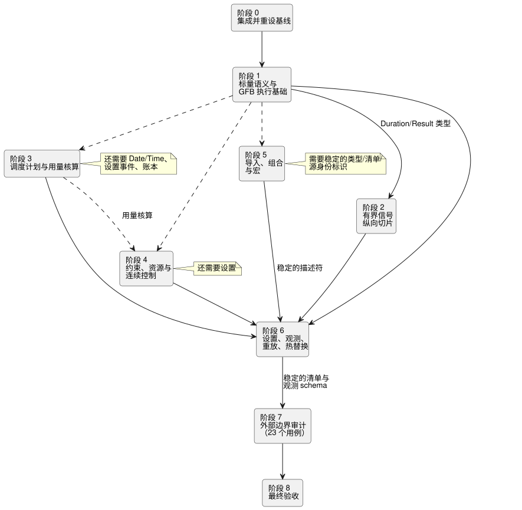

<!-- translation-source: tasks/reference-compliance-plan.en.md -->
[英文原文](reference-compliance-plan.en.md)

# GhostFlow 语言参考合规实现计划

本计划跟踪为使 GhostFlow 编译器**和**运行时实现完整语言参考契约并留下可观测证据所需的工作。

**本文内容**

- [目标与完成标准](#目标与完成标准)：目标、三项完成条件、最新的门禁结果以及[最新的用户策略决定](#最新的用户策略决定)。
- [实现原则](#实现原则)与[依赖结构](#依赖结构)，包括共享文件冲突规则。
- 各实现切片的[当前进展](#当前进展)。
- [剩余 27 个 CLI 用例的功能分组](#剩余-27-个-cli-用例的功能分组)。
- [164 个规定用例的实现边界审计](#164-个规定用例的实现边界审计)：141 个内部用例和 23 个外部边界。
- [实现阶段](#实现阶段) 0–8、[前三个有界实现范围](#前三个有界实现范围)以及[风险](#风险与缓解措施)。

## 目标与完成标准

**目标。** 编译器和运行时实现完整的语言参考契约，并为此留下可观测的证据。用户明确将运行时纳入完成范围。因此，需要将实际的 Rust/native/WASM 执行语义与仓库宿主适配器契约一并验证。

当前基线是下文列出的最后一次完整门禁。更早的执行历史保存在 `tests/reference/BASELINE.md` 中。

**门禁结果与进展说明**

下列计数是在不同时间点拍摄的快照（例如，诊断目录在不同的说明中被报告为 683 个和 687 个用例）。每条说明仅对其所描述的修订版有效。

- **最近一次 batch16 门禁。**
  - Node：2,139 个用例——1,947 个通过、28 个失败、164 个 TODO、0 个跳过。
  - 语言参考可执行用例：204 个——177 个通过、27 个失败。失败 ID 与 batch15 相同。
  - Rust 核心 160 个、native 包 28 个和 WASM ABI 10 个均通过。Native/WASM 制品已重新生成。由于 Node 门禁失败，教程未运行。
  - 证据：`build/compiler-runtime-batch16-reference-results.json`、`build/compiler-runtime-batch16-full.log`、`build/compiler-runtime-batch16-verification.json`。
  - 门禁完成时源哈希一致。之后的版本 fixture 和语言参考策略变更意味着，不再主张与*当前*哈希相对应。
  - GFB5 结构切片证据：核心 160、native 12、编码器 8 + 受影响 44、浏览器 3、跨语言 native 4、目录 5；日志为 `build/schedule-core-green.log`、`build/gfb5-encoder-affected.log`、`build/gfb5-browser-green.log`、`build/gfb5-native-green.log`、`build/gfb5-catalog.log`。
  - 当前诊断目录为 687 个用例。规范降级、调度计划执行、provider/资源以及重放仍待完成。

- **最近一次 batch15 门禁。**
  - Node：2,114 个用例——1,923 个通过、27 个失败、164 个 TODO、0 个跳过。
  - 语言参考可执行用例：204 个——177 个通过、27 个失败。这 27 个失败 ID 与 batch14 一致；没有新的回归。
  - Rust 核心 142 个、native 包 28 个和 WASM ABI 10 个均通过。Native/WASM 制品已重新生成。由于 Node 门禁失败，教程未运行。
  - 证据：`build/compiler-runtime-batch15-reference-results.json`、`build/compiler-runtime-batch15-full.log`、`build/compiler-runtime-batch15-verification.json`。完成后，所有验证源哈希都与当时的源代码一致。
- **164 个规定用例**不是 CLI 执行测试。部分现有执行证据已在 `reference-evidence.md` 中链接；完整的映射与验证仍未完成。
- **Batch13** 包括 native 包/framed CLI 以及基于测量的嵌套窗口。它实现了嵌套编译器/编码器支持、原始时间戳、独立的聚合权重、自有证明、完整的上游高水位、纪元失效、内存界限和 Rust 重放。另有六个绝对值/过期/延迟/转换来源（provenance）用例也在两个 WASM 宿主上通过。这些证据并不能确立所有时间操作或持久迁移已经完成。
- **Batch14** 包括保留原始数据的独立时间 ghost（影子运行）重放，以及两个 WASM 适配器 API。它复现了当前程序的记录、检查点、嵌套证明和帧 ID；1,024 条保留记录的翻转与重试验证通过。
  - Batch15 增加了激活前的静态资源计划，以及对 C/C−1 和 N/N−1 激活/重放边界的独立 wasm32 oracle 检查。采用长 tick 间隔的 native/WASM 状态/定时器检查也已通过。
  - 接下来是其余的调度计划/控制/组合契约。`true_for` 和 `after_event` 策略已在 `temporal-policy-decisions.md` 中确定，但实现证据仍有待产出。估计证据、持久迁移以及完整的 §6.8 分支身份标识/假设分析（what-if）也仍待完成。
- **目录位置修正**是在 batch13 之后加入的；两个 WASM 宿主的延迟错误/同一样本重试测试也已纳入之后的 batch14/15 完整门禁。更早的聚焦证据仍保存在 `build/window-derived-catalog-fix.log` 和 `build/window-derived-host-retry.log` 中。
- **另有六个诊断测试通过：**四个解析器调用点用例和两个嵌套窗口字节上限用例。诊断/边界目录共有 687 个用例。[时间适配器重放](temporal-adapter-replay-design.zh.md)通过 Astra（核心/ABI）、Sol（JS 适配器和实际 WASM 测试）、Luna（文档）和 root（集成/验证）交付；聚焦检查和 batch14 门禁均已通过。
- **batch15 之后：**修复了 DailySlots 接受重复 `timezone`/`selected` 的问题。Luna 的四个 RED 用例变成了五个 GREEN 用例，覆盖精确的错误类别、消息、原始位置以及一个有效的对照用例；root 的 231 个相关回归测试通过。诊断目录共有 683 个用例。证据：`build/compiler-schedule-duplicates-red.log`、`build/compiler-schedule-duplicates.log`、`build/schedule-duplicates-regression.log`。完整门禁没有重新运行；batch15 的哈希是此变更*之前*源代码的证据。
- **下一项实现：由 Rust 拥有的 Solar 脉冲准入。** Sol/Astra 审计发现，当前的 native/WASM 一致性只是重放一个由 JS 生成的 due 位；它并不能证明 Rust 的调度计划求值或回滚。需要将显式的 clock/gap/recovery、编译后的 `when`、provider 事实、自有观测以及重放连接到实际的 Runtime 事务。多次触发实例策略已在 `temporal-policy-decisions.md` 中确定；实现证据仍待完成。
- **时钟组件。** Sol 的六个仅信任 `ScheduleClockGate` 聚焦用例以及 root 的完整 148 个用例核心套件均已通过。仅有同一批核心测试的目录定位符（由 Luna 移动）发生了变化；五个目录用例也已通过。范围与证据见 `tasks/schedule-clock-design.md`。该门尚未连接到源调度计划、VM 事务或 WASM ABI，因此不要将其计为语言参考失败数的减少或调度计划已完成。将源 SHA 插入线路格式草案与“注释变更不改变 GFB”的契约相冲突，因此已将其移除。源身份标识保存在经过验证的外部激活元数据中。

**完成条件。** 只有当以下三项全部成立时才能宣布完成：

1. 每个可执行用例都通过实际的 `ghostc --check` 和构建路径。
2. 141 个内部实现的规定用例链接到编译器、核心、WASM 运行时或仓库宿主适配器中的独立执行测试。
3. 23 个外部边界将 Driver、渲染器（renderer）以及部署/provider 的职责与语言执行成功区分开，并且其输入/输出/身份标识/质量/修订版证据契约经过审计。

仅让剩余的 CLI 失败变为通过，**并不能**确立完整的语言参考合规。编译成功不能证明运行时语义、物理应用或 UI 呈现。

### 最新的用户策略决定

历史进展记录中标记为未解决的三个问题都已得到答复：

| 问题 | 决定 |
|---|---|
| `true_for` | 只识别其实际观测由 Driver 保证的连续区间。不在测量之间进行估计。 |
| `after_event` | 独立跟踪每个启动事件，并区分它们的结果。 |
| 同一调度计划在一个观测区间内的多次触发实例 | 全部记录为 missed（错过），一个也不执行。 |

基于 `temporal-policy-decisions.md` 和语言参考 §3.5/§4.4 以 TDD 方式推进。策略已确定并不意味着实现已完成。

## 实现原则

- **规范源**是 `docs/reference/*.md` 和 `tests/reference/cases/*.json`。绝不为迁就当前实现而降低期望。
- **纵向切片。** 尽可能将每个切片限定为涉及三到五个文件的纵向路径。将解析器/类型检查、清单（manifest）、运行时和实际观测测试一起完成。
- **优先复用：** `tools/control.mjs`、`tools/gfb1.mjs`、`tools/source-trace.mjs`、`runtimes/wasm/control-runtime.mjs`，以及 `crates/ghostflow-core` 中的 signal、scan、station 和 solar 模块。
- **原子故障 tick。** 出现故障的 tick 必须原子地保留状态、意图、定时器、控制器/资源状态和日志位置。
- **绝对期望值。** 给出相同错误答案的 native/WASM 一致性是不够的。要将每个后端与语言参考的绝对期望值进行比较。
- **变换之后的来源。** 在优化、降级和恢复之后，也要验证源文档/修订版、字节码摘要以及节点/依赖来源。
- **只重设一次基线。** 在进行中的各代理的变更合并之后，刷新一次基线。不要把旧的 44 项列表当作不变的工作队列使用。

## 依赖结构

下面每一层都建立在其上一层的基础之上：

```text
语言参考语法与语义类型
    -> 解析器/类型检查器与有界资源报告
        -> 清单与源追踪契约
            -> GFB 验证器/降级
                -> Rust 核心状态机
                    -> native/WASM 适配器
                        -> 宿主设置/provider/绑定契约
                            -> Driver/UI 边界证据
```

共享文件冲突规则：

- `tools/control.mjs` 中的每个声明族只由一个代理编辑。
- GFB 格式负责人串行化对 `tools/gfb1.mjs`、`crates/ghostflow-core/src/lib.rs` 的变更以及 WASM 制品重建。如有需要，扫描相关变更应与该负责人协调。
- 在与编译器清单生成方相同的切片中修改 `runtimes/wasm/control-runtime.mjs` 的清单 schema。
- 在核心变更批次之后，只重新生成一次 native 和 WASM 发布制品。

## 当前进展

| 切片 | 状态 | 负责人 / 难度 | 冲突边界 |
|---|---|---|---|
| GFB 短路求值与 `MIN % -1` | Batch3 通过，包括紧凑常量编码和 PC10 执行 | Astra / 高 | 独占 `tools/gfb1.mjs`、`lib.rs`、GFB 格式和制品重建 |
| Duration 边界与传感器恢复故障状态 | Batch3 通过 | Luna / 中 | 复用 Duration 词法分析器/类型块以及 `signals.rs` 的结果 |
| `moving_average` 编译器→清单→实际 WASM | 14 个宿主用例和两个相关语言参考用例通过（聚焦）；batch3 证据已保留 | Luna / 中低 | EMA 切片接手已完成的传感器变更 |
| EMA 编译器→清单→实际 WASM | Batch3 Number/Percent 及极值回归证据；Temperature 的连接属于物理量切片 | Sol / 中 | 传感器滤波器与宿主传感器验证 |
| 动态 Int 转换 | Batch3 通过，包括 native/WASM 转换、故障和回滚 | Astra / 高 | GFB3 操作码 48–53、稳定的故障和原子回滚 |
| 动态 Duration 算术 | 源/守卫连接已完成；batch3 通过 | Astra 核心 + Sol 源 | 将源端带类型算术与 GFB3 守卫一并连接 |
| 物理量目录/类型/运行时 | 切片完成；batch3 证据已保留 | Sol / 高；Astra 数值审查 | 所有公共使用方之间源/单位元数据的对应关系 |
| 带标签的时间字面量 | 编译器/运行时已连接；batch4 通过 | Sol 源 + Astra 包 + Luna 辅助测试 | 与完整语言参考的完成相区分 |
| Result 值与变换 | Batch6/7 聚焦的编译器/运行时/来源证据；native Rust 包的规范重放注意事项仍然存在 | Sol 编译器/宿主 + Astra 核心 | [执行记录契约](result-provenance-design.zh.md)、源元数据和 GFB3 操作码 56 |
| Debounce Bool/有限枚举/Result | Batch7 通过；按传感器去重、实际 native/WASM、重放和制品验证 | Sol 编译器/宿主、Astra Rust/代码体积、Luna 诊断、root 来源 | [契约与剩余边界](debounce-design.zh.md)、[扫描事务](sensor-atomicity-design.zh.md)；持久重启和 native 包规范源的注意事项仍然存在 |
| 基于测量的 hold_last | Batch9 编译器/native/两个 WASM、Held 来源、TTL、future/dedup/epoch/rollback/replay 以及签名制品检查均通过 | Sol 编译器/测试、Astra 包/代码体积、Luna 来源、root 集成 | [验证与剩余边界](hold-last-design.zh.md)；估计质量和持久连续性恢复仍待完成 |
| Int 运行设置 | Batch10 编译器/清单/交互描述符及 signed32 边界证据通过；原子 LIVE §5.2 尚未实现 | Sol 编译器/宿主 + root 集成 | Native 包源/默认值的对应关系仍未得到证明 |
| 时间 Rust 基础 | 七个 Rust 单元测试和六个 oracle 测试通过；编译器/GFB/WASM ABI 集成尚未完成 | Astra 核心 | [窗口证据设计](window-evidence-design.zh.md) |

## 剩余 27 个 CLI 用例的功能分组

| 分组 | 用例数量与 ID | 需要的实现 | 现有可复用部分 | 可观测的验收 | 依赖 / 难度 |
|---|---|---|---|---|---|
| 调度计划/provider/用量核算语法 | 11 个：`REF-03-024`、`032`、`036`、`038`、`042`、`045`、`050`、`057`、`059`、`060`、`062` | 通用调度计划策略、DailySlots/Periodic/Cron/Solar/Tide、TimeSlots、WorkCalendar、resource/event/account 语法以及带类型的条件 | 调度计划/日照宿主适配器、station 账本、触发实例追踪、源追踪 | 清单保留所有必需的策略和 provider 身份标识；实际的跨越/间隙/DST/provider 向量与绝对结果一致 | 日期/时间、设置、provider 契约 / 高 |
| 有界信号与时间证据 | 2 个：`REF-04-025`、`026` | true-for/after-event；改进窗口聚合/速率的重放与有界状态证据 | Rust 信号、连续定时器、源依赖、ControlRuntime 调理器 | 在实际 WASM 中验证半开边界、稀疏/错过的扫描、故障复位、检查点和内存界限 | Duration/物理量/Result / 中–高 |
| Capability/约束/资源/控制 | 7 个：`REF-04-035`、`044`、`045`、`050`、`058`、`061`、`063` | Option capability 匹配、约束阶段、有限集合聚合、仲裁策略、目标/降级/自适应描述符 | 约束不动点、station 资源管理器、运行设置、交互 schema | 请求/安全/已应用的分离、唯一的胜出者、原子预留、不绕过全局约束、仅提议式的自适应 | 物理量、Result、设置 / 高 |
| 导入/组合/宏 | 7 个：`REF-06-010`、`023`、`101`、`102`、`103`、`105`、`106` | 固定的文档闭包、摘要验证、实例/带类型端口图、带类型 quote/splice 展开上限 | 文学式源文件（literate）提取器、工具链摘要绑定、可移植包验证器 | 拒绝摘要/修订版篡改，拒绝重复 provider，普通检查器在带类型展开之后运行，拒绝递归/超限 | 源身份标识契约 / 高 |

合计 27 个用例。以下用例更早时已离开 CLI 失败队列：`REF-04-020` 在 batch7 通过，`REF-04-031` 在 batch9 通过，窗口用例 `REF-04-027`/`028`/`029` 在 batch13 之前通过。要将 CLI 通过与仍待完成的运行时验收区分开。

## 164 个规定用例的实现边界审计

### 分类结果

| 分类 | 数量 | 处理方式 |
|---|---:|---|
| 编译器/工具 | 22 | 通过编译器、源追踪以及包/恢复测试产出执行证据 |
| 核心/运行时 | 93 | 通过 Rust/native/WASM 的绝对结果以及状态/日志观测产出执行证据 |
| 仓库宿主适配器 | 26 | 通过确定性的调度计划/设置/capability/provider 适配器契约测试产出执行证据 |
| 外部 driver/渲染器 | 7 | 审计应用/确认/接线证据契约。语言运行时的成功不能替代它们 |
| 外部 cabinet-view | 3 | 审计基于描述符的读/写权限以及相同的验证语义 |
| 设计边界 | 7 | 架构审计，确认新的关键字/图/效果范围没有被无意混合 |
| 外部宿主/部署/provider | 6 | 审计操作系统、持久存储、provider 覆盖以及安装绑定证据 |
| **合计** | **164** | 141 个内部实现，23 个外部边界审计 |

以下是 23 个外部边界的确切列表。其余 141 个规定用例需要仓库内部的执行证据。

- Driver 7 个：`REF-00-002`、`REF-04-010`、`REF-04-043`、`REF-04-053`、`REF-06-005`、`REF-06-006`、`REF-08-010`
- Cabinet-view 3 个：`REF-00-009`、`REF-05-019`、`REF-05-020`
- 设计 7 个：`REF-01-003`、`REF-01-055`、`REF-03-018`、`REF-06-001`、`REF-06-024`、`REF-08-001`、`REF-08-006`
- 外部宿主/部署/provider 6 个：`REF-06-018`、`REF-08-003`、`REF-08-004`、`REF-08-008`、`REF-08-013`、`REF-08-016`

### 内部实现功能分组

| 分组 | 规定依据 | 实现位置与验收 | 难度 |
|---|---|---|---|
| 源/来源/工具链 | `REF-00-001`；`REF-01-004,017,018`；`REF-04-067`；`REF-05-028`；工具范围 `REF-06-003,007,011,015,025`、`REF-07-001,002,006-010`、`REF-08-002,005,011,017` | 通过篡改测试验证文档/制品摘要、节点身份标识、依赖读取以及解释链接 | 中 |
| 精确算术与 tick 语义 | `REF-01-062-064,067,079,080,086,093,094,098,099,102-105`；`REF-07-003-005` | Native/WASM 绝对值、短路求值、旧快照，以及被拒绝 tick 的状态/意图/tick/日志原子性 | 高 |
| 传感器 Result 与有界滤波 | `REF-00-007`；`REF-01-074,075,077`；`REF-04-003,005,011,012,016,019,023,024,030,032,065`；`REF-08-012` | 实际 WASM 样本身份标识、N-1/N、精确的陈旧边界、恢复期 NotReady、质量来源、实例隔离 | 中 |
| 定时器/滚动/调度计划语义 | `REF-00-006`；`REF-03-009,013,014,016,017,019-023,026,027,029,030,035,039,040,048,049`；内部宿主 `REF-03-010,025,028,031,037,041,047` | 通过追踪观测单调快照、半开触发实例、间隙/回拨/DST、稳定的事件 ID 以及账本拆分/预留 | 高 |
| Capability/约束/资源/模式 | `REF-00-008`；`REF-04-034,036,038,039,042,046-052,055-057,060,062`；内部宿主 `REF-04-054,064,066` | 唯一策略、只向 false 的不动点、单一最终写入者、停止顺序、用量核算阶段、原子的设置/自适应 | 高 |
| 设置/观测 | `REF-05-012-018,021-028,103-107`；`REF-08-009,014,015` | 修订版/生效位置、原子批次、覆盖值过期、重启/运行边界、快照/事件/报警/解释的身份标识 | 中 |
| 组合/重放/替换 | `REF-00-004,010`；`REF-06-002,004,008,009,012-017,019-022`；`REF-08-007` | 实例隔离、图写入者验证、同一核心重放、不编造输入、原子热替换和状态迁移 | 高 |

将每个分组的目录 ID 一对一链接到实际的测试名称或证据清单。如果现有测试已经证明了相应语义，只需添加 ID 链接；不要重复编写测试。

## 实现阶段

下面的路线图展示各阶段之间的依赖关系。实线箭头表示显式的阶段依赖；虚线箭头表示后续阶段建立在阶段 1 的类型以及用量核算之上。每个阶段还在各自的小节中列出其非阶段依赖。



### 阶段 0：集成进行中的工作并重设基线

**说明：**在一个包含已合并的短路求值/Int、Duration/传感器恢复以及移动平均变更的修订版上，重新计算实际剩余的用例。

**验收：**

- 将语言参考的通过/失败 ID 与非语言参考的测试失败分开。
- 不要把聚焦结果提升为完整门禁结果。
- 按根本原因对新的失败进行分组，并与末端失败计数分开。

**验证：**运行一次 `npm test`。如果在失败分析之后进行了变更，只运行受影响的聚焦测试，并安排最终的集成门禁。

### 阶段 1：标量语义与 GFB 执行基础

**说明：**首先确立短路求值、精确 Int、Date/Time、物理量常量以及 Result 值表示。

**验收：**

- Native 和 WASM 各自满足语言参考的绝对值和故障。
- 验证器在加载之前拒绝无效的操作码/类型/栈形态。
- 降级和恢复保留所有源依赖。

**依赖：**阶段 0。**难度：**高。**模型：**主要为 Astra；有界的解析器切片由 Sol 负责。

### 阶段 2：有界信号纵向切片

**说明：**通过编译器→清单→实际 WASM，逐一连接移动平均、EMA、debounce、Result 变换和时间证据。

**验收：**

- 每个有状态操作都在清单/资源报告中公开其内存界限和私有状态归属。
- 在故障、重复样本、重复 tick 和被拒绝 tick 上的状态转换与语言参考一致。
- 编译器的接受与运行时语义在同一个测试切片中观测。

**依赖：**阶段 1 的 Duration/Result 类型。**难度：**中–高。**模型：**现有引擎的连接由 Luna 负责；debounce/Result 集成由 Sol 负责。

### 阶段 3：调度计划与用量核算

**说明：**将通用调度计划策略确立为一个描述符契约，然后将其扩展到 DailySlots、Periodic、Cron、Solar、日历和潮汐。

**验收：**

- 所有调度计划都产生稳定的调度计划、触发实例和 provider 修订版身份标识。
- 跨越、间隙、回拨、DST、fallback 和实时更新的结果在 native、WASM 和宿主上产生相同的绝对追踪。
- 资源/事件/用量核算绝不混淆请求（requested）、安全（safe）、已应用（applied）和已确认（confirmed）各阶段。

**依赖：**Date/Time、设置事件、账本。**难度：**高。**模型：**Astra。

### 阶段 4：约束、资源与连续控制

**说明：**将 capability 匹配、约束阶段、仲裁、模式转换以及目标/fallback/自适应连接到现有的 station 核心和交互 schema。

**验收：**

- 同一 tick 的请求从同一个快照进行预留；只有唯一的最终写入者提交安全目标。
- 在被拒绝的 tick 上，控制器、资源和设置状态全部保持原子性。
- 解释将请求、钳位、仲裁和已应用/已确认的证据分开。

**依赖：**物理量、Result、设置、用量核算。**难度：**高。**模型：**Astra。

### 阶段 5：导入、组合与宏

**说明：**首先实现固定闭包和带类型的图。然后在普通检查器运行之前展开有界的 quote/splice。

**验收：**

- 以确定性的诊断拒绝精确修订版/摘要不匹配以及重复的写入者/provider。
- 按实例隔离状态、定时器、设置、绑定和来源。
- 宏展开不绕过类型检查、递归界限或 AST/资源界限。

**依赖：**稳定的类型/清单/源身份标识。**难度：**高。**模型：**Astra。

### 阶段 6：设置、观测、重放与热替换

**说明：**将现有的运行设置、临时覆盖值、交互快照、重放和热替换代码与语言参考的身份标识模型集成。

**验收：**

- 批量设置、过期和恢复原值都是原子的修订版事件；陈旧的过期不会覆盖较新的值。
- 重放既不编造未记录的值，也不编造物理效果。
- 失败的热替换保留之前的程序（Program）；成功的替换会创建新的制品身份标识和运行边界。

**依赖：**阶段 1–5 中描述符的稳定化。**难度：**中–高。**模型：**Sol；Astra 审查迁移核心。

### 阶段 7：外部边界审计

**说明：**针对 23 个外部用例，验证仓库所要求的证据 schema 和职责。编译器成功并不认证实际设备运行或 cabinet-view。

**验收：**

- Driver/渲染器契约将请求、已应用、已确认、质量、停止证明以及物理端点证据分开。
- Cabinet-view 契约既不改变描述符的类型/权限/验证，也不创建写入权限。
- Provider/部署契约规定修订版、覆盖、故障、持久身份标识以及离线可运行性。

**依赖：**稳定的内部清单和观测 schema。**难度：**中。**模型：**Sol 审计；实际硬件验收属于用户的环境。

### 阶段 8：最终验收

**验收：**

- 所有可执行用例通过。
- 全部 141 个内部规定用例都有执行测试/证据链接。
- 全部 23 个外部用例都有边界审计结果，并附有不执行的理由或实际环境证据。
- 没有缺失或重复的目录 ID，也没有陈旧的定位符。
- Native/WASM 制品从同一源修订版重新生成，并且完整的 `npm test` 通过。

## 前三个有界实现范围

### 切片 A——移动平均纵向路径（进行中）

**文件归属：**

- `tools/control.mjs`：传感器滤波器解析器/类型/范围以及清单生成方
- `runtimes/wasm/control-runtime.mjs`：清单验证器以及调理器配置转发
- 一个现有的传感器宿主测试：实际 ControlRuntime WASM 的 N-1/N/N+1 以及 0/偶数/越界

**验收：**`REF-04-021`、`REF-04-068`。一并检查编译器的接受/拒绝以及实际 WASM 的滑动平均。原样复用 Rust `Filter::MovingAverage`。

### 切片 B——EMA 纵向路径（紧接切片 A 之后的 Sol 候选）

**文件归属：**

- `tools/control.mjs`：`ema(alpha:)` 常量/范围类型检查以及清单字段
- `runtimes/wasm/control-runtime.mjs`：EMA 清单验证以及 alpha 转发
- 一个现有的传感器宿主测试：首个样本作为初值、alpha 边界、恢复前的 NotReady

**验收：**`REF-04-022`。验证拒绝 alpha 为 `0`、`>1` 以及非有限值的情况，并将实际 WASM 的递推结果与绝对值进行比对。切片 B 与切片 A 共享文件，因此二者不能并行进行。

### 切片 C——Debounce Bool/有限枚举/Result（batch7 已完成）

**文件归属：**

- `tools/control.mjs`：声明类型检查、正的 Duration、生成的私有状态/时钟描述符
- 使用现有的 GFB 操作进行降级。使用五个通用状态，加上每个物理根两个状态，不新增操作码，也不提高上限。
- 已验证实际 native/两个 WASM ABI、旧版/framed 宿主、来源、签名包和诊断。

**验收：**`REF-04-020` 以及 debounce 专用测试已在 batch7 通过。证据为 `build/compiler-runtime-batch7-full.log`。扫描事务证据记录在 [sensor-atomicity-design.zh.md](sensor-atomicity-design.zh.md) 中。持久重启和 native 包规范源重放仍未完成。

保留用于 Result 集成的 batch6/7 证据。其余的时间与组合功能按上述实现队列推进。

## 风险与缓解措施

| 风险 | 影响 | 缓解措施 |
|---|---|---|
| 44 项基线在之后的聚焦变更后变得陈旧 | 重复实现或错误的完成计数 | 在阶段 0 中于同一修订版重新生成完整结果 |
| 解析器通过，而运行时语义仍未实现 | 虚假的合规 | 对每一个有状态的接受，都要求实际的 native/WASM 追踪验收 |
| 共享清单按功能各自增长 | 验证器/恢复出现偏差 | 将生成方、验证器、源追踪和测试捆绑在同一个纵向切片中 |
| 并发的 GFB 格式变更 | 制品/验证器不匹配 | 一个格式负责人、一次重建、字节头/版本检查 |
| 164 个规定用例仅作为 TODO 计数保留 | 未能实现总体目标 | 将 ID→测试/证据索引作为最终门禁的必需制品 |
| 内部运行时声称满足外部物理/UI 要求 | 违反职责边界 | 单独审计 23 个外部用例，并将物理确认作为独立证据保存 |
