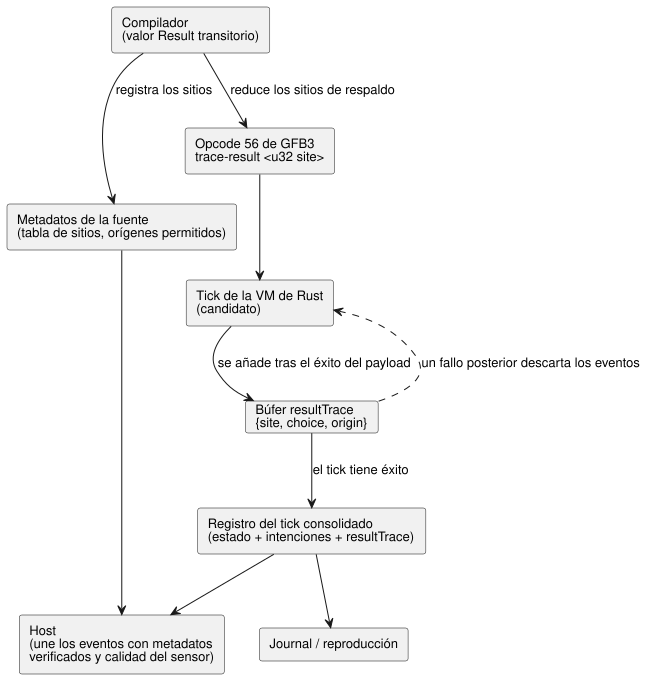

<!-- translation-source: tasks/result-provenance-design.md -->
[Original en inglés](result-provenance-design.md)

# Reducción de Result y evidencia de la recuperación ejecutada

**Estado:** decisión de implementación; la aceptación sigue pendiente.

Este documento decide dos cosas:

1. cómo el compilador representa y reduce (*lowering*) los valores `Result`; y
2. cómo el runtime registra qué opción de recuperación (respaldo, *fallback*)
   se ejecutó realmente en un tick, para que los hosts puedan explicarla después.

**Base normativa (Language Reference):**

| Sección | Qué exige aquí |
|---|---|
| §2.5 | Conservar el fallo original y la opción de respaldo. |
| §2.6 | Conservar la evaluación perezosa. |
| §2.8 | Rechazar de forma atómica un tick fallido. |
| §7.4 | Conservar el significado observable a lo largo de la reducción. |

El diagrama siguiente muestra el recorrido de la evidencia de recuperación,
desde la compilación hasta el registro del tick consolidado que consumen los
journals, la reproducción (replay) y los hosts.

## Representación

`Result` es un **valor transitorio del compilador**. Tiene cuatro expresiones
tipadas: `ok`, `value`, `faultCode` y `originTag`. No es un nuevo valor de la VM,
ni un tipo almacenable de entrada, salida o estado.

Reglas de tipado:

- La igualdad de tipos Result compara tanto el tipo del payload como el tipo de
  error.
- Los miembros de fallo integrados se resuelven a partir del tipo de error
  esperado. Si el miembro es ambiguo, se trata de un error de la fuente.

Reglas de codificación:

- Los códigos de fallo y las etiquetas de origen usan la representación Number
  existente para enumeraciones finitas.
- Los códigos de calidad del sensor se asignan **explícitamente** a los miembros
  declarados de `SensorFault`. No se supone que su orden numérico coincida.
- Los metadatos de la fuente vinculan cada etiqueta de origen con una identidad
  de sensor o con un nodo fuente explícito de construcción de fallo.

## Opción de recuperación real

**Instrucción.** El opcode 56 de GFB3, `trace-result <u32 site>`, consume
`[payload: T, choice: Number, origin: Number]` y deja en la pila el mismo payload
idéntico. La expresión interna es
`['trace-result', String(site), payload, choice, origin]`.

**Registro del tick.** El registro del tick en Rust expone un arreglo dedicado
`resultTrace` de eventos `{site, choice, origin}`. Nunca inserta nombres de
diagnóstico en las intenciones solicitadas ni en las intenciones seguras de los
actuadores. El JSON de traza nativo/WASM existente ya transporta este campo, así
que no se requiere ningún punto de entrada nuevo en la C ABI.

Campos y reglas del evento:

- **`site`** es un u32 positivo vinculado a la identidad del nodo fuente
  compilado. Las expansiones repetidas del mismo cuerpo de función pueden emitir
  el mismo site, por lo que un site *no* es un ID único de invocación en tiempo
  de ejecución.
- **`choice`**: `choice = 0` significa una rama Ok evaluada. Un choice positivo
  es el ordinal del miembro de fallo más uno (máximo 65535).
- **`origin`**: `origin = 0` significa que no hay origen de fallo. Una etiqueta
  u32 positiva se resuelve, mediante los metadatos de la fuente, al sensor o al
  nodo explícito de construcción de fallo.
- **Orden y repeticiones.** Los eventos conservan el orden de evaluación y las
  repeticiones. La ausencia de un site *no* implica Ok; significa que en ese tick
  no se registró ninguna evaluación completada de ese site.
- **Cuándo se escribe un evento.** El evento se añade después de que su
  expresión de payload tiene éxito. Las ramas no seleccionadas no producen
  ningún evento. El plegado de constantes debe conservar los marcadores
  ejecutados.

**Atomicidad.** Se comprueba que todos los metadatos del evento estén en el
rango de enteros exactos. El búfer de eventos pertenece al tick candidato y se
consolida junto con el estado y las intenciones. Cualquier fallo posterior en el
tick descarta sus eventos. El journal y la reproducción usan el mismo registro
consolidado; no existe un punto de control (checkpoint) mutable aparte para el
historial de recuperación.

## Límites y evidencia

**Límites de ejecución.** La ejecución de los marcadores está acotada por
expresiones solo hacia adelante y por los presupuestos de bytes existentes de
módulo/expresión. El límite de estrategia cuenta cada ocurrencia de
transición/intención, incluidas las expresiones emitidas repetidas. No se
introduce un límite arbitrario aparte de 256 marcadores.

**Evidencia estática frente a evidencia ejecutada.** Las dependencias estáticas
de la fuente describen qué lecturas son *posibles*. No pueden establecer qué
respaldo se ejecutó realmente. Los hosts unen los eventos producidos por el
núcleo con los metadatos de la fuente verificados y con la calidad del sensor;
no evalúan expresiones del lenguaje en JavaScript.

**Verificación de la tabla de sitios.** Los metadatos de la fuente registran
cada sitio de recuperación y sus orígenes permitidos. La reproducción de la
fuente canónica entrega la tabla de sitios esperada a la restauración y a la
validación de paquetes. La comparación debe ser exacta: eliminar un sitio o un
origen no debe pasar la validación solo porque los metadatos restantes sigan
siendo estructuralmente válidos. La tabla permanece vinculada a las identidades
del documento y del bytecode.

**La aceptación requerida** abarca:

- el rechazo de instrucciones, perfiles y pilas mal formados;
- el tipado estructural de Result;
- los fallos de callbacks omitidos (no evaluados);
- la identidad exacta del fallo;
- los eventos reales nativos/WASM;
- la reversión de un tick con fallo;
- la restauración de la fuente y la manipulación indebida;
- el comportamiento del journal y la reproducción.

Superar estas comprobaciones focalizadas no implica que se admita toda la
Reference.

## Límite de los consumidores que aún requiere auditoría final

Dos verificadores comprueban cosas distintas:

| Verificador | Qué comprueba | Qué no comprueba |
|---|---|---|
| API de restauración de Node y verificador de paquetes firmados en JavaScript | Reproducción de la fuente canónica y comparación exacta de los metadatos de los sitios de recuperación | — |
| Verificador de paquetes de Rust | Firmas, digests de artefactos, identidades de sobre y contratos del manifiesto | No ejecuta el compilador de la fuente ni demuestra de forma independiente la misma reducción de los sitios de Result |

Las pruebas de ejecución nativa demuestran los eventos de la VM. No demuestran
la afirmación más fuerte de reproducción de la fuente. La aceptación final de
paquetes/despliegue debe conservar esta distinción y contrastarla con el límite
de confianza requerido.
