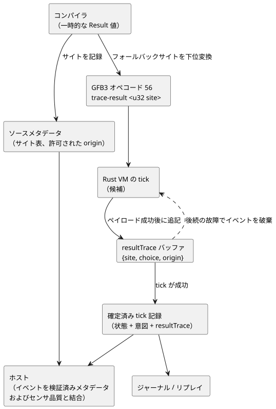

<!-- translation-source: tasks/result-provenance-design.md -->
[英語の原文](result-provenance-design.md)

# Result の下位変換と実行された復旧の証拠

**ステータス:** 実装方針は決定済み。受け入れは未完了です。

この文書では次の 2 点を決定します。

1. コンパイラが `Result` 値をどのように表現し、下位変換（lowering）するか。
2. ランタイムが、ある tick（論理判断の単位）で実際に実行された復旧（フォールバック）の選択をどのように記録し、ホストが後から説明できるようにするか。

**規範上の根拠（Language Reference）:**

| 節 | ここで要求していること |
|---|---|
| §2.5 | 元の故障（fault）とフォールバックの選択を保持する。 |
| §2.6 | 遅延評価を保持する。 |
| §2.8 | 失敗した tick をアトミックに拒否する。 |
| §7.4 | 下位変換を通じて観測可能な意味を保持する。 |

次の図は、コンパイルから、ジャーナル・リプレイ・ホストが利用する確定済み tick 記録までの、復旧の証拠の経路を示しています。

## 表現

`Result` は**一時的なコンパイラ値**です。`ok`、`value`、`faultCode`、`originTag` の 4 つの型付き式を持ちます。新しい VM 値ではなく、保存可能な入力・出力・状態の型でもありません。

型付け規則:

- Result 型の等価性は、ペイロード型とエラー型の両方を比較します。
- 組み込みの故障メンバーは、期待されるエラー型から解決されます。メンバーが曖昧な場合はソースエラーです。

エンコード規則:

- 故障コードと origin タグには、有限の列挙型（enum）向けの既存の Number 表現を使います。
- センサ品質コードは、宣言された `SensorFault` メンバーへ**明示的に**対応付けます。数値の順序が一致するとは仮定しません。
- ソースメタデータは、各 origin タグをセンサの同一性、または明示的な故障構築ソースノードのいずれかに結び付けます。

## 実際の復旧選択

**命令。** GFB3 のオペコード 56、`trace-result <u32 site>` は `[payload: T, choice: Number, origin: Number]` を消費し、同一のペイロードをスタックに残します。内部の式は `['trace-result', String(site), payload, choice, origin]` です。

**tick 記録。** Rust の tick 記録は、`{site, choice, origin}` イベントからなる専用の `resultTrace` 配列を公開します。診断名を要求意図（requested）や安全意図（safe）のアクチュエータ意図に挿入することは決してありません。既存のネイティブ/WASM トレース JSON はすでにこのフィールドを含んでいるため、新しい C ABI エントリポイントは必要ありません。

イベントのフィールドと規則:

- **`site`** は、コンパイルされたソースノードの同一性に結び付いた正の u32 です。同じ関数本体を繰り返し展開すると同じ site が出力されることがあるため、site は一意な実行時呼び出し ID では*ありません*。
- **`choice`**: `choice = 0` は評価された Ok 分岐を意味します。正の choice は、故障メンバーの序数に 1 を加えた値です（最大 65535）。
- **`origin`**: `origin = 0` は故障の origin がないことを意味します。正の u32 タグは、ソースメタデータを通じてセンサまたは明示的な故障構築ノードに解決されます。
- **順序と繰り返し。** イベントは評価順序と繰り返しを保持します。site が存在しないことは Ok を意味*しません*。その tick でその site の評価完了が記録されなかったことを意味します。
- **イベントが書き込まれるタイミング。** イベントは、そのペイロード式が成功した後に追記されます。選択されなかった分岐はイベントを生成しません。定数畳み込みは、実行済みマーカーを保持しなければなりません。

**アトミック性。** すべてのイベントメタデータは、厳密な整数範囲かどうかが検査されます。イベントバッファは候補 tick に属し、状態および意図とともに確定されます。tick 内で後から故障が発生すると、そのイベントは破棄されます。ジャーナルとリプレイは同じ確定済み記録を使います。変更可能な復旧履歴のチェックポイントを別に持つことはありません。

## 上限と証拠

**実行の上限。** マーカーの実行は、前方のみの式と、既存のモジュール/式のバイト予算によって上限が定まります。戦略の上限は、繰り返し出力される式を含め、すべての遷移/意図の出現を数えます。256 マーカーといった恣意的な上限を別に導入することはありません。

**静的な証拠と実行の証拠。** 静的なソース依存関係は、どの読み取りが*起こり得る*かを記述します。実際にどのフォールバックが実行されたかを確定することはできません。ホストは、コアが生成したイベントを検証済みのソースメタデータおよびセンサ品質と結合します。JavaScript で言語の式を評価することはありません。

**サイト表の検証。** ソースメタデータは、各復旧サイトとその許可された origin を記録します。正本ソースのリプレイは、期待されるサイト表を復元とパッケージ検証に提供します。比較は厳密でなければなりません。残りのメタデータが構造的に妥当であるというだけで、サイトや origin の削除が検証を通過してはなりません。サイト表は、文書とバイトコードの同一性に結び付いたままです。

**必要な受け入れ**は次を対象とします。

- 不正な命令、プロファイル、スタックの拒否
- 構造的な Result の型付け
- スキップされた（評価されなかった）コールバックの故障
- 厳密な故障の同一性
- 実際のネイティブ/WASM イベント
- 故障した tick のロールバック
- ソースの復元と改ざん
- ジャーナル/リプレイの動作

これらの限定的な検査に合格しても、Reference 全体のサポートを意味するわけではありません。

## 最終監査がまだ必要な利用側の境界

2 つの検証器は、それぞれ異なるものを検査します。

| 検証器 | 検査するもの | 検査しないもの |
|---|---|---|
| Node の復元 API と JavaScript の署名付きパッケージ検証器 | 正本ソースのリプレイと、復旧サイトのメタデータの厳密な比較 | — |
| Rust のパッケージ検証器 | 署名、成果物のダイジェスト、エンベロープの同一性、マニフェストの契約 | ソースコンパイラを実行せず、同じ Result サイトの下位変換を独立に証明することもない |

ネイティブ実行テストは VM のイベントを証明します。より強い、ソースリプレイに関する主張は証明しません。最終的なパッケージ/デプロイの受け入れでは、この区別を保持し、必要な信頼境界に照らして検査しなければなりません。
