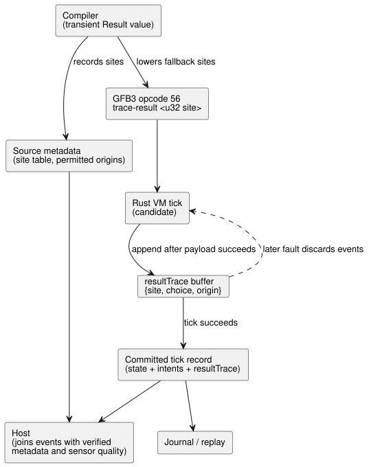

# Result lowering and executed recovery evidence

**Status:** implementation decision; acceptance remains pending.

This document decides two things:

1. how the compiler represents and lowers `Result` values; and
2. how the runtime records which recovery (fallback) choice actually executed in
   a tick, so hosts can explain it later.

**Normative basis (Language Reference):**

| Section | What it requires here |
|---|---|
| §2.5 | Preserve the original fault and the fallback choice. |
| §2.6 | Preserve lazy evaluation. |
| §2.8 | Reject a failed tick atomically. |
| §7.4 | Preserve observable meaning through lowering. |

The diagram below shows the path of recovery evidence, from compilation to the
committed tick record that journals, replay and hosts consume.

## Representation

`Result` is a **transient compiler value**. It has four typed expressions:
`ok`, `value`, `faultCode` and `originTag`. It is not a new VM value, and it is
not a storable input, output or state type.

Typing rules:

- Result type equality compares both the payload type and the error type.
- Built-in fault members resolve from the expected error type. If the member is
  ambiguous, that is a source error.

Encoding rules:

- Fault codes and origin tags use the existing Number representation for finite
  enums.
- Sensor quality codes are mapped **explicitly** to the declared `SensorFault`
  members. Their numeric ordering is not assumed to match.
- Source metadata binds each origin tag either to a sensor identity or to an
  explicit fault-construction source node.

## Actual recovery choice

**Instruction.** GFB3 opcode 56, `trace-result <u32 site>`, consumes
`[payload: T, choice: Number, origin: Number]` and leaves the identical payload
on the stack. The internal expression is
`['trace-result', String(site), payload, choice, origin]`.

**Tick record.** The Rust tick record exposes a dedicated `resultTrace` array of
`{site, choice, origin}` events. It never inserts diagnostic names into requested
or safe actuator intents. The existing native/WASM trace JSON already carries
this field, so no new C ABI entry point is required.

Event fields and rules:

- **`site`** is a positive u32 linked to the compiled source node identity.
  Repeated expansions of the same function body may emit the same site, so a
  site is *not* a unique runtime invocation ID.
- **`choice`**: `choice = 0` means an evaluated Ok branch. A positive choice is the fault
  member ordinal plus one (maximum 65535).
- **`origin`**: `origin = 0` means there is no fault origin. A positive u32 tag resolves
  through source metadata to the sensor or to the explicit fault-construction
  node.
- **Order and repeats.** Events keep evaluation order and repeats. An absent site
  does *not* imply Ok; it means no completed evaluation of that site was recorded
  in that tick.
- **When an event is written.** The event is appended after its payload
  expression succeeds. Unselected branches produce no event. Constant folding
  must preserve executed markers.

**Atomicity.** All event metadata is checked for exact integer range. The event
buffer belongs to the candidate tick and commits together with state and
intents. Any later fault in the tick discards its events. Journaling and replay
use the same committed record; there is no separate mutable recovery-history
checkpoint.

## Bounds and evidence

**Execution bounds.** Marker execution is bounded by forward-only expressions and
the existing module/expression byte budgets. The strategy bound counts every
transition/intent occurrence, including repeated emitted expressions. No
separate, arbitrary 256-marker limit is introduced.

**Static versus executed evidence.** Static source dependencies describe which
reads are *possible*. They cannot establish which fallback actually executed.
Hosts join core-produced events to verified source metadata and sensor quality;
they do not evaluate language expressions in JavaScript.

**Site table verification.** Source metadata records each recovery site and its
permitted origins. Canonical source replay supplies the expected site table to
restoration and package validation. The comparison must be exact: deleting a
site or an origin must not pass merely because the remaining metadata is still
structurally valid. The table stays bound to the document and bytecode
identities.

**Required acceptance** covers:

- rejection of malformed instructions, profiles and stacks;
- structural Result typing;
- skipped (unevaluated) callback faults;
- exact fault identity;
- actual native/WASM events;
- rollback of a faulted tick;
- source restoration and tampering;
- journal/replay behavior.

Passing these focused checks does not imply support for the whole Reference.

## Consumer boundary still requiring final audit

Two verifiers check different things:

| Verifier | What it checks | What it does not check |
|---|---|---|
| Node restoration API and JavaScript signed-package verifier | Canonical source replay and exact recovery-site metadata comparison | — |
| Rust package verifier | Signatures, artifact digests, envelope identities and manifest contracts | It does not run the source compiler or independently prove the same Result-site lowering |

Native execution tests prove the VM events. They do not prove the stronger
source-replay claim. Final package/deployment acceptance must preserve this
distinction and check it against the required trust boundary.
