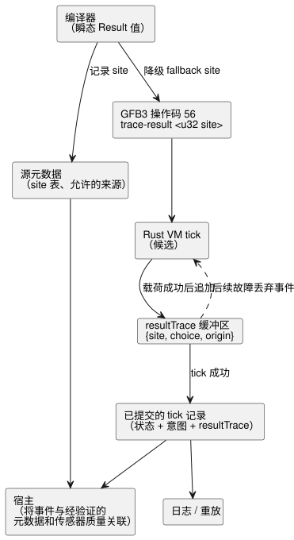

<!-- translation-source: tasks/result-provenance-design.md -->
[英文原文](result-provenance-design.md)

# Result 降级与已执行恢复的证据

**状态：** 实现决策已定；验收仍待完成。

本文决定两件事：

1. 编译器如何表示并降级（lower）`Result` 值；
2. 运行时如何记录某个 tick（逻辑决策步）中实际执行了哪一个恢复（fallback）选择，以便宿主（host）事后加以解释。

**规范依据（语言参考）：**

| 章节 | 在此处的要求 |
|---|---|
| §2.5 | 保留原始故障与 fallback 选择。 |
| §2.6 | 保留惰性求值。 |
| §2.8 | 原子地拒绝失败的 tick。 |
| §7.4 | 在降级过程中保留可观测的含义。 |

下图展示恢复证据的路径：从编译开始，一直到供日志（journal）、重放和宿主使用的已提交 tick 记录。

## 表示形式

`Result` 是一种**瞬态编译器值**。它由四个带类型的表达式组成：`ok`、`value`、`faultCode` 和 `originTag`。它不是新的 VM 值，也不是可存储的输入、输出或状态类型。

类型规则：

- Result 类型相等性同时比较载荷类型和错误类型。
- 内置故障成员根据期望的错误类型解析。如果成员有歧义，则属于源代码错误。

编码规则：

- 故障码和来源标签使用现有的有限枚举 Number 表示。
- 传感器质量码**显式**映射到已声明的 `SensorFault` 成员。不假定二者的数值顺序一致。
- 源元数据将每个来源标签绑定到某个传感器身份标识，或绑定到一个显式构造故障的源节点。

## 实际的恢复选择

**指令。** GFB3 操作码 56，即 `trace-result <u32 site>`，消耗 `[payload: T, choice: Number, origin: Number]`，并在栈上留下完全相同的载荷。其内部表达式为 `['trace-result', String(site), payload, choice, origin]`。

**Tick 记录。** Rust tick 记录公开一个专用的 `resultTrace` 数组，其元素为 `{site, choice, origin}` 事件。它绝不会把诊断名称插入请求意图或安全意图（执行器意图）中。现有的 native/WASM 追踪 JSON 已经携带此字段，因此不需要新的 C ABI 入口点。

事件字段与规则：

- **`site`** 是一个正的 u32，与编译后源节点的身份标识关联。同一函数体被多次展开时可能产生相同的 site，因此 site *不是*唯一的运行时调用 ID。
- **`choice`**：`choice = 0` 表示已求值的 Ok 分支。正的 choice 为故障成员序号加一（最大 65535）。
- **`origin`**：`origin = 0` 表示没有故障来源。正的 u32 标签通过源元数据解析到传感器或显式构造故障的节点。
- **顺序与重复。** 事件保留求值顺序和重复。某个 site 缺失*并不*意味着 Ok；它表示该 tick 中没有记录该 site 的已完成求值。
- **事件何时写入。** 事件在其载荷表达式成功之后追加。未被选中的分支不产生事件。常量折叠必须保留已执行标记。

**原子性。** 所有事件元数据都要检查精确整数范围。事件缓冲区属于候选 tick，并与状态和意图一起提交。该 tick 中任何后续故障都会丢弃这些事件。日志和重放使用同一份已提交记录；不存在单独的、可变的恢复历史检查点。

## 界限与证据

**执行界限。** 标记的执行受仅向前的表达式以及现有模块/表达式字节预算约束。策略界限计入每一次转换/意图出现，包括重复发出的表达式。不另外引入任意的 256 个标记上限。

**静态证据与执行证据。** 静态源依赖描述哪些读取是*可能*发生的。它们无法确定实际执行了哪一个 fallback。宿主将核心产生的事件与经过验证的源元数据和传感器质量关联起来；宿主不会在 JavaScript 中对语言表达式求值。

**Site 表验证。** 源元数据记录每个恢复 site 及其允许的来源。规范源重放向恢复（restoration）和包验证提供期望的 site 表。比较必须精确：删除某个 site 或来源后，不得仅因剩余元数据在结构上仍然有效就通过。该表始终绑定到文档和字节码的身份标识。

**必需的验收**包括：

- 拒绝格式错误的指令、profile 和栈；
- 结构化的 Result 类型检查；
- 被跳过（未求值）的回调故障；
- 精确的故障身份；
- 实际的 native/WASM 事件；
- 回滚出现故障的 tick；
- 源恢复与篡改；
- 日志/重放行为。

通过这些聚焦检查并不意味着支持整个语言参考。

## 仍需最终审计的消费者边界

两个验证器检查不同的内容：

| 验证器 | 检查内容 | 不检查的内容 |
|---|---|---|
| Node 恢复 API 和 JavaScript 签名包验证器 | 规范源重放以及恢复 site 元数据的精确比较 | — |
| Rust 包验证器 | 签名、制品摘要、信封身份标识和清单（manifest）契约 | 它不运行源编译器，也不独立证明相同的 Result site 降级 |

Native 执行测试证明的是 VM 事件，并不证明更强的源重放主张。最终的包/部署验收必须保留这一区别，并依照所需的信任边界加以检查。
