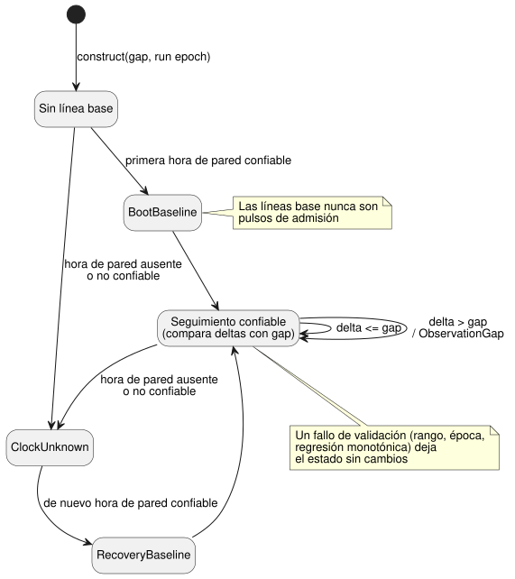

<!-- translation-source: tasks/schedule-clock-design.md -->
[Original en inglés](schedule-clock-design.md)

# Compuerta de reloj de schedule solo confiable (trusted-only)

**Estado:** el componente de reloj nativo está implementado y aceptado; la
integración con la VM/ABI sigue pendiente.

Este documento describe el **componente de reloj** de la
[admisión de pulsos Solar](schedule-pulse-design.es.md). Se basa en las §3.1 y
§3.5 de la Reference. La compuerta de reloj decide si cada observación del reloj
es utilizable para los schedules con `clock = trusted_only`. Todavía no conecta
los schedules de la fuente con la VM y no implementa la admisión de ocurrencias.

## Contrato

La compuerta transita entre los estados siguientes. Las líneas base establecen
un punto de referencia; nunca son pulsos de admisión.

**Entradas y construcción**

- El llamador entrega una instantánea (snapshot) inmutable por observación. La
  compuerta nunca lee un reloj de la máquina. No tiene una cadencia de
  observación implícita ni un gap predeterminado.
- La construcción requiere un gap Duration positivo y exacto, y una época de
  ejecución (run epoch) explícita.
- El tiempo monotónico y la época son enteros seguros exactos. La hora de pared
  está acotada por el dominio DateTime de la Reference. La incertidumbre
  opcional es un valor exacto y no negativo.

**Validación antes de la mutación**

- Valide el rango, la época de ejecución y la progresión monotónica *antes* de
  cualquier cambio de estado.
- Una época distinta requiere una nueva ejecución. No puede reiniciar esta
  compuerta en silencio.

**Unknown y líneas base**

- Una hora de pared ausente o no confiable devuelve `ClockUnknown`. La compuerta
  conserva el motivo original y la revisión opaca de la fuente.
- La incertidumbre ausente permanece ausente. Su ausencia por sí sola no
  invalida un instante de pared que, por lo demás, es confiable.
- La primera observación confiable establece `BootBaseline`. Una observación
  confiable después de Unknown establece `RecoveryBaseline`. Ninguna de las dos
  es un pulso de admisión.

**Detección de gaps**

- Para observaciones confiables consecutivas, compare tanto el delta monotónico
  como el delta de pared positivo con el gap explícito. Se permite un delta igual
  al gap; un delta mayor es `ObservationGap`. Se acepta el retroceso de la hora
  de pared.
- Mantenga el **instante de pared efectivo anterior** separado de la **marca de
  agua alta confiable** (high-water; la mayor hora de pared confiable vista hasta
  el momento). Ejemplo: tras los valores de pared 1000, 900, 1050, el último
  delta positivo es 150 (1050 − 900), no 50 (1050 − 1000). Con un gap de 100, la
  compuerta debe, por lo tanto, informar `ObservationGap`.

**Salidas y atomicidad**

- Exponga tanto la marca de agua alta confiable anterior como la actualizada al
  motor de admisión posterior. La marca actualizada por sí sola no puede
  clasificar un evento recién cruzado.
- La integración en el runtime prepara un clon y lo consolida solo con un tick
  completo exitoso. El propio componente también conserva su estado cuando la
  validación falla.

**Almacenamiento.** El estado vivo contiene solo campos escalares fijos. Las
cadenas de revisión y de motivo de las instantáneas y observaciones se toman
prestadas, no se retienen en la compuerta. Esto no afirma nada sobre un futuro
almacenamiento propio de hechos/journal; eso requiere el plan explícito de
recursos integrado en [la propuesta de wire](schedule-wire-design.es.md).

## Límite de aceptación

Las pruebas focalizadas deben cubrir:

- gap exacto y gap+1, para cada reloj;
- retroceso seguido de un gap hacia adelante;
- Unknown y recuperación;
- marcas de tiempo sin cambios;
- incertidumbre opcional;
- conservación de revisiones y motivos opacos;
- límites numéricos exactos;
- discrepancia de época;
- regresión monotónica;
- descarte y reintento de un candidato preparado.

La aceptación de este componente nativo **no** es la aceptación del compilador,
la WASM ABI, la deduplicación de ocurrencias, la política de reloj retenido
(held-clock), la restauración duradera ni la funcionalidad completa de
schedules. La decisión de producto pendiente sobre cruces múltiples no afecta a
este componente de reloj.

## Evidencia

- Sol implementó `crates/ghostflow-core/src/schedule_clock.rs`. Root revisó la
  mutación de estado, la marca de agua alta anterior frente a la actualizada y
  las aserciones de los extremos.
- `build/schedule-clock-red.log`: la prueba inicial de la API pública del reloj
  no compiló porque los nuevos tipos aún no existían. Esto no es un resultado RED
  en tiempo de ejecución para cada vector de límite posterior.
- `build/schedule-clock-first-green.log`: la ruta inicial del reloj pasó.
- `build/schedule-clock-final-green.log`: pasan seis pruebas focalizadas.
  Incluyen extremos numéricos aceptados, gap/gap+1 exactos, marcas de tiempo sin
  cambios, procedencia, mensajes de rechazo exactos, estado sin cambios e
  igualdad del reintento tras descartar la preparación.
- `build/schedule-clock-core-regression.log`: pasan las 148 pruebas del núcleo,
  código de salida 0.
- `build/schedule-clock-catalog.log`: pasan cinco pruebas de catálogo después de
  que Luna moviera una línea el localizador de la prueba de atomicidad del núcleo
  (sin cambios). Su digest no cambia.
- `cargo fmt --all -- --check` y `git diff --check` pasan.

**No ejecutado:** ninguna nueva compuerta completa de host ni compilación WASM.
La API de Rust recibe campos enteros; la futura decodificación de paquetes de
hechos debe rechazar por separado los números fraccionarios del host.
