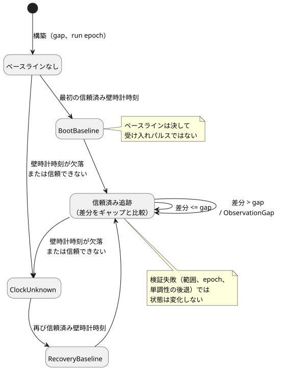

<!-- translation-source: tasks/schedule-clock-design.md -->
[英語の原文](schedule-clock-design.md)

# trusted-only スケジュールのクロックゲート

**ステータス:** ネイティブのクロックコンポーネントは実装済みで受け入れ済みです。VM/ABI との統合は未完了です。

この文書は、[Solar パルスの受け入れ](schedule-pulse-design.ja.md)の**クロックコンポーネント**について説明します。根拠は Reference の §3.1 と §3.5 です。クロックゲートは、各クロック観測が `clock = trusted_only` のスケジュールで使用できるかどうかを判断します。ソースのスケジュールを VM にまだ接続しておらず、発生（オカレンス）の受け入れ（アドミッション）も実装していません。

## 契約

ゲートは次の状態の間を遷移します。ベースラインは基準点を確立するものであり、受け入れパルスになることは決してありません。

**入力と構築**

- 呼び出し側は、観測ごとに不変のスナップショットを 1 つ渡します。ゲートがマシンのクロックを読むことは決してありません。暗黙の観測周期も既定のギャップもありません。
- 構築には、正の厳密な Duration のギャップと、明示的な run epoch が必要です。
- 単調時間と epoch は厳密な安全整数です。壁時計の時刻は Reference の DateTime ドメインで範囲が制限されます。オプションの不確かさは、厳密な非負の値です。

**状態変更前の検証**

- 範囲、run epoch、単調な進行を、状態が変化する*前に*検証します。
- epoch が異なる場合は新しい実行（run）が必要です。このゲートを暗黙にリセットすることはできません。

**Unknown とベースライン**

- 壁時計の時刻が欠落しているか信頼できない場合は `ClockUnknown` を返します。ゲートは元の理由と不透明なソースのリビジョンを保持します。
- 欠落した不確かさは欠落のままです。不確かさがないことだけでは、それ以外の点で信頼できる壁時計の時刻が無効になることはありません。
- 最初の信頼済みの観測は `BootBaseline` を確立します。Unknown の後の信頼済みの観測は `RecoveryBaseline` を確立します。どちらも受け入れパルスではありません。

**ギャップ検出**

- 連続する信頼済みの観測では、単調時間の差分と正の壁時計の差分の両方を、明示的なギャップと比較します。ギャップと等しい差分は許容されます。それより大きい差分は `ObservationGap` です。壁時計の巻き戻りは受け入れられます。
- **直前の有効な壁時計時刻**と、**信頼済みの high-water マーク**（これまでに見た最大の信頼済み壁時計時刻）を区別して保持します。例: 壁時計の値が 1000、900、1050 の順で来た場合、最後の正の差分は 50（1050 − 1000）ではなく 150（1050 − 900）です。したがってギャップが 100 であれば、ゲートは `ObservationGap` を報告しなければなりません。

**出力とアトミック性**

- 更新前と更新後の両方の信頼済み high-water マークを、下流の受け入れエンジンに公開します。更新後のマークだけでは、新たに通過したイベントを分類できません。
- ランタイム統合はクローンをステージし、tick 全体が成功した場合にのみそれを確定します。コンポーネント自体も、検証が失敗したときは状態を保持します。

**ストレージ。** ライブ状態は固定のスカラーフィールドだけを含みます。スナップショットや観測に含まれるリビジョンと理由の文字列は借用され、ゲート内には保持されません。これは将来の所有型のファクト/ジャーナルのストレージについて何も主張するものではありません。それには[ワイヤー提案](schedule-wire-design.ja.md)にある、明示的に統合されたリソース計画が必要です。

## 受け入れの境界

限定的なテストは次を網羅しなければなりません。

- 各クロックについて、ちょうどギャップの値と、ギャップ+1
- 巻き戻りの後に続く前方へのギャップ
- Unknown と復旧
- 変化しないタイムスタンプ
- オプションの不確かさ
- 不透明なリビジョンと理由の保持
- 厳密な数値の上限
- epoch の不一致
- 単調時間の後退
- ステージされた候補の破棄と再試行

このネイティブコンポーネントの受け入れは、コンパイラ、WASM ABI、発生の重複排除、保持クロック（held-clock）のポリシー、永続的な復元、またはスケジュール機能全体の受け入れでは**ありません**。未決定の複数交差に関する製品判断は、このクロックコンポーネントには影響しません。

## 証拠

- Sol が `crates/ghostflow-core/src/schedule_clock.rs` を実装しました。Root が状態変更、更新前と更新後の high-water、端点のアサーションをレビューしました。
- `build/schedule-clock-red.log`: 最初の公開クロック API テストは、新しい型がまだ存在しなかったためコンパイルに失敗しました。これは、後のすべての境界ベクトルに対する実行時の RED 結果ではありません。
- `build/schedule-clock-first-green.log`: 最初のクロック経路が合格しました。
- `build/schedule-clock-final-green.log`: 6 つの限定的なテストが合格します。受け入れられる数値の端点、ちょうどのギャップ/ギャップ+1、変化しないタイムスタンプ、来歴（provenance）、厳密な拒否メッセージ、変化しない状態、破棄したステージの再試行での等価性を含みます。
- `build/schedule-clock-core-regression.log`: 148 個のコアテストすべてが合格し、終了コードは 0 です。
- `build/schedule-clock-catalog.log`: Luna が（内容は変わらない）コアのアトミック性テストのロケータを 1 行移動した後、5 つのカタログテストが合格します。そのダイジェストは変わっていません。
- `cargo fmt --all -- --check` と `git diff --check` が合格します。

**未実行:** 新しいフルのホストゲートや WASM ビルドは実行していません。Rust API は整数フィールドを受け取ります。将来のファクトパケットのデコードでは、ホストからの小数値を別途拒否しなければなりません。
