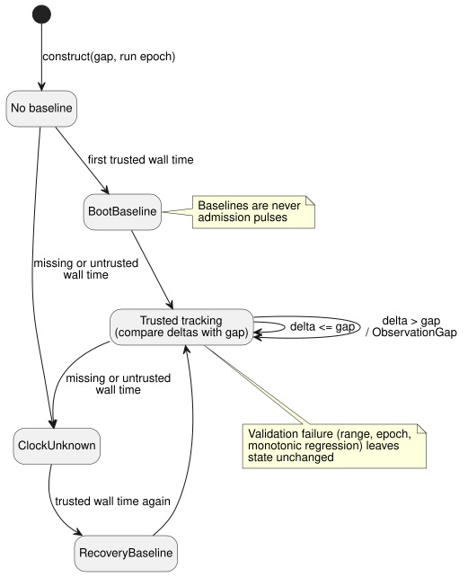

# Trusted-only schedule clock gate

**Status:** native clock component implemented and accepted; VM/ABI integration
pending.

This document describes the **clock component** of
[Solar pulse admission](schedule-pulse-design.md). It is grounded in Reference
§3.1 and §3.5. The clock gate decides whether each clock observation is usable
for `clock = trusted_only` schedules. It does not yet connect source schedules to
the VM, and it does not implement occurrence admission.

## Contract

The gate moves between the states below. Baselines establish a reference point;
they are never admission pulses.

**Inputs and construction**

- The caller supplies one immutable snapshot per observation. The gate never
  reads a machine clock. It has no implicit observation cadence and no default
  gap.
- Construction requires a positive, exact Duration gap and an explicit run epoch.
- Monotonic time and the epoch are exact safe integers. Wall time is bounded by
  the Reference DateTime domain. The optional uncertainty is an exact,
  nonnegative value.

**Validation before mutation**

- Validate range, run epoch and monotonic progression *before* any state
  changes.
- A different epoch requires a new run. It cannot silently reset this gate.

**Unknown and baselines**

- Missing or untrusted wall time returns `ClockUnknown`. The gate preserves the
  original reason and the opaque source revision.
- Missing uncertainty stays absent. Its absence alone does not invalidate an
  otherwise trusted wall instant.
- The first trusted observation establishes `BootBaseline`. A trusted observation
  after Unknown establishes `RecoveryBaseline`. Neither is an admission pulse.

**Gap detection**

- For consecutive trusted observations, compare both the monotonic delta and the
  positive wall delta with the explicit gap. A delta equal to the gap is allowed;
  a greater delta is `ObservationGap`. Wall rollback is accepted.
- Keep the **previous effective wall instant** separate from the **trusted
  high-water mark** (the largest trusted wall time seen so far). Example: after
  wall values 1000, 900, 1050, the final positive delta is 150 (1050 − 900), not
  50 (1050 − 1000). With a gap of 100, the gate must therefore report
  `ObservationGap`.

**Outputs and atomicity**

- Expose both the prior and the updated trusted high-water marks to the
  downstream admission engine. The updated mark alone cannot classify a newly
  crossed event.
- Runtime integration stages a clone and commits it only with a successful whole
  tick. The component itself also preserves its state when validation fails.

**Storage.** The live state contains only fixed scalar fields. Revision and
reason strings from snapshots and observations are borrowed, not retained in the
gate. This makes no claim about future owned fact/journal storage; that needs
the explicit integrated resource plan in
[the wire proposal](schedule-wire-design.md).

## Acceptance boundary

Focused tests must cover:

- exact gap and gap+1, for each clock;
- rollback followed by a forward gap;
- Unknown and recovery;
- unchanged timestamps;
- optional uncertainty;
- preservation of opaque revisions and reasons;
- exact numeric bounds;
- epoch mismatch;
- monotonic regression;
- discard and retry of a staged candidate.

Acceptance of this native component is **not** acceptance of the compiler, the
WASM ABI, occurrence deduplication, held-clock policy, durable restore or the
complete schedule feature. The pending multiple-crossing product decision does
not affect this clock component.

## Evidence

- Sol implemented `crates/ghostflow-core/src/schedule_clock.rs`. Root reviewed
  state mutation, prior versus updated high-water, and endpoint assertions.
- `build/schedule-clock-red.log`: the initial public clock API test failed to
  compile because the new types did not exist yet. This is not a runtime RED
  result for every later boundary vector.
- `build/schedule-clock-first-green.log`: the initial clock path passed.
- `build/schedule-clock-final-green.log`: six focused tests pass. They include
  accepted numeric endpoints, exact gap/gap+1, unchanged timestamps, provenance,
  exact rejection messages, unchanged state and discarded-stage retry equality.
- `build/schedule-clock-core-regression.log`: all 148 core tests pass, exit 0.
- `build/schedule-clock-catalog.log`: five catalog tests pass after Luna moved
  the (unchanged) core atomicity test locator by one line. Its digest is
  unchanged.
- `cargo fmt --all -- --check` and `git diff --check` pass.

**Not run:** no new full host gate or WASM build. The Rust API takes integer
fields; future fact-packet decoding must separately reject fractional host
numbers.
