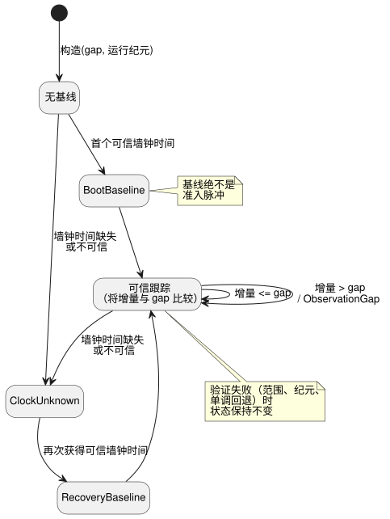

<!-- translation-source: tasks/schedule-clock-design.md -->
[英文原文](schedule-clock-design.md)

# 仅信任时钟的调度计划时钟门

**状态：** native 时钟组件已实现并通过验收；VM/ABI 集成待完成。

本文描述 [Solar 脉冲准入](schedule-pulse-design.zh.md)中的**时钟组件**。其依据是语言参考 §3.1 和 §3.5。时钟门判定每一次时钟观测能否用于 `clock = trusted_only` 的调度计划。它尚未把源调度计划连接到 VM，也不实现触发实例（occurrence）的准入。

## 契约

时钟门在下列状态之间转换。基线（baseline）用于建立参考点；它们绝不是准入脉冲。

**输入与构造**

- 调用方为每次观测提供一个不可变快照。时钟门绝不读取机器时钟。它没有隐式的观测节奏，也没有默认 gap。
- 构造时需要一个正的、精确的 Duration gap，以及一个显式的运行（run）纪元（epoch）。
- 单调时间和纪元是精确的安全整数。墙钟时间受语言参考 DateTime 域约束。可选的不确定度是一个精确的非负值。

**变更前验证**

- 在任何状态变化*之前*验证范围、运行纪元和单调递进。
- 不同的纪元需要新的运行。它不能静默地重置此时钟门。

**Unknown 与基线**

- 墙钟时间缺失或不可信时返回 `ClockUnknown`。时钟门保留原始原因和不透明的源修订版。
- 缺失的不确定度保持缺失。仅凭它的缺失不会使一个原本可信的墙钟时刻失效。
- 第一次可信观测建立 `BootBaseline`。Unknown 之后的可信观测建立 `RecoveryBaseline`。二者都不是准入脉冲。

**间隙检测**

- 对于连续的可信观测，将单调增量和正的墙钟增量都与显式 gap 比较。增量等于 gap 时允许；增量更大时为 `ObservationGap`。墙钟回拨是被接受的。
- 将**前一个有效墙钟时刻**与**可信高水位**（迄今见过的最大可信墙钟时间）分开保存。示例：在墙钟值依次为 1000、900、1050 之后，最后一个正增量是 150（1050 − 900），而不是 50（1050 − 1000）。当 gap 为 100 时，时钟门因此必须报告 `ObservationGap`。

**输出与原子性**

- 向下游准入引擎同时公开先前的和更新后的可信高水位。仅凭更新后的高水位无法对新跨越的事件进行分类。
- 运行时集成会暂存一个副本，并且只在整个 tick 成功时才提交它。验证失败时，组件自身也会保留其状态。

**存储。** 实时状态只包含固定的标量字段。来自快照和观测的修订版字符串与原因字符串是借用的，不会保存在时钟门中。这并不对未来自有的事实/日志存储作任何承诺；那需要[线路格式提案](schedule-wire-design.zh.md)中显式的集成资源计划。

## 验收边界

聚焦测试必须覆盖：

- 每种时钟的精确 gap 和 gap+1；
- 回拨之后紧接着向前的间隙；
- Unknown 与恢复；
- 未变化的时间戳；
- 可选的不确定度；
- 不透明修订版与原因的保留；
- 精确的数值界限；
- 纪元不匹配；
- 单调回退；
- 丢弃暂存候选并重试。

此 native 组件的验收**不等于**编译器、WASM ABI、触发实例去重、保持时钟（held-clock）策略、持久恢复或完整调度计划功能的验收。尚未决定的多次跨越产品决策不影响此时钟组件。

## 证据

- Sol 实现了 `crates/ghostflow-core/src/schedule_clock.rs`。Root 审查了状态变更、先前与更新后的高水位，以及端点断言。
- `build/schedule-clock-red.log`：最初的公共时钟 API 测试编译失败，因为新类型尚不存在。这并不是针对此后每个边界向量的运行时 RED 结果。
- `build/schedule-clock-first-green.log`：最初的时钟路径通过。
- `build/schedule-clock-final-green.log`：六个聚焦测试通过。其中包括被接受的数值端点、精确 gap/gap+1、未变化的时间戳、来源（provenance）、精确的拒绝消息、未变化的状态，以及丢弃暂存后重试的相等性。
- `build/schedule-clock-core-regression.log`：全部 148 个核心测试通过，退出码 0。
- `build/schedule-clock-catalog.log`：在 Luna 将（未变化的）核心原子性测试定位符移动一行之后，五个目录测试通过。其摘要未变。
- `cargo fmt --all -- --check` 和 `git diff --check` 通过。

**未运行：** 没有新的完整宿主门禁，也没有 WASM 构建。Rust API 接受整数字段；未来的事实数据包解码必须另外拒绝宿主传入的小数。
