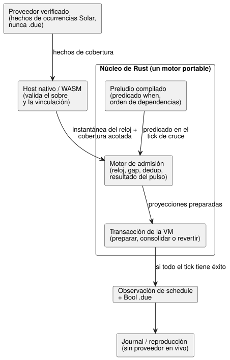
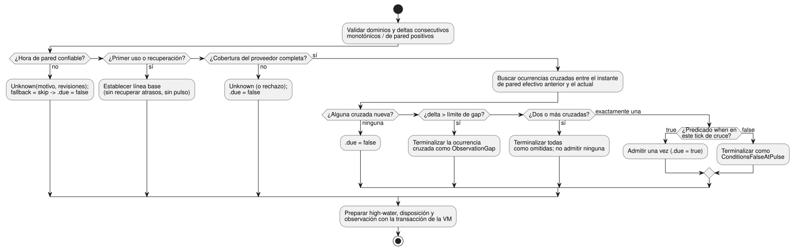

<!-- translation-source: tasks/schedule-pulse-design.md -->
[Original en inglés](schedule-pulse-design.md)

# Diseño de la admisión de schedules Solar por pulso

**Estado:** arquitectura aprobada; un segmento acotado de admisión nativa está
implementado y probado. Siguen pendientes la vinculación GFB/WASM/proveedor, la
prueba de recursos y la reproducción duradera.

Este diseño define cómo un schedule Solar con `basis = pulse` decide, una vez por
ocurrencia planificada, si se dispara (*admisión*). Documentos relacionados: la
[compuerta de reloj trusted-only](schedule-clock-design.es.md) (componente de
reloj) y la [propuesta de wire](schedule-wire-design.es.md).

## Alcance y fuente de verdad

La [§3.5 de la Reference](../docs/reference/03-time-and-schedules.es.md#35-semántica-común-de-schedule)
define los schedules como valores reactivos tipados. Las reglas clave son:

- Un **proveedor** identifica una ocurrencia planificada. La **ejecución
  portable** decide la admisión sobre una instantánea aceptada.
- Un pulso cuyo predicado falla es terminal. Nunca se pone en cola.
- Cada decisión conserva una identidad de ocurrencia estable, su contexto de
  reloj/proveedor y una disposición explícita.

El primer segmento completo es Solar con:

- `basis = pulse`;
- un predicado Bool `when` escrito por el autor;
- `clock = trusted_only`;
- `gap = skip_after(positive constant Duration)`;
- `recovery = baseline`;
- `fallback = skip`.

Cubre la ruta de fuente y de runtime que necesitan REF-03-042 y REF-03-045.

Fuera del alcance de este segmento:

- **Daily** sigue rechazado hasta que su proveedor de disparo IANA/DST esté
  completo. Una aceptación solo en el parser no satisfaría REF-03-024.
- `window`, `run`, `hold_trusted` y `fixed_time` siguen siendo carencias de
  implementación explícitas.

El contrato completo de la Reference sigue siendo obligatorio.

## Decisiones

### Los hechos del proveedor no son decisiones de admisión

Un proveedor externo verificado entrega un conjunto acotado y completo de
**hechos** de ocurrencias Solar para un intervalo cubierto explícito. Nunca
entrega `.due`.

Cada hecho identifica:

- las revisiones del proveedor y del contexto;
- la fecha local de origen;
- una clave estable de la ocurrencia de origen;
- el instante de pared planificado;
- o bien la disponibilidad, o bien un fallo específico del contexto temporal.

El descriptor estático de la fuente aporta la identidad del schedule, la zona
horaria, la ubicación, la salida/puesta del sol y el desplazamiento. Un perfil de
activación acota la cantidad de hechos por instantánea aceptada y por cobertura.
La cadencia de sondeo esperada *no* es una cota de ese tipo.

Esta separación mantiene el lenguaje abierto a cualquier proveedor compatible con
IANA. La implementación Solar portable en Rust y el adaptador SunCalc en
JavaScript pueden seguir siendo proveedores de referencia para las zonas que
admiten. La aceptación del compilador no restringe el lenguaje a esas
implementaciones. La activación debe vincular un proveedor compatible.

### Rust es dueño de la admisión y del estado del reloj

Un único motor portable en Rust es dueño de:

- la validación del reloj confiable;
- el estado de línea base/recuperación;
- las marcas de agua alta (high-water) de pared y monotónica;
- la disposición ante gaps;
- la deduplicación de ocurrencias;
- el resultado del pulso.

JavaScript no duplica esta máquina de estados. El motor se prepara junto con el
resto de un tick y se consolida solo después de que toda la decisión de la VM
tiene éxito.

`ClockSnapshot` transporta el tiempo monotónico aceptado más una hora de pared
opcional, la confianza, la revisión del reloj y una incertidumbre opcional.

- `trusted_only` requiere una hora de pared confiable. Una hora de pared ausente
  permanece Unknown.
- La incertidumbre ausente permanece `None`; nunca se sustituye por cero. Su
  ausencia por sí sola no convierte en Unknown un instante de pared que, por lo
  demás, es confiable.
- La futura política `hold_trusted` debe definir la antigüedad de HeldClock y el
  crecimiento de la incertidumbre antes de aceptarse. Este primer segmento no la
  implementa.

### El orden del preludio está guiado por las dependencias

El *preludio* es la parte de un tick que prepara las proyecciones con estado
antes de que se ejecuten las transiciones escritas por el autor. La expresión
`when` del autor puede depender de entradas, de Results de sensores o de otras
proyecciones de señales con estado. Las futuras expresiones temporales también
pueden consumir proyecciones de schedules. Por eso un orden fijo —"schedules
antes que ventanas" o "ventanas antes que schedules"— es incorrecto.

En su lugar, el compilador:

1. construye un único grafo de dependencias del preludio, heterogéneo y del mismo
   tick, en el que cada descriptor con estado registra sus dependencias tipadas;
2. emite un orden topológico y rechaza un ciclo indicando las ubicaciones en la
   fuente.

Los predicados de schedule leen las proyecciones seleccionadas del mismo tick
solo después de que sus dependencias se han preparado. Ningún descriptor puede
leer una ranura posterior del preludio. Las transiciones e intenciones del autor
siguen ejecutándose después de todo el preludio.

## Ruta de extremo a extremo

Los componentes y sus responsabilidades se muestran a continuación. El proveedor
solo entrega hechos; únicamente el núcleo de Rust decide la admisión y la
consolida con el tick.



### Fuente y compilador

Solar acepta cada campo de disparo y cada campo de política común exactamente una
vez:

```ghost
schedule dawn: Solar {
  timezone = "Asia/Seoul";
  latitude = 37.5665;
  longitude = 126.9780;
  at = sun`rise + 30min`;
  basis = pulse;
  when = true;
  clock = trusted_only;
  gap = skip_after(60s);
  recovery = baseline;
  fallback = skip;
}
```

Reglas del compilador:

- Reutilizar el parser Solar etiquetado actual para la salida/puesta del sol y
  los desplazamientos Duration enteros exactos en `[-24h, +24h]`, incluido cero.
- Analizar los campos comunes como nodos AST tipados.
- `when` es una expresión Bool compilada en el preludio. Ni el proveedor ni el
  host JavaScript la evalúan.
- Las tres formas de política admitidas anteriores se reducen a valores
  explícitos del descriptor.
- Una política ausente, duplicada, mal formada o no admitida produce un
  diagnóstico con ubicación. No sustituya en silencio los valores actualmente
  codificados de 60 segundos, baseline o skip.

El descriptor semántico contiene lo siguiente (aún no se prescribe un formato de
bytes):

- el sitio y el nombre estables de la declaración;
- los hechos de disparo Solar: zona horaria, latitud, longitud, evento y
  desplazamiento;
- la política: pulse, trusted-only, milisegundos de gap positivos, baseline y
  skip;
- el predicado Bool compilado y sus dependencias heterogéneas del preludio;
- el requisito de proveedor y las vinculaciones de hechos generadas;
- la identidad tipada de la proyección `.due`.

El siguiente paso de implementación debe especificar y probar de forma
independiente el wire GFB acotado. Este documento no selecciona una versión de
formato, anchos de campo ni opcode.

### Límite entre proveedor y host

Los hosts nativo y WASM entregan los mismos hechos semánticos validados:

- **reloj:** tiempo monotónico, hora de pared opcional, confianza, revisión del
  reloj e incertidumbre opcional;
- **cobertura del proveedor:** un intervalo acotado y un conjunto completo y
  ordenado de hechos de disponibilidad/fallo. Cada hecho tiene una clave estable
  de ocurrencia de origen, la hora de pared planificada, la fecha local de
  origen, la revisión del proveedor y la revisión del contexto.

La validación ocurre dos veces. El host valida el sobre y la vinculación. El
núcleo vuelve a validar los dominios y la relación descriptor/hecho antes de
preparar.

Reglas de la API pública:

- La API pública ControlRuntime acepta hechos de reloj/proveedor, no un valor
  Solar `due` calculado por el llamador. Los fixtures de escaneo nativos usan los
  mismos hechos.
- La ruta due existente de DailySlots se mantiene hasta su propio reemplazo.
- La ausencia de proveedor o un contexto no admitido se convierte en Unknown con
  su motivo; no se convierte en un `false` ordinario.
- La API de decisión del núcleo acepta la instantánea del reloj más un conjunto
  de cobertura estable y acotado de hechos del proveedor. Devuelve proyecciones y
  observaciones de schedule preparadas. No adquiere la hora, no consulta a un
  proveedor ni modifica el ledger duradero de Station.

**La cobertura debe ser completa.** El host no debe enumerar solo la fecha local
actual y la anterior y llamar a eso completo. Un gap permitido puede abarcar más
de una ocurrencia Solar. La cobertura ausente es Unknown, no una prueba de que no
existió ninguna ocurrencia.

### Admisión portable

Para cada instantánea aceptada, el motor de Rust:

1. valida los dominios entregados y los deltas consecutivos aceptados, tanto
   monotónicos como de pared positivos;
2. establece una línea base en el primer uso o en la recuperación, sin recuperar
   atrasos;
3. valida la cobertura completa del proveedor e identifica cada ocurrencia Solar
   cruzada, independientemente de la revisión del proveedor;
4. detecta cada cruce entre el **instante de pared efectivo anterior** y el
   **instante de pared efectivo actual**. La marca de agua alta de pared
   confiable es aparte: se usa para la corrección y la supresión de duplicados,
   no como intervalo de cruce;
5. aplica `skip_after` a los deltas consecutivos aceptados monotónicos y de pared
   positivos. Un delta mayor que la cota del autor que intersecta la admisión
   terminaliza la ocurrencia como `ObservationGap`; nunca se calcula a partir de
   la marca de agua alta;
6. evalúa el predicado compilado exactamente en el tick de cruce;
7. admite una vez cuando el predicado es verdadero, o terminaliza un resultado
   falso como `ConditionsFalseAtPulse`;
8. conserva el motivo Unknown y las revisiones a través de `fallback = skip`
   mientras proyecta `.due = false`;
9. prepara la marca de agua alta, la disposición y la observación con la
   transacción de la VM.

El diagrama de flujo siguiente resume estos pasos para una instantánea aceptada
de un schedule.



Invariantes:

- El retroceso de la hora de pared nunca rearma una ocurrencia.
- La corrección del proveedor cambia los metadatos, no la identidad estable de la
  ocurrencia.
- Si una expresión o intención posterior falla, el candidato del schedule se
  revierte. Por lo tanto, un reintento aceptado idéntico ve el cruce exactamente
  una vez.

### Comportamiento seleccionado: cruces múltiples

Si una cota de gap del autor permite más de un día, un intervalo aceptado puede
cruzar varias ocurrencias Solar.

- **Dos o más** ocurrencias nuevas del mismo schedule cruzadas entre escaneos
  aceptados consecutivos: terminalizar cada ocurrencia recién cruzada como
  omitida (missed), y no admitir ni ejecutar ninguna.
- **Exactamente una** ocurrencia recién cruzada: continuar con la admisión de
  pulso ordinaria.

El motor y el wire deben seguir transportando hechos de cobertura acotados y
completos. Ninguna implementación puede derivar la cobertura de ocurrencias a
partir de la cadencia de escaneo.

### Evidencia del segmento de admisión nativa

`crates/ghostflow-core/src/solar_admission.rs` es dueño de un ledger de
reloj/terminales preparado, con clonación antes de consolidar, para un schedule
vinculado. Verifica:

- la línea base;
- la admisión por predicado, o el terminal falso, para un cruce;
- la supresión de correcciones anteriores a la marca de agua alta;
- la terminalización por brecha de observación;
- cruces múltiples omitidos/sin ejecución;
- la evaluación explícita del predicado;
- el rechazo de preparaciones obsoletas;
- la reversión al descartar una preparación.

Los casos focalizados están en `crates/ghostflow-core/tests/solar_admission.rs`
(este texto originalmente contaba siete; el archivo ahora contiene nueve casos
`#[test]`). `build/solar-admission-red.log` registra la primera API faltante, y
`build/solar-admission-green7.log` registra el resultado actual de 9/9 aprobados.

Este es un requisito previo nativo acotado. **No** afirma una cobertura completa
del proveedor, compatibilidad con IANA, reducción de la fuente, GFB/WASM ABI,
vinculación de ajustes ni reproducción duradera.

### Runtime, traza y reproducción

El preludio GFB produce una proyección `.due` Bool tipada. El runtime, el WASM
heredado, el WASM con tramas (framed) y el ScanDriver nativo ejecutan todos el
mismo motor de admisión de Rust. Los puntos de control (checkpoint) y la
reproducción conservan la marca de agua alta del reloj, el estado de
confianza/recuperación, los registros terminales de ocurrencias y el estado
exacto de las dependencias del preludio.

Cada escaneo aceptado transporta una observación de schedule, separada del Bool:

- el sitio/nombre del schedule y la identidad de definición verificada;
- `False | Due | Unknown(reason)`;
- una disposición como `Before`, `PredicateFalse`, `AlreadyAdmitted`,
  `ConditionsFalseAtPulse` u `ObservationGap`;
- la identidad estable de la ocurrencia, la hora de pared planificada y la fecha
  local de origen, cuando se conocen;
- las revisiones del proveedor, del contexto y del reloj;
- las dependencias seleccionadas del predicado y la proyección de respaldo.

La reproducción debe reproducir este registro y `.due` sin consultar a un
proveedor en vivo. Los escaneos rechazados no exponen ninguna observación de
schedule preparada.

### Manifiesto, traza de la fuente y paquetes

- **Manifiesto:** registra el descriptor exacto, el requisito de proveedor y las
  vinculaciones de hechos generadas.
- **Traza de la fuente:** vincula el descriptor y los consumidores de `.due` con
  la declaración del schedule, y vincula las dependencias del predicado con sus
  nodos escritos por el autor.
- **Restauración canónica:** verifica el orden de los descriptores, los sitios,
  las vinculaciones, las dependencias y la correspondencia con el bytecode. No
  confía en la prosa mutable del manifiesto.
- **Validadores de paquetes:** los validadores de JavaScript y de Rust exigen el
  mismo esquema exacto. Una manipulación firmada de un disparo, una política, una
  vinculación de proveedor, una dependencia, un sitio o una proyección debe
  fallar antes de que se ejecute el cargador de destino.

Las observaciones del proveedor siguen siendo hechos de tiempo de ejecución. No
se copian en el manifiesto firmado.

## Obligaciones del reemplazo incompatible

Después de que la nueva ruta pase en nativo y en ambos adaptadores WASM:

- eliminar la opción de activación Solar v3 y `acceptSolar`;
- eliminar los descriptores Solar reducidos y las entradas
  `__gf_schedule_due_*` generadas por Solar;
- eliminar los valores due de Solar entregados por el llamador en ControlRuntime
  y en las cintas de schedule nativas. Conservar la ruta due de DailySlots hasta
  que se acepte su propio reemplazo;
- eliminar el estado de admisión, marca de agua alta, gap y recuperación de
  `SolarSchedule.poll` en JavaScript; conservar solo un adaptador de cálculo del
  proveedor si hace falta;
- reemplazar las pruebas de paridad nativo/WASM que reproducen bits due
  precalculados por pruebas que usen hechos explícitos de reloj/proveedor y
  observaciones absolutas de schedule;
- eliminar los ejemplos y pruebas Solar antiguos que omiten los campos de
  política comunes;
- auditar `scheduled-admission.mjs` como el adaptador de despliegue posterior
  independiente. Revincularlo o eliminarlo solo si la nueva ruta verificada de
  ocurrencias compiladas realmente reemplaza ese contrato; no eliminar el soporte
  de admisión de DailySlots no relacionado;
- conservar el ledger de ocurrencias de Station en Rust para el arbitraje
  duradero de arranques posterior, conectado mediante la identidad de ocurrencia
  verificada.

Este es un reemplazo previo a la 1.0. No existe una ruta de compatibilidad activa
para el descriptor antiguo, la inyección de due por el host ni la sintaxis de
fuente abreviada.

## Pruebas de aceptación RED decisivas

1. El caso exacto REF-03-042 y ambos límites de REF-03-045 se compilan en un
   único descriptor estricto. Los campos de política ausentes o duplicados y las
   formas de política no admitidas se rechazan en sus ubicaciones de la fuente.
2. Un cruce Solar con `when = false` registra `ConditionsFalseAtPulse`. Un valor
   verdadero posterior nunca pone en cola ni rearma esa ocurrencia.
3. Un delta igual a la cota de gap sigue siendo observable. Un delta mayor
   terminaliza la ocurrencia cruzada como `ObservationGap`.
4. La hora de pared ausente/no confiable y los fallos del proveedor proyectan due
   `false` y conservan su motivo Unknown distinto y sus revisiones. La
   recuperación establece solo una línea base.
5. El retroceso de la hora de pared, un cambio de revisión del proveedor y los
   hechos duplicados nunca duplican una ocurrencia admitida.
6. Un fallo aritmético posterior de la VM revierte la admisión. Reintentar el
   mismo reloj, ocurrencia y predicado admite una vez y avanza una observación.
7. Un predicado que depende de una ventana/señal previa se evalúa en orden
   topológico; un ciclo de dependencia inverso se rechaza. El orden de
   declaración no cambia la salida.
8. El nativo, el WASM heredado y el WASM con tramas producen los mismos valores
   due absolutos, disposiciones, identidades y registros de traza a partir de una
   misma cinta de hechos. Los puntos de control, el rebobinado y la reproducción
   temporal los conservan.
9. Las mutaciones de paquetes firmados en cada política, vinculación de
   proveedor, dependencia y sitio se rechazan antes de invocar el cargador.
10. La sintaxis Solar abreviada antigua, la inyección de due por el llamador y
    las políticas no admitidas de Daily, window/run y held-clock siguen
    rechazadas durante el reemplazo escalonado.
11. Un gap que abarca al menos dos hechos Solar recién cruzados registra cada
    ocurrencia como omitida, no admite ninguna y conserva ambas identidades en el
    reintento. Un caso emparejado de cruce único mantiene la admisión de pulso
    ordinaria. La cobertura incompleta del proveedor se rechaza o permanece
    Unknown.

## Trabajo pendiente sobre schedules

- Daily y DailySlots con hechos completos del proveedor IANA/DST para horas
  faltantes/repetidas (REF-03-024 y §3.6), incluidos los ajustes TimeSlots en
  vivo;
- admisión, cancelación y duración activa monotónica de Window y Run;
- `hold_trusted` con incertidumbre explícita y procedencia de HeldClock;
- el respaldo terminal `fixed_time` de Solar y un ledger compartido de
  ocurrencias por fecha local;
- At, Periodic, Cron, Tide, calendarios laborales y reglas de
  corrección/retirada de proveedores naturales;
- la migración duradera de ocurrencias entre programas, la integración completa
  con Station y las restricciones de contabilización de uso/recursos restantes.

Ninguno de ellos recibe un valor predeterminado ni una aproximación de
compatibilidad a partir del segmento de pulsos Solar.
