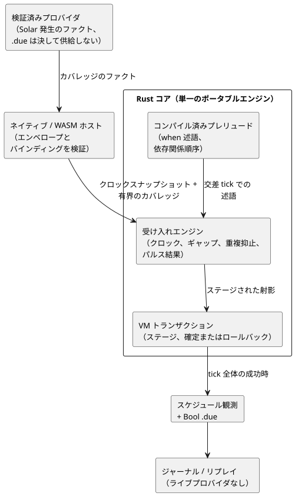
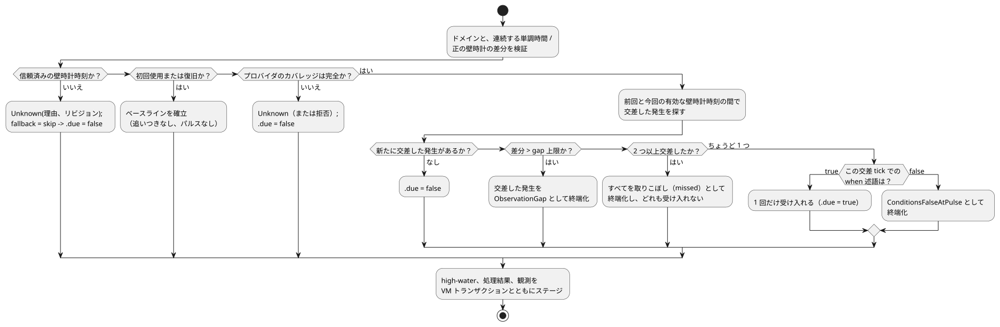

<!-- translation-source: tasks/schedule-pulse-design.md -->
[英語の原文](schedule-pulse-design.md)

# Solar パルススケジュールの受け入れ設計

**ステータス:** アーキテクチャは承認済みです。範囲を限定したネイティブの受け入れスライスは実装済みで、テストされています。GFB/WASM/プロバイダのバインディング、リソースの証明、永続的なリプレイは未完了です。

この設計は、`basis = pulse` の Solar スケジュールが、計画された発生（オカレンス）ごとに 1 回、発火するかどうか（*受け入れ*、アドミッション）をどのように判断するかを定義します。関連文書: [trusted-only クロックゲート](schedule-clock-design.ja.md)（クロックコンポーネント）と[ワイヤー提案](schedule-wire-design.ja.md)。

## 範囲と根拠

[Reference §3.5](../docs/reference/03-time-and-schedules.ja.md) は、スケジュールを型付きのリアクティブな値として定義しています。主な規則は次のとおりです。

- **プロバイダ**は、計画された発生を特定します。**ポータブルな実行**は、受け入れられたスナップショットに基づいて受け入れを判断します。
- 述語が偽となったパルスは終端です。キューに入れられることは決してありません。
- すべての判断は、安定した発生の同一性、そのクロック/プロバイダのコンテキスト、明示的な処理結果（disposition）を保持します。

最初の完全なスライスは、次の条件を持つ Solar です。

- `basis = pulse`
- 作成者が記述した Bool の `when` 述語
- `clock = trusted_only`
- `gap = skip_after(positive constant Duration)`
- `recovery = baseline`
- `fallback = skip`

これは、REF-03-042 と REF-03-045 に必要なソースとランタイムの経路を網羅します。

このスライスの範囲外:

- **Daily** は、その IANA/DST トリガープロバイダが完成するまで拒否されたままです。パーサーだけで受け付けても REF-03-024 は満たされません。
- `window`、`run`、`hold_trusted`、`fixed_time` は、明示的な実装上の未対応部分として残ります。

Reference の契約全体は引き続き必須です。

## 決定事項

### プロバイダのファクトは受け入れの判断ではない

外部の検証済みプロバイダは、明示的にカバーされた区間について、有界かつ完全な Solar 発生の**ファクト**の集合を提供します。`.due` を提供することは決してありません。

各ファクトは次を特定します。

- プロバイダとコンテキストのリビジョン
- ソースのローカル日付
- 安定したソース発生キー
- 計画された壁時計の時刻
- 利用可能であること、または特定の時間コンテキストの故障のいずれか

静的なソースディスクリプタは、スケジュールの同一性、タイムゾーン、位置、日の出/日の入り、オフセットを提供します。アクティベーションプロファイルは、受け入れられたスナップショットごと、およびカバレッジごとのファクト数に上限を設けます。想定されるポーリング周期は、そのような上限には*なりません*。

この分離により、言語は IANA に対応可能な任意のプロバイダに対して開かれたままになります。ポータブルな Rust の Solar 実装と JavaScript の SunCalc アダプタは、それぞれが対応するゾーンについて参照プロバイダとして残すことができます。コンパイラが受け付けることで、言語がそれらの実装に限定されることはありません。アクティベーションでは、互換性のあるプロバイダをバインドしなければなりません。

### 受け入れとクロック状態は Rust が所有する

単一のポータブルな Rust エンジンが次を所有します。

- 信頼済みクロックの検証
- ベースライン/復旧の状態
- 壁時計と単調時間の high-water マーク
- ギャップの処理結果
- 発生の重複排除
- パルスの結果

JavaScript はこの状態機械を重複して持ちません。エンジンは tick（論理判断の単位）の他の部分とともにステージされ、VM の判断全体が成功した後にのみ確定されます。

`ClockSnapshot` は、受け入れられた単調時間に加えて、オプションの壁時計時刻、信頼性、クロックのリビジョン、オプションの不確かさを保持します。

- `trusted_only` は信頼済みの壁時計時刻を必要とします。壁時計時刻が欠落している場合は Unknown のままです。
- 欠落した不確かさは `None` のままで、ゼロに置き換えられることは決してありません。不確かさがないことだけでは、それ以外の点で信頼できる壁時計の時刻が Unknown になることはありません。
- 将来の `hold_trusted` ポリシーは、受け入れられる前に HeldClock の経過時間と不確かさの増加を定義しなければなりません。この最初のスライスでは実装しません。

### プレリュードの順序は依存関係で決まる

*プレリュード*とは、作成者が記述した遷移が実行される前に、状態を持つ射影をステージする tick 内の部分です。作成者が記述した `when` 式は、入力、センサの Result、または他の状態を持つ信号の射影に依存することがあります。将来の時間的な式がスケジュールの射影を利用する可能性もあります。したがって、「スケジュールが先でウィンドウが後」や「ウィンドウが先でスケジュールが後」といった固定の順序は正しくありません。

代わりに、コンパイラは次を行います。

1. 同じ tick 内の、異種混在のプレリュード依存関係グラフを 1 つ構築します。このグラフでは、状態を持つ各ディスクリプタが自身の型付き依存関係を記録します。
2. トポロジカル順序を出力し、循環があればソース位置を付けて拒否します。

スケジュールの述語は、依存関係がステージされた後にのみ、選択された同一 tick の射影を読み取ります。どのディスクリプタも、後のプレリュードスロットを読み取ってはなりません。作成者が記述した遷移と意図は、引き続きプレリュード全体の後に実行されます。

## エンドツーエンドの経路

コンポーネントとその責務を下に示します。プロバイダはファクトを提供するだけで、受け入れを判断して tick とともに確定するのは Rust コアだけです。



### ソースとコンパイラ

Solar は、すべてのトリガーフィールドとすべての共通ポリシーフィールドをちょうど 1 回ずつ受け付けます。

```ghost
schedule dawn: Solar {
  timezone = "Asia/Seoul";
  latitude = 37.5665;
  longitude = 126.9780;
  at = sun`rise + 30min`;
  basis = pulse;
  when = true;
  clock = trusted_only;
  gap = skip_after(60s);
  recovery = baseline;
  fallback = skip;
}
```

コンパイラの規則:

- 日の出/日の入りと、`[-24h, +24h]` の範囲（ゼロを含む）の厳密な整数 Duration オフセットには、現在のタグ付き Solar パーサーを再利用します。
- 共通フィールドを型付きの AST ノードにパースします。
- `when` はプレリュードにコンパイルされる Bool 式です。プロバイダも JavaScript ホストもこれを評価しません。
- 上記の 3 つのサポートされたポリシー形式は、明示的なディスクリプタの値に下位変換されます。
- ポリシーの欠落、重複、不正、または未サポートは、位置付きの診断を生成します。現在ハードコードされている 60 秒、baseline、skip を暗黙に代用してはなりません。

意味ディスクリプタには次が含まれます（バイトレイアウトはまだ規定していません）。

- 安定した宣言サイトと名前
- Solar のトリガーファクト: タイムゾーン、緯度、経度、イベント、オフセット
- ポリシー: pulse、trusted-only、正のギャップのミリ秒数、baseline、skip
- コンパイルされた Bool 述語と、その異種混在のプレリュード依存関係
- プロバイダの要件と、生成されたファクトのバインディング
- 型付きの `.due` 射影の同一性

次の実装ステップでは、有界の GFB ワイヤーを規定し、独立にテストしなければなりません。この文書では、フォーマットのバージョン、フィールド幅、オペコードを選択しません。

### プロバイダとホストの境界

ネイティブホストと WASM ホストは、どちらも同じ検証済みの意味的なファクトを提供します。

- **クロック:** 単調時間、オプションの壁時計時刻、信頼性、クロックのリビジョン、オプションの不確かさ
- **プロバイダのカバレッジ:** 有界の区間と、利用可能/故障のファクトの完全で順序付けられた集合。各ファクトは、安定したソース発生キー、計画された壁時計時刻、ソースのローカル日付、プロバイダのリビジョン、コンテキストのリビジョンを持ちます。

検証は 2 回行われます。ホストはエンベロープとバインディングを検証します。コアは、ステージの前にドメインとディスクリプタ/ファクトの関係を再度検証します。

公開 API の規則:

- 公開の ControlRuntime API は、呼び出し側が計算した Solar の `due` 値ではなく、クロック/プロバイダのファクトを受け付けます。ネイティブのスキャンフィクスチャも同じファクトを使います。
- 既存の DailySlots の due 経路は、それ自体の置き換えが行われるまで残ります。
- プロバイダの欠如や未サポートのコンテキストは、その理由を伴う Unknown になります。通常の `false` にはなりません。
- コアの判断 API は、クロックスナップショットと、プロバイダのファクトの安定した有界のカバレッジ集合を受け付けます。ステージされたスケジュールの射影と観測を返します。時刻を取得したり、プロバイダに問い合わせたり、永続的な Station 台帳（レジャー）を変更したりはしません。

**カバレッジは完全でなければなりません。** ホストは、現在と前日のローカル日付だけを列挙して、それを完全と呼んではなりません。許可されたギャップは、複数の Solar 発生にまたがることがあります。カバレッジの欠落は Unknown であり、発生が存在しなかったことの証明ではありません。

### ポータブルな受け入れ

受け入れられたスナップショットごとに、Rust エンジンは次を行います。

1. 提供されたドメインと、連続する受け入れ済みの単調時間および正の壁時計の差分を検証します。
2. 初回使用時または復旧時にベースラインを確立します。追いつき（catch-up）は行いません。
3. プロバイダのカバレッジが完全であることを検証し、交差したすべての Solar 発生を、プロバイダのリビジョンとは独立に特定します。
4. **直前の有効な壁時計時刻**と**現在の有効な壁時計時刻**の間の各交差を検出します。信頼済みの壁時計 high-water は別物です。これは補正と重複抑止に使われ、交差区間としては使われません。
5. 連続する受け入れ済みの単調時間および正の壁時計の差分に `skip_after` を適用します。作成者が記述した上限より大きく、受け入れと重なる差分は、その発生を `ObservationGap` として終端化します。これが high-water から計算されることは決してありません。
6. コンパイルされた述語を、交差した tick でちょうど評価します。
7. 述語が真の場合は 1 回だけ受け入れ、偽の場合は `ConditionsFalseAtPulse` として終端化します。
8. `.due = false` を射影しつつ、`fallback = skip` を通じて Unknown の理由とリビジョンを保持します。
9. high-water、処理結果、観測を VM トランザクションとともにステージします。

次のフローチャートは、1 つのスケジュールの 1 つの受け入れ済みスナップショットについて、これらのステップをまとめたものです。



不変条件:

- 壁時計の巻き戻りによって、発生が再アームされることは決してありません。
- プロバイダの補正はメタデータを変更しますが、安定した発生の同一性は変更しません。
- 後続の式や意図が失敗した場合、スケジュールの候補はロールバックされます。したがって、同一の受け入れ済みの再試行では、交差がちょうど 1 回だけ見えます。

### 選択された動作: 複数の交差

作成者が記述したギャップの上限が 1 日を超えることを許す場合、1 つの受け入れ済み区間が複数の Solar 発生と交差することがあります。

- 連続する受け入れ済みスキャンの間で、同じスケジュールの新しい発生が **2 つ以上**交差した場合: 新たに交差したすべての発生を取りこぼし（missed）として終端化し、どれも受け入れず、実行もしません。
- 新たに交差した発生が**ちょうど 1 つ**の場合: 通常のパルスの受け入れを続けます。

エンジンとワイヤーは、引き続き有界かつ完全なカバレッジのファクトを運ばなければなりません。どの実装も、スキャン周期から発生のカバレッジを導出してはなりません。

### ネイティブの受け入れスライスの証拠

`crates/ghostflow-core/src/solar_admission.rs` は、1 つのバインドされたスケジュールについて、ステージされ、確定前にクローンされるクロック/終端台帳を所有します。次を検証します。

- ベースライン
- 1 つの交差に対する述語による受け入れ、または終端の偽
- high-water より前の補正の抑止
- 観測ギャップによる終端化
- 複数交差での取りこぼし/実行なし
- 明示的な述語評価
- 古いステージの拒否
- ステージの破棄によるロールバック

限定的なケースは `crates/ghostflow-core/tests/solar_admission.rs` にあります（この文章は当初 7 件と数えていましたが、現在このファイルには 9 件の `#[test]` ケースがあります）。`build/solar-admission-red.log` は最初に欠けていた API を記録し、`build/solar-admission-green7.log` は現在の 9/9 の合格を記録しています。

これは範囲を限定したネイティブの前提条件です。完全なプロバイダのカバレッジ、IANA サポート、ソースの下位変換、GFB/WASM ABI、設定のバインディング、永続的なリプレイを主張するものでは**ありません**。

### ランタイム、トレース、リプレイ

GFB のプレリュードは、型付きの Bool `.due` 射影を生成します。ランタイム、レガシー WASM、フレーム付き WASM、ネイティブの ScanDriver はすべて、同じ Rust の受け入れエンジンを実行します。チェックポイントとリプレイは、クロックの high-water、信頼/復旧の状態、発生の終端記録、厳密なプレリュード依存関係の状態を保持します。

受け入れられた各スキャンは、Bool とは別に、スケジュールの観測を運びます。

- スケジュールのサイト/名前と、検証済みの定義の同一性
- `False | Due | Unknown(reason)`
- `Before`、`PredicateFalse`、`AlreadyAdmitted`、`ConditionsFalseAtPulse`、`ObservationGap` などの処理結果
- 判明している場合は、安定した発生の同一性、計画された壁時計時刻、ソースのローカル日付
- プロバイダ、コンテキスト、クロックのリビジョン
- 選択された述語の依存関係と、フォールバックの射影

リプレイは、ライブのプロバイダを参照せずに、この記録と `.due` を再現しなければなりません。拒否されたスキャンは、ステージされたスケジュールの観測を一切公開しません。

### マニフェスト、ソーストレース、パッケージ

- **マニフェスト:** 厳密なディスクリプタ、プロバイダの要件、生成されたファクトのバインディングを記録します。
- **ソーストレース:** ディスクリプタと `.due` の利用者をスケジュール宣言に結び付け、述語の依存関係をそれぞれの記述ノードに結び付けます。
- **正本の復元:** ディスクリプタの順序、サイト、バインディング、依存関係、バイトコードとの対応を検証します。変更可能なマニフェストの説明文は信頼しません。
- **パッケージ検証器:** JavaScript と Rust の検証器は、同じ厳密なスキーマを要求します。トリガー、ポリシー、プロバイダのバインディング、依存関係、サイト、射影に対する署名付きの改ざんは、ターゲットのローダーが実行される前に失敗しなければなりません。

プロバイダの観測は実行時のファクトのままです。署名付きマニフェストにはコピーされません。

## 破壊的な置き換えの義務

新しい経路がネイティブと両方の WASM アダプタで合格した後:

- Solar v3 のオプトインと `acceptSolar` を削除します。
- 縮小版の Solar ディスクリプタと、Solar が生成する `__gf_schedule_due_*` 入力を削除します。
- 呼び出し側が提供する Solar の due 値を、ControlRuntime とネイティブのスケジュールテープから削除します。DailySlots の due 経路は、それ自体の置き換えが受け入れられるまで残します。
- 受け入れ、high-water、ギャップ、復旧の状態を JavaScript の `SolarSchedule.poll` から削除します。必要であればプロバイダの計算アダプタだけを残します。
- 事前計算された due ビットをリプレイするネイティブ/WASM のパリティ（一致性）テストを、明示的なクロック/プロバイダのファクトと絶対的なスケジュールの観測を使うテストに置き換えます。
- 共通ポリシーフィールドを省略している古い Solar の例とテストを削除します。
- `scheduled-admission.mjs` を、別個の下流デプロイアダプタとして監査します。新しい検証済みのコンパイルされた発生の経路が実際にその契約に取って代わる場合にのみ、再バインドまたは削除します。無関係な DailySlots の受け入れサポートは削除しないでください。
- 下流の永続的な開始調停のために Rust の Station 発生台帳を残し、検証済みの発生の同一性を通じて接続します。

これは 1.0 より前の置き換えです。古いディスクリプタ、ホストによる due の注入、省略形のソース構文のための有効な互換経路はありません。

## 決定的な RED 受け入れテスト

1. REF-03-042 の厳密なケースと REF-03-045 の両方の境界が、1 つの厳格なディスクリプタにコンパイルされます。ポリシーフィールドの欠落や重複、未サポートのポリシー形式は、そのソース位置で拒否されます。
2. `when = false` の Solar 交差は `ConditionsFalseAtPulse` を記録します。後から値が真になっても、その発生がキューに入れられたり再アームされたりすることは決してありません。
3. ギャップの上限と等しい差分は観測可能なままです。それより大きい差分は、交差した発生を `ObservationGap` として終端化します。
4. 欠落した/信頼できない壁時計時刻とプロバイダの故障は、それぞれ異なる Unknown の理由とリビジョンを保持したまま、due を `false` として射影します。復旧はベースラインだけを確立します。
5. 壁時計の巻き戻り、プロバイダのリビジョン変更、重複したファクトによって、受け入れ済みの発生が重複することは決してありません。
6. 後続の VM の算術故障は受け入れをロールバックします。同一のクロック、発生、述語で再試行すると、1 回だけ受け入れ、観測を 1 つ進めます。
7. 先行するウィンドウ/信号に依存する述語は、トポロジカル順序で評価されます。逆方向の依存の循環は拒否されます。宣言の順序は出力を変えません。
8. ネイティブ、レガシー WASM、フレーム付き WASM は、1 つのファクトテープから同じ絶対的な due 値、処理結果、同一性、トレース記録を生成します。チェックポイント、巻き戻し、時間的リプレイはそれらを保持します。
9. すべてのポリシー、プロバイダのバインディング、依存関係、サイトに対する署名付きパッケージの改変は、ローダーが呼び出される前に拒否されます。
10. 古い省略形の Solar 構文、呼び出し側による due の注入、未サポートの Daily、window/run/held-clock のポリシーは、段階的な置き換えの間も拒否されたままです。
11. 新たに交差した Solar ファクトを 2 つ以上またぐギャップは、すべての発生を取りこぼしとして記録し、どれも受け入れず、再試行をまたいで両方の同一性を保持します。対になる単一交差のケースでは、通常のパルスの受け入れが維持されます。不完全なプロバイダのカバレッジは拒否されるか、Unknown のままです。

## 残りのスケジュール作業

- 完全な IANA/DST の欠落/重複のプロバイダファクトを伴う Daily と DailySlots（REF-03-024 と §3.6）。ライブの TimeSlots 設定を含みます。
- Window と Run の受け入れ、キャンセル、単調なアクティブ継続時間
- 明示的な不確かさと HeldClock の来歴（provenance）を伴う `hold_trusted`
- Solar の `fixed_time` 終端フォールバックと、共有のローカル日付の発生台帳
- At、Periodic、Cron、Tide、稼働カレンダー、自然現象プロバイダの補正/撤回の規則
- 永続的なプログラム間の発生の移行、Station との完全な統合、残りの使用量計上（アカウンティング）/リソースの制約

これらはいずれも、Solar パルススライスから既定値や互換性のための近似を受け取りません。
