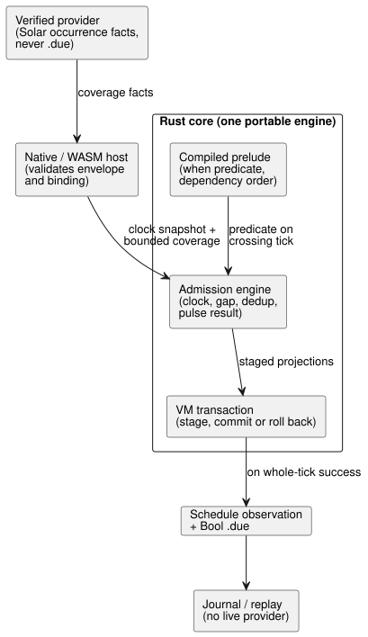
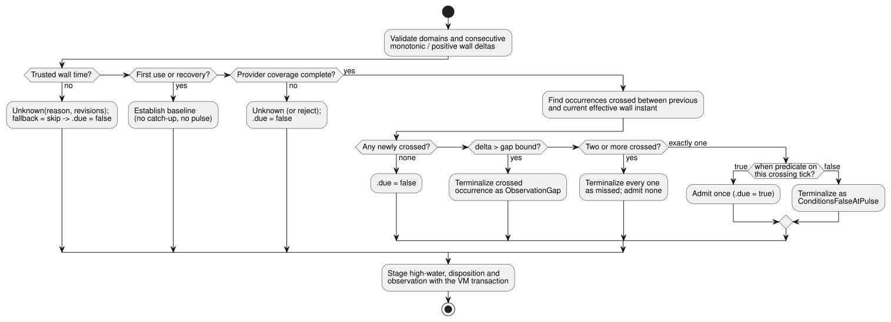

# Solar pulse schedule admission design

**Status:** approved architecture; a bounded native admission slice is
implemented and tested. GFB/WASM/provider binding, resource proof and durable
replay remain pending.

This design defines how a Solar schedule with `basis = pulse` decides, once per
planned occurrence, whether to fire (*admission*). Related documents: the
[trusted-only clock gate](schedule-clock-design.md) (clock component) and the
[wire proposal](schedule-wire-design.md).

## Scope and ground truth

[Reference §3.5](../docs/reference/03-time-and-schedules.md#35-schedule의-공통-의미)
defines schedules as typed reactive values. The key rules are:

- A **provider** identifies a planned occurrence. **Portable execution** decides
  admission on an accepted snapshot.
- A pulse whose predicate fails is terminal. It is never queued.
- Every decision keeps a stable occurrence identity, its clock/provider context
  and an explicit disposition.

The first complete slice is Solar with:

- `basis = pulse`;
- an authored Bool `when` predicate;
- `clock = trusted_only`;
- `gap = skip_after(positive constant Duration)`;
- `recovery = baseline`;
- `fallback = skip`.

It covers the source and runtime path needed by REF-03-042 and REF-03-045.

Out of scope for this slice:

- **Daily** stays rejected until its IANA/DST trigger provider is complete.
  Parser-only acceptance would not satisfy REF-03-024.
- `window`, `run`, `hold_trusted` and `fixed_time` remain explicit
  implementation gaps.

The full Reference contract remains required.

## Decisions

### Provider facts are not admission decisions

An external, verified provider supplies a bounded, complete set of Solar
occurrence **facts** for an explicit covered interval. It never supplies `.due`.

Each fact identifies:

- the provider and context revisions;
- the source local date;
- a stable source occurrence key;
- the planned wall instant;
- either availability or a specific temporal-context fault.

The static source descriptor supplies the schedule identity, timezone, location,
rise/set and offset. An activation profile bounds the number of facts per
accepted snapshot and per coverage. The expected polling cadence is *not* such a
bound.

This separation keeps the language open to any IANA-capable provider. The
portable Rust Solar implementation and the JavaScript SunCalc adapter can remain
reference providers for the zones they support. Compiler acceptance does not
narrow the language to those implementations. Activation must bind a compatible
provider.

### Rust owns admission and clock state

One portable Rust engine owns:

- trusted-clock validation;
- baseline/recovery state;
- wall and monotonic high-water marks;
- gap disposition;
- occurrence deduplication;
- the pulse result.

JavaScript does not duplicate this state machine. The engine is staged with the
rest of a tick and commits only after the complete VM decision succeeds.

`ClockSnapshot` carries the accepted monotonic time plus an optional wall time,
trust, clock revision and optional uncertainty.

- `trusted_only` requires trusted wall time. Missing wall time stays Unknown.
- Missing uncertainty stays `None`; it is never replaced with zero. Its absence
  alone does not make an otherwise trusted wall instant Unknown.
- The future `hold_trusted` policy must define HeldClock age and uncertainty
  growth before it is accepted. This first slice does not implement it.

### Prelude ordering is dependency driven

The *prelude* is the part of a tick that stages stateful projections before
authored transitions run. The authored `when` expression may depend on inputs,
sensor Results or other stateful signal projections. Future temporal expressions
may also consume schedule projections. So a fixed order — "schedules before
windows" or "windows before schedules" — is incorrect.

Instead, the compiler:

1. builds one heterogeneous, same-tick prelude dependency graph, in which each
   stateful descriptor records its typed dependencies;
2. emits a topological order, and rejects a cycle with source locations.

Schedule predicates read the selected same-tick projections only after their
dependencies have been staged. No descriptor may read a later prelude slot.
Authored transitions and intents still run after the whole prelude.

## End-to-end path

The components and their responsibilities are shown below. The provider only
supplies facts; the Rust core alone decides admission and commits it with the
tick.



### Source and compiler

Solar accepts every trigger field and every common-policy field exactly once:

```ghost
schedule dawn: Solar {
  timezone = "Asia/Seoul";
  latitude = 37.5665;
  longitude = 126.9780;
  at = sun`rise + 30min`;
  basis = pulse;
  when = true;
  clock = trusted_only;
  gap = skip_after(60s);
  recovery = baseline;
  fallback = skip;
}
```

Compiler rules:

- Reuse the current tagged Solar parser for rise/set and exact whole Duration
  offsets in `[-24h, +24h]`, including zero.
- Parse the common fields into typed AST nodes.
- `when` is a Bool expression compiled into the prelude. Neither the provider nor
  the JavaScript host evaluates it.
- The three supported policy forms above lower to explicit descriptor values.
- A missing, duplicate, malformed or unsupported policy produces a located
  diagnostic. Do not silently substitute the currently hardcoded 60 seconds,
  baseline or skip.

The semantic descriptor contains the following (no byte layout is prescribed
yet):

- stable declaration site and name;
- Solar trigger facts: timezone, latitude, longitude, event and offset;
- policy: pulse, trusted-only, positive gap milliseconds, baseline and skip;
- the compiled Bool predicate and its heterogeneous prelude dependencies;
- provider requirement and generated fact bindings;
- typed `.due` projection identity.

The next implementation step must specify and independently test the bounded GFB
wire. This document does not select a format version, field widths or opcode.

### Provider and host boundary

Native and WASM hosts both supply the same validated semantic facts:

- **clock:** monotonic time, optional wall time, trust, clock revision and
  optional uncertainty;
- **provider coverage:** a bounded interval and a complete, ordered set of
  availability/fault facts. Each fact has a stable source occurrence key, planned
  wall time, source local date, provider revision and context revision.

Validation happens twice. The host validates the envelope and binding. The core
validates domains and the descriptor/fact relationship again before staging.

Public API rules:

- The public ControlRuntime API accepts clock/provider facts, not a
  caller-computed Solar `due` value. Native scan fixtures use the same facts.
- The existing DailySlots due path remains until its own replacement.
- Provider absence or an unsupported context becomes Unknown with its reason; it
  does not become ordinary `false`.
- The core decision API accepts the clock snapshot plus a stable, bounded
  coverage set of provider facts. It returns staged schedule projections and
  observations. It does not acquire time, query a provider or mutate the durable
  Station ledger.

**Coverage must be complete.** The host must not enumerate only the current and
previous local dates and call that complete. A permitted gap can span more than
one Solar occurrence. Missing coverage is Unknown, not proof that no occurrence
existed.

### Portable admission

For each accepted snapshot, the Rust engine:

1. validates the supplied domains and the consecutive accepted monotonic and
   positive wall deltas;
2. establishes a baseline on first use or on recovery, without catching up;
3. validates complete provider coverage and identifies every crossed Solar
   occurrence independently of provider revision;
4. detects each crossing between the **previous effective wall instant** and the
   **current effective wall instant**. The trusted wall high-water is separate:
   it is used for correction and duplicate suppression, not as the crossing
   interval;
5. applies `skip_after` to consecutive accepted monotonic and positive-wall
   deltas. A delta greater than the authored bound that intersects admission
   terminalizes the occurrence as `ObservationGap`; it is never computed from the
   high-water;
6. evaluates the compiled predicate exactly on the crossing tick;
7. admits once when the predicate is true, or terminalizes a false result as
   `ConditionsFalseAtPulse`;
8. preserves the Unknown reason and revisions through `fallback = skip` while
   projecting `.due = false`;
9. stages the high-water, disposition and observation with the VM transaction.

The flowchart below summarizes these steps for one accepted snapshot of one
schedule.



Invariants:

- Wall rollback never rearms an occurrence.
- Provider correction changes metadata, not the stable occurrence identity.
- If a later expression or intent fails, the schedule candidate rolls back. An
  identical accepted retry therefore sees the crossing exactly once.

### Selected behavior: multiple crossings

If an authored gap bound permits more than a day, one accepted interval can cross
multiple Solar occurrences.

- **Two or more** new occurrences of the same schedule crossed between
  consecutive accepted scans: terminalize every newly crossed occurrence as
  missed, and admit or execute none.
- **Exactly one** newly crossed occurrence: continue through ordinary pulse
  admission.

The engine and the wire must still carry bounded, complete coverage facts. No
implementation may derive occurrence coverage from scan cadence.

### Native admission slice evidence

`crates/ghostflow-core/src/solar_admission.rs` owns a staged,
clone-before-commit clock/terminal ledger for one bound schedule. It verifies:

- baseline;
- predicate admission, or terminal false, for one crossing;
- correction-before-high-water suppression;
- observation-gap terminalization;
- multiple-crossing missed/no-execution;
- explicit predicate evaluation;
- stale-stage rejection;
- rollback by dropping a stage.

The focused cases are in `crates/ghostflow-core/tests/solar_admission.rs` (this
text originally counted seven; the file now holds nine `#[test]` cases).
`build/solar-admission-red.log` records the first missing API, and
`build/solar-admission-green7.log` records the current 9/9 pass.

This is a bounded native prerequisite. It does **not** claim complete provider
coverage, IANA support, source lowering, GFB/WASM ABI, settings binding or
durable replay.

### Runtime, trace and replay

The GFB prelude produces a typed Bool `.due` projection. Runtime, legacy WASM,
framed WASM and the native ScanDriver all execute the same Rust admission
engine. Checkpoint and replay retain the clock high-water, trust/recovery state,
occurrence terminal records and the exact prelude dependency state.

Each accepted scan carries a schedule observation, separate from the Bool:

- schedule site/name and verified definition identity;
- `False | Due | Unknown(reason)`;
- a disposition such as `Before`, `PredicateFalse`, `AlreadyAdmitted`,
  `ConditionsFalseAtPulse` or `ObservationGap`;
- stable occurrence identity, planned wall time and source local date, when
  known;
- provider, context and clock revisions;
- selected predicate dependencies and the fallback projection.

Replay must reproduce this record and `.due` without consulting a live provider.
Rejected scans expose no staged schedule observation.

### Manifest, source trace and packages

- **Manifest:** records the exact descriptor, provider requirement and generated
  fact bindings.
- **Source trace:** binds the descriptor and the `.due` consumers to the schedule
  declaration, and binds predicate dependencies to their authored nodes.
- **Canonical restore:** verifies descriptor order, sites, bindings,
  dependencies and bytecode correspondence. It does not trust mutable manifest
  prose.
- **Package validators:** the JavaScript and Rust validators require the same
  exact schema. Signed tampering with a trigger, policy, provider binding,
  dependency, site or projection must fail before the target loader runs.

Provider observations remain runtime facts. They are not copied into the signed
manifest.

## Breaking replacement obligations

After the new path passes on native and on both WASM adapters:

- remove the Solar v3 opt-in and `acceptSolar`;
- remove reduced Solar descriptors and the Solar-generated
  `__gf_schedule_due_*` inputs;
- remove caller-supplied Solar due values from ControlRuntime and from native
  schedule tapes. Retain the DailySlots due path until its own replacement is
  accepted;
- remove admission, high-water, gap and recovery state from JavaScript
  `SolarSchedule.poll`; keep only a provider calculation adapter if needed;
- replace native/WASM parity tests that replay precomputed due bits with tests
  that use explicit clock/provider facts and absolute schedule observations;
- remove old Solar examples and tests that omit the common policy fields;
- audit `scheduled-admission.mjs` as the separate downstream deployment adapter.
  Rebind or remove it only if the new verified compiled occurrence path actually
  supersedes that contract; do not delete unrelated DailySlots admission support;
- retain the Rust Station occurrence ledger for downstream durable start
  arbitration, connected through the verified occurrence identity.

This is a pre-1.0 replacement. There is no active compatibility route for the
old descriptor, host due injection or the abbreviated source syntax.

## Decisive RED acceptance tests

1. The exact REF-03-042 case and both REF-03-045 boundaries compile to one strict
   descriptor. Missing or duplicate policy fields and unsupported policy forms
   are rejected at their source locations.
2. A Solar crossing with `when = false` records `ConditionsFalseAtPulse`. A later
   true value never queues or rearms that occurrence.
3. A delta equal to the gap bound remains observable. A delta greater than it
   terminalizes the crossed occurrence as `ObservationGap`.
4. Missing/untrusted wall time and provider faults project due `false` while
   keeping their distinct Unknown reason and revisions. Recovery establishes only
   a baseline.
5. Wall rollback, a provider revision change and duplicate facts never duplicate
   an admitted occurrence.
6. A later VM arithmetic fault rolls back admission. Retrying the identical
   clock, occurrence and predicate admits once and advances one observation.
7. A predicate that depends on a prior window/signal evaluates in topological
   order; a reverse dependency cycle is rejected. Declaration order does not
   change the output.
8. Native, legacy WASM and framed WASM produce the same absolute due values,
   dispositions, identities and trace records from one fact tape. Checkpoint,
   rewind and temporal replay preserve them.
9. Signed package mutations of every policy, provider binding, dependency and
   site are rejected before the loader is invoked.
10. Old abbreviated Solar syntax, caller due injection and unsupported Daily,
    window/run/held-clock policies remain rejected during the staged replacement.
11. A gap spanning at least two newly crossed Solar facts records every
    occurrence as missed, admits none, and preserves both identities across
    retry. A paired single-crossing case keeps ordinary pulse admission.
    Incomplete provider coverage is rejected or remains Unknown.

## Remaining schedule work

- Daily and DailySlots with complete IANA/DST missing/repeated provider facts
  (REF-03-024 and §3.6), including live TimeSlots settings;
- Window and Run admission, cancellation and monotonic active duration;
- `hold_trusted` with explicit uncertainty and HeldClock provenance;
- Solar `fixed_time` terminal fallback and a shared local-date occurrence ledger;
- At, Periodic, Cron, Tide, work calendars and natural-provider correction/
  withdrawal rules;
- durable cross-program occurrence migration, full Station integration and the
  remaining accounting/resource constraints.

None of these receive a default or a compatibility approximation from the Solar
pulse slice.
