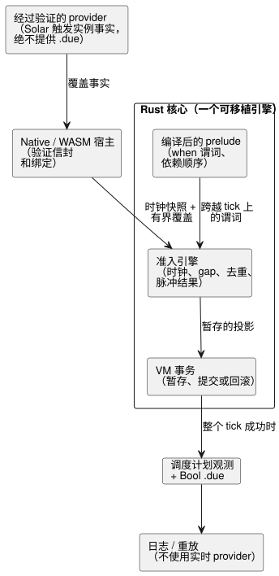
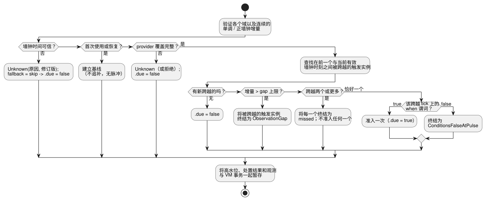

<!-- translation-source: tasks/schedule-pulse-design.md -->
[英文原文](schedule-pulse-design.md)

# Solar 脉冲调度计划准入设计

**状态：** 架构已批准；一个有界的 native 准入切片已实现并测试。GFB/WASM/provider 绑定、资源证明和持久重放仍待完成。

本设计定义 `basis = pulse` 的 Solar 调度计划如何针对每个计划中的触发实例（occurrence）只做一次是否触发的决定（即*准入*，admission）。相关文档：[仅信任时钟门](schedule-clock-design.zh.md)（时钟组件）以及[线路格式提案](schedule-wire-design.zh.md)。

## 范围与基本事实

[语言参考 §3.5](../docs/reference/03-time-and-schedules.zh.md#35-调度计划的通用语义) 将调度计划定义为带类型的响应式值。关键规则如下：

- **provider** 标识一个计划中的触发实例。**可移植执行**在一个已接受的快照上决定准入。
- 谓词失败的脉冲即为终结状态。它绝不会被排队。
- 每一个决定都保留稳定的触发实例身份标识、其时钟/provider 上下文，以及一个显式的处置结果（disposition）。

第一个完整切片是具有以下特征的 Solar：

- `basis = pulse`；
- 作者编写的 Bool `when` 谓词；
- `clock = trusted_only`；
- `gap = skip_after(positive constant Duration)`；
- `recovery = baseline`；
- `fallback = skip`。

它覆盖 REF-03-042 和 REF-03-045 所需的源代码与运行时路径。

本切片范围之外：

- 在其 IANA/DST 触发 provider 完成之前，**Daily** 仍被拒绝。仅在解析器层面接受不能满足 REF-03-024。
- `window`、`run`、`hold_trusted` 和 `fixed_time` 仍是显式的实现缺口。

完整的语言参考契约仍然是必需的。

## 决策

### Provider 事实不是准入决定

一个经过验证的外部 provider 为某个显式覆盖的区间提供一组有界且完整的 Solar 触发实例**事实**。它绝不提供 `.due`。

每条事实标识：

- provider 修订版与上下文修订版；
- 来源本地日期；
- 稳定的来源触发实例键；
- 计划的墙钟时刻；
- 可用性，或某个具体的时间上下文故障。

静态源描述符提供调度计划身份标识、时区、位置、日出/日落以及偏移量。激活 profile 对每个已接受快照以及每次覆盖中的事实数量设定上限。预期的轮询节奏*不是*这样的上限。

这种分离使语言对任何支持 IANA 的 provider 保持开放。可移植的 Rust Solar 实现和 JavaScript SunCalc 适配器可以继续作为其所支持时区的参考 provider。编译器的接受并不会把语言局限于这些实现。激活时必须绑定一个兼容的 provider。

### Rust 拥有准入与时钟状态

一个可移植的 Rust 引擎负责：

- 可信时钟验证；
- 基线/恢复状态；
- 墙钟与单调高水位；
- gap 处置；
- 触发实例去重；
- 脉冲结果。

JavaScript 不重复实现这个状态机。该引擎与 tick 的其余部分一起暂存，只有在完整的 VM 判定成功之后才提交。

`ClockSnapshot` 携带已接受的单调时间，以及可选的墙钟时间、信任状态、时钟修订版和可选的不确定度。

- `trusted_only` 要求可信的墙钟时间。缺失的墙钟时间保持为 Unknown。
- 缺失的不确定度保持为 `None`；绝不会被替换为零。仅凭它的缺失不会使一个原本可信的墙钟时刻变为 Unknown。
- 未来的 `hold_trusted` 策略在被接受之前，必须定义 HeldClock 的时长和不确定度增长。第一个切片不实现它。

### Prelude 顺序由依赖驱动

*prelude* 是 tick 中在作者编写的转换运行之前暂存有状态投影的部分。作者编写的 `when` 表达式可能依赖输入、传感器 Result 或其他有状态信号投影。未来的时间表达式也可能使用调度计划投影。因此，固定顺序——“先调度计划后窗口”或“先窗口后调度计划”——是不正确的。

取而代之，编译器：

1. 构建一张异构的、同一 tick 的 prelude 依赖图，其中每个有状态描述符都记录其带类型的依赖；
2. 输出拓扑顺序，并在出现环时附带源位置予以拒绝。

调度计划谓词只有在其依赖已经暂存之后，才会读取所选的同一 tick 投影。任何描述符都不得读取更靠后的 prelude 槽位。作者编写的转换和意图仍在整个 prelude 之后运行。

## 端到端路径

下图展示各组件及其职责。provider 只提供事实；只有 Rust 核心决定准入，并将其随 tick 一起提交。



### 源代码与编译器

Solar 恰好各接受一次所有触发字段和所有通用策略字段：

```ghost
schedule dawn: Solar {
  timezone = "Asia/Seoul";
  latitude = 37.5665;
  longitude = 126.9780;
  at = sun`rise + 30min`;
  basis = pulse;
  when = true;
  clock = trusted_only;
  gap = skip_after(60s);
  recovery = baseline;
  fallback = skip;
}
```

编译器规则：

- 复用当前带标签的 Solar 解析器，处理日出/日落以及位于 `[-24h, +24h]`（含零）范围内的精确整数 Duration 偏移。
- 将通用字段解析为带类型的 AST 节点。
- `when` 是编译进 prelude 的 Bool 表达式。provider 和 JavaScript 宿主都不对其求值。
- 上述三种受支持的策略形式降级为显式的描述符值。
- 缺失、重复、格式错误或不受支持的策略会产生带位置的诊断。不得静默地替换为当前硬编码的 60 秒、baseline 或 skip。

语义描述符包含以下内容（尚未规定字节布局）：

- 稳定的声明 site 和名称；
- Solar 触发事实：时区、纬度、经度、事件和偏移；
- 策略：pulse、trusted-only、正的 gap 毫秒数、baseline 和 skip；
- 编译后的 Bool 谓词及其异构 prelude 依赖；
- provider 要求和生成的事实绑定；
- 带类型的 `.due` 投影身份标识。

下一个实现步骤必须规定有界的 GFB 线路格式并对其进行独立测试。本文不选择格式版本、字段宽度或操作码。

### Provider 与宿主边界

Native 和 WASM 宿主都提供相同的、经过验证的语义事实：

- **时钟：** 单调时间、可选的墙钟时间、信任状态、时钟修订版和可选的不确定度；
- **provider 覆盖：** 一个有界区间，以及一组完整、有序的可用性/故障事实。每条事实具有稳定的来源触发实例键、计划的墙钟时间、来源本地日期、provider 修订版和上下文修订版。

验证进行两次。宿主验证信封和绑定。核心在暂存之前再次验证各个域以及描述符与事实的关系。

公共 API 规则：

- 公共 ControlRuntime API 接受时钟/provider 事实，而不是调用方计算出的 Solar `due` 值。Native 扫描 fixture 使用相同的事实。
- 现有的 DailySlots due 路径在其自身被替换之前保持不变。
- provider 缺失或不受支持的上下文会变为带原因的 Unknown；它不会变成普通的 `false`。
- 核心判定 API 接受时钟快照以及一组稳定、有界的 provider 事实覆盖集。它返回已暂存的调度计划投影和观测。它不获取时间、不查询 provider，也不修改持久的 Station 账本。

**覆盖必须完整。** 宿主不得只枚举当前和前一个本地日期并将其称为完整。允许的间隙可能跨越不止一个 Solar 触发实例。缺失的覆盖是 Unknown，而不是不存在触发实例的证明。

### 可移植准入

对于每个已接受的快照，Rust 引擎：

1. 验证所提供的域，以及连续已接受的单调增量和正的墙钟增量；
2. 首次使用或恢复时建立基线，不进行追补；
3. 验证完整的 provider 覆盖，并独立于 provider 修订版识别每一个被跨越的 Solar 触发实例；
4. 检测**前一个有效墙钟时刻**与**当前有效墙钟时刻**之间的每一次跨越。可信墙钟高水位是独立的：它用于校正和重复抑制，而不用作跨越区间；
5. 对连续已接受的单调增量和正墙钟增量应用 `skip_after`。大于作者设定上限且与准入相交的增量会将该触发实例终结为 `ObservationGap`；它绝不根据高水位计算；
6. 恰好在跨越发生的 tick 上对编译后的谓词求值；
7. 谓词为真时准入一次，或将假结果终结为 `ConditionsFalseAtPulse`；
8. 在投影 `.due = false` 的同时，通过 `fallback = skip` 保留 Unknown 原因和修订版；
9. 将高水位、处置结果和观测与 VM 事务一起暂存。

下面的流程图针对单个调度计划的一个已接受快照总结了这些步骤。



不变量：

- 墙钟回拨绝不会重新激活一个触发实例。
- provider 校正改变的是元数据，而不是稳定的触发实例身份标识。
- 如果后续某个表达式或意图失败，调度计划候选会回滚。因此，完全相同的已接受重试恰好只看到一次跨越。

### 选定的行为：多次跨越

如果作者设定的 gap 上限允许超过一天，一个已接受区间就可能跨越多个 Solar 触发实例。

- 在连续的已接受扫描之间，同一调度计划有**两个或更多**新的触发实例被跨越：将每一个新跨越的触发实例终结为 missed（错过），并且不准入、不执行任何一个。
- **恰好一个**新跨越的触发实例：继续进行普通的脉冲准入。

引擎和线路格式仍必须携带有界且完整的覆盖事实。任何实现都不得根据扫描节奏推导触发实例覆盖。

### Native 准入切片证据

`crates/ghostflow-core/src/solar_admission.rs` 为单个已绑定调度计划拥有一个暂存的、提交前先克隆的时钟/终结账本。它验证：

- 基线；
- 单次跨越的谓词准入或终结为 false；
- 在高水位之前进行校正时的抑制；
- 观测间隙终结；
- 多次跨越时记为 missed 且不执行；
- 显式的谓词求值；
- 拒绝陈旧的暂存；
- 通过丢弃暂存实现回滚。

聚焦用例位于 `crates/ghostflow-core/tests/solar_admission.rs`（本文最初统计为七个；该文件现有九个 `#[test]` 用例）。`build/solar-admission-red.log` 记录了最初缺失的 API，`build/solar-admission-green7.log` 记录了当前 9/9 通过的结果。

这是一个有界的 native 先决条件。它**不**声称完成了完整的 provider 覆盖、IANA 支持、源降级、GFB/WASM ABI、设置绑定或持久重放。

### 运行时、追踪与重放

GFB prelude 产生一个带类型的 Bool `.due` 投影。Runtime、旧版 WASM、framed WASM 和 native ScanDriver 都执行同一个 Rust 准入引擎。检查点和重放保留时钟高水位、信任/恢复状态、触发实例终结记录以及精确的 prelude 依赖状态。

每次已接受的扫描都携带一条与 Bool 分开的调度计划观测：

- 调度计划 site/名称以及经过验证的定义身份标识；
- `False | Due | Unknown(reason)`；
- 处置结果，例如 `Before`、`PredicateFalse`、`AlreadyAdmitted`、`ConditionsFalseAtPulse` 或 `ObservationGap`；
- 已知时的稳定触发实例身份标识、计划墙钟时间和来源本地日期；
- provider、上下文和时钟修订版；
- 所选的谓词依赖以及 fallback 投影。

重放必须在不查询实时 provider 的情况下复现这条记录和 `.due`。被拒绝的扫描不公开任何已暂存的调度计划观测。

### 清单、源追踪与包

- **清单（manifest）：** 记录精确的描述符、provider 要求和生成的事实绑定。
- **源追踪：** 将描述符和 `.due` 的使用方绑定到调度计划声明，并将谓词依赖绑定到其作者编写的节点。
- **规范恢复：** 验证描述符顺序、site、绑定、依赖以及与字节码的对应关系。它不信任可变的清单描述文字。
- **包验证器：** JavaScript 和 Rust 验证器要求相同的精确 schema。对触发、策略、provider 绑定、依赖、site 或投影的签名篡改必须在目标加载器运行之前失败。

Provider 观测仍是运行时事实。它们不会被复制到签名清单中。

## 破坏性替换义务

在新路径于 native 和两个 WASM 适配器上都通过之后：

- 移除 Solar v3 opt-in 和 `acceptSolar`；
- 移除精简的 Solar 描述符以及 Solar 生成的 `__gf_schedule_due_*` 输入；
- 从 ControlRuntime 和 native 调度计划 tape 中移除调用方提供的 Solar due 值。在 DailySlots due 路径自身的替换被接受之前保留它；
- 从 JavaScript `SolarSchedule.poll` 中移除准入、高水位、gap 和恢复状态；如有需要，只保留 provider 计算适配器；
- 将重放预先计算的 due 位的 native/WASM 一致性测试，替换为使用显式时钟/provider 事实和绝对调度计划观测的测试；
- 移除省略通用策略字段的旧 Solar 示例和测试；
- 将 `scheduled-admission.mjs` 作为独立的下游部署适配器进行审计。只有当新的、经过验证的编译后触发实例路径确实取代了该契约时，才重新绑定或移除它；不要删除无关的 DailySlots 准入支持；
- 保留 Rust Station 触发实例账本，用于下游的持久启动仲裁，并通过经过验证的触发实例身份标识与之连接。

这是 1.0 之前的替换。对于旧描述符、宿主 due 注入或缩写源语法，不存在有效的兼容路径。

## 决定性的 RED 验收测试

1. 精确的 REF-03-042 用例和两个 REF-03-045 边界都编译为同一个严格描述符。缺失或重复的策略字段以及不受支持的策略形式在其源位置被拒绝。
2. `when = false` 的 Solar 跨越记录 `ConditionsFalseAtPulse`。之后出现的真值绝不会将该触发实例排队或重新激活。
3. 等于 gap 上限的增量仍然可观测。大于它的增量会将被跨越的触发实例终结为 `ObservationGap`。
4. 缺失/不可信的墙钟时间以及 provider 故障投影 due 为 `false`，同时保留各自不同的 Unknown 原因和修订版。恢复只建立基线。
5. 墙钟回拨、provider 修订版变化和重复事实绝不会重复已准入的触发实例。
6. 后续的 VM 算术故障会回滚准入。用完全相同的时钟、触发实例和谓词重试时只准入一次，并推进一条观测。
7. 依赖先前窗口/信号的谓词按拓扑顺序求值；反向依赖环被拒绝。声明顺序不改变输出。
8. Native、旧版 WASM 和 framed WASM 从同一条事实 tape 产生相同的绝对 due 值、处置结果、身份标识和追踪记录。检查点、倒带和时间重放会保留它们。
9. 针对每一个策略、provider 绑定、依赖和 site 的签名包篡改，都在调用加载器之前被拒绝。
10. 在分阶段替换期间，旧的缩写 Solar 语法、调用方 due 注入以及不受支持的 Daily、window/run/held-clock 策略仍被拒绝。
11. 跨越至少两条新跨越 Solar 事实的间隙会把每个触发实例记录为 missed，不准入任何一个，并在重试时保留两个身份标识。配对的单次跨越用例保持普通的脉冲准入。不完整的 provider 覆盖会被拒绝或保持为 Unknown。

## 剩余的调度计划工作

- 具有完整 IANA/DST 缺失/重复 provider 事实的 Daily 和 DailySlots（REF-03-024 和 §3.6），包括实时 TimeSlots 设置；
- Window 和 Run 的准入、取消和单调活动持续时间；
- 带显式不确定度和 HeldClock 来源（provenance）的 `hold_trusted`；
- Solar `fixed_time` 终结 fallback 以及共享的本地日期触发实例账本；
- At、Periodic、Cron、Tide、工作日历以及自然 provider 的校正/撤回规则；
- 持久的跨程序触发实例迁移、完整的 Station 集成以及其余的用量核算/资源约束。

以上各项都不会从 Solar 脉冲切片获得默认值或兼容性近似。
