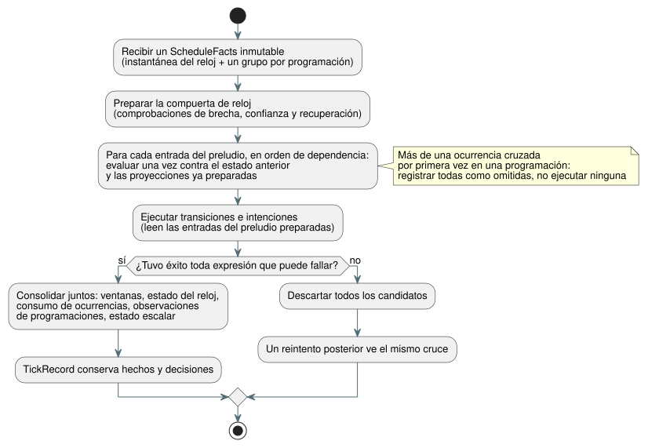

<!-- translation-source: tasks/schedule-wire-design.md -->
[Original en inglés](schedule-wire-design.md)

# Propuesta de formato de cable (wire) de programaciones y preludio transaccional

**Estado: borrador para revisión de root.**

Esta propuesta define cómo viajan las programaciones (schedules) en el formato
de bytecode GFB5 (el "wire" o formato de cable), qué hechos por escaneo
proporciona un host y cómo un tick (paso de decisión lógica) admite una
ocurrencia de programación como una única transacción.

**Avance hasta ahora:**

- El **corte estructural** de GFB5 **está completo**. Estas suites pasaron:
  core 160, native 12, encoder 8 más 44 afectadas, browser 3, native
  multilenguaje 4 y catalog 5.
- **Aún pendiente:** lowering canónico, ejecución de programaciones,
  proveedores, contabilización de recursos y reproducción (replay).
- **No definitivo:** la vinculación de identidad (§3) y la geometría de
  recursos (§5) que se describen abajo aún no están aprobadas.
- **Fijado por la Referencia §3.5:** el comportamiento ante cruces múltiples.
  Cuando un escaneo cruza por primera vez varias ocurrencias, se registran todas
  como omitidas y no se ejecuta ninguna.

**Lo que root ha aprobado.** Root aprobó el diseño ejecutable de §2 para una
implementación estructural por etapas:

- El primer cambio agrega solo el codificador interno y el cargador/verificador
  portable. El lowering de la fuente canónica y la ejecución de programaciones
  siguen pendientes.
- Un módulo de formato 5 requiere al menos una programación. La compilación que
  solo contiene ventanas mantiene el formato 4.
- Hasta que exista la ruta de ejecución, toda ruta de activación debe rechazar
  los módulos con programaciones con `schedule activation requires runtime bindings`.
  Nunca debe sustituirlo por un valor `.due` falso.

**Evidencia:** `build/schedule-core-green.log`, `build/gfb5-encoder-affected.log`,
`build/gfb5-browser-green.log`, `build/gfb5-native-green.log` y
`build/gfb5-catalog.log`. `docs/GFB5-SCHEDULE-PRELUDE.md` registra el corte de
wire aprobado.

**Fuentes de verdad:** [Referencia §3](../docs/reference/03-time-and-schedules.es.md),
el [diseño de pulse](schedule-pulse-design.es.md) y el
[contrato GFB4](window-gfb4-design.es.md) existente.

**En este documento:** §1 alcance del primer corte de ejecución · §2 diseño de
bytes de GFB5 · §3 vinculación de identidad (requiere aprobación) · §4 hechos
por escaneo y ABI · §5 transacción, reproducción y recursos · §6 responsables y
primeras pruebas.

## 1. Primer corte de ejecución

El primer corte cubre exactamente esta combinación:

- Solar, `pulse`;
- un `when` Bool escrito por el autor;
- `trusted_only`;
- un `skip_after(Duration)` explícito y positivo;
- `baseline`;
- `fallback = skip`.

Las responsabilidades se reparten así:

| Componente | Responsable de |
| --- | --- |
| Rust | Consume los hechos de ocurrencias planificadas. Es responsable de la validación del reloj, los cruces, la evaluación de predicados, la disposición y la consolidación (commit). |
| Proveedores | Mantienen la conversión de zonas horarias IANA y el cálculo Solar. Ningún proveedor suministra `.due`. |

El auxiliar Solar nativo solo admite un subconjunto UTC/Seúl. Ese subconjunto
no puede restringir el soporte IANA del lenguaje.

**Trabajo requerido aparte** (fuera de este corte): `window`, `run`, reloj
retenido, respaldo (fallback) de hora fija, planificación Daily/IANA-DST y
migración del libro mayor (ledger) de ocurrencias duradero.

El wire debe representar el conjunto completo y acotado de cruces. Cuando una
programación tiene varias ocurrencias cruzadas por primera vez, todas se
registran como omitidas y ninguna se ejecuta.

## 2. Diseño de bytes propuesto para GFB5

**Reglas generales:**

- Todos los enteros son little endian.
- Las cadenas y los blobs de expresiones reutilizan los prefijos de longitud y
  los límites existentes de GFB.
- GFB5 conserva las secciones de módulo/entrada/estado de GFB4 y el encabezado
  de reloj/raíz.
- Los módulos que solo contienen programaciones pueden tener cero raíces
  físicas.
- Se requiere al menos una entrada de preludio con estado.

**Preludio.** Cada estrategia reemplaza la lista de ventanas de GFB4 por
`u16 preludeCount`. Le siguen entradas etiquetadas en orden de dependencia y
luego las transiciones e intenciones existentes:

| Etiqueta de entrada | Cuerpo |
| --- | --- |
| `0` | Descriptor de ventana de GFB4 existente, idéntico |
| `1` | Descriptor de pulse Solar, descrito abajo |

Cuerpo Solar propuesto, en orden de bytes:

```
u32 site
string name
string timezone
f64 latitude
f64 longitude
u8 event                 // 0 rise, 1 set
i64 offsetMs             // whole milliseconds, -24h..+24h
u8 basis                 // 0 pulse
u8 clockPolicy           // 0 trusted_only
u8 recovery              // 0 baseline
u8 fallback              // 0 skip
u64 gapMs                // 1..9007199254740991
blob when                // exactly one Bool result
```

Las coordenadas deben ser finitas y permanecer dentro de sus dominios de fuente
existentes. Los bytes de política son explícitos; nunca son valores
predeterminados. Las demás políticas del lenguaje simplemente no están
implementadas en este corte. No son formas del lenguaje permanentemente
inválidas.

**Slots y opcodes.**

- Los slots de ventana y los slots de programación son índices densos
  separados. Cada uno se asigna a medida que se decodifican las entradas de ese
  tipo.
- El opcode 57 conserva su espacio de nombres de ventanas existente.
- El opcode 58 propuesto es `[58, u16 scheduleSlot, u8 field]`. El campo `0`
  devuelve el Bool `.due`. Cualquier otro campo se rechaza.
- Dentro de una estrategia, los sites y los nombres son únicos entre ambos
  tipos del preludio heterogéneo. Estrategias distintas pueden referirse a la
  misma declaración de fuente, como en el perfil de ventanas existente.

**Visibilidad y orden.**

- El verificador expone solo las entradas que preceden al descriptor actual.
  Así, una fuente de ventana puede leer una programación anterior, y un
  predicado de programación puede leer una ventana anterior.
- El compilador ordena topológicamente el grafo combinado e informa los ciclos
  con diagnósticos ubicados.
- La verificación de marcadores/raíces de evidencia de ventanas no cambia.
- Las transiciones e intenciones pueden leer todas las entradas de preludio
  preparadas (staged).
- Todas las lecturas ordinarias de estado siguen observando el estado escrito
  anterior. No existe una consulta `next` preparada.

**Límites y compatibilidad.**

- Por estrategia, se mantiene `scalar state count + prelude count <= 128`. Los
  techos de entrada, pila, expresiones y módulo no cambian. Esto amplía el
  presupuesto actual de entradas con estado; no agrega una cuota de
  programaciones no relacionada.
- El formato 5 requiere actualizaciones coordinadas del decodificador, el
  codificador, el paquete, el host, los fixtures y los goldens.
- Los formatos 1–4 siguen siendo perfiles vigentes dondequiera que el
  compilador aún los emita.
- Una vez aceptado esto, se elimina la ruta de ejecución Solar con due externo
  que queda reemplazada.

## 3. Vinculación de identidad que requiere aprobación

La identidad de una declaración ejecutable y la identidad de un artefacto
verificado son cosas distintas:

| Identidad | Significado |
| --- | --- |
| `site` | Identidad de nodo/proyección de fuente local al artefacto. Nunca es una clave duradera. |
| `name` | El nombre semántico de la declaración local que se transporta en GFB. |
| SHA exacto de la fuente y `documentId`/`revisionId` externos | Metadatos verificados del artefacto de activación. Nunca son campos de los bytes GFB ejecutables. |

**Clave de ocurrencia.** La clave combina:

1. un espacio de nombres de declaraciones estable vinculado a la activación,
2. la declaración local,
3. la fecha local de origen, y
4. el tipo de evento.

Una revisión del proveedor o una marca de tiempo planificada corregida no crea
una nueva ocurrencia. La revisión exacta de la fuente es procedencia
explicativa; no forma parte de la clave de ocurrencia estable. El SHA de la
fuente, el SHA del bytecode y la huella u64 no criptográfica del Runtime siguen
siendo tres valores distintos. Esta propuesta no introduce ningún hash
criptográfico adicional ni ningún ID de fuente fabricado.

**De dónde obtiene la activación la vinculación.** La activación la toma de los
`sourceDocument` y `traceMetadata` existentes de `tools/compile-source.mjs`. Las
comprobaciones del mapa canónico de la cadena de herramientas y la frontera de
artefacto/paquete verificado la validan.

- Un cambio solo en comentarios o en prosa debe conservar la identidad de GFB y
  de los nodos, mientras cambia la identidad de la fuente. La Referencia §1 y la
  prueba de revisión solo de comentarios en `tests/toolchain.test.mjs` lo
  exigen.
- Un hecho de proveedor no puede establecer ni anular la vinculación.
- Cargar GFB en bruto solo demuestra la estructura del bytecode. No autentica
  la identidad de la fuente.
- La validación nativa de paquetes firmados (firma, digest, metadatos) no
  implica que el código nativo haya recompilado la fuente canónica. Esta
  propuesta no tiene un compilador de fuentes nativo.

**Sin resolver:** el espacio de nombres de declaraciones estable exacto
vinculado a la activación y sus reglas para instancias de documento/importación.
Un par control/nombre por sí solo es insuficiente cuando documentos instalados
distintos comparten esos nombres. Reutilice la frontera de identidad de
instalación/fuente verificada. Ningún identificador de proveedor opaco y sin
comprobar puede entrar en GFB como sustituto. La migración duradera del libro
mayor entre revisiones sigue siendo un contrato aparte.

## 4. Propuesta de hechos tipados por escaneo y ABI

Puntos de entrada nativos:

```
Runtime::tick_with_schedule(&ScheduleFacts)
ScanDriver::scan_with_schedule(ScanFrameV1, &ScheduleFacts)
```

**El objeto de hechos.** El objeto de hechos inmutable contiene una
instantánea del reloj y grupos por site ordenados por site, con exactamente un
grupo por programación seleccionada.

- **Reloj:** época de arranque/tiempo, milisegundos monotónicos, milisegundos de
  pared opcionales, confianza, incertidumbre opcional y revisión opcional de la
  fuente del reloj. La incertidumbre faltante permanece ausente.
- **Grupo:** ID/revisión del proveedor y revisión de zona/contexto, vinculados
  a la capacidad (capability) del proveedor instalado. Un grupo contiene o bien
  una razón Unknown tipada, o bien un intervalo de pared cubierto explícito más
  una lista completa y ordenada de fechas de origen.
- **Fila de fecha:** un instante de pared del evento, o una razón tipada de no
  disponibilidad.

Rust suma el desplazamiento compilado y valida los límites de DateTime. Una
fila de fecha conserva su fecha de origen incluso cuando el desplazamiento cruza
la medianoche. El contexto de hora local planificada puede acompañar la
evidencia del proveedor, pero nunca reemplaza la clave estable de fecha de
origen.

**Encuadre del paquete.** El paquete propuesto es `GFSC`, `u16 version=1`,
luego el reloj y luego `u16 groupCount`.

- Los escalares usan los dominios canónicos actuales de día de época,
  milisegundo de época y entero seguro.
- Las etiquetas de presencia/estado marcan los campos opcionales. No hay una
  hora de pared centinela.
- Las cadenas y filas con prefijo de longitud deben caber en el presupuesto
  explícito de hechos.
- La codificación exacta de filas/estados sigue a la revisión del contrato de
  cobertura del proveedor. Este borrador no la fija de forma implícita.

**Cobertura.** La cobertura debe incluir cada fecha de origen elegible para el
intervalo y el desplazamiento solicitados. La validación estructural puede
demostrar que las filas son consecutivas, están dentro de los límites y no
tienen claves duplicadas. No puede demostrar que un proveedor IANA o
astronómico externo haya dicho la verdad; esa es la frontera de capacidad del
driver verificado. Enumerar solo la fecha actual y la anterior no constituye
una cobertura completa para brechas arbitrarias escritas por el autor.

**Exportaciones.** Exportaciones propuestas, que conservan las llamadas
existentes sin programaciones:

```
gf_tick_schedule(handle, factsPtr, factsLen) -> 1|0
gf_frame_scan_schedule(handle, scanId, logicalTimeMs,
                       inputPtr, inputLen, factsPtr, factsLen) -> 1|0
```

**Reglas de ABI:**

- El tiempo monotónico del reloj debe ser igual al tiempo lógico encuadrado y a
  la vinculación now generada de la VM.
- Los módulos que requieren programaciones rechazan un tick/escaneo ordinario
  sin hechos. No hay respaldo con hechos en caché.
- Ambas ABI comparten un único decodificador de paquetes en Rust.
- Las entradas encuadradas más el sobre de hechos deben caber juntas dentro del
  límite de transporte existente de 64 KiB.
- Las llamadas directas nativas aplican la misma geometría de recursos
  activada. No deben aceptar un Vec ilimitado solo porque omiten el
  decodificador de paquetes.

## 5. Transacción, reproducción y prueba de recursos

**Compuerta de reloj.** Una compuerta de reloj preparada comprueba las brechas
usando valores de pared/monotónicos aceptados consecutivos. La marca de agua
máxima de pared confiable se registra por separado.

- Un delta positivo **mayor que** la brecha escrita por el autor rechaza la
  admisión; un delta **igual a** la brecha no la rechaza.
- Las líneas base de recuperación de arranque/confianza no se ponen al día
  (no hacen catch-up).
- Unknown/recuperación, los fallos del proveedor y las disposiciones terminales
  se registran de forma diferenciada.
- Reemplazar la época requiere una nueva sesión explícita, porque los
  temporizadores y las ventanas dependen de la continuidad de una sesión fija.

**Una transacción por tick.** El diagrama siguiente muestra el orden de
preparación y la consolidación de todo o nada.



- Evalúe cada predicado de programación una vez, en el orden del preludio,
  contra el estado anterior y las proyecciones ya preparadas.
- Las ventanas, el estado del reloj, el consumo de ocurrencias, las
  observaciones de programaciones y el estado escalar se consolidan juntos,
  después de que toda expresión que puede fallar tenga éxito.
- Cualquier fallo posterior descarta todos los candidatos. Un reintento ve el
  mismo cruce.
- Ninguna máquina de estados de admisión en JavaScript ni ninguna caché de
  proveedor que consolide de forma independiente puede sustituir esta
  transacción.

**Reproducción.** TickRecord es responsable de los hechos necesarios para
reproducir y de cada decisión de programación. Los puntos de control
(checkpoints) incluyen el estado de reloj aceptado y el estado de consumo de
ocurrencias. La reproducción ghost usa esos hechos registrados y las
definiciones instaladas verificadas; no vuelve a consultar al proveedor. La
reproducción encuadrada conserva los IDs de escaneo originales y los tiempos
lógicos aceptados.

**Revisión de recursos aún requerida.**

- Introducir un presupuesto explícito y positivo de bytes de hechos para la
  activación de programaciones, acotado por el máximo de transporte de la ABI.
  Derivar las capacidades de filas a partir de la codificación. Es una capacidad
  de almacenamiento, no una cadencia de operación.
- GFTA v2 es el lugar propuesto para este campo y para los perfiles que solo
  contienen programaciones con capacidad de muestras de ventana cero. No
  reinterprete los campos faltantes de GFTA1 como valores predeterminados.
- Root debe aprobar este cambio de perfil antes de la implementación.

**Lo que el planificador estructural compartido debe contabilizar:**

- capacidades decodificadas de grupos/filas/cadenas;
- bancos de reloj y de admisión;
- `(journalCapacity+1)` registros de hechos/decisiones propios y puntos de
  control;
- el solapamiento entre candidatos y reproducción.

Contabilizar solo los 64 KiB codificados, o solo la arena temporal existente,
es insuficiente. Evite repetir cadenas del proveedor en cada decisión: vincule
filas y decisiones a metadatos que el registro posee una sola vez. Las
comprobaciones de capacidad reales siguen la regla existente del plan temporal.
Los búferes JSON siguen acotados por separado.

Una representación finita dentro de la sesión del consumo de ocurrencias
también necesita una prueba de que se mantiene ante correcciones del
proveedor. No agregue un HashSet que crezca indefinidamente. No pode claves
consumidas simplemente porque se desalojó un registro del journal.

## 6. Límites de implementación y primeras comprobaciones decisivas

| Responsable | Trabajo acotado tras la aprobación del contrato |
| --- | --- |
| Root | Decisiones de identidad/capacidad; Referencia y vinculación de artefactos |
| Astra | Verificador GFB5, preludio/admisión compartidos en Rust, transacción/recursos/reproducción, ABI |
| Sol | Grafo de fuente/lowering/codificador, proveedor de hechos IANA y host/envoltorios delgados |
| Luna | Vectores independientes de diagnóstico y de aceptación nativos/WASM |

Las primeras pruebas deben distinguir:

1. un predicado alimentado por una ventana frente a una entrada de estado
   anterior;
2. la dependencia inversa, y un ciclo;
3. una brecha exacta frente a brecha+1;
4. una intención tardía fallida y luego un reintento del cruce idéntico;
5. una marca de tiempo de proveedor corregida que conserva la identidad de la
   ocurrencia;
6. una reproducción con rotación del journal que conserva las decisiones sin
   llamadas al proveedor.

Agregue también una prueba de cobertura de varias fechas que demuestre que dos
ocurrencias cruzadas por primera vez de una misma programación se registran
ambas como omitidas y ninguna se admite. Acompáñela de un control con un solo
cruce que mantenga el comportamiento de admisión ordinario.

**Secuenciación.** El componente independiente de reloj solo confiable
(trusted-only) puede avanzar primero. La identidad del descriptor GFB, la
codificación completa de hechos y el plan de almacenamiento combinado necesitan
revisión antes de que alguien afirme que la ruta completa de pulse está
aceptada.
