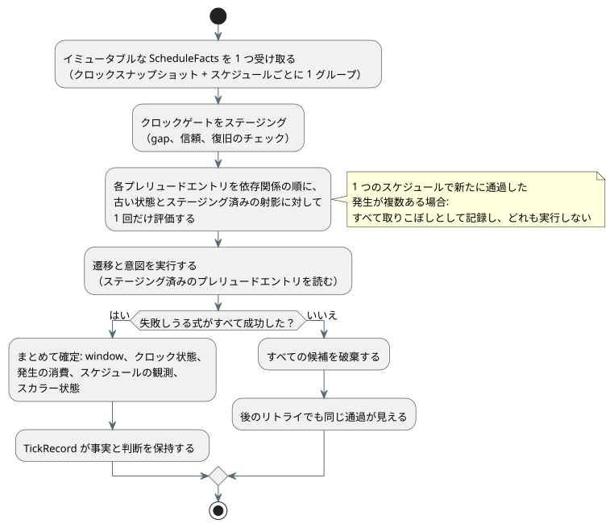

<!-- translation-source: tasks/schedule-wire-design.md -->
[英語の原文](schedule-wire-design.md)

# スケジュールのワイヤ形式とトランザクショナルなプレリュードの提案

**ステータス: root レビュー用のドラフトです。**

この提案では、スケジュールが GFB5 バイトコード形式（「ワイヤ」）でどのように運ばれるか、ホストがスキャンごとにどの事実を供給するか、そして 1 回の tick がスケジュールの発生（オカレンス）を単一のトランザクションとしてどのように受け入れる（アドミッション）かを定義します。

**これまでの進捗:**

- GFB5 の**構造スライスは完了しています**。次のスイートが合格しました: core 160、native 12、encoder 8 と影響を受ける 44、browser 3、cross-language native 4、catalog 5。
- **未完了:** 正準的な lowering、スケジュールの実行、プロバイダ、リソースの使用量計上、リプレイ。
- **未確定:** 以下の同一性バインディング（§3）とリソースのジオメトリ（§5）はまだ承認されていません。
- **Reference §3.5 で確定済み:** 複数回の通過の振る舞い。1 回のスキャンで複数の発生を新たに通過した場合、そのすべてを取りこぼし（missed）として記録し、どれも実行しません。

**root が承認した内容。** root は、段階的な構造実装のために §2 の実行可能レイアウトを承認しました。

- 最初の変更で追加するのは、内部エンコーダと移植可能なローダー/検証器だけです。正準的なソースの lowering とスケジュールの実行は未完了のままです。
- format 5 のモジュールには少なくとも 1 つのスケジュールが必要です。Window のみのコンパイルは format 4 のままです。
- 実行経路ができるまでは、すべてのアクティベーション経路がスケジュールモジュールを `schedule activation requires runtime bindings` で拒否しなければなりません。偽の `.due` 値で代用することは決してあってはなりません。

**証拠:** `build/schedule-core-green.log`、`build/gfb5-encoder-affected.log`、`build/gfb5-browser-green.log`、`build/gfb5-native-green.log`、`build/gfb5-catalog.log`。`docs/GFB5-SCHEDULE-PRELUDE.md` に承認済みのワイヤスライスが記録されています。

**基準となる情報源:** [Reference §3](../docs/reference/03-time-and-schedules.ja.md)、[pulse の設計](schedule-pulse-design.ja.md)、既存の [GFB4 契約](window-gfb4-design.ja.md)。

**このドキュメントの内容:** §1 最初の実行スライスの範囲 · §2 GFB5 のバイトレイアウト · §3 同一性バインディング（承認が必要） · §4 スキャンごとの事実と ABI · §5 トランザクション、リプレイ、リソース · §6 担当者と最初のテスト。

## 1. 最初の実行スライス

最初のスライスは、ちょうど次の組み合わせを対象とします。

- Solar、`pulse`
- 作成者が記述した Bool の `when`
- `trusted_only`
- 明示的な正の `skip_after(Duration)`
- `baseline`
- `fallback = skip`

責務は次のように分担されます。

| コンポーネント | 担当 |
| --- | --- |
| Rust | 計画された発生の事実を消費します。クロックの検証、通過、述語の評価、処置（disposition）、確定を担当します。 |
| プロバイダ | IANA タイムゾーン変換と Solar の計算を保持します。`.due` を供給するプロバイダはありません。 |

ネイティブの Solar ヘルパーは UTC/Seoul のサブセットだけをサポートします。このサブセットが言語の IANA サポートを制限することはできません。

**別途必要な作業**（このスライスには含まれません）: `window`、`run`、保持クロック（held clock）、固定時刻のフォールバック、Daily/IANA-DST の計画、永続的な発生台帳（レジャー）の移行。

ワイヤは、通過の完全かつ有界な集合を表現しなければなりません。1 つのスケジュールに新たに通過した発生が複数ある場合、そのすべてを取りこぼしとして記録し、どれも実行しません。

## 2. 提案する GFB5 のバイトレイアウト

**一般規則:**

- すべての整数はリトルエンディアンです。
- 文字列と式の blob は、既存の GFB の長さプレフィックスと上限を再利用します。
- GFB5 は GFB4 の module/input/state セクションと clock/root ヘッダーを維持します。
- スケジュールのみのモジュールは物理ルートを 0 個にできます。
- 状態を持つプレリュードエントリが少なくとも 1 つ必要です。

**プレリュード。** 各戦略は GFB4 の window リストを `u16 preludeCount` に置き換えます。その後にタグ付きエントリが依存関係の順に続き、さらに既存の遷移と意図が続きます。

| エントリタグ | 本体 |
| --- | --- |
| `0` | 既存の GFB4 window ディスクリプタそのもの |
| `1` | 以下の Solar pulse ディスクリプタ |

提案する Solar 本体（バイト順）:

```
u32 site
string name
string timezone
f64 latitude
f64 longitude
u8 event                 // 0 rise, 1 set
i64 offsetMs             // whole milliseconds, -24h..+24h
u8 basis                 // 0 pulse
u8 clockPolicy           // 0 trusted_only
u8 recovery              // 0 baseline
u8 fallback              // 0 skip
u64 gapMs                // 1..9007199254740991
blob when                // exactly one Bool result
```

座標は有限でなければならず、既存のソースのドメイン内に収まっていなければなりません。ポリシーのバイトは明示的なものであり、決して既定値ではありません。その他の言語ポリシーは、このスライスで単に実装されていないだけです。恒久的に無効な言語形式というわけではありません。

**スロットとオペコード。**

- window スロットとスケジュールスロットは別々の密なインデックスです。それぞれ、その種類のエントリがデコードされるたびに割り当てられます。
- オペコード 57 は既存の window 名前空間を維持します。
- 提案するオペコード 58 は `[58, u16 scheduleSlot, u8 field]` です。フィールド `0` は Bool の `.due` を返します。それ以外のフィールドは拒否されます。
- 1 つの戦略の中では、site と name は異種混在のプレリュード内の両方の種類にまたがって一意です。既存の window プロファイルと同様に、別々の戦略が同じソース宣言を参照することはできます。

**可視性と順序。**

- 検証器は、現在のディスクリプタより前にあるエントリだけを公開します。したがって、window のソースは前にあるスケジュールを読むことができ、スケジュールの述語は前にある window を読むことができます。
- コンパイラは結合したグラフをトポロジカルソートし、循環を位置情報付きの診断で報告します。
- window の証拠マーカー/ルートの検証は変わりません。
- 遷移と意図は、ステージングされたすべてのプレリュードエントリを読むことができます。
- 通常の状態読み取りはすべて、引き続き作成者が記述した古い状態を観測します。ステージングされた `next` の参照はありません。

**上限と互換性。**

- 戦略ごとに `scalar state count + prelude count <= 128` を維持します。入力、スタック、式、モジュールの上限は変わりません。これは現在の状態を持つエントリの予算を拡張するもので、無関係なスケジュール用の割り当て枠を追加するものではありません。
- format 5 では、デコーダ、エンコーダ、パッケージ、ホスト、フィクスチャ、ゴールデンを協調して更新する必要があります。
- format 1〜4 は、コンパイラがまだそれらを出力している箇所では現行のプロファイルのままです。
- これが受け入れられたら、置き換えられた Solar の外部 due 実行経路は削除されます。

## 3. 承認が必要な同一性バインディング

実行可能な宣言の同一性と、検証済みアーティファクトの同一性は別物です。

| 同一性 | 意味 |
| --- | --- |
| `site` | アーティファクトローカルなソースノード/射影の同一性。決して永続的なキーではありません。 |
| `name` | GFB に含まれる、意味上のローカル宣言名。 |
| 正確なソース SHA と外部の `documentId`/`revisionId` | 検証済みアクティベーションアーティファクトのメタデータ。決して実行可能な GFB バイト内のフィールドではありません。 |

**発生キー。** キーは次を組み合わせたものです。

1. アクティベーションに結び付いた安定した宣言名前空間
2. ローカル宣言
3. ソースのローカル日付
4. イベントの種類

プロバイダのリビジョンや、修正された計画タイムスタンプは、新しい発生を作りません。正確なソースリビジョンは説明のための来歴であり、安定した発生キーの一部ではありません。ソース SHA、バイトコード SHA、Runtime の非暗号学的な u64 フィンガープリントは、3 つの別個の値のままです。この提案は追加の暗号学的ハッシュも、捏造したソース ID も導入しません。

**アクティベーションがバインディングを得る場所。** アクティベーションは、`tools/compile-source.mjs` の既存の `sourceDocument` と `traceMetadata` からバインディングを取得します。ツールチェーンの正準マップのチェックと、検証済みアーティファクト/パッケージの境界がそれを検証します。

- コメントや文章だけの変更では、ソースの同一性は変わっても、GFB とノードの同一性は維持されなければなりません。Reference §1 と `tests/toolchain.test.mjs` のコメントのみのリビジョンテストがこれを要求しています。
- プロバイダの事実がバインディングを設定したり上書きしたりすることはできません。
- 生の GFB をロードしても、証明されるのはバイトコードの構造だけです。ソースの同一性は認証されません。
- ネイティブの署名付きパッケージの検証（署名、ダイジェスト、メタデータ）は、ネイティブコードが正準ソースを再コンパイルしたことを意味しません。この提案にはネイティブのソースコンパイラはありません。

**未解決:** アクティベーションに結び付いた安定した宣言名前空間の正確な定義と、ドキュメント/インポートのインスタンスに関するその規則。インストールされた別々のドキュメントが同じ名前を共有する場合、control/name の組だけでは不十分です。検証済みのインストール/ソースの同一性の境界を再利用してください。不透明で未検証のプロバイダ識別子を代わりに GFB に入れてはなりません。リビジョンをまたぐ永続的な台帳の移行は、別個の契約のままです。

## 4. 型付きのスキャンごとの事実と ABI の提案

ネイティブのエントリポイント:

```
Runtime::tick_with_schedule(&ScheduleFacts)
ScanDriver::scan_with_schedule(ScanFrameV1, &ScheduleFacts)
```

**事実オブジェクト。** イミュータブルな事実オブジェクトには、1 つのクロックスナップショットと、site 順に並んだ site グループが含まれます。選択された各スケジュールにつき、ちょうど 1 つのグループがあります。

- **クロック:** ブート/時刻エポック、単調ミリ秒、任意の壁時計ミリ秒、信頼、任意の不確かさ、任意のクロックソースリビジョン。不確かさが欠けている場合は欠落のままです。
- **グループ:** プロバイダ ID/リビジョンとゾーン/コンテキストリビジョン。インストールされたプロバイダのケイパビリティに結び付けられます。グループには、型付きの Unknown 理由か、明示的にカバーされた壁時計区間と完全で順序付けられたソース日付リストのどちらかが含まれます。
- **日付行:** イベントの壁時計瞬間、または型付きの利用不可理由。

Rust はコンパイル済みのオフセットを加え、DateTime の範囲を検証します。オフセットが真夜中をまたぐ場合でも、日付行はそのソース日付を保持します。計画されたローカル時刻のコンテキストがプロバイダの証拠に付随することはありますが、安定したソース日付キーを置き換えることは決してありません。

**パケットのフレーミング。** 提案するパケットは `GFSC`、`u16 version=1`、次にクロック、次に `u16 groupCount` の順です。

- スカラーは現在の正準的なエポック日、エポックミリ秒、安全な整数のドメインを使います。
- 存在/ステータスタグが任意フィールドを示します。番兵となる壁時計時刻はありません。
- 長さプレフィックス付きの文字列と行は、明示的な事実予算に収まらなければなりません。
- 正確な行/ステータスのエンコーディングは、プロバイダのカバレッジ契約のレビューに従います。このドラフトはそれを暗黙に確定させません。

**カバレッジ。** カバレッジには、要求された区間とオフセットに該当するすべてのソース日付が含まれていなければなりません。構造的な検証で証明できるのは、行が連続していること、範囲内にあること、重複キーがないことです。外部の IANA や天文計算のプロバイダが真実を伝えたことは証明できません。それは検証済みドライバのケイパビリティの境界です。現在の日付と前の日付だけを列挙しても、任意に記述された gap に対する完全なカバレッジにはなりません。

**エクスポート。** 提案するエクスポートです。既存のスケジュール以外の呼び出しは維持します。

```
gf_tick_schedule(handle, factsPtr, factsLen) -> 1|0
gf_frame_scan_schedule(handle, scanId, logicalTimeMs,
                       inputPtr, inputLen, factsPtr, factsLen) -> 1|0
```

**ABI の規則:**

- クロックの単調時間は、フレーム化された論理時間および生成された VM の now バインディングと等しくなければなりません。
- スケジュールを必要とするモジュールは、事実のない通常の tick/スキャンを拒否します。キャッシュされた事実へのフォールバックはありません。
- 両方の ABI が 1 つの Rust パケットデコーダを共有します。
- フレーム化された入力と事実エンベロープは、合わせて既存の 64 KiB の転送上限に収まらなければなりません。
- ネイティブの直接呼び出しも、アクティベートされた同じリソースジオメトリを強制します。パケットデコーダを経由しないからといって、上限のない Vec を受け入れてはなりません。

## 5. トランザクション、リプレイ、リソースの証明

**クロックゲート。** ステージングされた 1 つのクロックゲートが、連続して受け入れられた壁時計/単調時間の値を使って gap をチェックします。信頼された壁時計のハイウォーターマークは別に追跡されます。

- 作成者が記述した gap **より大きい**正の差分は受け入れを拒否します。gap と**等しい**差分は拒否しません。
- ブート/信頼の復旧ベースラインは追いつき（catch up）を行いません。
- Unknown/復旧、プロバイダの故障、終端的な処置は、それぞれ区別して記録されます。
- タイマーと window は固定セッションの連続性に依存するため、エポックを置き換えるには明示的な新しいセッションが必要です。

**tick ごとに 1 つのトランザクション。** 以下の図は、ステージングの順序と、すべてか無かの確定を示しています。



- 各スケジュールの述語は、古い状態とすでにステージングされた射影に対して、プレリュード順に 1 回だけ評価します。
- window、クロック状態、発生の消費、スケジュールの観測、スカラー状態は、失敗しうるすべての式が成功した後に、まとめて確定します。
- その後に故障が起きると、すべての候補が破棄されます。リトライでは同じ通過が見えます。
- JavaScript の受け入れステートマシンや、独立して確定するプロバイダキャッシュがこのトランザクションの代わりになってはなりません。

**リプレイ。** TickRecord は、リプレイに必要な事実と各スケジュールの判断を保持します。チェックポイントには、受け入れられたクロック状態と発生の消費状態が含まれます。ゴースト（ゴースト実行）のリプレイは、記録された事実と検証済みのインストール済み定義を使い、プロバイダに再度問い合わせることはしません。フレーム化されたリプレイは、元のスキャン ID と受け入れられた論理時間を保持します。

**まだ必要なリソースのレビュー。**

- スケジュールのアクティベーション用に、明示的な正の事実バイト予算を導入します。これは ABI の転送上限で制限されます。行の容量はエンコーディングから導出します。これはストレージ容量であり、動作周期ではありません。
- GFTA v2 は、このフィールドと、window のサンプル容量が 0 のスケジュール専用プロファイルの置き場所として提案されています。欠けている GFTA1 のフィールドを既定値として再解釈しないでください。
- 実装の前に、root がこのプロファイル変更を承認しなければなりません。

**共有の構造プランナーが計上しなければならないもの:**

- デコード後のグループ/行/文字列の容量
- クロックと受け入れのバンク
- `(journalCapacity+1)` 個の所有された事実/判断レコードとチェックポイント
- 候補とリプレイの重なり

エンコードされた 64 KiB だけ、あるいは既存の時間アリーナだけを計上するのでは不十分です。すべての判断にプロバイダの文字列を繰り返し持たせることは避けてください。行と判断は、レコード内で一度だけ所有されるメタデータに結び付けます。実際の容量チェックは既存の時間計画の規則に従います。JSON バッファは引き続き別個に制限されます。

発生の消費をセッション内で有限に表現するには、プロバイダの修正があってもそれが成り立つことの証明も必要です。際限なく増える HashSet を追加しないでください。ジャーナルレコードが追い出されたというだけで、消費済みのキーを刈り込まないでください。

## 6. 実装の境界と最初の決定的なチェック

| 担当者 | 契約承認後の有界な作業 |
| --- | --- |
| Root | 同一性/容量の決定、Reference とアーティファクトのバインディング |
| Astra | GFB5 検証器、共有の Rust プレリュード/受け入れ、トランザクション/リソース/リプレイ、ABI |
| Sol | ソースグラフ/lowering/エンコーダ、IANA 事実プロバイダ、薄いホスト/ラッパー |
| Luna | 独立した診断と、ネイティブ/WASM の受け入れベクタ |

最初のテストでは、次を区別する必要があります。

1. window から供給される述語と、古い状態の入力
2. 逆向きの依存関係と、循環
3. ちょうどの gap と gap+1
4. 後段の意図の失敗と、その後の同一の通過のリトライ
5. 発生の同一性を保つ、修正されたプロバイダタイムスタンプ
6. プロバイダを呼び出さずに判断を保持する、ジャーナルのロールオーバー後のリプレイ

さらに、1 つのスケジュールで新たに通過した 2 つの発生が両方とも取りこぼしとして記録され、どちらも受け入れられないことを証明する複数日付のカバレッジテストを追加してください。通常の受け入れの振る舞いを保つ単一通過の対照テストと組にしてください。

**進める順序。** 独立した trusted-only のクロックコンポーネントを先に進めることができます。完全な pulse 経路が受け入れられたと主張する前に、GFB ディスクリプタの同一性、完全な事実エンコーディング、結合したストレージ計画のレビューが必要です。
