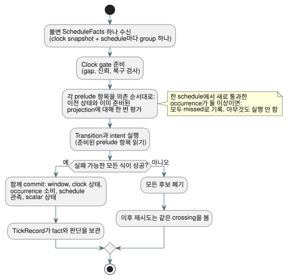

<!-- translation-source: tasks/schedule-wire-design.md -->
[영문 원문](schedule-wire-design.md)

# Schedule wire와 트랜잭션 prelude 제안

**상태: root 검토용 초안입니다.**

이 제안은 schedule이 GFB5 바이트코드 형식(이하 "wire")에서 어떻게 전달되는지,
호스트가 scan마다 어떤 fact를 공급하는지, 그리고 하나의 tick이 schedule
occurrence(발생)를 단일 트랜잭션으로 어떻게 admission(수용)하는지를 정의합니다.

**지금까지의 진행 상황:**

- GFB5 **구조 slice는 완료되었습니다**. 다음 테스트 묶음이 통과했습니다: core 160,
  native 12, encoder 8과 영향받은 44, browser 3, cross-language native 4,
  catalog 5.
- **아직 남은 작업:** 정본 lowering, schedule 실행, provider,
  자원 accounting, replay.
- **최종 확정 아님:** 아래의 식별자 binding(§3)과 자원 구성(§5)은
  아직 승인되지 않았습니다.
- **Reference §3.5로 확정됨:** multiple-crossing 동작. 한 scan이 여러
  occurrence를 새로 통과하면 모두 missed로 기록하고 아무것도 실행하지 않습니다.

**Root가 승인한 내용.** Root는 단계적 구조 구현을 위해 §2의 실행 배치를
승인했습니다:

- 첫 변경은 내부 encoder와 portable loader/verifier만 추가합니다. 정본 source
  lowering과 schedule 실행은 아직 남아 있습니다.
- Format-5 module에는 schedule이 최소 하나 있어야 합니다. Window만 있는 컴파일은
  format 4를 유지합니다.
- 실행 경로가 생기기 전까지 모든 activation 경로는 schedule module을
  `schedule activation requires runtime bindings`로 거부해야 합니다. 거짓
  `.due` 값으로 대신해서는 절대 안 됩니다.

**증거:** `build/schedule-core-green.log`, `build/gfb5-encoder-affected.log`,
`build/gfb5-browser-green.log`, `build/gfb5-native-green.log`,
`build/gfb5-catalog.log`. `docs/GFB5-SCHEDULE-PRELUDE.md`가 승인된
wire slice를 기록합니다.

**기준 자료:** [Reference §3](../docs/reference/03-time-and-schedules.md),
[pulse 설계](schedule-pulse-design.ko.md), 기존
[GFB4 계약](window-gfb4-design.ko.md).

**이 문서의 구성:** §1 첫 실행 slice의 범위 · §2 GFB5 바이트 배치 ·
§3 식별자 binding(승인 필요) · §4 scan별 fact와 ABI ·
§5 트랜잭션, replay, 자원 · §6 소유자와 첫 테스트.

## 1. 첫 실행 slice

첫 slice는 정확히 다음 조합만 다룹니다:

- Solar, `pulse`;
- 작성된 Bool `when`;
- `trusted_only`;
- 명시적인 양수 `skip_after(Duration)`;
- `baseline`;
- `fallback = skip`.

책임은 다음과 같이 나뉩니다:

| 구성요소 | 소유하는 일 |
| --- | --- |
| Rust | 계획된 occurrence fact를 소비합니다. clock 검증, crossing, 술어 평가, 처분, commit을 소유합니다. |
| Provider | IANA 시간대 변환과 Solar 계산을 맡습니다. 어떤 provider도 `.due`를 공급하지 않습니다. |

Native Solar helper는 UTC/Seoul 부분집합만 지원합니다. 이 부분집합이 언어의
IANA 지원을 제한할 수는 없습니다.

**별도로 필요한 작업**(이 slice에 포함되지 않음): `window`, `run`, held clock,
fixed-time fallback, Daily/IANA-DST 계획, 영속 occurrence-ledger 이관.

Wire는 유한하고 완전한 crossing 집합을 표현해야 합니다. 한 schedule에 새로
통과한 occurrence가 여러 개 있으면 모두 missed로 기록하고 아무것도 실행하지
않습니다.

## 2. 제안하는 GFB5 바이트 배치

**일반 규칙:**

- 모든 정수는 little endian입니다.
- 문자열과 식 blob은 기존 GFB 길이 prefix와 상한을 재사용합니다.
- GFB5는 GFB4의 module/input/state 구역과 clock/root header를 유지합니다.
- Schedule만 있는 module은 물리 root가 0개일 수 있습니다.
- Stateful prelude 항목이 최소 하나 있어야 합니다.

**Prelude.** 각 strategy는 GFB4의 window 목록을 `u16 preludeCount`로
대체합니다. 그 뒤에 tag가 붙은 항목이 의존 순서대로 오고, 이어서 기존
transition과 intent가 옵니다:

| 항목 tag | 본문 |
| --- | --- |
| `0` | 기존 GFB4 window descriptor와 정확히 동일 |
| `1` | 아래의 Solar pulse descriptor |

제안하는 Solar 본문(바이트 순서):

```
u32 site
string name
string timezone
f64 latitude
f64 longitude
u8 event                 // 0 rise, 1 set
i64 offsetMs             // whole milliseconds, -24h..+24h
u8 basis                 // 0 pulse
u8 clockPolicy           // 0 trusted_only
u8 recovery              // 0 baseline
u8 fallback              // 0 skip
u64 gapMs                // 1..9007199254740991
blob when                // exactly one Bool result
```

좌표는 유한해야 하며 기존 소스 영역 안에 있어야 합니다. 정책 바이트는
명시적인 값이며 기본값이 아닙니다. 다른 언어 정책은 이 slice에서 단지 구현되지
않았을 뿐입니다. 영구적으로 잘못된 언어 형태라는 뜻이 아닙니다.

**Slot과 opcode.**

- Window slot과 schedule slot은 서로 별개인 조밀한 index입니다. 각각 해당 종류의
  항목을 decoding하는 순서대로 할당됩니다.
- Opcode 57은 기존 window namespace를 유지합니다.
- 제안하는 opcode 58은 `[58, u16 scheduleSlot, u8 field]`입니다. 필드 `0`은
  Bool `.due`를 반환합니다. 다른 필드는 거부됩니다.
- 한 strategy 안에서 site와 이름은 이종 prelude의 두 종류 전체에 걸쳐
  고유합니다. 기존 window profile처럼, 서로 다른 strategy는 같은 소스 선언을
  참조할 수 있습니다.

**가시성과 순서.**

- Verifier는 현재 descriptor보다 앞선 항목만 노출합니다. 따라서 window source는
  앞선 schedule을 읽을 수 있고, schedule 술어는 앞선 window를 읽을 수 있습니다.
- 컴파일러는 결합된 graph를 위상 정렬하고, cycle은 위치 정보가 있는 진단으로
  보고합니다.
- Window evidence marker/root 검증은 바뀌지 않습니다.
- Transition과 intent는 준비된(staged) 모든 prelude 항목을 읽을 수 있습니다.
- 모든 일반 상태 읽기는 여전히 작성된 이전 상태를 봅니다. 준비된 `next` 조회는
  없습니다.

**한계와 호환성.**

- Strategy마다 `scalar state count + prelude count <= 128`을 유지합니다. Input,
  stack, expression, module 상한은 바뀌지 않습니다. 이는 기존 stateful 항목
  예산을 확장하는 것이며, 무관한 schedule 할당량을 새로 추가하지 않습니다.
- Format 5에는 decoder, encoder, package, host, fixture, golden의 조율된 갱신이
  필요합니다.
- Format 1–4는 컴파일러가 아직 생성하는 곳에서 현재 profile로 남습니다.
- 이 제안이 수용되면, 대체된 Solar external-due 실행 경로는 제거됩니다.

## 3. 승인이 필요한 식별자 binding

실행 가능한 선언의 식별자와 검증된 산출물의 식별자는 별개입니다:

| 식별자 | 의미 |
| --- | --- |
| `site` | 산출물 내부의 source node/projection 식별자입니다. 절대 영속 key가 아닙니다. |
| `name` | GFB에 담기는 의미상의 local 선언 이름입니다. |
| 정확한 source SHA와 외부 `documentId`/`revisionId` | 검증된 activation 산출물 metadata입니다. 절대 실행 GFB 바이트의 필드가 아닙니다. |

**Occurrence key.** Key는 다음을 결합합니다:

1. activation에 연결된 안정적인 선언 namespace,
2. local 선언,
3. source local date,
4. event 종류.

Provider revision이나 보정된 계획 타임스탬프는 새 occurrence를 만들지 않습니다.
정확한 source revision은 설명용 provenance(출처)이며, 안정적인 occurrence key의
일부가 아닙니다. Source SHA, bytecode SHA, Runtime의 비암호학적 u64
fingerprint는 서로 다른 세 값으로 남습니다. 이 제안은 추가 암호학적 해시도,
꾸며낸 source ID도 도입하지 않습니다.

**Activation이 binding을 얻는 곳.** Activation은 `tools/compile-source.mjs`의
기존 `sourceDocument`와 `traceMetadata`에서 binding을 가져옵니다. Toolchain의
정본 map 검사와 검증된 artifact/package 경계가 이를 검증합니다.

- 주석이나 설명문만 바뀐 경우, source 식별자는 바뀌되 GFB와 node 식별자는
  유지되어야 합니다. Reference §1과 `tests/toolchain.test.mjs`의 comment-only
  revision 테스트가 이를 요구합니다.
- Provider fact는 binding을 설정하거나 덮어쓸 수 없습니다.
- Raw GFB를 로딩하는 것은 bytecode 구조만 증명합니다. Source 식별자를
  인증하지는 않습니다.
- Native 서명 package 검증(서명, digest, metadata)은 native 코드가 정본 소스를
  다시 컴파일했다는 뜻이 아닙니다. 이 제안에는 native 소스 컴파일러가 없습니다.

**미결:** activation에 연결된 안정적인 선언 namespace의 정확한 정의와, 그
namespace의 document/import instance 규칙. 서로 다른 설치 문서가 같은 이름을
공유하면 control/name 쌍만으로는 부족합니다. 검증된 installation/source 식별자
경계를 재사용합니다. 불투명하고 검사되지 않은 provider 식별자가 대체물로 GFB에
들어가서는 안 됩니다. Revision 간 영속 ledger 이관은 별도 계약으로 남습니다.

## 4. 타입이 지정된 scan별 fact와 ABI 제안

Native 진입점:

```
Runtime::tick_with_schedule(&ScheduleFacts)
ScanDriver::scan_with_schedule(ScanFrameV1, &ScheduleFacts)
```

**Fact 객체.** 불변 fact 객체는 clock snapshot 하나와, site 순으로 정렬된 site
group들을 담습니다. 선택된 schedule마다 group이 정확히 하나 있습니다.

- **Clock:** boot/time epoch, 단조 밀리초, 선택적 wall 밀리초, 신뢰 여부,
  선택적 uncertainty, 선택적 clock source revision. Uncertainty가 없으면 없는
  상태로 유지합니다.
- **Group:** 설치된 provider capability에 연결된 provider ID/revision과
  zone/context revision. Group은 타입이 지정된 Unknown 사유를 담거나, 아니면
  명시적인 covered wall 구간과 완전하고 정렬된 source-date 목록을 담습니다.
- **날짜 행:** event wall instant, 또는 타입이 지정된 unavailable 사유.

Rust는 컴파일된 offset을 더하고 DateTime 상한을 검증합니다. Offset이 자정을
넘더라도 날짜 행은 자신의 source date를 유지합니다. 계획된 local-time 맥락을
provider 증거와 함께 담을 수는 있지만, 안정적인 source-date key를 대체하지는
않습니다.

**Packet framing.** 제안하는 packet은 `GFSC`, `u16 version=1`, 그 뒤 clock,
그 뒤 `u16 groupCount`입니다.

- Scalar는 현재의 정본 epoch-day, epoch-millisecond, safe-integer 영역을
  사용합니다.
- Presence/status tag가 선택 필드를 표시합니다. Wall time sentinel은 없습니다.
- 길이 prefix가 있는 문자열과 행은 명시적인 fact 예산 안에 들어가야 합니다.
- 정확한 row/status encoding은 provider coverage 계약 검토 결과를 따릅니다.
  이 초안이 조용히 확정하지 않습니다.

**Coverage.** Coverage는 요청된 구간과 offset에 해당하는 모든 적격 source date를
포함해야 합니다. 구조 검증은 행이 연속적이고, 상한 안에 있으며, 중복 key가
없음을 증명할 수 있습니다. 하지만 외부 IANA 또는 천문 provider가 사실을 말했는지는
증명할 수 없습니다. 그것은 검증된 driver capability 경계의 몫입니다. 현재 날짜와
이전 날짜만 열거하는 것은 임의의 작성된 gap에 대해 완전한 coverage가 아닙니다.

**Export.** 기존 nonschedule 호출을 유지하면서 제안하는 export:

```
gf_tick_schedule(handle, factsPtr, factsLen) -> 1|0
gf_frame_scan_schedule(handle, scanId, logicalTimeMs,
                       inputPtr, inputLen, factsPtr, factsLen) -> 1|0
```

**ABI 규칙:**

- Clock의 단조 시각은 framed 논리 시간 및 생성된 VM now binding과 같아야
  합니다.
- Schedule이 필요한 module은 fact가 없는 일반 tick/scan을 거부합니다.
  Cached-fact fallback은 없습니다.
- 두 ABI는 하나의 Rust packet decoder를 공유합니다.
- Framed 입력과 fact envelope는 합쳐서 기존 64 KiB 전송 상한 안에 들어가야
  합니다.
- Native 직접 호출도 같은 활성화된 자원 구성을 강제합니다. Packet decoder를
  우회한다는 이유만으로 무제한 Vec를 받아들여서는 안 됩니다.

## 5. 트랜잭션, replay, 자원 증명

**Clock gate.** 하나의 준비된 clock gate가 연속으로 수용된 wall/단조 값을 사용해
gap을 검사합니다. 신뢰된 wall high-water mark는 따로 추적합니다.

- 작성된 gap**보다 큰** 양의 delta는 admission을 거부합니다. gap과 **같은**
  delta는 거부하지 않습니다.
- Boot/trust 복구 baseline은 catch-up하지 않습니다.
- Unknown/복구, provider fault, 종결 처분은 서로 구분해서 기록합니다.
- Timer와 window가 고정 session의 연속성에 의존하므로, epoch를 교체하려면
  명시적인 새 session이 필요합니다.

**Tick마다 하나의 트랜잭션.** 아래 다이어그램은 준비 순서와 전부 아니면 전무
방식의 commit을 보여 줍니다.



- 각 schedule 술어를 prelude 순서대로, 이전 상태와 이미 준비된 projection에 대해
  한 번 평가합니다.
- Window, clock 상태, occurrence 소비, schedule 관측, scalar 상태는 실패할 수 있는
  모든 식이 성공한 뒤에 함께 commit됩니다.
- 이후에 fault가 나면 모든 후보를 폐기합니다. 재시도는 같은 crossing을 봅니다.
- JavaScript admission 상태 기계나 독립적으로 commit하는 provider cache가 이
  트랜잭션을 대신해서는 안 됩니다.

**Replay.** TickRecord는 replay에 필요한 fact와 각 schedule 판단을 소유합니다.
Checkpoint에는 수용된 clock 상태와 occurrence 소비 상태가 포함됩니다. Ghost
replay는 기록된 fact와 검증된 설치 definition을 사용하며, provider에 다시 질의하지
않습니다. Framed replay는 원래 scan ID와 수용된 논리 시간을 보존합니다.

**자원 검토가 여전히 필요합니다.**

- Schedule activation을 위한 명시적인 양수 fact-byte 예산을 도입하고, ABI 전송
  최대값으로 제한합니다. 행 용량은 encoding에서 도출합니다. 이것은 저장 용량이며
  운전 주기가 아닙니다.
- GFTA v2가 이 필드와, window sample 용량이 0인 schedule 전용 profile을 담을
  위치로 제안됩니다. 누락된 GFTA1 필드를 기본값으로 재해석하지 않습니다.
- 구현 전에 root가 이 profile 변경을 승인해야 합니다.

**공유 구조 planner가 비용으로 반영해야 하는 것:**

- decoding된 group/row/string 용량;
- clock bank와 admission bank;
- `(journalCapacity+1)`개의 소유 fact/판단 기록과 checkpoint;
- 후보와 replay의 중첩.

Encoding된 64 KiB만, 또는 기존 temporal arena만 반영하는 것으로는 부족합니다.
모든 판단마다 provider 문자열을 반복하지 마세요. 행과 판단을 기록에서 한 번만
소유하는 metadata에 연결합니다. 실제 용량 검사는 기존 temporal plan 규칙을
따릅니다. JSON buffer는 별도로 제한됩니다.

Session 안에서 occurrence 소비를 유한하게 표현하려면, provider 보정 아래에서도
그 표현이 성립한다는 증명이 필요합니다. 무한히 커지는 HashSet을 추가하지 마세요.
Journal 기록이 제거되었다는 이유만으로 소비된 key를 정리하지 마세요.

## 6. 구현 경계와 첫 결정적 검사

| 소유자 | 계약 승인 후 범위가 제한된 작업 |
| --- | --- |
| Root | 식별자/용량 결정; Reference와 산출물 binding |
| Astra | GFB5 verifier, 공유 Rust prelude/admission, 트랜잭션/자원/replay, ABI |
| Sol | Source graph/lowering/encoder, IANA fact provider, 얇은 host/wrapper |
| Luna | 독립적인 진단, native/WASM 수용 vector |

첫 테스트는 다음을 구분해야 합니다:

1. window가 공급하는 술어와 이전 상태 입력;
2. 역방향 의존과 cycle;
3. 정확한 gap과 gap+1;
4. 뒤늦은 intent 실패 후 동일한 crossing의 재시도;
5. occurrence 식별자를 유지하는 보정된 provider 타임스탬프;
6. provider 호출 없이 판단을 보존하는 journal rollover replay.

또한 한 schedule에서 새로 통과한 두 occurrence가 모두 missed로 기록되고 어느
것도 admission되지 않음을 증명하는 여러 날짜 coverage 테스트를 추가합니다. 일반
admission 동작을 유지하는 single-crossing 대조 테스트와 짝지어 둡니다.

**진행 순서.** 독립적인 trusted-only clock 구성요소는 먼저 진행할 수 있습니다.
전체 pulse 경로가 수용되었다고 주장하기 전에 GFB descriptor 식별자, 완전한 fact
encoding, 결합 저장 계획을 검토해야 합니다.
