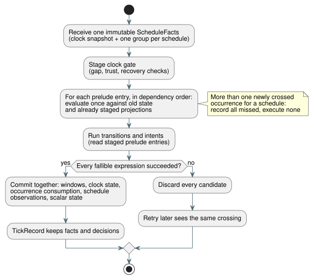

# Schedule wire and transactional prelude proposal

**Status: draft for root review.**

This proposal defines how schedules travel in the GFB5 bytecode format (the
"wire"), what per-scan facts a host supplies, and how one tick admits a
schedule occurrence as a single transaction.

**Progress so far:**

- The GFB5 **structural slice is complete**. These suites passed: core 160,
  native 12, encoder 8 plus 44 affected, browser 3, cross-language native 4,
  and catalog 5.
- **Still pending:** canonical lowering, schedule execution, providers,
  resource accounting, and replay.
- **Not final:** the identity binding (§3) and the resource geometry (§5)
  below are not yet approved.
- **Fixed by Reference §3.5:** multiple-crossing behavior. When a scan newly
  crosses several occurrences, record all of them as missed and execute none.

**What root has approved.** Root approved §2's executable layout for a staged
structural implementation:

- The first change adds only the internal encoder and the portable
  loader/verifier. Canonical source lowering and schedule execution remain
  pending.
- A format-5 module requires at least one schedule. Window-only compilation
  keeps format 4.
- Until the execution path exists, every activation path must reject schedule
  modules with `schedule activation requires runtime bindings`. It must never
  substitute a false `.due` value.

**Evidence:** `build/schedule-core-green.log`, `build/gfb5-encoder-affected.log`,
`build/gfb5-browser-green.log`, `build/gfb5-native-green.log`, and
`build/gfb5-catalog.log`. `docs/GFB5-SCHEDULE-PRELUDE.md` records the approved
wire slice.

**Ground truth:** [Reference §3](../docs/reference/03-time-and-schedules.md),
the [pulse design](schedule-pulse-design.md), and the existing
[GFB4 contract](window-gfb4-design.md).

**In this document:** §1 scope of the first execution slice · §2 GFB5 byte
layout · §3 identity binding (needs approval) · §4 per-scan facts and ABI ·
§5 transaction, replay and resources · §6 owners and first tests.

## 1. First execution slice

The first slice covers exactly this combination:

- Solar, `pulse`;
- an authored Bool `when`;
- `trusted_only`;
- an explicit positive `skip_after(Duration)`;
- `baseline`;
- `fallback = skip`.

Responsibilities are split as follows:

| Component | Owns |
| --- | --- |
| Rust | Consumes planned occurrence facts. Owns clock validation, crossings, predicate evaluation, disposition and commit. |
| Providers | Keep IANA time-zone conversion and Solar calculation. No provider supplies `.due`. |

The native Solar helper supports only a UTC/Seoul subset. That subset cannot
restrict the language's IANA support.

**Separate required work** (not in this slice): `window`, `run`, held clock,
fixed-time fallback, Daily/IANA-DST planning, and durable occurrence-ledger
migration.

The wire must represent the complete, bounded set of crossings. When one
schedule has multiple newly crossed occurrences, all are recorded missed and
none executes.

## 2. Proposed GFB5 byte layout

**General rules:**

- All integers are little endian.
- Strings and expression blobs reuse the existing GFB length prefixes and bounds.
- GFB5 keeps the GFB4 module/input/state sections and the clock/root header.
- Schedule-only modules may have zero physical roots.
- At least one stateful prelude entry is required.

**Prelude.** Each strategy replaces GFB4's window list with `u16 preludeCount`.
Tagged entries follow in dependency order, then the existing transitions and
intents:

| Entry tag | Body |
| --- | --- |
| `0` | Exact existing GFB4 window descriptor |
| `1` | Solar pulse descriptor below |

Proposed Solar body, in byte order:

```
u32 site
string name
string timezone
f64 latitude
f64 longitude
u8 event                 // 0 rise, 1 set
i64 offsetMs             // whole milliseconds, -24h..+24h
u8 basis                 // 0 pulse
u8 clockPolicy           // 0 trusted_only
u8 recovery              // 0 baseline
u8 fallback              // 0 skip
u64 gapMs                // 1..9007199254740991
blob when                // exactly one Bool result
```

Coordinates must be finite and stay within their existing source domains.
Policy bytes are explicit; they are never defaults. Other language policies are
simply not implemented by this slice. They are not permanently invalid
language forms.

**Slots and opcodes.**

- Window slots and schedule slots are separate dense indices. Each is assigned
  as entries of that kind are decoded.
- Opcode 57 keeps its existing window namespace.
- Proposed opcode 58 is `[58, u16 scheduleSlot, u8 field]`. Field `0` returns
  the Bool `.due`. Any other field rejects.
- Within one strategy, sites and names are unique across both kinds in the
  heterogeneous prelude. Separate strategies may refer to the same source
  declaration, as in the existing window profile.

**Visibility and ordering.**

- The verifier exposes only entries that precede the current descriptor. So a
  window source may read an earlier schedule, and a schedule predicate may read
  an earlier window.
- The compiler topologically sorts the combined graph and reports cycles with
  located diagnostics.
- Window evidence marker/root verification is unchanged.
- Transitions and intents can read all staged prelude entries.
- All ordinary state reads still observe the old authored state. There is no
  staged `next` lookup.

**Limits and compatibility.**

- Per strategy, keep `scalar state count + prelude count <= 128`. Input, stack,
  expression and module ceilings are unchanged. This extends the current
  stateful-entry budget; it does not add an unrelated schedule quota.
- Format 5 requires coordinated updates to the decoder, encoder, package, host,
  fixtures and goldens.
- Formats 1–4 remain current profiles wherever the compiler still emits them.
- Once this is accepted, the superseded Solar external-due execution path is
  removed.

## 3. Identity binding requiring approval

The identity of an executable declaration and the identity of a verified
artifact are separate things:

| Identity | Meaning |
| --- | --- |
| `site` | Artifact-local source node/projection identity. Never a durable key. |
| `name` | The semantic local declaration name carried in GFB. |
| Exact source SHA and external `documentId`/`revisionId` | Verified activation-artifact metadata. Never fields in executable GFB bytes. |

**Occurrence key.** The key combines:

1. an activation-bound stable declaration namespace,
2. the local declaration,
3. the source local date, and
4. the event kind.

A provider revision or a corrected planned timestamp does not create a new
occurrence. The exact source revision is explanatory provenance; it is not part
of the stable occurrence key. Source SHA, bytecode SHA and the Runtime's
noncryptographic u64 fingerprint remain three distinct values. This proposal
introduces no additional cryptographic hash and no fabricated source ID.

**Where activation gets the binding.** Activation takes it from the existing
`sourceDocument` and `traceMetadata` of `tools/compile-source.mjs`. The
toolchain's canonical map checks and the verified artifact/package boundary
validate it.

- A comment- or prose-only change must keep GFB and node identity while
  changing source identity. Reference §1 and the comment-only revision test in
  `tests/toolchain.test.mjs` require this.
- A provider fact cannot set or override the binding.
- Loading raw GFB proves bytecode structure only. It does not authenticate
  source identity.
- Native signed-package validation (signature, digest, metadata) does not imply
  that native code recompiled the canonical source. This proposal has no native
  source compiler.

**Unresolved:** the exact activation-bound stable declaration namespace and its
rules for document/import instances. A control/name pair alone is insufficient
when distinct installed documents share those names. Reuse the verified
installation/source identity boundary. No opaque, unchecked provider identifier
may enter GFB as a substitute. Durable ledger migration across revisions remains
a separate contract.

## 4. Typed per-scan facts and ABI proposal

Native entry points:

```
Runtime::tick_with_schedule(&ScheduleFacts)
ScanDriver::scan_with_schedule(ScanFrameV1, &ScheduleFacts)
```

**The facts object.** The immutable facts object contains one clock snapshot and
site groups sorted by site, with exactly one group per selected schedule.

- **Clock:** boot/time epoch, monotonic milliseconds, optional wall
  milliseconds, trust, optional uncertainty, and optional clock source revision.
  Missing uncertainty stays absent.
- **Group:** provider ID/revision and zone/context revision, bound to the
  installed provider capability. A group contains either a typed Unknown reason,
  or an explicit covered wall interval plus a complete, ordered source-date list.
- **Date row:** an event wall instant, or a typed unavailable reason.

Rust adds the compiled offset and validates DateTime bounds. A date row keeps
its source date even when the offset crosses midnight. Planned local-time
context may accompany the provider evidence, but it never replaces the stable
source-date key.

**Packet framing.** The proposed packet is `GFSC`, `u16 version=1`, then the
clock, then `u16 groupCount`.

- Scalars use the current canonical epoch-day, epoch-millisecond and
  safe-integer domains.
- Presence/status tags mark optional fields. There is no sentinel wall time.
- Length-prefixed strings and rows must fit the explicit facts budget.
- The exact row/status encoding follows the review of the provider coverage
  contract. This draft does not silently fix it.

**Coverage.** Coverage must include every eligible source date for the
requested interval and offset. Structural validation can prove that rows are
consecutive, in bounds and free of duplicate keys. It cannot prove that an
external IANA or astronomical provider told the truth; that is the verified
driver capability boundary. Enumerating only the current and previous date is
not complete coverage for arbitrary authored gaps.

**Exports.** Proposed exports, which keep the existing nonschedule calls:

```
gf_tick_schedule(handle, factsPtr, factsLen) -> 1|0
gf_frame_scan_schedule(handle, scanId, logicalTimeMs,
                       inputPtr, inputLen, factsPtr, factsLen) -> 1|0
```

**ABI rules:**

- The clock's monotonic time must equal the framed logical time and the
  generated VM now binding.
- Modules that require schedules reject an ordinary tick/scan without facts.
  There is no cached-facts fallback.
- Both ABIs share one Rust packet decoder.
- Framed inputs plus the facts envelope must fit together within the existing
  64 KiB transport bound.
- Native direct calls enforce the same activated resource geometry. They must
  not accept an unbounded Vec just because they bypass the packet decoder.

## 5. Transaction, replay and resource proof

**Clock gate.** One staged clock gate checks gaps using consecutive accepted
wall/monotonic values. The trusted wall high-water mark is tracked separately.

- A positive delta **greater than** the authored gap rejects admission; a delta
  **equal to** the gap does not.
- Boot/trust recovery baselines do not catch up.
- Unknown/recovery, provider faults and terminal dispositions are recorded
  distinctly.
- Replacing the epoch requires an explicit new session, because timers and
  windows rely on fixed-session continuity.

**One transaction per tick.** The diagram below shows the order of staging and
the all-or-nothing commit.



- Evaluate each schedule predicate once, in prelude order, against old state
  and the projections already staged.
- Windows, clock state, occurrence consumption, schedule observations and
  scalar state all commit together, after every fallible expression succeeds.
- Any later fault discards every candidate. A retry sees the same crossing.
- No JavaScript admission state machine and no independently committing
  provider cache may stand in for this transaction.

**Replay.** TickRecord owns the facts needed to replay and each schedule
decision. Checkpoints include the accepted clock state and the
occurrence-consumption state. Ghost replay uses those recorded facts and the
verified installed definitions; it does not query the provider again. Framed
replay preserves the original scan IDs and accepted logical times.

**Resource review still required.**

- Introduce an explicit positive facts-byte budget for schedule activation,
  bounded by the ABI transport maximum. Derive row capacities from the encoding.
  This is a storage capacity, not an operating cadence.
- GFTA v2 is the proposed home for this field and for schedule-only profiles
  with zero window sample capacity. Do not reinterpret missing GFTA1 fields as
  defaults.
- Root must approve this profile change before implementation.

**What the shared structural planner must charge:**

- decoded group/row/string capacities;
- clock and admission banks;
- `(journalCapacity+1)` owned facts/decision records and checkpoints;
- candidate and replay overlap.

Charging only the encoded 64 KiB, or only the existing temporal arena, is
insufficient. Avoid repeating provider strings in every decision: bind rows and
decisions to metadata owned once in the record. Actual capacity checks follow
the existing temporal plan rule. JSON buffers remain separately bounded.

A finite in-session representation of occurrence consumption also needs a
proof that it holds under provider corrections. Do not add an indefinitely
growing HashSet. Do not prune consumed keys merely because a journal record was
evicted.

## 6. Implementation boundaries and first decisive checks

| Owner | Bounded work after contract approval |
| --- | --- |
| Root | Identity/capacity decisions; Reference and artifact binding |
| Astra | GFB5 verifier, shared Rust prelude/admission, transaction/resource/replay, ABI |
| Sol | Source graph/lowering/encoder, IANA fact provider and thin host/wrappers |
| Luna | Independent diagnostic and native/WASM acceptance vectors |

The first tests should distinguish:

1. a window-fed predicate from an old-state input;
2. the inverse dependency, and a cycle;
3. an exact gap versus gap+1;
4. a failed late intent, then a retry of the identical crossing;
5. a corrected provider timestamp that keeps occurrence identity;
6. journal-rollover replay that preserves decisions without provider calls.

Also add a multi-date coverage test proving that two newly crossed occurrences
for one schedule are both recorded missed and neither is admitted. Pair it with
a single-crossing control that keeps ordinary admission behavior.

**Sequencing.** The independent trusted-only clock component can proceed first.
GFB descriptor identity, the complete fact encoding, and the combined storage
plan need review before anyone claims the full pulse path is accepted.
