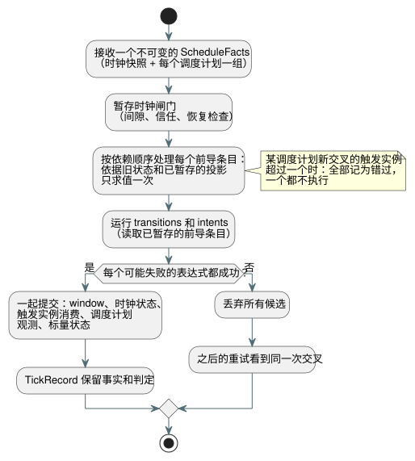

<!-- translation-source: tasks/schedule-wire-design.md -->
[英文原文](schedule-wire-design.md)

# 调度计划线格式与事务性前导（prelude）提案

**状态：供 root 审阅的草案。**

本提案定义调度计划（schedule）如何在 GFB5 字节码格式（即“线格式”，wire）中传递、宿主（host）在每次扫描中提供哪些事实，以及一个 tick（逻辑决策步）如何以单一事务的方式准入（admission）一个调度计划触发实例（occurrence）。

**目前进展：**

- GFB5 **结构切片已完成**。以下测试套件已通过：core 160、native 12、encoder 8 及受影响的 44 个、browser 3、跨语言 native 4、catalog 5。
- **仍待完成：**规范降级（canonical lowering）、调度计划执行、provider、资源用量核算以及重放。
- **尚未最终确定：**下文的身份标识绑定（§3）和资源几何（§5）尚未获批。
- **已由 Reference §3.5 确定：**多重交叉行为。当一次扫描新交叉了多个触发实例时，将其全部记录为错过（missed），且一个都不执行。

**root 已批准的内容。** root 已批准 §2 的可执行布局，用于分阶段的结构实现：

- 第一项变更只加入内部编码器和可移植的加载器/验证器。规范源降级和调度计划执行仍待完成。
- format-5 模块至少需要一个调度计划。只含 window 的编译保持 format 4。
- 在执行路径存在之前，每条激活路径都必须以 `schedule activation requires runtime bindings` 拒绝调度计划模块。绝不得以一个假的 `.due` 值代替。

**证据：**`build/schedule-core-green.log`、`build/gfb5-encoder-affected.log`、`build/gfb5-browser-green.log`、`build/gfb5-native-green.log` 和 `build/gfb5-catalog.log`。`docs/GFB5-SCHEDULE-PRELUDE.md` 记录了已批准的线格式切片。

**基本事实依据：**[Reference §3](../docs/reference/03-time-and-schedules.zh.md)、[pulse 设计](schedule-pulse-design.zh.md)以及现有的 [GFB4 契约](window-gfb4-design.zh.md)。

**本文内容：**§1 第一个执行切片的范围 · §2 GFB5 字节布局 · §3 身份标识绑定（需要批准） · §4 每次扫描的事实与 ABI · §5 事务、重放与资源 · §6 负责人与首批测试。

## 1. 第一个执行切片

第一个切片恰好覆盖以下组合：

- Solar，`pulse`；
- 由作者编写的 Bool `when`；
- `trusted_only`；
- 显式的正值 `skip_after(Duration)`；
- `baseline`；
- `fallback = skip`。

职责划分如下：

| 组件 | 负责 |
| --- | --- |
| Rust | 消费已规划的触发实例事实。负责时钟校验、交叉判定、谓词求值、处置（disposition）和提交。 |
| Provider | 保留 IANA 时区转换和 Solar 计算。任何 provider 都不提供 `.due`。 |

原生 Solar 辅助程序只支持 UTC/首尔这一子集。该子集不能限制语言本身对 IANA 的支持。

**另需完成的工作**（不在本切片内）：`window`、`run`、保持时钟（held clock）、固定时刻回退（fallback）、Daily/IANA-DST 规划，以及持久化触发实例账本（ledger）的迁移。

线格式必须表示完整且有界的交叉集合。当一个调度计划有多个新交叉的触发实例时，全部记录为错过，且一个都不执行。

## 2. 提议的 GFB5 字节布局

**通用规则：**

- 所有整数均为小端序。
- 字符串和表达式 blob 复用现有的 GFB 长度前缀和边界。
- GFB5 保留 GFB4 的 module/input/state 段以及 clock/root 头部。
- 仅含调度计划的模块可以没有物理 root。
- 至少需要一个有状态的前导条目。

**前导。** 每个策略用 `u16 preludeCount` 取代 GFB4 的 window 列表。随后按依赖顺序排列带标签的条目，再接现有的 transitions 和 intents：

| 条目标签 | 主体 |
| --- | --- |
| `0` | 与现有 GFB4 window 描述符完全相同 |
| `1` | 下文的 Solar pulse 描述符 |

提议的 Solar 主体，按字节顺序：

```
u32 site
string name
string timezone
f64 latitude
f64 longitude
u8 event                 // 0 rise, 1 set
i64 offsetMs             // whole milliseconds, -24h..+24h
u8 basis                 // 0 pulse
u8 clockPolicy           // 0 trusted_only
u8 recovery              // 0 baseline
u8 fallback              // 0 skip
u64 gapMs                // 1..9007199254740991
blob when                // exactly one Bool result
```

坐标必须是有限值，并保持在其现有的源定义域内。策略字节是显式的，绝不是默认值。其他语言策略只是本切片尚未实现，并不是永久无效的语言形式。

**槽位与操作码。**

- window 槽位和调度计划槽位是两套独立的稠密索引。每套索引都在解码到对应种类的条目时分配。
- 操作码 57 保留其现有的 window 命名空间。
- 提议的操作码 58 为 `[58, u16 scheduleSlot, u8 field]`。字段 `0` 返回 Bool `.due`。其他任何字段都会被拒绝。
- 在同一策略内，site 和 name 在异构前导的两种条目之间都必须唯一。与现有 window profile 一样，不同策略可以引用同一个源声明。

**可见性与顺序。**

- 验证器只暴露位于当前描述符之前的条目。因此 window 源可以读取更早的调度计划，调度计划谓词也可以读取更早的 window。
- 编译器对合并后的图做拓扑排序，并以带位置的诊断报告环。
- window 证据标记/root 验证保持不变。
- transitions 和 intents 可以读取所有已暂存的前导条目。
- 所有普通状态读取仍然观测作者编写的旧状态。不存在暂存的 `next` 查找。

**限制与兼容性。**

- 每个策略保持 `scalar state count + prelude count <= 128`。input、栈、表达式和模块的上限不变。这扩展了当前有状态条目的预算，而不是新增一个无关的调度计划配额。
- format 5 需要对解码器、编码器、包、宿主、fixture 和 golden 做协调更新。
- 只要编译器仍然输出 format 1–4，它们就仍是当前 profile。
- 本提案一旦被接受，被取代的 Solar 外部 due 执行路径即被移除。

## 3. 需要批准的身份标识绑定

可执行声明的身份标识与已验证制品（artifact）的身份标识是两回事：

| 身份标识 | 含义 |
| --- | --- |
| `site` | 制品局部的源节点/投影身份标识。绝不是持久键。 |
| `name` | GFB 中携带的语义性局部声明名。 |
| 精确的源 SHA 以及外部 `documentId`/`revisionId` | 已验证的激活制品元数据。绝不是可执行 GFB 字节中的字段。 |

**触发实例键。** 该键组合以下内容：

1. 与激活绑定的稳定声明命名空间，
2. 局部声明，
3. 源本地日期，以及
4. 事件种类。

provider 修订版或修正后的计划时间戳不会产生新的触发实例。精确的源修订版是用于解释的来源（provenance）信息，不属于稳定的触发实例键。源 SHA、字节码 SHA 和 Runtime 的非加密 u64 指纹始终是三个不同的值。本提案不引入额外的加密哈希，也不捏造源 ID。

**激活从何处获得绑定。** 激活从 `tools/compile-source.mjs` 现有的 `sourceDocument` 和 `traceMetadata` 中获取绑定。工具链的规范映射检查以及已验证的制品/包边界会对其进行校验。

- 仅修改注释或说明文字的变更，必须保持 GFB 和节点身份标识不变，同时改变源身份标识。Reference §1 和 `tests/toolchain.test.mjs` 中的仅注释修订测试要求这一点。
- provider 事实不能设置或覆盖该绑定。
- 加载原始 GFB 只能证明字节码结构，不能认证源身份标识。
- 原生签名包校验（签名、摘要、元数据）并不意味着原生代码重新编译了规范源。本提案中没有原生源编译器。

**未解决：**与激活绑定的稳定声明命名空间的确切形式，以及它针对文档/import 实例的规则。当不同的已安装文档共享相同名称时，仅凭 control/name 对是不够的。应复用已验证的安装/源身份标识边界。任何不透明、未经检查的 provider 标识符都不得作为替代进入 GFB。跨修订版的持久账本迁移仍是一份单独的契约。

## 4. 带类型的每次扫描事实与 ABI 提案

原生入口点：

```
Runtime::tick_with_schedule(&ScheduleFacts)
ScanDriver::scan_with_schedule(ScanFrameV1, &ScheduleFacts)
```

**事实对象。** 不可变的事实对象包含一个时钟快照，以及按 site 排序的 site 组，每个被选中的调度计划恰好对应一组。

- **时钟：**启动/时间纪元（epoch）、单调毫秒、可选的墙钟毫秒、信任状态、可选的不确定度，以及可选的时钟源修订版。缺失的不确定度保持缺失。
- **组：**provider ID/修订版和时区/上下文修订版，与已安装的 provider 能力（capability）绑定。一个组要么包含一个带类型的 Unknown 原因，要么包含一个显式的已覆盖墙钟区间加上完整、有序的源日期列表。
- **日期行：**一个事件墙钟时刻，或一个带类型的不可用原因。

Rust 加上编译期确定的偏移量，并校验 DateTime 边界。即使偏移量跨越午夜，日期行也保留其源日期。计划的本地时间上下文可以伴随 provider 证据一起提供，但绝不会取代稳定的源日期键。

**数据包封装。** 提议的数据包为 `GFSC`、`u16 version=1`，然后是时钟，然后是 `u16 groupCount`。

- 标量使用当前规范的 epoch-day、epoch-millisecond 和安全整数定义域。
- 存在性/状态标签标记可选字段。不存在哨兵墙钟时间。
- 带长度前缀的字符串和行必须符合显式的事实预算。
- 行/状态的确切编码要在 provider 覆盖契约审阅之后确定。本草案不会默默将其固定下来。

**覆盖。** 覆盖必须包含所请求区间和偏移量下每一个符合条件的源日期。结构校验可以证明各行连续、在边界内且没有重复键，但无法证明外部 IANA 或天文 provider 说的是真话；那属于已验证的驱动程序能力边界。对于任意由作者设定的间隙，只枚举当天和前一天并不构成完整覆盖。

**导出。** 提议的导出如下，现有的非调度计划调用保持不变：

```
gf_tick_schedule(handle, factsPtr, factsLen) -> 1|0
gf_frame_scan_schedule(handle, scanId, logicalTimeMs,
                       inputPtr, inputLen, factsPtr, factsLen) -> 1|0
```

**ABI 规则：**

- 时钟的单调时间必须等于帧中的逻辑时间以及生成的 VM now 绑定。
- 需要调度计划的模块会拒绝没有事实的普通 tick/扫描。不存在缓存事实的回退。
- 两个 ABI 共用一个 Rust 数据包解码器。
- 帧输入加上事实信封，必须合计符合现有的 64 KiB 传输上限。
- 原生直接调用执行相同的已激活资源几何。它们不得仅因为绕过了数据包解码器就接受无界的 Vec。

## 5. 事务、重放与资源证明

**时钟闸门。** 一个暂存的时钟闸门使用连续被接受的墙钟/单调值检查间隙。受信任墙钟的高水位标记单独跟踪。

- 正的增量**大于**作者设定的间隙时拒绝准入；增量**等于**间隙时不拒绝。
- 启动/信任恢复的基线不会补执行（catch up）。
- Unknown/恢复、provider 故障和终态处置分别记录。
- 更换纪元需要显式开启一个新会话，因为定时器和 window 依赖固定会话的连续性。

**每个 tick 一个事务。** 下图展示了暂存的顺序以及全有或全无的提交。



- 每个调度计划谓词按前导顺序只求值一次，求值依据为旧状态和已暂存的投影。
- window、时钟状态、触发实例消费、调度计划观测和标量状态，在每个可能失败的表达式都成功之后一起提交。
- 之后的任何故障都会丢弃所有候选。重试时看到的是同一次交叉。
- 任何 JavaScript 准入状态机或独立提交的 provider 缓存，都不得代替这一事务。

**重放。** TickRecord 拥有重放所需的事实以及每个调度计划判定。检查点包含已接受的时钟状态和触发实例消费状态。ghost（影子运行）重放使用这些已记录的事实和已验证的已安装定义，不会再次查询 provider。帧式重放保留原始扫描 ID 和已接受的逻辑时间。

**仍需进行的资源审阅。**

- 为调度计划激活引入一个显式的正值事实字节预算，其上限为 ABI 传输最大值。行容量由编码推导得出。这是存储容量，而不是运行节拍。
- 提议将该字段以及 window 样本容量为零的仅调度计划 profile 放在 GFTA v2 中。不要把 GFTA1 中缺失的字段重新解释为默认值。
- 在实现之前，root 必须批准这一 profile 变更。

**共享结构规划器必须计入的内容：**

- 解码后的组/行/字符串容量；
- 时钟和准入存储库（bank）；
- `(journalCapacity+1)` 个自有的事实/判定记录和检查点；
- 候选与重放的重叠部分。

只计入编码后的 64 KiB，或只计入现有的时间 arena，都是不够的。避免在每个判定中重复 provider 字符串：将行和判定绑定到在记录中只拥有一次的元数据上。实际的容量检查遵循现有的时间规划规则。JSON 缓冲区仍单独设限。

触发实例消费的有限会话内表示，还需要证明它在 provider 修正下依然成立。不要添加无限增长的 HashSet。不要仅仅因为某条日志（journal）记录被逐出，就修剪已消费的键。

## 6. 实现边界与首批决定性检查

| 负责人 | 契约获批后的有界工作 |
| --- | --- |
| Root | 身份标识/容量决策；Reference 与制品绑定 |
| Astra | GFB5 验证器、共享 Rust 前导/准入、事务/资源/重放、ABI |
| Sol | 源图/降级/编码器、IANA 事实 provider 以及薄宿主/包装层 |
| Luna | 独立的诊断以及原生/WASM 验收向量 |

首批测试应能区分：

1. 由 window 提供的谓词与读取旧状态 input 的谓词；
2. 反向依赖以及环；
3. 恰好等于间隙与间隙+1；
4. 一次失败的后续 intent，然后对相同交叉的重试；
5. 保持触发实例身份标识不变的修正后 provider 时间戳；
6. 日志翻转（rollover）后的重放，在不调用 provider 的情况下保留判定。

还要添加一个多日期覆盖测试，证明一个调度计划新交叉的两个触发实例都被记录为错过，且都未被准入。同时配一个单次交叉的对照测试，保持普通准入行为。

**顺序安排。** 独立的 trusted-only 时钟组件可以先行推进。在任何人声称完整的 pulse 路径已被接受之前，GFB 描述符身份标识、完整的事实编码以及合并后的存储规划都需要审阅。
