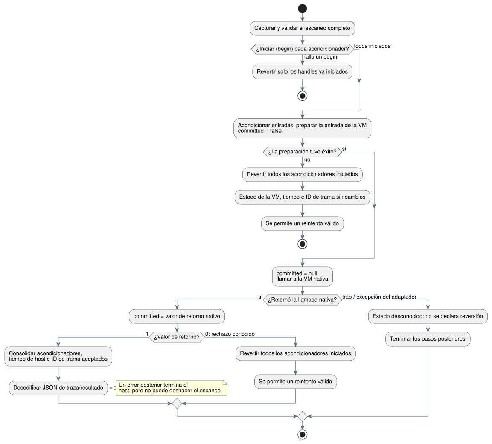

<!-- translation-source: tasks/sensor-atomicity-design.md -->
[Original en inglés](sensor-atomicity-design.md)

# Transacción de escaneo de sensores

La Referencia §2.8/§4.15 exige que un tick rechazado deje sin consolidar el
estado de sensores, filtros y VM.

Batch7 demostró que el debounce de la VM se revierte correctamente. También
expuso una brecha: los acondicionadores (los handles de filtro de sensor y de
histéresis) se modificaban *antes* de que la VM aceptara el tick. Este trabajo
cierra esa brecha de integración en el host.

**Fuera de alcance:** no certifica la adquisición física, la persistencia tras
un reinicio ni futuras implementaciones de controladores/recursos.

## Contrato

El diagrama siguiente resume cómo un escaneo pasa por el inicio, el despacho
nativo y la consolidación (commit) o la reversión (rollback). Las reglas que
siguen son normativas.

**Punto de control por handle.** Cada handle de señal de Rust posee como máximo
un punto de control (checkpoint) completo. El punto de control contiene el
historial del filtro, los relojes, la identidad de la muestra aceptada, los
fallos, el contador de recuperaciones, la histéresis, los diagnósticos, la
configuración y el búfer de errores de la ABI.

**Exportaciones de ciclo de vida.** `gf_signal_begin`, `gf_signal_commit` y
`gf_signal_rollback` devuelven 1 si tienen éxito y 0 ante un handle o un ciclo
de vida inválidos.

- Un begin anidado no puede reemplazar el punto de control original.
- Un commit o rollback sin una transacción activa se rechaza.
- La liberación (disposal) descarta tanto el estado actual como cualquier punto
  de control.
- Un reset dentro de una transacción es reversible.

**JavaScript delgado.** Los métodos JS de `SignalConditioner` solo llaman a
esas exportaciones. No se introduce ningún estado de sensor, evaluador ni caché
de frescura copiado en JS.

**Fase de inicio.** Primero capture y valide el escaneo completo. Luego inicie
(begin) cada acondicionador de sensor y de histéresis antes de modificar
cualquiera de ellos. Si un begin falla, revierta solo los handles ya iniciados.

**Rechazo conocido.** Si el acondicionamiento, la preparación de entradas o la
VM nativa rechazan de una forma conocida, revierta todos los acondicionadores
iniciados. El estado/resultado consolidado de la VM, el último tiempo aceptado
y el ID de trama no cambian. Se permite un reintento completo y válido.

**El estado `committed`.** Un error tipado de despacho nativo lleva
`committed: false | true | null`:

| Momento | `committed` |
| --- | --- |
| Antes de la preparación | `false` |
| Inmediatamente antes de la llamada nativa | `null` |
| Inmediatamente después de que retorna la llamada nativa | el valor de retorno booleano nativo |

La decodificación del búfer de errores y la limpieza de asignaciones no pueden
sobrescribir este hecho. Nunca se usa el texto del mensaje de error para
inferir el estado de consolidación.

**Estado nativo positivo.** Ante un estado nativo positivo, consolide los
acondicionadores y el tiempo de host/ID de trama aceptados *antes* de
decodificar el JSON de traza/resultado.

- Un error de presentación posterior no puede deshacer la ejecución aceptada.
- Si una excepción de limpieza sigue a un estado nativo positivo, los
  acondicionadores y la contabilidad aceptada del host deben consolidarse de
  todos modos.
- Tales errores terminan esa instancia del host.
- Una vez consolidado un escaneo, la clase de una excepción posterior no puede
  reclasificarlo como rechazado.

**Estado desconocido.** Un trap inesperado o una excepción del adaptador durante
el despacho nativo deja desconocido el estado de consolidación. Termine los
pasos posteriores. No declare una reversión y no permita un reintento
especulativo. Conserve el estado actual y libere los puntos de control
pendientes al liberar el host, para que el último resultado consolidado de la
VM siga siendo inspeccionable.

**Eliminación del latch general.** El antiguo latch (retención) general de
fallos encuadrado existía solo porque no se disponía de reversión de
acondicionadores. Elimínelo para los escaneos rechazados conocidos. Mantenga el
manejo terminal solo para los casos concretos de estado desconocido y
posteriores a la consolidación descritos arriba.

## Aceptación y responsables

| Responsable | Responsabilidad |
| --- | --- |
| Astra | Instantánea Rust acotada, ciclo de vida y pruebas nativas, compilación WASM correspondiente. |
| Luna | Métodos JS delgados y pruebas reales de ciclo de vida/errores en WASM. Un TypeError por ABI faltante no debe satisfacer una aserción de rechazo de ciclo de vida. |
| Sol | Ambas rutas de ControlRuntime, la frontera explícita de consolidación nativa, pruebas reales de reversión y reintento de mediana/EMA/histéresis/recuperación, y contratos reemplazados. |
| Root | Revisión de fuente/API, registro explícito de pruebas, la compuerta de integración completa una vez que todos los responsables congelen su trabajo, el índice de evidencia y la contabilidad del alcance restante. |

**Vectores distintivos.** Estos vectores muestran que una muestra rechazada deja
intacto el historial previo en lugar de reiniciarlo:

| Filtro | Secuencia | Esperado |
| --- | --- | --- |
| median(3) | consolidados 10, 20 + rechazado 999 + consolidado 30 | 20 |
| EMA(0.5) | consolidado 10 + rechazado 20 + consolidado 30 | 20 |
| histéresis | consolidado 20 (on) + rechazado 40 (off) + consolidado 33 (entre umbrales) | sigue en on |

Los contadores de recuperación, las identidades, los diagnósticos y los relojes
deben revertirse de la misma manera.

**Memoria.** El costo es una instantánea Rust acotada adicional por cada
acondicionador asignado. El presupuesto del compilador canónico de 128 entradas
generadas permite como máximo 42 acondicionadores de tres entradas; otras
entradas pueden reducir ese número. No es un límite global de asignación para
quienes llaman a la ABI de forma independiente. Registre la memoria medida por
handle y los resultados reales de aceptación después de la implementación.

## Evidencia de Rust

| Destino | `Sensor` | Slot de punto de control | Handle completo |
| --- | ---: | ---: | ---: |
| Nativo | 664 bytes | 688 bytes | 1,376 bytes |
| WASM | 648 bytes | 664 bytes | 1,328 bytes |

- Un punto de control puede poseer además hasta 40 bytes de texto de error
  copiado. Se excluye la sobrecarga del asignador. El Sensor del núcleo no tiene
  campos propios en el heap.
- Aprobadas: señales del núcleo 15/15, ABI nativa 2/2, prueba de asignación 1/1.
  La prueba de asignación cubre update/read/clone/restore del núcleo, no la
  asignación de la cadena de error de la ABI.
- Evidencia: `build/sensor-transaction-core-final.log`,
  `build/sensor-transaction-abi-final.log`,
  `build/sensor-transaction-allocations.log`,
  `build/sensor-transaction-wasm-memory.log`.
- Estos resultados por sí solos no demuestran REF-04-065 ni la finalización
  global del compilador/runtime.

## Evidencia enfocada en el host

- Pruebas reales de ciclo de vida en WASM: 6/6. Pruebas de estado de despacho
  nativo: 11/11 (`build/native-dispatch-status-final.log`).
- Pruebas de atomicidad del host: 9/9
  (`build/control-runtime-atomicity-final.log`). Cubren varios filtros,
  histéresis, recuperación, un error posterior de un acondicionador,
  identidad/tiempo aceptados, reintento y fallos posteriores a la
  consolidación.
- REF-04-065 global sigue siendo **parcial**. Las transacciones de
  controladores/recursos y sus otras cláusulas necesitan evidencia aparte. El
  reinicio/reproducción duraderos del estado completo del host son algo
  distinto de este punto de control efímero del escaneo.
- Compuerta de integración completa de Batch8: Node 1,621 en total, 1,426
  aprobadas, 31 fallidas, 164 TODO, 0 omitidas; Referencia 172 aprobadas / 31
  fallidas; no Referencia 0; tutorial no ejecutado. Informes:
  `build/compiler-runtime-batch8-full.log`,
  `build/compiler-runtime-batch8-reference-results.json`,
  `build/compiler-runtime-batch8-verification.json`.
