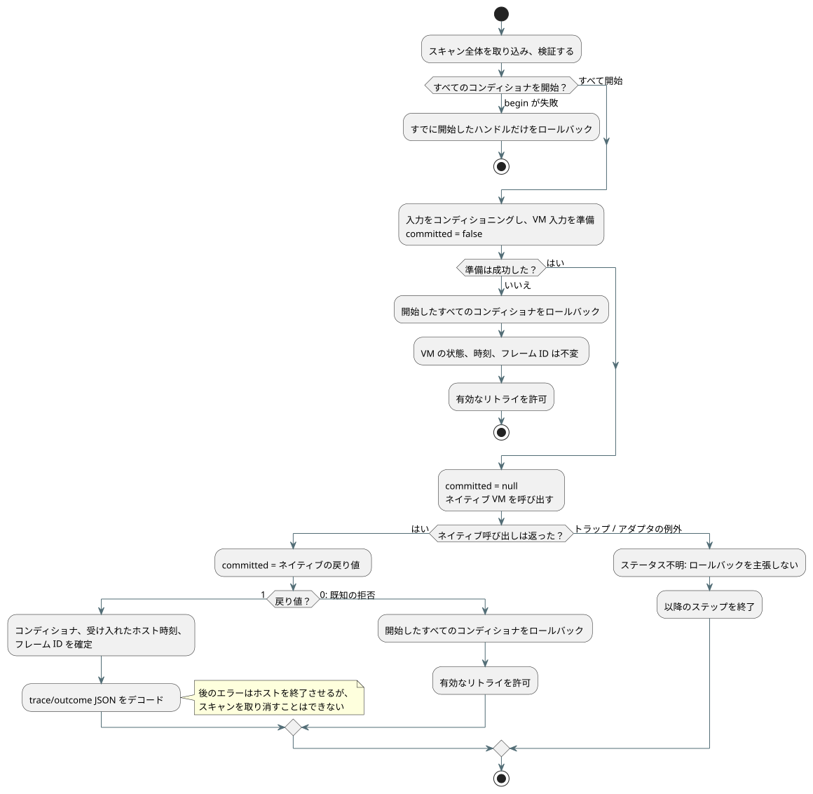

<!-- translation-source: tasks/sensor-atomicity-design.md -->
[英語の原文](sensor-atomicity-design.md)

# センサのスキャントランザクション

Reference §2.8/§4.15 は、拒否された tick がセンサ、フィルタ、VM の状態を未確定のまま残すことを要求しています。

Batch7 では、VM のチャタリング除去（デバウンス）が正しくロールバックされることが証明されました。同時に、1 つのギャップも明らかになりました。コンディショナ（センサのフィルタとヒステリシスのハンドル）が、VM が tick を受け入れる*前に*変更されていたのです。この作業はそのホスト統合のギャップを解消します。

**対象外:** 物理的な取得、再起動をまたぐ永続化、将来のコントローラ/リソースの実装は保証しません。

## 契約

以下の図は、1 回のスキャンが開始、ネイティブへのディスパッチ、確定またはロールバックをどのように進むかをまとめたものです。その後に続く規則は規範的です。

**ハンドルごとのチェックポイント。** 各 Rust 信号ハンドルは、完全なチェックポイントを最大 1 つ所有します。チェックポイントには、フィルタの履歴、クロック、受け入れたサンプルの同一性、故障、復旧回数、ヒステリシス、診断、設定、ABI のエラーバッファが含まれます。

**ライフサイクルのエクスポート。** `gf_signal_begin`、`gf_signal_commit`、`gf_signal_rollback` は、成功時に 1 を返し、無効なハンドルまたはライフサイクルの場合に 0 を返します。

- ネストした begin が元のチェックポイントを置き換えることはできません。
- アクティブなトランザクションがない状態での commit または rollback は拒否されます。
- 破棄（disposal）は現在の状態とチェックポイントの両方を捨てます。
- トランザクション内のリセットは元に戻せます。

**薄い JavaScript。** JS の `SignalConditioner` のメソッドは、これらのエクスポートを呼び出すだけです。JS 側にセンサ状態のコピー、評価器、鮮度キャッシュは導入しません。

**開始フェーズ。** まずスキャン全体を取り込み、検証します。次に、どれかを変更する前に、すべてのセンサとヒステリシスのコンディショナを開始します。begin が失敗した場合は、すでに開始したハンドルだけをロールバックします。

**既知の拒否。** コンディショニング、入力の準備、またはネイティブ VM が既知の形で拒否した場合、開始したすべてのコンディショナをロールバックします。VM の確定済み状態/結果、最後に受け入れた時刻、フレーム ID は変わりません。完全で有効なリトライが許可されます。

**`committed` ステータス。** 型付きのネイティブディスパッチエラーは `committed: false | true | null` を持ちます。

| 時点 | `committed` |
| --- | --- |
| 準備の前 | `false` |
| ネイティブ呼び出しの直前 | `null` |
| ネイティブ呼び出しが返った直後 | ネイティブの Boolean 戻り値 |

エラーバッファのデコードや割り当てのクリーンアップがこの事実を上書きすることはできません。エラーメッセージのテキストから確定ステータスを推測することは決してありません。

**正のネイティブステータス。** ネイティブステータスが正の場合は、trace/outcome の JSON をデコードする*前に*、コンディショナと受け入れたホスト時刻/フレーム ID を確定します。

- その後の表示上のエラーが、受け入れられた実行を取り消すことはできません。
- 正のネイティブステータスの後にクリーンアップの例外が発生しても、コンディショナと受け入れたホスト側の記録は確定されなければなりません。
- そのようなエラーは、そのホストインスタンスを終了させます。
- いったんスキャンが確定されたら、後の例外の種類によってそれを拒否に再分類することはできません。

**不明なステータス。** ネイティブディスパッチ中の予期しないトラップやアダプタの例外は、確定ステータスを不明のままにします。それ以降のステップを終了します。ロールバックを主張してはならず、推測に基づくリトライも許可しません。現在の状態を保持し、最後に確定した VM の結果を調べられるように、保留中のチェックポイントはホストの破棄時に解放します。

**包括的なラッチの削除。** 以前のフレーム化された包括的な故障ラッチは、コンディショナのロールバックが利用できなかったために存在していたにすぎません。既知の拒否されたスキャンについては、それを削除します。終端的な扱いは、上記の具体的な不明ケースと確定後のケースにだけ残します。

## 受け入れと担当

| 担当者 | 責務 |
| --- | --- |
| Astra | 有界な Rust スナップショット、ライフサイクルとネイティブのテスト、対応する WASM ビルド。 |
| Luna | 薄い JS メソッドと、実際の WASM のライフサイクル/エラーテスト。ABI 欠落による TypeError がライフサイクル拒否のアサーションを満たしてはなりません。 |
| Sol | 両方の ControlRuntime 経路、明示的なネイティブ確定境界、実際の median/EMA/ヒステリシス/復旧のロールバックとリトライのテスト、置き換えられた契約。 |
| Root | ソース/API のレビュー、明示的なテスト登録、すべての担当者が凍結した後の完全な統合ゲート、証拠の索引、残りの範囲の計上。 |

**区別のためのベクタ。** これらのベクタは、拒否されたサンプルが以前の履歴をリセットせず、そのまま残すことを示します。

| フィルタ | シーケンス | 期待値 |
| --- | --- | --- |
| median(3) | 確定 10、20 + 拒否 999 + 確定 30 | 20 |
| EMA(0.5) | 確定 10 + 拒否 20 + 確定 30 | 20 |
| ヒステリシス | 確定 20（on）+ 拒否 40（off）+ 確定 33（しきい値の間） | on のまま |

復旧カウンタ、同一性、診断、クロックも同じようにロールバックしなければなりません。

**メモリ。** コストは、割り当てられたコンディショナごとに有界な Rust スナップショットが 1 つ増えることです。正準コンパイラの生成入力 128 個という予算では、3 入力のコンディショナは最大 42 個です。他の入力があればこの数は減ります。これはスタンドアロンの ABI 呼び出し元に対するグローバルな割り当て上限ではありません。実装後に、測定したハンドルごとのメモリと実際の受け入れ結果を記録してください。

## Rust の証拠

| ターゲット | `Sensor` | チェックポイントスロット | ハンドル全体 |
| --- | ---: | ---: | ---: |
| Native | 664 バイト | 688 バイト | 1,376 バイト |
| WASM | 648 バイト | 664 バイト | 1,328 バイト |

- チェックポイントは、さらに最大 40 バイトのコピーしたエラーテキストを所有できます。アロケータのオーバーヘッドは含みません。コアの Sensor にはヒープ所有のフィールドはありません。
- 合格: core signals 15/15、native ABI 2/2、allocation テスト 1/1。allocation テストは core の update/read/clone/restore を対象としており、ABI のエラー文字列の割り当ては対象外です。
- 証拠: `build/sensor-transaction-core-final.log`、`build/sensor-transaction-abi-final.log`、`build/sensor-transaction-allocations.log`、`build/sensor-transaction-wasm-memory.log`。
- これらの結果だけでは、REF-04-065 やコンパイラ/ランタイム全体の完了は証明されません。

## ホストに焦点を当てた証拠

- 実際の WASM ライフサイクルテスト: 6/6。ネイティブディスパッチのステータステスト: 11/11（`build/native-dispatch-status-final.log`）。
- ホストのアトミック性テスト: 9/9（`build/control-runtime-atomicity-final.log`）。複数のフィルタ、ヒステリシス、復旧、後段のコンディショナのエラー、受け入れた同一性/時刻、リトライ、確定後の失敗を対象としています。
- グローバルな REF-04-065 は引き続き**部分的**です。コントローラ/リソースのトランザクションとその他の条項には別の証拠が必要です。ホスト状態全体の永続的な再起動/リプレイは、この一時的なスキャンチェックポイントとは別のものです。
- Batch8 の完全な統合ゲート: Node 合計 1,621、合格 1,426、失敗 31、TODO 164、スキップ 0。Reference は合格 172 / 失敗 31、Reference 以外は 0、チュートリアルは未実行。レポート: `build/compiler-runtime-batch8-full.log`、`build/compiler-runtime-batch8-reference-results.json`、`build/compiler-runtime-batch8-verification.json`。
