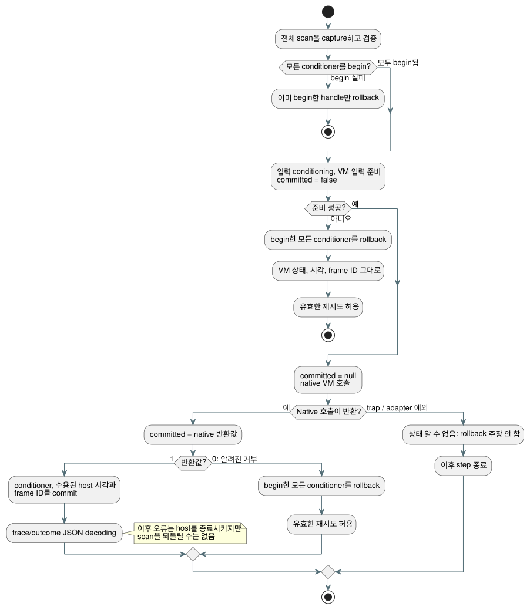

<!-- translation-source: tasks/sensor-atomicity-design.md -->
[영문 원문](sensor-atomicity-design.md)

# Sensor scan 트랜잭션

Reference §2.8/§4.15는 거부된 tick이 sensor, filter, VM 상태를 commit되지 않은
채로 남겨야 한다고 요구합니다.

Batch7은 VM debounce가 올바르게 rollback됨을 증명했습니다. 동시에 공백 하나도
드러냈습니다. conditioner(sensor filter와 hysteresis handle)가 VM이 tick을
수용하기 *전에* 변경되고 있었습니다. 이 작업은 그 host 통합 공백을 메웁니다.

**범위 밖:** 물리 수집, 재부팅 간 영속성, 향후 controller/resource 구현은
인증하지 않습니다.

## 계약

아래 다이어그램은 scan 하나가 begin, native dispatch, 그리고 commit 또는
rollback을 거치는 과정을 요약합니다. 그 뒤에 오는 규칙은 규범적입니다.

**Handle별 checkpoint.** 각 Rust signal handle은 완전한 checkpoint를 최대 하나
소유합니다. Checkpoint에는 filter 이력, 시계, 수용된 sample 식별자, fault, 복구
횟수, hysteresis, 진단, 설정, ABI 오류 buffer가 들어 있습니다.

**Lifecycle export.** `gf_signal_begin`, `gf_signal_commit`,
`gf_signal_rollback`은 성공하면 1을, handle이나 lifecycle이 잘못되면 0을
반환합니다.

- 중첩된 begin은 원래 checkpoint를 대체할 수 없습니다.
- 활성 트랜잭션이 없는 commit이나 rollback은 거부됩니다.
- Dispose는 현재 상태와 모든 checkpoint를 함께 버립니다.
- 트랜잭션 안에서의 reset은 되돌릴 수 있습니다.

**얇은 JavaScript.** JS `SignalConditioner` 메서드는 그 export들만 호출합니다.
복사된 JS sensor 상태, 평가기, freshness cache는 도입하지 않습니다.

**Begin 단계.** 먼저 전체 scan을 capture하고 검증합니다. 그런 다음 어떤
conditioner든 변경하기 전에 모든 sensor와 hysteresis conditioner를 begin합니다.
Begin이 실패하면 이미 begin한 handle만 rollback합니다.

**알려진 거부.** Conditioning, 입력 준비, native VM 중 어느 것이 알려진 방식으로
거부하면, begin한 모든 conditioner를 rollback합니다. VM의 commit된 상태/결과,
마지막으로 수용된 시각과 frame ID는 바뀌지 않습니다. 완전하고 유효한 재시도는
허용됩니다.

**`committed` 상태.** 타입이 지정된 native-dispatch 오류는
`committed: false | true | null`을 담습니다:

| 시점 | `committed` |
| --- | --- |
| 준비 전 | `false` |
| native 호출 직전 | `null` |
| native 호출이 반환된 직후 | native 반환값(Boolean) |

오류 buffer decoding과 allocation 정리는 이 사실을 덮어쓸 수 없습니다. 오류
메시지 텍스트로 commit 상태를 추정하는 일은 절대 없습니다.

**양의 native 상태.** Native 상태가 양이면, trace/outcome JSON을 decoding하기
*전에* conditioner와 수용된 host 시각/frame ID를 commit합니다.

- 이후의 표시 오류가 수용된 실행을 되돌릴 수는 없습니다.
- 양의 native 상태 뒤에 정리 예외가 발생해도, conditioner와 수용된 host 관리
  정보는 반드시 commit되어야 합니다.
- 이런 오류는 해당 host instance를 종료시킵니다.
- Scan이 일단 commit되면, 이후 예외의 종류가 그 scan을 거부된 것으로 재분류할 수
  없습니다.

**알 수 없는 상태.** Native dispatch 중 예상하지 못한 trap이나 adapter 예외가
나면 commit 상태를 알 수 없습니다. 이후 step을 종료합니다. Rollback했다고
주장하지 말고, 추측에 기반한 재시도도 허용하지 마세요. 현재 상태를 유지하고,
host dispose 시 대기 중인 checkpoint를 해제하여 마지막으로 commit된 VM 결과를
계속 검사할 수 있게 합니다.

**포괄 latch 제거.** 이전의 framed 포괄 fault latch는 conditioner rollback이
없었기 때문에만 존재했습니다. 알려진 거부 scan에서는 이를 제거합니다. 종결
처리는 위에서 말한 구체적인 알 수 없는 상태와 commit 이후의 경우에만
유지합니다.

## 수용 기준과 소유권

| 소유자 | 책임 |
| --- | --- |
| Astra | 제한된 Rust snapshot, lifecycle/native 테스트, 대응하는 WASM build. |
| Luna | 얇은 JS 메서드와 실제 WASM lifecycle/오류 테스트. 누락된 ABI로 인한 TypeError가 lifecycle 거부 assertion을 충족해서는 안 됩니다. |
| Sol | 두 ControlRuntime 경로, 명시적인 native commit 경계, 실제 median/EMA/hysteresis/복구 rollback 및 재시도 테스트, 대체된 계약. |
| Root | Source/API 검토, 명시적 테스트 등록, 모든 소유자가 변경을 확정한 뒤의 전체 통합 gate, 증거 색인, 남은 범위 집계. |

**구분 가능한 vector.** 다음 vector는 거부된 sample이 이전 이력을 초기화하지 않고
그대로 남긴다는 것을 보여 줍니다:

| Filter | 순서 | 기대값 |
| --- | --- | --- |
| median(3) | commit 10, 20 + 거부 999 + commit 30 | 20 |
| EMA(0.5) | commit 10 + 거부 20 + commit 30 | 20 |
| hysteresis | commit 20 (on) + 거부 40 (off) + commit 33 (두 임계값 사이) | 계속 on |

복구 counter, 식별자, 진단, 시계도 같은 방식으로 rollback되어야 합니다.

**메모리.** 할당된 conditioner마다 제한된 Rust snapshot이 하나 더 드는 것이
비용입니다. 정본 컴파일러의 생성 입력 예산 128개는 3입력 conditioner를 최대
42개까지 허용합니다. 다른 입력이 있으면 이 수는 줄어들 수 있습니다. 이는 독립 ABI
호출자에 대한 전역 allocation 한계가 아닙니다. 구현 후 handle별 측정 메모리와
실제 수용 결과를 기록합니다.

## Rust 증거

| 대상 | `Sensor` | Checkpoint slot | 전체 handle |
| --- | ---: | ---: | ---: |
| Native | 664바이트 | 688바이트 | 1,376바이트 |
| WASM | 648바이트 | 664바이트 | 1,328바이트 |

- Checkpoint는 복사된 오류 텍스트를 추가로 최대 40바이트까지 소유할 수 있습니다.
  Allocator 부가 비용은 제외합니다. Core Sensor에는 heap 소유 필드가 없습니다.
- 통과: core signals 15/15, native ABI 2/2, allocation 테스트 1/1. Allocation
  테스트는 core update/read/clone/restore를 다루며, ABI 오류 문자열 할당은 다루지
  않습니다.
- 증거: `build/sensor-transaction-core-final.log`,
  `build/sensor-transaction-abi-final.log`,
  `build/sensor-transaction-allocations.log`,
  `build/sensor-transaction-wasm-memory.log`.
- 이 결과만으로는 REF-04-065나 전체 compiler/runtime 완료를 증명하지 않습니다.

## 집중 host 증거

- 실제 WASM lifecycle 테스트: 6/6. Native-dispatch 상태 테스트: 11/11
  (`build/native-dispatch-status-final.log`).
- Host 원자성 테스트: 9/9 (`build/control-runtime-atomicity-final.log`). 여러
  filter, hysteresis, 복구, 이후의 conditioner 오류, 수용된 식별자/시각, 재시도,
  commit 이후 실패를 다룹니다.
- 전역 REF-04-065는 여전히 **부분 완료**입니다. Controller/resource 트랜잭션과
  그 밖의 조항에는 별도의 증거가 필요합니다. 전체 host 상태의 영속 재시작/replay는
  이 일시적인 scan checkpoint와 별개입니다.
- Batch8 전체 통합 gate: Node 총 1,621건, 1,426 pass, 31 fail, 164 TODO, 0 skip; Reference 172 pass / 31 fail; non-Reference 0; tutorial 미실행. 보고서: `build/compiler-runtime-batch8-full.log`, `build/compiler-runtime-batch8-reference-results.json`, `build/compiler-runtime-batch8-verification.json`.
