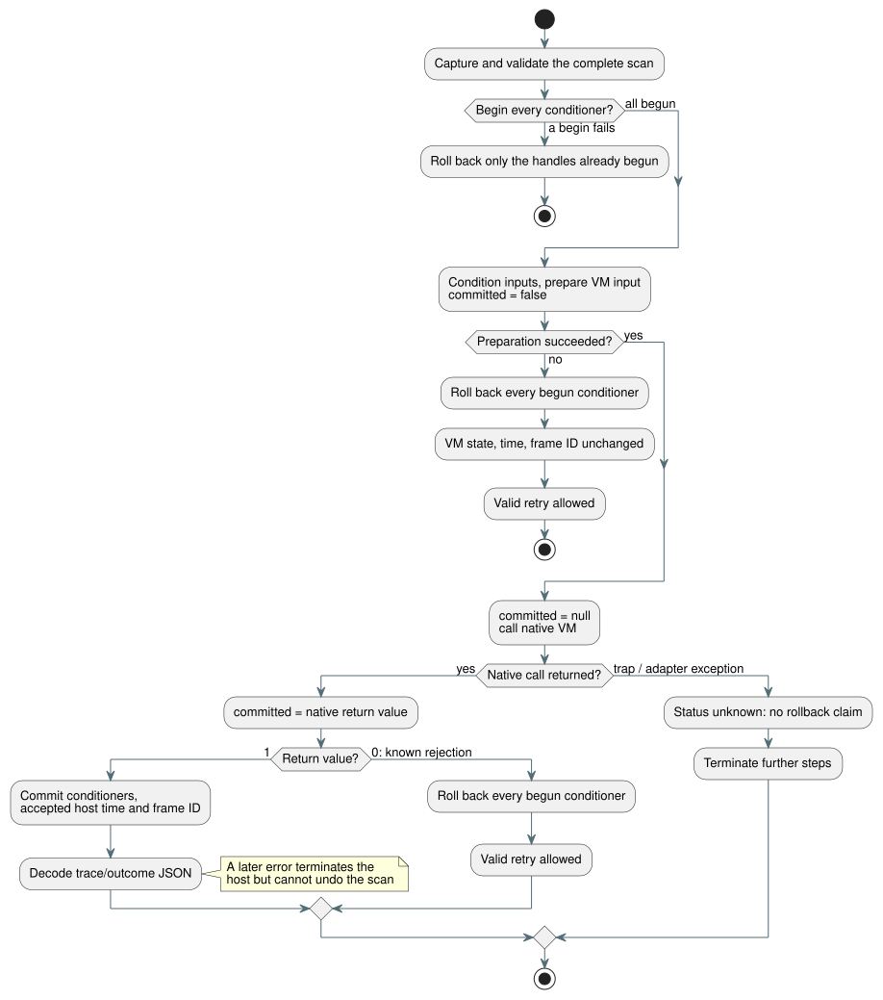

# Sensor scan transaction

Reference §2.8/§4.15 requires that a rejected tick leave sensor, filter and VM
state uncommitted.

Batch7 proved that VM debounce rolls back correctly. It also exposed a gap:
conditioners (the sensor filter and hysteresis handles) were mutated
*before* the VM accepted the tick. This work closes that host integration gap.

**Out of scope:** it does not certify physical acquisition, persistence across
reboot, or future controller/resource implementations.

## Contract

The diagram below summarizes how one scan moves through begin, native dispatch,
and commit or rollback. The rules that follow are normative.

**Checkpoint per handle.** Each Rust signal handle owns at most one complete
checkpoint. The checkpoint contains filter history, clocks, accepted sample
identity, faults, recovery count, hysteresis, diagnostics, configuration and the
ABI error buffer.

**Lifecycle exports.** `gf_signal_begin`, `gf_signal_commit` and
`gf_signal_rollback` return 1 on success and 0 on an invalid handle or
lifecycle.

- A nested begin cannot replace the original checkpoint.
- Commit or rollback without an active transaction rejects.
- Disposal drops both the current state and any checkpoint.
- Reset inside a transaction is reversible.

**Thin JavaScript.** JS `SignalConditioner` methods only call those exports. No
copied JS sensor state, evaluator or freshness cache is introduced.

**Begin phase.** Capture and validate the complete scan first. Then begin every
sensor and hysteresis conditioner before mutating any of them. If a begin fails,
roll back only the handles already begun.

**Known rejection.** If conditioning, input preparation, or the native VM
rejects in a known way, roll back every begun conditioner. The VM's committed
state/outcome, last accepted time and frame ID stay unchanged. A complete, valid
retry is allowed.

**The `committed` status.** A typed native-dispatch error carries
`committed: false | true | null`:

| Moment | `committed` |
| --- | --- |
| Before preparation | `false` |
| Immediately before the native call | `null` |
| Immediately after the native call returns | the Boolean native return value |

Error-buffer decoding and allocation cleanup cannot overwrite this fact. Error
message text is never used to infer commit status.

**Positive native status.** On a positive native status, commit the conditioners
and the accepted host time/frame ID *before* decoding the trace/outcome JSON.

- A later presentation error cannot undo accepted execution.
- If a cleanup exception follows a positive native status, the conditioners and
  accepted host bookkeeping must still commit.
- Such errors terminate that host instance.
- Once a scan is committed, the class of a later exception cannot reclassify it
  as rejected.

**Unknown status.** An unexpected trap or adapter exception during native
dispatch leaves the commit status unknown. Terminate further steps. Do not claim
a rollback and do not allow a speculative retry. Keep the current state, and
release pending checkpoints on host disposal so that the last committed VM
outcome remains inspectable.

**Removing the blanket latch.** The old framed blanket fault latch existed only
because conditioner rollback was unavailable. Remove it for known rejected
scans. Keep terminal handling only for the concrete unknown and post-commit
cases above.

## Acceptance and ownership

| Owner | Responsibility |
| --- | --- |
| Astra | Bounded Rust snapshot, lifecycle and native tests, matching WASM build. |
| Luna | Thin JS methods and real WASM lifecycle/error tests. A missing-ABI TypeError must not satisfy a lifecycle-rejection assertion. |
| Sol | Both ControlRuntime paths, the explicit native commit boundary, real median/EMA/hysteresis/recovery rollback and retry tests, and superseded contracts. |
| Root | Source/API review, explicit test registration, the full integration gate after all owners freeze, the evidence index, and remaining-scope accounting. |

**Distinguishing vectors.** These vectors show that a rejected sample leaves the
prior history intact rather than resetting it:

| Filter | Sequence | Expected |
| --- | --- | --- |
| median(3) | committed 10, 20 + rejected 999 + committed 30 | 20 |
| EMA(0.5) | committed 10 + rejected 20 + committed 30 | 20 |
| hysteresis | committed 20 (on) + rejected 40 (off) + committed 33 (between thresholds) | still on |

Recovery counters, identities, diagnostics and clocks must roll back in the same
way.

**Memory.** The cost is one additional bounded Rust snapshot per allocated
conditioner. The canonical compiler's budget of 128 generated inputs allows at
most 42 three-input conditioners; other inputs can lower that number. This is
not a global allocation limit for standalone ABI callers. Record the measured
per-handle memory and the actual acceptance results after implementation.

## Rust evidence

| Target | `Sensor` | Checkpoint slot | Full handle |
| --- | ---: | ---: | ---: |
| Native | 664 bytes | 688 bytes | 1,376 bytes |
| WASM | 648 bytes | 664 bytes | 1,328 bytes |

- A checkpoint can additionally own up to 40 bytes of copied error text.
  Allocator overhead is excluded. The core Sensor has no heap-owned fields.
- Passed: core signals 15/15, native ABI 2/2, allocation test 1/1. The
  allocation test covers core update/read/clone/restore, not the ABI error
  string allocation.
- Evidence: `build/sensor-transaction-core-final.log`,
  `build/sensor-transaction-abi-final.log`,
  `build/sensor-transaction-allocations.log`,
  `build/sensor-transaction-wasm-memory.log`.
- These results alone do not prove REF-04-065 or overall compiler/runtime
  completion.

## Focused host evidence

- Real WASM lifecycle tests: 6/6. Native-dispatch status tests: 11/11
  (`build/native-dispatch-status-final.log`).
- Host atomicity tests: 9/9 (`build/control-runtime-atomicity-final.log`). They
  cover multiple filters, hysteresis, recovery, a later conditioner error,
  accepted identity/time, retry, and post-commit failures.
- Global REF-04-065 remains **partial**. Controller/resource transactions and
  its other clauses need separate evidence. Durable restart/replay of the
  complete host state is separate from this ephemeral scan checkpoint.
- Batch8 full integration gate: Node 1,621 total, 1,426 pass, 31 fail, 164 TODO, 0 skip; Reference 172 pass / 31 fail; non-Reference 0; tutorial not run. Reports: `build/compiler-runtime-batch8-full.log`, `build/compiler-runtime-batch8-reference-results.json`, `build/compiler-runtime-batch8-verification.json`.
