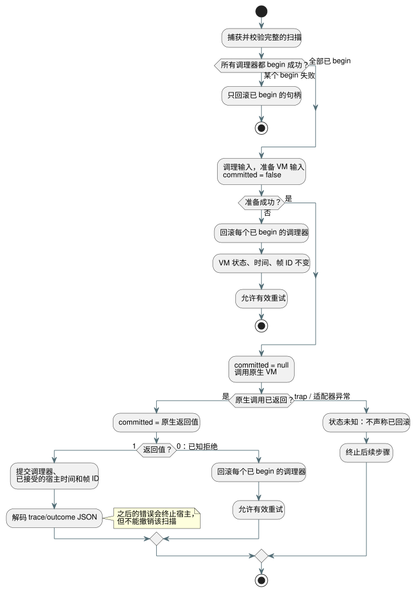

<!-- translation-source: tasks/sensor-atomicity-design.md -->
[英文原文](sensor-atomicity-design.md)

# 传感器扫描事务

Reference §2.8/§4.15 要求被拒绝的 tick（逻辑决策步）使传感器、滤波器和 VM 状态保持未提交。

Batch7 证明了 VM 消抖（debounce）能正确回滚。它也暴露了一个缺口：调理器（conditioner，即传感器滤波器和迟滞句柄）在 VM 接受 tick *之前*就已被修改。本项工作补上这一宿主集成缺口。

**不在范围内：**本工作不认证物理采集、跨重启的持久化，也不认证未来的控制器/资源实现。

## 契约

下图概括了一次扫描如何经过开始（begin）、原生分派，再到提交或回滚。其后的规则是规范性的。

**每个句柄一个检查点。** 每个 Rust 信号句柄最多拥有一个完整的检查点。检查点包含滤波历史、时钟、已接受样本的身份标识、故障、恢复计数、迟滞、诊断、配置以及 ABI 错误缓冲区。

**生命周期导出。** `gf_signal_begin`、`gf_signal_commit` 和 `gf_signal_rollback` 成功时返回 1，句柄或生命周期无效时返回 0。

- 嵌套的 begin 不能替换原有检查点。
- 没有活动事务时的提交或回滚会被拒绝。
- 释放（disposal）会同时丢弃当前状态和任何检查点。
- 事务内的重置是可撤销的。

**薄 JavaScript 层。** JS `SignalConditioner` 方法只调用这些导出。不引入任何复制到 JS 的传感器状态、求值器或新鲜度缓存。

**开始阶段。** 先捕获并校验完整的扫描。然后在修改任何调理器之前，先对每个传感器和迟滞调理器执行 begin。如果某个 begin 失败，只回滚已经 begin 的句柄。

**已知拒绝。** 如果调理、输入准备或原生 VM 以已知方式拒绝，则回滚每个已 begin 的调理器。VM 已提交的状态/结果、上次接受的时间和帧 ID 保持不变。允许进行一次完整、有效的重试。

**`committed` 状态。** 带类型的原生分派错误携带 `committed: false | true | null`：

| 时刻 | `committed` |
| --- | --- |
| 准备之前 | `false` |
| 紧接原生调用之前 | `null` |
| 原生调用返回之后立即 | 原生返回的 Boolean 值 |

错误缓冲区解码和分配清理不能覆盖这一事实。绝不根据错误消息文本推断提交状态。

**正的原生状态。** 当原生状态为正时，在解码 trace/outcome JSON *之前*，先提交调理器以及已接受的宿主时间/帧 ID。

- 之后的展示错误不能撤销已接受的执行。
- 如果在正的原生状态之后发生清理异常，调理器和已接受的宿主记账仍必须提交。
- 此类错误会终止该宿主实例。
- 一旦扫描已提交，之后异常的类别不能将其重新归类为已拒绝。

**未知状态。** 原生分派期间出现意外 trap 或适配器异常时，提交状态未知。终止后续步骤。不要声称已回滚，也不允许推测性重试。保留当前状态，并在宿主释放时释放待处理的检查点，以便最后一次已提交的 VM 结果仍可检查。

**移除一刀切的锁存。** 旧的帧式一刀切故障锁存之所以存在，只是因为当时无法回滚调理器。对已知被拒绝的扫描移除它。只对上述具体的未知情形和提交后情形保留终止处理。

## 验收与职责

| 负责人 | 职责 |
| --- | --- |
| Astra | 有界的 Rust 快照、生命周期和原生测试，以及对应的 WASM 构建。 |
| Luna | 薄 JS 方法以及真实的 WASM 生命周期/错误测试。缺失 ABI 导致的 TypeError 不得满足生命周期拒绝断言。 |
| Sol | 两条 ControlRuntime 路径、显式的原生提交边界、真实的中值/EMA/迟滞/恢复回滚与重试测试，以及被取代的契约。 |
| Root | 源码/API 审阅、显式的测试注册、所有负责人冻结后的完整集成闸门、证据索引，以及剩余范围的核算。 |

**区分性向量。** 这些向量表明，被拒绝的样本会保持先前历史不变，而不是将其重置：

| 滤波器 | 序列 | 期望值 |
| --- | --- | --- |
| median(3) | 已提交 10、20 + 被拒绝 999 + 已提交 30 | 20 |
| EMA(0.5) | 已提交 10 + 被拒绝 20 + 已提交 30 | 20 |
| hysteresis | 已提交 20（on）+ 被拒绝 40（off）+ 已提交 33（介于两个阈值之间） | 仍为 on |

恢复计数器、身份标识、诊断和时钟必须以同样方式回滚。

**内存。** 代价是每个已分配的调理器额外占用一个有界的 Rust 快照。规范编译器的 128 个生成 input 预算最多允许 42 个三输入调理器；其他 input 可能使这一数字更低。这并不是对独立 ABI 调用方的全局分配上限。实现之后，应记录实测的每句柄内存和实际验收结果。

## Rust 证据

| 目标 | `Sensor` | 检查点槽位 | 完整句柄 |
| --- | ---: | ---: | ---: |
| Native | 664 bytes | 688 bytes | 1,376 bytes |
| WASM | 648 bytes | 664 bytes | 1,328 bytes |

- 检查点还可以额外拥有最多 40 字节的复制错误文本。不含分配器开销。核心 Sensor 没有堆上拥有的字段。
- 已通过：core signals 15/15、native ABI 2/2、分配测试 1/1。分配测试覆盖核心的 update/read/clone/restore，不覆盖 ABI 错误字符串分配。
- 证据：`build/sensor-transaction-core-final.log`、`build/sensor-transaction-abi-final.log`、`build/sensor-transaction-allocations.log`、`build/sensor-transaction-wasm-memory.log`。
- 仅凭这些结果不能证明 REF-04-065 或编译器/运行时整体完成。

## 聚焦的宿主证据

- 真实 WASM 生命周期测试：6/6。原生分派状态测试：11/11（`build/native-dispatch-status-final.log`）。
- 宿主原子性测试：9/9（`build/control-runtime-atomicity-final.log`）。它们覆盖多个滤波器、迟滞、恢复、之后发生的调理器错误、已接受的身份标识/时间、重试以及提交后的失败。
- 全局 REF-04-065 仍为**部分完成**。控制器/资源事务及其他条款需要单独的证据。完整宿主状态的持久化重启/重放，与这一临时性的扫描检查点是两回事。
- Batch8 完整集成闸门：Node 共 1,621，通过 1,426，失败 31，TODO 164，跳过 0；Reference 通过 172 / 失败 31；非 Reference 0；未运行教程。报告：`build/compiler-runtime-batch8-full.log`、`build/compiler-runtime-batch8-reference-results.json`、`build/compiler-runtime-batch8-verification.json`。
