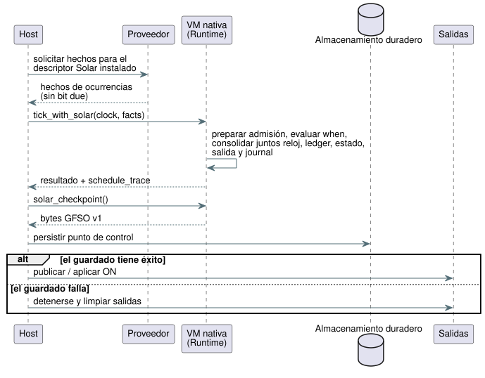

<!-- translation-source: tasks/solar-native-admission-integration.md -->
[Original en inglés](solar-native-admission-integration.md)

# Integración nativa de la admisión Solar

**Fuentes de verdad:** la Referencia §3.4–3.8 y el contrato existente de pulse
Solar de GFB5. Este es un registro de implementación. No cambia el contrato del
lenguaje.

**Por qué existe.** La API encuadrada duradera es el requisito previo acotado
[#400](https://github.com/callin2/ghostflow-language/issues/400) para Farm Device
[#102](https://github.com/callin2/farm-device/issues/102). Reutiliza la
implementación original del responsable `4815b54` sobre la base de desarrollo
actual. La migración del pin del dispositivo y la aceptación en hardware siguen
siendo compuertas aparte.

**División del trabajo en una línea:** el host suministra hechos completos del
proveedor; la VM es responsable de la admisión y de la consolidación (commit)
atómica del estado.

## Implementado

**Activación y tick.**

- `Runtime::activate_with_solar` acepta un módulo GFB5 que solo contiene
  programaciones, una época de arranque explícita y una capacidad de
  identidades terminales.
- `tick_with_solar` recibe un ClockSnapshot y los hechos completos de
  ocurrencias del proveedor en el orden de los descriptores, vinculados por el
  site de la declaración.
- El proveedor debe derivar los hechos del descriptor Solar instalado (zona
  horaria, latitud, longitud, evento, desplazamiento y revisiones). Suministra
  hechos, nunca un bit `due` precalculado.

**Lo que hace la VM nativa en un tick:**

1. Prepara (stage) la admisión del SolarPulseEngine de Rust.
2. Evalúa el predicado `when` del bytecode solo en un cruce elegible. Se admiten
   lecturas de proyecciones de programaciones precedentes.
3. Ejecuta las transiciones/intenciones escalares contra esas proyecciones.
4. Consolida juntos el reloj, el libro mayor (ledger) terminal, el estado
   escalar, la salida y el journal.

Cualquier fallo descarta los cambios de programación preparados, y los ticks
rechazados siguen siendo reintentables. `TickRecord.schedule_trace` y su
codificación JSON conservan las decisiones y la evidencia de revisión de
proveedor/contexto por ocurrencia.

**API del controlador de escaneo y de puntos de control.**

- La API pública de Rust también expone `ScanDriver::scan_with_solar(frame, clock,
  &[SolarInput]) -> ScanOutcome`.
- `Runtime::solar_checkpoint()` devuelve una instantánea opaca `GFSO` v1 como
  `Result<Vec<u8>>`.
- `Runtime::restore_solar_checkpoint(&[u8])` y
  `ScanDriver::restore_solar_checkpoint(&[u8])` la restauran, pero solo antes del
  primer escaneo.

Lo que contiene y lo que no contiene la instantánea `GFSO`:

| Contiene | No contiene |
| --- | --- |
| La huella exacta existente del programa y los sites Solar ordenados | Estado escalar |
| Una comprobación CRC32 contra corrupción accidental (no es autenticación) | Soporte para la reproducción de ejecuciones (run) |
| Solo identidades terminales de día de origen | Un formato de punto de control civil (no se agrega ninguno) |

La restauración conserva la época de arranque nueva y la línea base del reloj
del runtime recién activado. Cada programación permanece acotada a 1–4096
identidades terminales.

**Persistir antes de ON.** El host debe persistir un punto de control exitoso
antes de publicar o aplicar ON. Si el guardado falla, el host debe detenerse y
limpiar las salidas; un guardado fallido no establece que el hardware haya
actuado. La secuencia es:

**Pausa explícita.** `Runtime::observe_solar_paused(clock, facts)` y su
envoltorio de ScanDriver avanzan solo los relojes Solar puros y las identidades
terminales
([#402](https://github.com/callin2/ghostflow-language/issues/402)).

- Nada más cambia: no hay evaluación de predicados/escalares escritos por el
  autor, ni consumo de entradas escalares, ni intención, ni entrada en el
  journal de ticks, ni cambio de identidad del escaneo.
- La supresión no es una traza `ConditionsFalseAtPulse` escrita por el autor.
- Una observación rechazada no consolida nada.
- Persista las identidades terminales modificadas mientras está en OFF. Si el
  guardado falla, deténgase; nunca confirme la durabilidad ni permita la
  reanudación.

**Semántica del reloj.** Solar usa el reloj lógico de programa no decreciente
que exige `scan_with_solar`. Ese reloj puede congelarse durante la pausa. La
hora de pared real y la confianza siguen siendo entradas sin cambios. Las
brechas de pared, la regresión (rollback) y la recuperación siguen las reglas
del núcleo compartido, y las ocurrencias consumidas no se ponen al día al
reanudar. Esto no es movimiento medido ni duración de aplicación.

**Límites de almacenamiento.**

- Quien llama selecciona 1–4096 identidades terminales por programación. El lote
  está acotado por esa capacidad.
- El texto de revisión se limita a 128 bytes UTF-8 por campo antes de que la
  evidencia se prepare o se retenga.
- El agotamiento rechaza el tick; nunca desaloja historial de identidades.
- Son límites de almacenamiento explícitos, no un presupuesto de bytes
  certificado ni un resultado de despliegue en ESP32.

## Evidencia

**Conteos históricos.** La evidencia enfocada original en `4815b54` fue
`cargo check -p ghostflow-core --tests`: aprobada; `schedule_module`: 30
aprobadas; `scan::tests`: 6 aprobadas. Son conteos históricos. No aceptan el
consumidor ni el firmware actuales.

**Ejecución actual.** `cargo test -p ghostflow-core --test schedule_module`: 21
pruebas aprobadas, incluidas 9 pruebas de ejecución que cubren:

- línea base, cruce exacto, supresión de duplicados y traza JSON;
- terminalización por predicado falso en lugar de ejecución diferida;
- reversión ante un fallo aritmético aguas abajo, con reintento exitoso;
- límite exacto de brecha, omisión por exceso de brecha y cruces múltiples
  todos omitidos;
- reloj desconocido, línea base de recuperación y regresión del reloj de pared;
- dependencias de proyecciones de programaciones previas;
- site/época que no coinciden, límites de revisión y capacidad terminal;
- rechazo explícito de ticks no vinculados, rebobinado y preludios temporales
  mixtos.

La primera prueba de ejecución nativa falló antes de implementar las nuevas API
y pasó después de la vinculación nativa. `cargo test -p ghostflow-core` y
`cargo check --workspace` pasan.

## Transporte de hechos del proveedor en WASM

**Flujo en JavaScript.**

1. `GhostFlowRuntime.activateSolar({ bootEpoch, terminalCapacity })` vincula el
   mismo motor nativo que solo contiene programaciones mediante
   `gf_activate_solar`.
2. El host establece todas las entradas escalares, incluidas las
   `__gf_now_ms`/`__gf_time_epoch` correspondientes.
3. El host llama a `tickSolar({ clock, schedules })`.
4. Un tick exitoso consume esas entradas escalares, como en otros ticks
   nativos. `trace.scheduleTrace` conserva las decisiones nativas.

**Forma de los objetos.**

| Objeto | Campos |
| --- | --- |
| `clock` | `monotonicMs`, `bootEpoch`, `wallMs`/`uncertaintyMs` opcionales, `trusted`, `unknownReason` cuando no es confiable, `sourceRevision` opcional |
| entrada de programación (ordenada) | `site`, `coverageFromWallMs`, `coverageToWallMs`, `rows` |
| fila | `sourceDay`, `available`, `scheduledWallMs` opcional (presente exactamente cuando está disponible), `providerRevision`, `contextRevision` |

El host no puede proporcionar un bit due. Son hechos del proveedor; este
transporte de bajo nivel no verifica de forma independiente una predicción
astronómica.

**Paquete binario `GFSF`.** Versión 1, little endian, con tope de 65,536 bytes.

| Parte | Codificación |
| --- | --- |
| Encabezado | u16 versión, u16 cantidad de programaciones (1–128) |
| Reloj | u64 tiempo monotónico, u64 época de arranque, hora de pared opcional, incertidumbre opcional, Bool trusted, cadena de razón, cadena de revisión |
| Entero opcional | indicador de presencia de un byte y luego un u64 (cero cuando está ausente) |
| Cadena | longitud en bytes UTF-8 u16 y luego como máximo 128 bytes |
| Programación | u32 site, u64 inicio/fin de cobertura, u16 cantidad de filas (0–4096) y luego las filas |
| Fila | u32 día de origen, Bool disponibilidad, hora programada opcional, cadena del proveedor, cadena del contexto |

**Validación.**

- Los booleanos aceptan solo 0/1. Todos los valores u64 deben caber en el rango
  de enteros exactos de JS.
- Los sites duplicados, el truncamiento, el UTF-8 inválido, los bytes sobrantes
  y los indicadores de opción contradictorios se rechazan antes del despacho al
  runtime.
- La admisión nativa valida la cobertura de ocurrencias y la vinculación de
  reloj/site.
- Una ejecución fallida deja la admisión y el estado escalar reintentables.

`tests/solar-provider-wasm.test.mjs` verifica la admisión real en WASM, la
reversión, la supresión de duplicados, la evidencia de traza del proveedor, la
recuperación de reloj desconocido y todos los truncamientos de paquetes. Junto
con las pruebas de codificación GFB5, pasan 12 pruebas.

## Trabajo de integración restante (histórico)

Esta sección registra el corte nativo inicial anterior a la integración pública
del compilador GFB5. #400 agrega la frontera duradera del responsable en Rust.
No establece la integración actual con Device, los presupuestos de despliegue ni
la aceptación en hardware.

**Ningún ID de aceptación de la Referencia pasa a verde** a partir de este corte
nativo. La compilación pública de Solar sigue rechazando la política canónica
hasta que se cumplan ambas condiciones:

- el compilador emite su preludio GFB5; y
- el ControlRuntime público valida el manifiesto de políticas y transporta
  hechos del proveedor vinculados al descriptor a través de la nueva API WASM.

Actualmente, ControlRuntime espera `dueInput` en los descriptores Solar; aún no
vincula esta ruta GFB5. Las entradas `due` existentes del host no son evidencia
del contrato de admisión nativo.

**Aún incompleto:** preludios mixtos window/true_for, presupuestos de bytes
calibrados, una integración de proveedor de eventos naturales verificada por
descriptor y los formatos de ocurrencia civil/Tide.

La activación nativa simple, la activación mixta no admitida y el rebobinado
siguen cerrándose ante fallos (fail-closed). Ninguno de esos contratos
faltantes se sustituye por un pulse calculado por el host ni por un fixture de
la Referencia debilitado.
