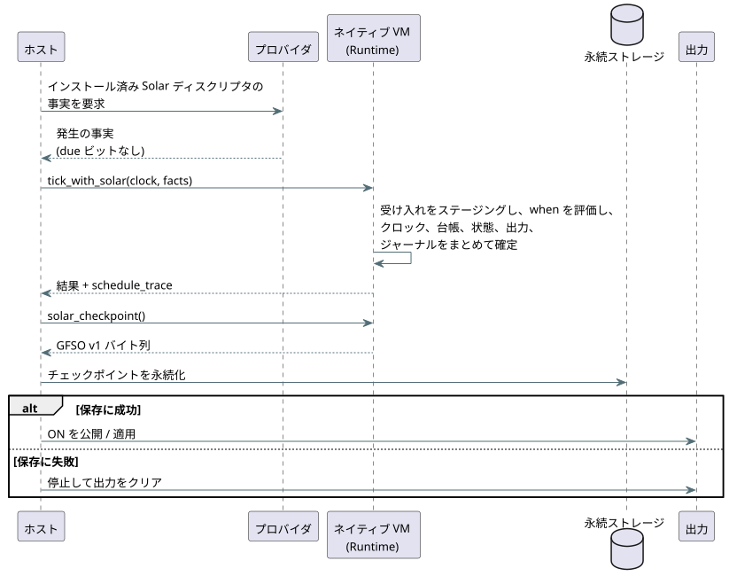

<!-- translation-source: tasks/solar-native-admission-integration.md -->
[英語の原文](solar-native-admission-integration.md)

# ネイティブ Solar 受け入れ（アドミッション）の統合

**基準となる情報源:** Reference §3.4〜3.8 と、既存の GFB5 Solar pulse 契約。これは実装の記録です。言語の契約は変更しません。

**存在理由。** 永続的なフレーム化 API は、Farm Device [#102](https://github.com/callin2/farm-device/issues/102) のための有界な前提条件 [#400](https://github.com/callin2/ghostflow-language/issues/400) です。現在の開発ベース上で、元の `4815b54` の担当者実装を再利用しています。デバイスのピン移行とハードウェアの受け入れは、別個のゲートのままです。

**分担を一行で言うと:** ホストは完全なプロバイダの事実を供給し、VM は受け入れとアトミックな状態の確定を担当します。

## 実装済み

**アクティベーションと tick。**

- `Runtime::activate_with_solar` は、スケジュールのみの GFB5 モジュール、明示的なブートエポック、終端同一性の容量を受け取ります。
- `tick_with_solar` は、ClockSnapshot と、ディスクリプタ順の完全なプロバイダ発生（オカレンス）の事実を受け取ります。事実は宣言 site によって結び付けられます。
- プロバイダは、インストールされた Solar ディスクリプタ（タイムゾーン、緯度、経度、イベント、オフセット、リビジョン）から事実を導出しなければなりません。供給するのは事実であり、事前計算された `due` ビットは決して供給しません。

**ネイティブ VM が 1 回の tick で行うこと:**

1. Rust の SolarPulseEngine の受け入れをステージングします。
2. 該当する通過のときだけ、バイトコードの `when` 述語を評価します。前にあるスケジュールの射影の読み取りがサポートされています。
3. それらの射影に対してスカラーの遷移/意図を実行します。
4. クロック、終端台帳、スカラー状態、出力、ジャーナルをまとめて確定します。

いずれかが失敗すると、ステージングされたスケジュールの変更は破棄され、拒否された tick はリトライ可能なままです。`TickRecord.schedule_trace` とその JSON エンコーディングは、判断と、発生ごとのプロバイダ/コンテキストのリビジョンの証拠を保持します。

**スキャンドライバとチェックポイント API。**

- 公開 Rust API は `ScanDriver::scan_with_solar(frame, clock,
  &[SolarInput]) -> ScanOutcome` も公開します。
- `Runtime::solar_checkpoint()` は、不透明な `GFSO` v1 スナップショットを `Result<Vec<u8>>` として返します。
- `Runtime::restore_solar_checkpoint(&[u8])` と `ScanDriver::restore_solar_checkpoint(&[u8])` はそれを復元しますが、最初のスキャンの前に限ります。

`GFSO` スナップショットに含まれるものと含まれないもの:

| 含まれるもの | 含まれないもの |
| --- | --- |
| 既存のプログラムフィンガープリントそのものと、順序付けられた Solar の site | スカラー状態 |
| 偶発的な破損を検出するための CRC32 チェック（認証ではありません） | run リプレイのサポート |
| 終端のソース日の同一性のみ | 暦（civil）のチェックポイント形式（追加されません） |

復元しても、新たにアクティベートされたランタイムの新しいブートエポックとクロックのベースラインは維持されます。各スケジュールは 1〜4096 個の終端同一性で有界のままです。

**ON の前に永続化。** ホストは、ON を公開または適用する前に、成功したチェックポイントを永続化しなければなりません。保存が失敗した場合、ホストは停止して出力をクリアしなければなりません。保存の失敗は、ハードウェアが動作したことを立証するものではありません。シーケンスは次のとおりです。

**明示的な一時停止。** `Runtime::observe_solar_paused(clock, facts)` とその ScanDriver ラッパーは、純粋な Solar のクロックと終端同一性だけを進めます（[#402](https://github.com/callin2/ghostflow-language/issues/402)）。

- それ以外は何も変わりません。作成者が記述した述語/スカラーの評価、スカラー入力の消費、意図、tick のジャーナルエントリ、スキャンの同一性の変更は、いずれも行われません。
- 抑止は、作成者が記述した `ConditionsFalseAtPulse` トレースではありません。
- 拒否された観測は何も確定しません。
- OFF の間に変化した終端同一性を永続化します。保存が失敗した場合は停止します。永続化を承認したり、再開を許可したりすることは決してありません。

**クロックのセマンティクス。** Solar は、`scan_with_solar` が要求する非減少のプログラム論理クロックを使います。このクロックは一時停止中に止まってもかまいません。実際の壁時計の時刻と信頼は、変更されない入力のままです。壁時計の gap、巻き戻り、復旧は共有コアの規則に従い、消費済みの発生は再開時に追いつきません。これは測定された動作や適用の継続時間ではありません。

**ストレージの上限。**

- 呼び出し元は、スケジュールごとに 1〜4096 個の終端同一性を選択します。バッチはその容量で制限されます。
- リビジョンのテキストは、証拠がステージングまたは保持される前に、フィールドごとに 128 UTF-8 バイトに制限されます。
- 容量が尽きると tick は拒否されます。同一性の履歴が追い出されることは決してありません。
- これらは明示的なストレージ上限であり、認定されたバイト予算や ESP32 への展開結果ではありません。

## 証拠

**過去のカウント。** `4815b54` での元の焦点を絞った証拠は、`cargo check -p ghostflow-core --tests`: 合格、`schedule_module`: 30 合格、`scan::tests`: 6 合格でした。これらは過去のカウントです。現在の利用側やファームウェアを受け入れるものではありません。

**現在の実行。** `cargo test -p ghostflow-core --test schedule_module`: 21 テストが合格しました。そのうち 9 つの実行テストは次を対象としています。

- ベースライン、ちょうどの通過、重複抑止、JSON トレース
- 遅延実行ではなく、偽の述語による終端化
- 下流の算術エラーによるロールバックと、成功するリトライ
- ちょうどの gap の境界、gap 超過のスキップ、すべて取りこぼしとなる複数通過
- 不明なクロック、復旧ベースライン、壁時計の巻き戻り
- 前にあるスケジュールの射影への依存関係
- site/エポックの不一致、リビジョンの上限、終端容量
- バインドされていない tick、巻き戻し、混在した時間プレリュードの明示的な拒否

最初のネイティブ実行テストは、新しい API の実装前には失敗し、ネイティブバインディング後に合格しました。`cargo test -p ghostflow-core` と `cargo check --workspace` は合格します。

## WASM のプロバイダ事実の転送

**JavaScript のフロー。**

1. `GhostFlowRuntime.activateSolar({ bootEpoch, terminalCapacity })` が、`gf_activate_solar` を通じて同じネイティブのスケジュール専用エンジンをバインドします。
2. ホストは、対応する `__gf_now_ms`/`__gf_time_epoch` を含むすべてのスカラー入力を設定します。
3. ホストは `tickSolar({ clock, schedules })` を呼び出します。
4. 成功した tick は、他のネイティブ tick と同様に、それらのスカラー入力を消費します。`trace.scheduleTrace` はネイティブの判断を保持します。

**オブジェクトの形。**

| オブジェクト | フィールド |
| --- | --- |
| `clock` | `monotonicMs`、`bootEpoch`、任意の `wallMs`/`uncertaintyMs`、`trusted`、信頼されていない場合の `unknownReason`、任意の `sourceRevision` |
| スケジュールエントリ（順序付き） | `site`、`coverageFromWallMs`、`coverageToWallMs`、`rows` |
| 行 | `sourceDay`、`available`、任意の `scheduledWallMs`（available のときにちょうど存在）、`providerRevision`、`contextRevision` |

ホストは due ビットを提供できません。これらはプロバイダの事実です。この低レベルの転送は、天文予測を独自に検証するものではありません。

**`GFSF` バイナリパケット。** バージョン 1、リトルエンディアン、上限は 65,536 バイトです。

| 部分 | エンコーディング |
| --- | --- |
| ヘッダー | u16 バージョン、u16 スケジュール数（1〜128） |
| クロック | u64 単調時間、u64 ブートエポック、任意の壁時計時刻、任意の不確かさ、Bool の trusted、理由の文字列、リビジョンの文字列 |
| 任意の整数 | 1 バイトの存在フラグ、続いて u64（欠落時は 0） |
| 文字列 | u16 の UTF-8 バイト長、続いて最大 128 バイト |
| スケジュール | u32 site、u64 カバレッジの開始/終了、u16 行数（0〜4096）、続いて行 |
| 行 | u32 ソース日、Bool の利用可否、任意の予定時刻、プロバイダの文字列、コンテキストの文字列 |

**検証。**

- Boolean は 0/1 だけを受け付けます。すべての u64 値は JS の厳密な整数の範囲に収まらなければなりません。
- 重複した site、切り詰め、無効な UTF-8、末尾の余分なバイト、矛盾するオプションフラグは、ランタイムへのディスパッチ前に拒否されます。
- ネイティブの受け入れが、発生のカバレッジとクロック/site のバインディングを検証します。
- 実行が失敗しても、受け入れとスカラー状態はリトライ可能なままです。

`tests/solar-provider-wasm.test.mjs` は、実際の WASM の受け入れ、ロールバック、重複抑止、プロバイダのトレース証拠、不明クロックからの復旧、すべてのパケット切り詰めを検証します。GFB5 のエンコーディングテストと合わせて、12 テストが合格します。

## 過去に残っていた統合作業

この節は、公開 GFB5 コンパイラ統合の前の、最初のネイティブスライスを記録したものです。#400 は永続的な Rust の担当境界を追加します。現在の Device 統合、展開予算、ハードウェアの受け入れを立証するものではありません。

**このネイティブスライスによって新たにグリーンになった Reference 受け入れ ID はありません。** 次の両方が成り立つまで、公開の Solar コンパイルは引き続き正準ポリシーを拒否します。

- コンパイラがその GFB5 プレリュードを出力すること
- 公開の ControlRuntime がポリシーマニフェストを検証し、ディスクリプタに結び付いたプロバイダの事実を新しい WASM API を通じて転送すること

ControlRuntime は現在、Solar ディスクリプタに `dueInput` を期待しており、この GFB5 経路はまだバインドしていません。既存のホストの `due` 入力は、ネイティブ受け入れ契約の証拠ではありません。

**まだ未完了:** 混在した window/true_for プレリュード、較正されたバイト予算、ディスクリプタで検証された自然イベントのプロバイダ統合、civil/Tide の発生形式。

ネイティブの通常アクティベーション、サポートされていない混在アクティベーション、巻き戻しは、引き続きフェイルクローズドです。欠けているこれらの契約のいずれも、ホストが計算した pulse や弱められた Reference フィクスチャで置き換えられてはいません。
