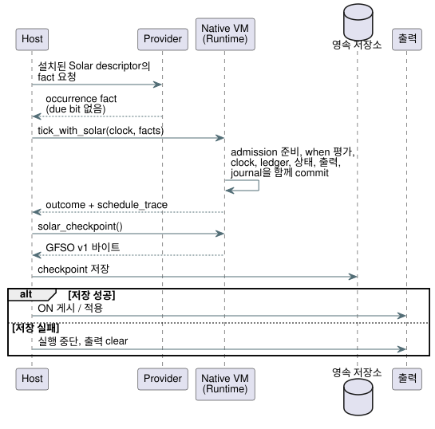

<!-- translation-source: tasks/solar-native-admission-integration.md -->
[영문 원문](solar-native-admission-integration.md)

# Native Solar admission 통합

**기준 자료:** Reference §3.4–3.8과 기존 GFB5 Solar pulse 계약. 이 문서는 구현
기록입니다. 언어 계약을 바꾸지 않습니다.

**이 작업이 필요한 이유.** 영속 framed API는 Farm Device
[#102](https://github.com/callin2/farm-device/issues/102)의 범위가 제한된 선행 작업
[#400](https://github.com/callin2/ghostflow-language/issues/400)입니다. 현재 개발
base 위에 원래의 `4815b54` owner 구현을 재사용합니다. Device pin 이전과
하드웨어 수용은 별도의 gate로 남습니다.

**역할 분담 한 줄 요약:** host는 완전한 provider fact를 공급하고, VM은
admission(수용)과 원자적 상태 commit을 소유합니다.

## 구현된 내용

**Activation과 tick.**

- `Runtime::activate_with_solar`는 schedule 전용 GFB5 module, 명시적인 boot epoch,
  terminal identity 용량을 받습니다.
- `tick_with_solar`는 ClockSnapshot과, 선언 site로 연결되어 descriptor 순서로
  정렬된 완전한 provider occurrence fact를 받습니다.
- Provider는 설치된 Solar descriptor(timezone, latitude, longitude, event,
  offset, revision)로부터 fact를 도출해야 합니다. Provider는 fact를 공급하며,
  미리 계산된 `due` bit는 절대 공급하지 않습니다.

**Native VM이 한 tick에서 하는 일:**

1. Rust SolarPulseEngine admission을 준비(stage)합니다.
2. 적격 crossing에서만 bytecode `when` 술어를 평가합니다. 앞선 schedule
   projection 읽기를 지원합니다.
3. 그 projection에 대해 scalar transition/intent를 실행합니다.
4. Clock, terminal ledger, scalar 상태, 출력, journal을 함께 commit합니다.

어떤 실패든 준비된 schedule 변경을 폐기하며, 거부된 tick은 재시도할 수 있는
상태로 남습니다. `TickRecord.schedule_trace`와 그 JSON encoding은 판단과
occurrence별 provider/context revision 증거를 보존합니다.

**Scan driver와 checkpoint API.**

- 공개 Rust API는 `ScanDriver::scan_with_solar(frame, clock,
  &[SolarInput]) -> ScanOutcome`도 제공합니다.
- `Runtime::solar_checkpoint()`는 불투명한 `GFSO` v1 snapshot을
  `Result<Vec<u8>>`로 반환합니다.
- `Runtime::restore_solar_checkpoint(&[u8])`와
  `ScanDriver::restore_solar_checkpoint(&[u8])`는 이를 복원하지만, 첫 scan 전에만
  가능합니다.

`GFSO` snapshot에 들어 있는 것과 들어 있지 않은 것:

| 포함 | 미포함 |
| --- | --- |
| 정확한 기존 program fingerprint와 순서가 있는 Solar site | Scalar 상태 |
| 우발적 손상을 잡기 위한 CRC32 검사(인증 아님) | Run replay 지원 |
| Terminal source-day identity만 | Civil checkpoint 형식(추가하지 않음) |

복원은 새로 활성화된 runtime의 fresh boot epoch와 clock baseline을 유지합니다.
각 schedule은 terminal identity 1–4096개로 계속 제한됩니다.

**ON 전에 저장.** Host는 ON을 게시하거나 적용하기 전에 성공한 checkpoint를 저장해야
합니다. 저장이 실패하면 host는 실행을 중단하고 출력을 clear해야 합니다. 저장
실패는 하드웨어가 동작했다는 사실을 성립시키지 않습니다. 순서는 다음과 같습니다:

**명시적 pause.** `Runtime::observe_solar_paused(clock, facts)`와 그 ScanDriver
wrapper는 pure-Solar clock과 terminal identity만 진행시킵니다
([#402](https://github.com/callin2/ghostflow-language/issues/402)).

- 그 밖에는 아무것도 바뀌지 않습니다: 작성된 술어/scalar 평가 없음, scalar 입력
  소비 없음, intent 없음, tick journal 항목 없음, scan identity 변경 없음.
- Suppression은 작성된 `ConditionsFalseAtPulse` trace가 아닙니다.
- 거부된 관측은 아무것도 commit하지 않습니다.
- OFF 상태에서 변경된 terminal identity를 저장합니다. 저장이 실패하면 실행을
  중단합니다. Durability를 인정하거나 resume을 허용해서는 절대 안 됩니다.

**Clock 의미.** Solar는 `scan_with_solar`가 요구하는 비감소 program-logical
clock을 사용합니다. 이 clock은 pause 중에 멈출 수 있습니다. 실제 wall time과
trust는 그대로의 입력으로 남습니다. Wall gap, rollback, 복구는 shared-core 규칙을
따르며, 소비된 occurrence는 resume 시 뒤늦게 실행되지 않습니다. 이것은 실측한 이동
시간이나 적용 지속 시간이 아닙니다.

**저장 상한.**

- 호출자는 schedule마다 terminal identity를 1–4096개 선택합니다. Batch는 그 용량으로
  제한됩니다.
- Revision 텍스트는 증거를 준비하거나 보존하기 전에 필드마다 UTF-8 128바이트로
  제한됩니다.
- 용량이 소진되면 tick을 거부합니다. 식별자 이력을 절대 제거하지 않습니다.
- 이것은 명시적인 저장 상한이며, 인증된 바이트 예산이나 ESP32 배포 결과가
  아닙니다.

## 증거

**과거 수치.** `4815b54` 시점의 원래 집중 증거는
`cargo check -p ghostflow-core --tests`: 통과, `schedule_module`: 30건 통과,
`scan::tests`: 6건 통과였습니다. 이는 과거 수치입니다. 현재 consumer나 firmware를
수용하는 근거가 아닙니다.

**현재 실행.** `cargo test -p ghostflow-core --test schedule_module`: 테스트
21건이 통과하며, 그중 실행 테스트 9건이 다음을 다룹니다:

- baseline, 정확한 crossing, 중복 억제, JSON trace;
- 지연 실행 대신 거짓 술어의 종결 처리;
- 하류 산술 실패 rollback과 성공하는 재시도;
- 정확한 gap 경계, gap 초과 skip, 모두 missed가 되는 multiple crossing;
- unknown clock, 복구 baseline, wall-clock rollback;
- 앞선 schedule projection 의존성;
- 불일치 site/epoch, revision 상한, terminal 용량;
- 연결되지 않은 tick, rewind, 혼합 temporal prelude의 명시적 거부.

첫 native 실행 테스트는 새 API 구현 전에는 실패했고 native binding 후에
통과했습니다. `cargo test -p ghostflow-core`와 `cargo check --workspace`가
통과합니다.

## WASM provider-fact transport

**JavaScript 흐름.**

1. `GhostFlowRuntime.activateSolar({ bootEpoch, terminalCapacity })`가
   `gf_activate_solar`를 통해 같은 native schedule 전용 engine을 연결합니다.
2. Host는 일치하는 `__gf_now_ms`/`__gf_time_epoch`를 포함한 모든 scalar 입력을
   설정합니다.
3. Host가 `tickSolar({ clock, schedules })`를 호출합니다.
4. 성공한 tick은 다른 native tick과 마찬가지로 그 scalar 입력을 소비합니다.
   `trace.scheduleTrace`는 native 판단을 보존합니다.

**객체 형태.**

| 객체 | 필드 |
| --- | --- |
| `clock` | `monotonicMs`, `bootEpoch`, 선택적 `wallMs`/`uncertaintyMs`, `trusted`, 신뢰되지 않을 때 `unknownReason`, 선택적 `sourceRevision` |
| schedule 항목(순서 있음) | `site`, `coverageFromWallMs`, `coverageToWallMs`, `rows` |
| 행 | `sourceDay`, `available`, 선택적 `scheduledWallMs`(available일 때 정확히 존재), `providerRevision`, `contextRevision` |

Host는 due bit를 제공할 수 없습니다. 이것들은 provider fact이며, 이 저수준
transport는 천문 예측을 독립적으로 검증하지 않습니다.

**`GFSF` 바이너리 packet.** Version 1, little endian, 최대 65,536바이트입니다.

| 부분 | Encoding |
| --- | --- |
| Header | u16 version, u16 schedule 수(1–128) |
| Clock | u64 단조 시각, u64 boot epoch, 선택적 wall time, 선택적 uncertainty, Bool trusted, 사유 문자열, revision 문자열 |
| 선택 정수 | 1바이트 존재 flag, 그 뒤 u64(없으면 0) |
| 문자열 | u16 UTF-8 바이트 길이, 그 뒤 최대 128바이트 |
| Schedule | u32 site, u64 coverage 시작/끝, u16 행 수(0–4096), 그 뒤 행들 |
| 행 | u32 source day, Bool 가용성, 선택적 예정 시각, provider 문자열, context 문자열 |

**검증.**

- Boolean은 0/1만 받습니다. 모든 u64 값은 JS 정확한 정수 범위 안에 있어야
  합니다.
- 중복 site, 잘림, 잘못된 UTF-8, 후행 바이트, 모순된 option flag는 runtime
  dispatch 전에 거부됩니다.
- Native admission은 occurrence coverage와 clock/site binding을 검증합니다.
- 실행이 실패하면 admission과 scalar 상태는 재시도할 수 있는 상태로 남습니다.

`tests/solar-provider-wasm.test.mjs`는 실제 WASM admission, rollback, 중복 억제,
provider trace 증거, unknown-clock 복구, 모든 packet 잘림을 검증합니다. GFB5
encoding 테스트와 함께 테스트 12건이 통과합니다.

## 과거 기록: 남은 통합 작업

이 절은 공개 GFB5 컴파일러 통합 이전의 초기 native slice를 기록합니다. #400은
영속 Rust owner 경계를 추가합니다. 현재의 Device 통합, 배포 예산, 하드웨어 수용을
입증하지는 않습니다.

이 native slice로 **새로 GREEN이 된 Reference 수용 ID는 없습니다**. 공개 Solar
컴파일은 다음 두 가지가 모두 성립할 때까지 정본 정책을 계속 거부합니다:

- 컴파일러가 GFB5 prelude를 생성한다; 그리고
- 공개 ControlRuntime이 정책 manifest를 검증하고, descriptor에 연결된 provider
  fact를 새 WASM API로 전달한다.

ControlRuntime은 현재 Solar descriptor에서 `dueInput`을 기대하며, 아직 이 GFB5
경로를 연결하지 않았습니다. 기존 host의 `due` 입력은 native admission 계약의
증거가 아닙니다.

**아직 미완료:** 혼합 window/true_for prelude, 보정된 바이트 예산, descriptor로
검증된 자연 사건 provider 통합, civil/Tide occurrence 형식.

Native 일반 activation, 지원하지 않는 혼합 activation, rewind는 계속 fail-closed로
남습니다. 이 누락된 계약 중 어느 것도 host가 계산한 pulse나 약화된 Reference
fixture로 대체되지 않습니다.
