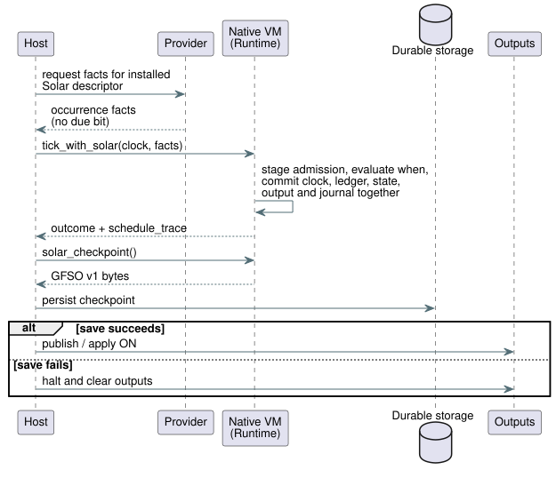

# Native Solar admission integration

**Ground truth:** Reference §3.4–3.8 and the existing GFB5 Solar pulse
contract. This is an implementation record. It does not change the language
contract.

**Why it exists.** The durable framed API is the bounded prerequisite
[#400](https://github.com/callin2/ghostflow-language/issues/400) for Farm Device
[#102](https://github.com/callin2/farm-device/issues/102). It reuses the original
`4815b54` owner implementation on the current development base. Device pin
migration and hardware acceptance remain separate gates.

**Division of labor in one line:** the host supplies complete provider facts;
the VM owns admission and the atomic state commit.

## Implemented

**Activation and tick.**

- `Runtime::activate_with_solar` accepts a schedule-only GFB5 module, an
  explicit boot epoch, and a terminal identity capacity.
- `tick_with_solar` takes a ClockSnapshot and complete provider occurrence
  facts in descriptor order, bound by declaration site.
- The provider must derive the facts from the installed Solar descriptor
  (timezone, latitude, longitude, event, offset and revisions). It supplies
  facts, never a precomputed `due` bit.

**What the native VM does in one tick:**

1. Stages Rust SolarPulseEngine admission.
2. Evaluates the bytecode `when` predicate only at an eligible crossing.
   Reads of preceding schedule projections are supported.
3. Runs scalar transitions/intents against those projections.
4. Commits clock, terminal ledger, scalar state, output and journal together.

Any failure discards the staged schedule changes, and rejected ticks remain
retryable. `TickRecord.schedule_trace` and its JSON encoding keep the decisions
and the per-occurrence provider/context revision evidence.

**Scan driver and checkpoint API.**

- The public Rust API also exposes `ScanDriver::scan_with_solar(frame, clock,
  &[SolarInput]) -> ScanOutcome`.
- `Runtime::solar_checkpoint()` returns an opaque `GFSO` v1 snapshot as
  `Result<Vec<u8>>`.
- `Runtime::restore_solar_checkpoint(&[u8])` and
  `ScanDriver::restore_solar_checkpoint(&[u8])` restore it, but only before the
  first scan.

What the `GFSO` snapshot contains and does not contain:

| Contains | Does not contain |
| --- | --- |
| The exact existing program fingerprint and ordered Solar sites | Scalar state |
| A CRC32 check for accidental corruption (not authentication) | Support for run replay |
| Terminal source-day identities only | A civil checkpoint format (none is added) |

Restore keeps the newly activated runtime's fresh boot epoch and clock
baseline. Each schedule stays bounded at 1–4096 terminal identities.

**Persist before ON.** The host must persist a successful checkpoint before it
publishes or applies ON. If the save fails, the host must halt and clear
outputs; a failed save does not establish that hardware acted. The sequence is:

**Explicit pause.** `Runtime::observe_solar_paused(clock, facts)` and its
ScanDriver wrapper advance only pure-Solar clocks and terminal identities
([#402](https://github.com/callin2/ghostflow-language/issues/402)).

- Nothing else changes: no authored predicate/scalar evaluation, no scalar
  input consumption, no intent, no tick journal entry, no scan identity change.
- Suppression is not an authored `ConditionsFalseAtPulse` trace.
- A rejected observation commits nothing.
- Persist changed terminal identities while OFF. If the save fails, halt; never
  acknowledge durability or permit resume.

**Clock semantics.** Solar uses the nondecreasing program-logical clock that
`scan_with_solar` requires. That clock may freeze during pause. Actual wall time
and trust remain unchanged inputs. Wall gaps, rollback and recovery follow the
shared-core rules, and consumed occurrences do not catch up on resume. This is
not measured movement or application duration.

**Storage bounds.**

- A caller selects 1–4096 terminal identities per schedule. The batch is
  bounded by that capacity.
- Revision text is limited to 128 UTF-8 bytes per field before evidence is
  staged or retained.
- Exhaustion rejects the tick; it never evicts identity history.
- These are explicit storage bounds, not a certified byte budget or an ESP32
  deployment result.

## Evidence

**Historical counts.** The original focused evidence at `4815b54` was
`cargo check -p ghostflow-core --tests`: pass; `schedule_module`: 30 pass;
`scan::tests`: 6 pass. These are historical counts. They do not accept the
current consumer or firmware.

**Current run.** `cargo test -p ghostflow-core --test schedule_module`: 21 tests
pass, including 9 execution tests that cover:

- baseline, exact crossing, duplicate suppression and JSON trace;
- false predicate terminalization rather than delayed execution;
- downstream arithmetic failure rollback, with successful retry;
- exact gap boundary, over-gap skip and all-missed multiple crossings;
- unknown clock, recovery baseline and wall-clock rollback;
- prior schedule projection dependencies;
- mismatched site/epoch, revision bounds and terminal capacity;
- explicit rejection of unbound ticks, rewind and mixed temporal preludes.

The first native execution test failed before the new APIs were implemented and
passed after native binding. `cargo test -p ghostflow-core` and
`cargo check --workspace` pass.

## WASM provider-fact transport

**JavaScript flow.**

1. `GhostFlowRuntime.activateSolar({ bootEpoch, terminalCapacity })` binds the
   same native schedule-only engine through `gf_activate_solar`.
2. The host sets all scalar inputs, including the matching
   `__gf_now_ms`/`__gf_time_epoch`.
3. The host calls `tickSolar({ clock, schedules })`.
4. A successful tick consumes those scalar inputs, as with other native ticks.
   `trace.scheduleTrace` keeps the native decisions.

**Object shape.**

| Object | Fields |
| --- | --- |
| `clock` | `monotonicMs`, `bootEpoch`, optional `wallMs`/`uncertaintyMs`, `trusted`, `unknownReason` when untrusted, optional `sourceRevision` |
| schedule entry (ordered) | `site`, `coverageFromWallMs`, `coverageToWallMs`, `rows` |
| row | `sourceDay`, `available`, optional `scheduledWallMs` (present exactly when available), `providerRevision`, `contextRevision` |

The host cannot provide a due bit. These are provider facts; this low-level
transport does not independently verify an astronomical prediction.

**`GFSF` binary packet.** Version 1, little endian, capped at 65,536 bytes.

| Part | Encoding |
| --- | --- |
| Header | u16 version, u16 schedule count (1–128) |
| Clock | u64 monotonic time, u64 boot epoch, optional wall time, optional uncertainty, Bool trusted, reason string, revision string |
| Optional integer | one-byte presence flag, then a u64 (zero when absent) |
| String | u16 UTF-8 byte length, then at most 128 bytes |
| Schedule | u32 site, u64 coverage start/end, u16 row count (0–4096), then rows |
| Row | u32 source day, Bool availability, optional scheduled time, provider string, context string |

**Validation.**

- Booleans accept only 0/1. All u64 values must fit the JS exact-integer range.
- Duplicate sites, truncation, invalid UTF-8, trailing bytes and contradictory
  option flags reject before runtime dispatch.
- Native admission validates occurrence coverage and clock/site binding.
- Failed execution leaves admission and scalar state retryable.

`tests/solar-provider-wasm.test.mjs` verifies actual WASM admission, rollback,
duplicate suppression, provider trace evidence, unknown-clock recovery and all
packet truncations. Together with the GFB5 encoding tests, 12 tests pass.

## Historical remaining integration work

This section records the initial native slice before public GFB5 compiler
integration. #400 adds the durable Rust owner boundary. It does not establish
current Device integration, deployment budgets or hardware acceptance.

**No Reference acceptance ID is newly green** from this native slice. Public
Solar compilation still rejects the canonical policy until both of these hold:

- the compiler emits its GFB5 prelude; and
- public ControlRuntime validates the policy manifest and transports
  descriptor-bound provider facts through the new WASM API.

ControlRuntime currently expects `dueInput` on Solar descriptors; it does not
yet bind this GFB5 path. Existing host `due` inputs are not evidence of the
native admission contract.

**Still incomplete:** mixed window/true_for preludes, calibrated byte budgets, a
descriptor-verified natural-event provider integration, and the civil/Tide
occurrence formats.

Native plain activation, unsupported mixed activation and rewind stay
fail-closed. None of those missing contracts is replaced by a host-computed
pulse or a weakened Reference fixture.
