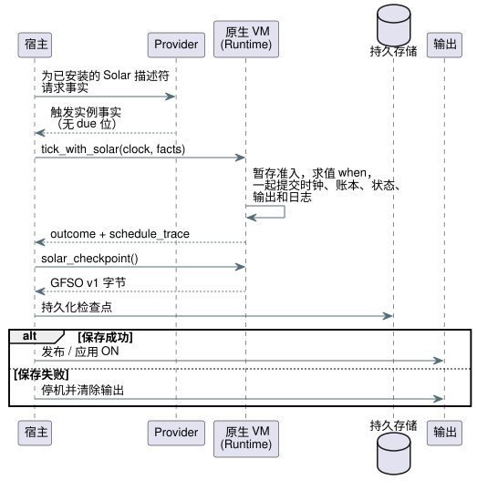

<!-- translation-source: tasks/solar-native-admission-integration.md -->
[英文原文](solar-native-admission-integration.md)

# 原生 Solar 准入集成

**基本事实依据：**Reference §3.4–3.8 以及现有的 GFB5 Solar pulse 契约。本文是实现记录，不改变语言契约。

**为什么需要它。** 持久化的帧式 API 是 Farm Device [#102](https://github.com/callin2/farm-device/issues/102) 的有界前提条件 [#400](https://github.com/callin2/ghostflow-language/issues/400)。它在当前开发基线上复用了最初的 `4815b54` 负责人实现。设备引脚迁移和硬件验收仍是单独的闸门。

**一句话分工：**宿主（host）提供完整的 provider 事实；VM 负责准入（admission）和原子的状态提交。

## 已实现

**激活与 tick。**

- `Runtime::activate_with_solar` 接受仅含调度计划的 GFB5 模块、显式的启动纪元（boot epoch）以及终态身份标识容量。
- `tick_with_solar` 接受一个 ClockSnapshot 以及按描述符顺序排列、按声明 site 绑定的完整 provider 触发实例（occurrence）事实。
- provider 必须从已安装的 Solar 描述符（timezone、latitude、longitude、event、offset 和修订版）推导这些事实。它提供事实，绝不提供预先计算好的 `due` 位。

**原生 VM 在一个 tick 中所做的事：**

1. 暂存 Rust SolarPulseEngine 的准入。
2. 只在符合条件的交叉处对字节码 `when` 谓词求值。支持读取之前的调度计划投影。
3. 基于这些投影运行标量 transitions/intents。
4. 将时钟、终态账本（ledger）、标量状态、输出和日志（journal）一起提交。

任何失败都会丢弃已暂存的调度计划变更，被拒绝的 tick 仍可重试。`TickRecord.schedule_trace` 及其 JSON 编码保留各项判定以及每个触发实例的 provider/上下文修订版证据。

**扫描驱动程序与检查点 API。**

- 公开的 Rust API 还暴露了 `ScanDriver::scan_with_solar(frame, clock,
  &[SolarInput]) -> ScanOutcome`。
- `Runtime::solar_checkpoint()` 以 `Result<Vec<u8>>` 返回不透明的 `GFSO` v1 快照。
- `Runtime::restore_solar_checkpoint(&[u8])` 和 `ScanDriver::restore_solar_checkpoint(&[u8])` 用于恢复快照，但只能在第一次扫描之前调用。

`GFSO` 快照包含和不包含的内容：

| 包含 | 不包含 |
| --- | --- |
| 精确的现有程序指纹和有序的 Solar site | 标量状态 |
| 用于检测意外损坏的 CRC32 校验（不是认证） | 对运行（run）重放的支持 |
| 仅终态源日身份标识 | 民用（civil）检查点格式（未新增） |

恢复会保留新激活运行时的全新启动纪元和时钟基线。每个调度计划的终态身份标识数量限定在 1–4096 之间。

**先持久化再置 ON。** 宿主必须在发布或应用 ON 之前持久化一个成功的检查点。如果保存失败，宿主必须停机并清除输出；保存失败并不能证明硬件已经动作。顺序如下：

**显式暂停。** `Runtime::observe_solar_paused(clock, facts)` 及其 ScanDriver 包装只推进纯 Solar 的时钟和终态身份标识（[#402](https://github.com/callin2/ghostflow-language/issues/402)）。

- 其他一切都不改变：不进行作者编写的谓词/标量求值，不消费标量 input，不产生 intent，不写入 tick 日志条目，不改变扫描身份标识。
- 抑制不是作者编写的 `ConditionsFalseAtPulse` trace。
- 被拒绝的观测不提交任何内容。
- 在 OFF 期间持久化已变更的终态身份标识。如果保存失败则停机；绝不确认持久性，也不允许恢复运行。

**时钟语义。** Solar 使用 `scan_with_solar` 所要求的、非递减的程序逻辑时钟。该时钟在暂停期间可以冻结。实际墙钟时间和信任状态仍作为不变的输入。墙钟间隙、回拨和恢复遵循共享核心的规则，已消费的触发实例在恢复运行时不会补执行。这不是实测的移动量或应用持续时间。

**存储边界。**

- 调用方为每个调度计划选择 1–4096 个终态身份标识。批次受该容量限制。
- 在暂存或保留证据之前，每个字段的修订版文本限制为 128 个 UTF-8 字节。
- 容量耗尽会拒绝 tick；绝不会逐出身份标识历史。
- 这些是显式的存储边界，而不是经过认证的字节预算或 ESP32 部署结果。

## 证据

**历史计数。** `4815b54` 处最初的聚焦证据为：`cargo check -p ghostflow-core --tests`：通过；`schedule_module`：30 通过；`scan::tests`：6 通过。这些是历史计数，不构成对当前使用方或固件的验收。

**当前运行。** `cargo test -p ghostflow-core --test schedule_module`：21 个测试通过，其中 9 个执行测试覆盖：

- baseline、恰好交叉、重复抑制以及 JSON trace；
- 谓词为 false 时进入终态，而不是延迟执行；
- 下游算术失败的回滚，以及随后成功的重试；
- 恰好等于间隙的边界、超过间隙的跳过，以及多重交叉全部错过；
- 未知时钟、恢复基线以及墙钟回拨；
- 对之前调度计划投影的依赖；
- site/纪元不匹配、修订版边界以及终态容量；
- 显式拒绝未绑定的 tick、倒带（rewind）以及混合的时间前导。

第一个原生执行测试在新 API 实现之前失败，在原生绑定之后通过。`cargo test -p ghostflow-core` 和 `cargo check --workspace` 均通过。

## WASM provider 事实传输

**JavaScript 流程。**

1. `GhostFlowRuntime.activateSolar({ bootEpoch, terminalCapacity })` 通过 `gf_activate_solar` 绑定同一个原生的仅调度计划引擎。
2. 宿主设置所有标量 input，包括相匹配的 `__gf_now_ms`/`__gf_time_epoch`。
3. 宿主调用 `tickSolar({ clock, schedules })`。
4. 与其他原生 tick 一样，成功的 tick 会消费这些标量 input。`trace.scheduleTrace` 保留原生判定。

**对象结构。**

| 对象 | 字段 |
| --- | --- |
| `clock` | `monotonicMs`、`bootEpoch`、可选的 `wallMs`/`uncertaintyMs`、`trusted`、不受信任时的 `unknownReason`、可选的 `sourceRevision` |
| 调度计划条目（有序） | `site`、`coverageFromWallMs`、`coverageToWallMs`、`rows` |
| 行 | `sourceDay`、`available`、可选的 `scheduledWallMs`（当且仅当可用时存在）、`providerRevision`、`contextRevision` |

宿主不能提供 due 位。这些是 provider 事实；这一低层传输不会独立验证天文预测。

**`GFSF` 二进制数据包。** 版本 1，小端序，上限 65,536 字节。

| 部分 | 编码 |
| --- | --- |
| 头部 | u16 版本，u16 调度计划数量（1–128） |
| 时钟 | u64 单调时间、u64 启动纪元、可选墙钟时间、可选不确定度、Bool trusted、原因字符串、修订版字符串 |
| 可选整数 | 一字节存在标志，然后是一个 u64（缺失时为零） |
| 字符串 | u16 UTF-8 字节长度，然后最多 128 字节 |
| 调度计划 | u32 site、u64 覆盖起点/终点、u16 行数（0–4096），然后是各行 |
| 行 | u32 源日、Bool 可用性、可选计划时间、provider 字符串、上下文字符串 |

**校验。**

- Boolean 只接受 0/1。所有 u64 值都必须在 JS 精确整数范围内。
- 重复的 site、截断、无效 UTF-8、尾随字节以及相互矛盾的可选标志，会在运行时分派之前被拒绝。
- 原生准入校验触发实例覆盖以及时钟/site 绑定。
- 执行失败时，准入和标量状态保持可重试。

`tests/solar-provider-wasm.test.mjs` 验证实际的 WASM 准入、回滚、重复抑制、provider trace 证据、未知时钟恢复以及所有数据包截断情形。连同 GFB5 编码测试，共有 12 个测试通过。

## 历史上剩余的集成工作

本节记录的是公开 GFB5 编译器集成之前的初始原生切片。#400 加入了持久化的 Rust 负责人边界。它并不确立当前的 Device 集成、部署预算或硬件验收。

**此原生切片没有使任何 Reference 验收 ID 新变为通过。** 在以下两点都成立之前，公开的 Solar 编译仍会拒绝规范策略：

- 编译器输出其 GFB5 前导；并且
- 公开的 ControlRuntime 校验策略清单（manifest），并通过新的 WASM API 传输与描述符绑定的 provider 事实。

ControlRuntime 目前期望 Solar 描述符上有 `dueInput`；它尚未绑定这条 GFB5 路径。现有的宿主 `due` input 不能作为原生准入契约的证据。

**仍未完成：**混合 window/true_for 前导、校准后的字节预算、经描述符验证的自然事件 provider 集成，以及民用/Tide 触发实例格式。

原生普通激活、不受支持的混合激活和倒带仍保持失败即关闭（fail-closed）。上述缺失的契约，没有一个被宿主计算的 pulse 或被削弱的 Reference fixture 所替代。
