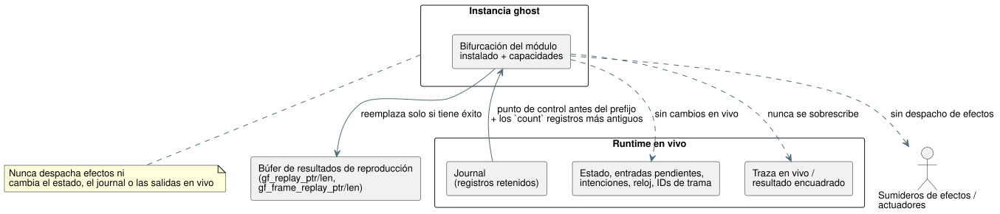

<!-- translation-source: tasks/temporal-adapter-replay-design.md -->
[Original en inglés](temporal-adapter-replay-design.md)

# Reproducción temporal a través de los adaptadores WASM

**Estado: implementado.** Pasaron la aceptación enfocada en Rust y la de
reproducción (replay) en WASM real. Batch14 incluye estas pruebas y no presenta
nuevas regresiones. Sus 27 fallos no relacionados de la Referencia y sus 164
casos TODO siguen impidiendo la finalización del objetivo global.

**Fuente de verdad.** La Referencia §6.8 exige que la reproducción:

- se ejecute en una instancia ghost separada;
- reproduzca las entradas originales en sus tiempos lógicos originales; y
- preserve la línea de tiempo en vivo y sus sumideros de efectos.

La aceptación de ventanas anidadas medidas también exige la reproducción tras la
rotación del journal a través de ambos adaptadores WASM. Modificar un runtime en
vivo con `rewind` no satisface este contrato.

## API y titularidad

El diagrama muestra qué lee el ghost del runtime en vivo y qué se le permite
escribir.



**Punto de entrada en Rust.**
`Runtime::replay_current_with_temporal(count, activation, max_peak_temporal_bytes)`
bifurca (fork) el módulo y las capacidades instalados. Quien llama suministra el
perfil de activación temporal y el presupuesto de pico temporal combinado de
original más ghost.

**IDs de escaneo en ejecuciones encuadradas.** `ScanDriver` registra el primer
tick del runtime subyacente en el momento de su creación.

- Solo son elegibles los registros del journal de esa ejecución encuadrada.
- El ID de escaneo de un registro retenido es `tick - first_scan_tick`.
- Su tiempo lógico proviene de su entrada de reloj registrada.
- Un driver que envuelve un runtime que ya ejecutó ticks debe empezar de todos
  modos en el ID de escaneo 0.

**Reglas de conteo.** El conteo es positivo y no puede superar la cantidad de
registros retenidos elegibles. La reproducción selecciona su prefijo más
antiguo y empieza en el punto de control inmediatamente anterior a ese prefijo.
Los conteos nunca se recortan silenciosamente y nunca se inventan entradas
faltantes.

**Exportaciones WASM.**

- `gf_replay_temporal` y `gf_frame_replay_temporal` reciben el paquete de
  activación GFTA sin cambios, el conteo, el presupuesto de pico temporal y el
  presupuesto JSON.
- `gf_replay_ptr/len` y `gf_frame_replay_ptr/len`, por separado, exponen la
  última reproducción exitosa. Nunca sobrescriben la traza en vivo ni el
  resultado encuadrado.

**Adaptadores JavaScript.** Ambos exponen
`replayTemporal({ count, profile, maxPeakTemporalBytes, maxJsonBytes })`.
El conteo y los presupuestos deben ser enteros u32 positivos; el codificador de
perfiles existente valida los campos del perfil. El método devuelve el JSON de
reproducción analizado.

Sobre:

```text
{ format: "GhostFlow/temporal-replay-v1",
  mode: "legacy" | "framed",
  checkpointTick,
  records: [TickRecord | { format: "GhostFlow/scan-outcome-v1",
                          scanId, logicalTimeMs, trace: TickRecord }] }
```

## Atomicidad y memoria

**Aislamiento.** El ghost posee su propio estado y su propia evidencia. Nunca
despacha un efecto a un actuador. Nunca cambia las entradas pendientes en vivo,
el estado, el journal, las intenciones, la secuencia de tramas, el reloj ni el
último resultado.

- Una reproducción exitosa reemplaza solo su búfer de resultados separado.
- Una solicitud rechazada preserva tanto la reproducción previa como la
  ejecución en vivo. Solo puede cambiar su diagnóstico de error.

**Dos presupuestos separados:**

| Presupuesto | Cubre | Excluye |
| --- | --- | --- |
| `maxPeakTemporalBytes` | La contabilidad explícita de arena temporal/punto de control/prueba y de trazas del núcleo | Clones de escalares/módulos y metadatos del asignador. No debe describirse como un límite total de memoria del proceso. |
| `maxJsonBytes` | El búfer de reproducción retenido previamente más el búfer candidato | El texto copiado y los objetos analizados de JavaScript (asignaciones propiedad de quien llama) |

**Escritura de JSON.** La serialización debe transmitir en flujo los registros
prestados. No debe construir una cadena de registros intermedia ilimitada.
Cuente los bytes UTF-8 escapados antes de asignar y luego escriba el candidato
sin crecimiento geométrico.

## Pruebas requeridas

1. La reproducción medida anidada preserva los valores agregados, las
   identidades de prueba propias y los ticks lógicos originales en ambos
   adaptadores, incluida la rotación del journal.
2. Un driver encuadrado creado después de ticks heredados (legacy) informa los
   IDs de escaneo correctos.
3. La evaluación tardía rechazada y el reintento no crean admisiones
   duplicadas.
4. La reproducción deja sin cambios las entradas pendientes en vivo, la
   traza/resultado, el estado, las intenciones, los IDs de trama y los relojes;
   un paso en vivo posterior sigue la línea de tiempo original.
5. Los conteos, perfiles, presupuestos temporales y presupuestos JSON inválidos
   preservan tanto la reproducción previa como el estado en vivo. Los límites
   de tamaño se prueban de forma independiente.
6. El WASM real recompilado ejecuta los casos de JavaScript; los mocks por sí
   solos son insuficientes.

## Alcance restante de la Referencia

Esta operación del adaptador sobre el programa instalado aporta evidencia de
ejecución. Por sí sola **no** completa estas partes de §6.8:

- identidades duraderas de Program/cierre de fuentes/ajustes/vinculación/ejecución
  y de ramas;
- reproducción hipotética (what-if) de un programa candidato;
- restauración de puntos de control externos;
- simulación del entorno.

Esto sigue siendo trabajo explícito del objetivo completo. Este corte no
debilita ninguna expectativa del lenguaje ni ninguna prueba existente de la
Referencia.

## Evidencia enfocada

| Registro | Resultado |
| --- | --- |
| `build/temporal-replay-rust-final.log` | Pasan 139 pruebas del núcleo y 8 de la ABI WASM. |
| `build/temporal-replay-wasm-build.log` | La compilación WASM de release tiene éxito. |
| `build/temporal-replay-wasm.log` | 27/27 aprobadas, incluida la igualdad exacta de registros en vivo/reproducidos, anidado 20/3, reintento de tick fallido, entradas pendientes preservadas, última reproducción exitosa preservada y rotación de 1024 registros en ambos adaptadores. |
| `build/scan-frame-wasm-temporal-replay.log` | La suite encuadrada existente pasa 17/17. |
| `build/temporal-replay-catalog.log` | 5/5 aprobadas tras reubicar sin cambios el cuerpo de la prueba de atomicidad de salidas en Rust; su digest registrado no cambia. |

**Escritor JSON compartido.** Las trazas ordinarias y la reproducción comparten
un único escritor JSON del núcleo basado en préstamos. Las pruebas cubren UTF-8
escapado, escrituras rechazadas en el sumidero, límites JSON exactos N/N-1 y la
capacidad del búfer retenido. La conversión de resultados encuadrados
contabiliza su vector de salida antes de crear el ghost, incluido su
solapamiento con el almacenamiento de traza devuelto por el núcleo.

**Compuerta completa.** Evidencia: `build/compiler-runtime-batch14-full.log` y
`build/compiler-runtime-batch14-verification.json`. Node: 1900 aprobadas, 27
fallos existentes de la Referencia, 164 TODO. Los hashes de las fuentes de
verificación coincidieron al final de la compuerta.

**Salvedad sobre el umbral de bytes.** Las pruebas del núcleo nativo demuestran
la contabilidad exacta N/N-1 del total de bytes temporales. Las dos rutas WASM
reales actualmente rechazan presupuestos de pico insuficientes y verifican la
rotación, pero no miden de forma independiente su umbral exacto de bytes
totales. Ese informe de recursos específico del destino y la evidencia de
límites se resuelven con la [evidencia del plan temporal](temporal-resource-plan-design.es.md)
enfocada. La restauración externa duradera, el intercambio en caliente
(hot-swap) y la identidad completa de §6.8 siguen abiertos.
