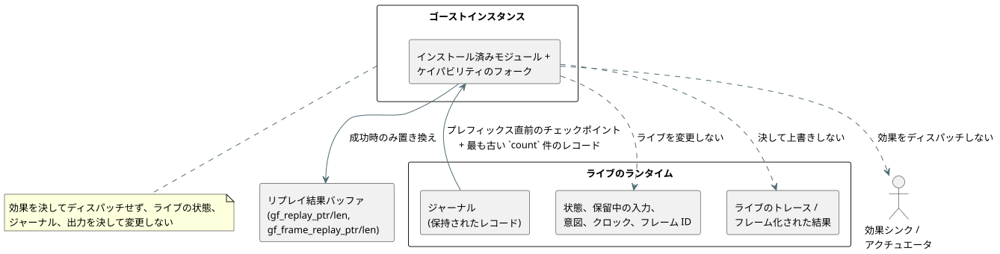

<!-- translation-source: tasks/temporal-adapter-replay-design.md -->
[英語の原文](temporal-adapter-replay-design.md)

# WASM アダプタを通じた時間的リプレイ

**ステータス: 実装済み。** 焦点を絞った Rust のテストと、実際の WASM でのリプレイ受け入れテストが合格しました。Batch14 にはこれらのテストが含まれており、新たなリグレッションはありません。無関係な Reference の失敗 27 件と TODO ケース 164 件が、引き続き全体目標の完了を妨げています。

**基準となる情報源。** Reference §6.8 は、リプレイに次のことを要求しています。

- 別個のゴースト（ゴースト実行）インスタンスで実行すること
- 元の入力を元の論理時間でリプレイすること
- ライブのタイムラインとその効果シンクを保持すること

測定された入れ子 window の受け入れでは、両方の WASM アダプタを通じて、ジャーナルのロールオーバー後のリプレイも要求されます。`rewind` でライブのランタイムを変更しても、この契約は満たされません。

## API と所有権

この図は、ゴーストがライブのランタイムから何を読み、何を書き込むことが許されているかを示しています。



**Rust のエントリポイント。**
`Runtime::replay_current_with_temporal(count, activation, max_peak_temporal_bytes)`
は、インストール済みのモジュールとケイパビリティをフォークします。呼び出し元は、時間的アクティベーションプロファイルと、元の実行とゴーストを合わせた時間的ピーク予算を供給します。

**フレーム化された実行でのスキャン ID。** `ScanDriver` は、作成時に基盤となるランタイムの最初の tick を記録します。

- そのフレーム化された実行のジャーナルレコードだけが対象になります。
- 保持されているレコードのスキャン ID は `tick - first_scan_tick` です。
- その論理時間は、記録されたクロック入力から得られます。
- すでに tick を実行したランタイムをラップするドライバであっても、スキャン ID 0 から開始しなければなりません。

**カウントの規則。** カウントは正であり、対象となる保持レコードの数を超えることはできません。リプレイはそれらの最も古いプレフィックスを選び、そのプレフィックスの直前のチェックポイントから開始します。カウントが暗黙に切り詰められることは決してなく、欠けている入力が捏造されることも決してありません。

**WASM のエクスポート。**

- `gf_replay_temporal` と `gf_frame_replay_temporal` は、変更されていない GFTA アクティベーションパケット、カウント、時間的ピーク予算、JSON 予算を受け取ります。
- 別個の `gf_replay_ptr/len` と `gf_frame_replay_ptr/len` が、最後に成功したリプレイを公開します。これらがライブのトレースやフレーム化された結果を上書きすることは決してありません。

**JavaScript アダプタ。** 両方とも
`replayTemporal({ count, profile, maxPeakTemporalBytes, maxJsonBytes })`
を公開します。カウントと予算は正の u32 整数でなければなりません。プロファイルのフィールドは既存のプロファイルエンコーダが検証します。このメソッドは、パースされたリプレイ JSON を返します。

エンベロープ:

```text
{ format: "GhostFlow/temporal-replay-v1",
  mode: "legacy" | "framed",
  checkpointTick,
  records: [TickRecord | { format: "GhostFlow/scan-outcome-v1",
                          scanId, logicalTimeMs, trace: TickRecord }] }
```

## アトミック性とメモリ

**分離。** ゴーストは自分自身の状態と証拠を所有します。アクチュエータへの効果を決してディスパッチしません。ライブの保留中の入力、状態、ジャーナル、意図、フレームシーケンス、クロック、最後の結果を決して変更しません。

- 成功したリプレイが置き換えるのは、その別個の結果バッファだけです。
- 拒否されたリクエストは、以前のリプレイとライブの実行の両方を保持します。変わりうるのは、そのエラー診断だけです。

**2 つの別個の予算:**

| 予算 | 対象 | 対象外 |
| --- | --- | --- |
| `maxPeakTemporalBytes` | コアの明示的な時間アリーナ/チェックポイント/証明とトレースの計上 | スカラー/モジュールのクローンとアロケータのメタデータ。プロセスのメモリ全体の上限として説明してはなりません。 |
| `maxJsonBytes` | 以前に保持されていたリプレイバッファと候補バッファ | JavaScript がコピーしたテキストとパース済みオブジェクト（呼び出し元が所有する割り当て） |

**JSON の書き込み。** シリアライズは借用したレコードをストリーミングしなければなりません。上限のない中間レコード文字列を構築してはなりません。割り当ての前にエスケープ後の UTF-8 バイト数を数え、その後、幾何級数的な拡張なしで候補を書き込みます。

## 必要なテスト

1. 入れ子の測定値リプレイが、ジャーナルのロールオーバーを含め、両方のアダプタで集計値、所有された証明の同一性、元の論理 tick を保持すること。
2. レガシーな tick の後に作成されたフレーム化ドライバが、正しいスキャン ID を報告すること。
3. 拒否された遅延評価とリトライが、重複した受け入れ（アドミッション）を生まないこと。
4. リプレイが、ライブの保留中の入力、トレース/結果、状態、意図、フレーム ID、クロックを変更しないこと。その後のライブのステップが元のタイムラインに従うこと。
5. 無効なカウント、プロファイル、時間的予算、JSON 予算が、以前のリプレイとライブの状態の両方を保持すること。サイズの境界は独立してテストします。
6. 実際に再ビルドした WASM で JavaScript のケースを実行すること。モックだけでは不十分です。

## Reference の残りの範囲

インストール済みのプログラムに対するこのアダプタ操作は、実行の証拠を提供します。それだけでは、§6.8 の次の部分は完了**しません**。

- 永続的な Program/ソースクロージャ/設定/バインディング/実行（run）とブランチの同一性
- 候補プログラムの what-if リプレイ
- 外部チェックポイントの復元
- 環境シミュレーション

これらは全体目標における明示的な作業のままです。このスライスは、言語の期待も既存の Reference テストも弱めていません。

## 焦点を絞った証拠

| ログ | 結果 |
| --- | --- |
| `build/temporal-replay-rust-final.log` | Core 139 と WASM ABI 8 のテストが合格。 |
| `build/temporal-replay-wasm-build.log` | リリース WASM ビルドが成功。 |
| `build/temporal-replay-wasm.log` | 27/27 合格。ライブとリプレイのレコードの完全一致、入れ子 20/3、失敗した tick のリトライ、保留中の入力の保持、最後に成功したリプレイの保持、両方のアダプタでの 1024 レコードのロールオーバーを含みます。 |
| `build/scan-frame-wasm-temporal-replay.log` | 既存のフレーム化スイート 17/17 合格。 |
| `build/temporal-replay-catalog.log` | 変更のない Rust の出力アトミック性テスト本体を移動した後、5/5 合格。記録されたダイジェストは変わっていません。 |

**共有の JSON ライター。** 通常のトレースとリプレイは、借用ベースのコア JSON ライターを 1 つ共有します。テストは、エスケープされた UTF-8、拒否されたシンクへの書き込み、JSON の N/N-1 の厳密な境界、保持バッファの容量を対象としています。フレーム化された結果の変換は、ゴーストを作成する前に、コアが返すトレースストレージとの重なりを含めて、その出力ベクタを計上します。

**完全なゲート。** 証拠: `build/compiler-runtime-batch14-full.log` と `build/compiler-runtime-batch14-verification.json`。Node: 合格 1900、既存の Reference の失敗 27、TODO 164。ゲート終了時に検証ソースのハッシュは一致していました。

**バイトしきい値に関する注意。** ネイティブのコアテストは、時間的バイトの合計について N/N-1 の厳密な計上を証明しています。実際の 2 つの WASM 経路は、現時点では不十分なピーク予算を拒否し、ロールオーバーを検証しますが、それぞれの合計バイトの厳密なしきい値を独立して測定してはいません。そのターゲット固有のリソースレポートと境界の証拠は、焦点を絞った[時間計画の証拠](temporal-resource-plan-design.ja.md)で解決されています。永続的な外部復元、ホットスワップ、§6.8 の完全な同一性は未解決のままです。
