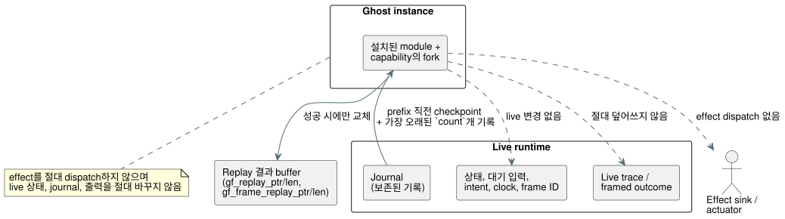

<!-- translation-source: tasks/temporal-adapter-replay-design.md -->
[영문 원문](temporal-adapter-replay-design.md)

# WASM adapter를 통한 temporal replay

**상태: 구현 완료.** 집중 Rust 테스트와 실제 WASM replay 수용 테스트가
통과했습니다. Batch14에는 이 테스트들이 포함되며 새 회귀는 없습니다. 무관한
Reference 실패 27건과 TODO 164건이 여전히 전체 목표 완료를 막고 있습니다.

**기준 자료.** Reference §6.8은 replay가 다음을 만족하도록 요구합니다:

- 별도의 ghost instance에서 실행된다;
- 원래 입력을 원래 논리 시간에 replay한다;
- live timeline과 그 effect sink를 보존한다.

측정된 nested-window 수용 기준은 두 WASM adapter 모두에서 journal rollover 이후의
replay도 요구합니다. `rewind`로 live runtime을 변경하는 것은 이 계약을 충족하지
않습니다.

## API와 소유권

다이어그램은 ghost가 live runtime에서 무엇을 읽고, 무엇을 쓸 수 있는지를
보여 줍니다.



**Rust 진입점.**
`Runtime::replay_current_with_temporal(count, activation, max_peak_temporal_bytes)`는
설치된 module과 capability를 fork합니다. 호출자는 temporal activation profile과,
원본과 ghost를 합친 temporal peak 예산을 공급합니다.

**Framed 실행의 scan ID.** `ScanDriver`는 생성될 때 첫 underlying runtime tick을
기록합니다.

- 그 framed 실행의 journal 기록만 적격입니다.
- 보존된 기록의 scan ID는 `tick - first_scan_tick`입니다.
- 논리 시간은 기록된 clock 입력에서 얻습니다.
- 이미 tick을 실행한 runtime을 감싸는 driver도 scan ID 0부터 시작해야 합니다.

**Count 규칙.** Count는 양수이며 적격 보존 기록 수를 넘을 수 없습니다. Replay는
그 기록들의 가장 오래된 prefix를 선택하고, 그 prefix 바로 앞의 checkpoint에서
시작합니다. Count를 조용히 줄이는 일은 절대 없으며, 누락된 입력을 지어내는 일도
절대 없습니다.

**WASM export.**

- `gf_replay_temporal`과 `gf_frame_replay_temporal`은 변경되지 않은 GFTA
  activation packet, count, temporal peak 예산, JSON 예산을 받습니다.
- 별도의 `gf_replay_ptr/len`과 `gf_frame_replay_ptr/len`이 마지막으로 성공한
  replay를 노출합니다. 이들은 live trace나 framed outcome을 절대 덮어쓰지
  않습니다.

**JavaScript adapter.** 두 adapter 모두
`replayTemporal({ count, profile, maxPeakTemporalBytes, maxJsonBytes })`를
제공합니다. Count와 예산은 양의 u32 정수여야 하며, 기존 profile encoder가 profile
필드를 검증합니다. 이 메서드는 파싱된 replay JSON을 반환합니다.

Envelope:

```text
{ format: "GhostFlow/temporal-replay-v1",
  mode: "legacy" | "framed",
  checkpointTick,
  records: [TickRecord | { format: "GhostFlow/scan-outcome-v1",
                          scanId, logicalTimeMs, trace: TickRecord }] }
```

## 원자성과 메모리

**격리.** Ghost는 자신의 상태와 증거를 소유합니다. Actuator effect를 절대
dispatch하지 않습니다. Live 대기 입력, 상태, journal, intent, frame 순서, clock,
마지막 outcome을 절대 바꾸지 않습니다.

- 성공한 replay는 자신의 별도 결과 buffer만 교체합니다.
- 거부된 요청은 이전 replay와 live 실행을 모두 보존합니다. 바뀔 수 있는 것은 오류
  진단뿐입니다.

**서로 다른 두 예산:**

| 예산 | 포함 | 제외 |
| --- | --- | --- |
| `maxPeakTemporalBytes` | Core의 명시적 temporal arena/checkpoint/proof와 trace 집계 | Scalar/module 복제와 allocator metadata. 이를 전체 process 메모리 상한으로 설명해서는 안 됩니다. |
| `maxJsonBytes` | 이전에 보존한 replay buffer와 후보 buffer의 합 | JavaScript가 복사한 텍스트와 파싱된 객체(호출자 소유 할당) |

**JSON 쓰기.** 직렬화는 빌린 기록을 stream해야 합니다. 무제한 중간 기록 문자열을
만들어서는 안 됩니다. 할당 전에 escape된 UTF-8 바이트 수를 세고, 기하급수적 증가
없이 후보를 씁니다.

## 필수 테스트

1. Nested 측정 replay는 journal rollover를 포함하여 두 adapter 모두에서 aggregate
   값, 소유 proof 식별자, 원래 논리 tick을 보존합니다.
2. Legacy tick 이후에 생성한 framed driver가 올바른 scan ID를 보고합니다.
3. 거부된 뒤늦은 평가와 재시도가 중복 admission을 만들지 않습니다.
4. Replay는 live 대기 입력, trace/outcome, 상태, intent, frame ID, clock을 바꾸지
   않습니다. 이후의 live step은 원래 timeline을 따릅니다.
5. 잘못된 count, profile, temporal 예산, JSON 예산은 이전 replay와 live 상태를
   모두 보존합니다. 크기 경계는 독립적으로 테스트합니다.
6. 실제로 다시 build한 WASM으로 JavaScript 사례를 실행합니다. Mock만으로는
   부족합니다.

## 남은 Reference 범위

설치된 프로그램에 대한 이 adapter 연산은 실행 증거를 제공합니다. 하지만 그것만으로
§6.8의 다음 부분이 완료되지는 **않습니다**:

- 영속적인 Program/source-closure/settings/binding/run 및 branch 식별자;
- 후보 프로그램의 what-if replay;
- 외부 checkpoint 복원;
- 환경 시뮬레이션.

이들은 전체 목표에서 명시적인 작업으로 남습니다. 이 slice는 어떤 언어 기대값이나
기존 Reference 테스트도 약화하지 않습니다.

## 집중 증거

| 로그 | 결과 |
| --- | --- |
| `build/temporal-replay-rust-final.log` | Core 139건과 WASM ABI 8건 테스트 통과. |
| `build/temporal-replay-wasm-build.log` | Release WASM build 성공. |
| `build/temporal-replay-wasm.log` | 27/27 통과. 정확한 live/replay 기록 동등성, nested 20/3, 실패한 tick 재시도, 대기 입력 보존, 마지막 성공 replay 보존, 두 adapter 모두에서의 기록 1024개 rollover를 포함합니다. |
| `build/scan-frame-wasm-temporal-replay.log` | 기존 framed suite 17/17 통과. |
| `build/temporal-replay-catalog.log` | 변경되지 않은 Rust output-atomicity 테스트 본문의 위치를 옮긴 뒤 5/5 통과. 기록된 digest는 바뀌지 않았습니다. |

**공유 JSON writer.** 일반 trace와 replay는 빌린 core JSON writer 하나를
공유합니다. 테스트는 escape된 UTF-8, 거부된 sink write, 정확한 JSON N/N-1 경계,
보존 buffer 용량을 다룹니다. Framed 결과 변환은 ghost를 만들기 전에 출력 vector
비용을 반영하며, core가 반환한 trace 저장소와의 중첩도 포함합니다.

**전체 gate.** 증거: `build/compiler-runtime-batch14-full.log`와
`build/compiler-runtime-batch14-verification.json`. Node: 1900 pass, 기존
Reference 실패 27건, 164 TODO. Gate 종료 시점에 verification source hash가
일치했습니다.

**바이트 임계값 관련 주의.** Native core 테스트는 정확한 전체 temporal 바이트
N/N-1 집계를 증명합니다. 두 실제 WASM 경로는 현재 부족한 peak 예산을 거부하고
rollover를 검증하지만, 정확한 전체 바이트 임계값을 독립적으로 측정하지는 않습니다.
이 대상별 자원 보고와 경계 증거는 집중
[temporal-plan 증거](temporal-resource-plan-design.ko.md)로 해결됩니다. 영속적인 외부
복원, hot-swap, 전체 §6.8 식별자는 아직 미결입니다.
