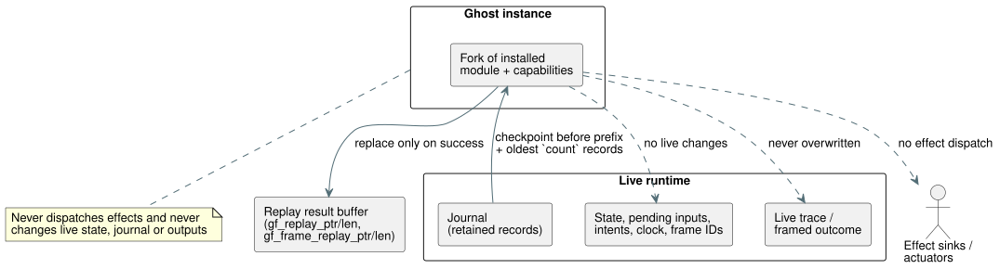

# Temporal replay through the WASM adapters

**Status: implemented.** Focused Rust and actual WASM replay acceptance passed.
Batch14 includes these tests and has no new regressions. Its 27 unrelated
Reference failures and 164 TODO cases still prevent overall goal completion.

**Ground truth.** Reference §6.8 requires replay to:

- run in a separate ghost instance;
- replay the original inputs at their original logical times; and
- preserve the live timeline and its effect sinks.

The measured nested-window acceptance also requires replay after journal
rollover through both WASM adapters. Mutating a live runtime with `rewind` does
not satisfy this contract.

## API and ownership

The diagram shows what the ghost reads from the live runtime and what it is
allowed to write.



**Rust entry point.**
`Runtime::replay_current_with_temporal(count, activation, max_peak_temporal_bytes)`
forks the installed module and capabilities. The caller supplies the temporal
activation profile and the combined original-plus-ghost temporal peak budget.

**Scan IDs in framed runs.** `ScanDriver` records the first underlying runtime
tick at its creation.

- Only journal records from that framed run are eligible.
- A retained record's scan ID is `tick - first_scan_tick`.
- Its logical time comes from its recorded clock input.
- A driver that wraps a runtime which has already executed ticks must still
  start at scan ID 0.

**Count rules.** Count is positive and cannot exceed the number of eligible
retained records. Replay selects their oldest prefix and starts at the
checkpoint immediately before that prefix. Counts are never silently clamped,
and missing inputs are never invented.

**WASM exports.**

- `gf_replay_temporal` and `gf_frame_replay_temporal` receive the unchanged GFTA
  activation packet, the count, the temporal peak budget and the JSON budget.
- Separate `gf_replay_ptr/len` and `gf_frame_replay_ptr/len` expose the last
  successful replay. They never overwrite the live trace or framed outcome.

**JavaScript adapters.** Both expose
`replayTemporal({ count, profile, maxPeakTemporalBytes, maxJsonBytes })`.
Count and budgets must be positive u32 integers; the existing profile encoder
validates the profile fields. The method returns the parsed replay JSON.

Envelope:

```text
{ format: "GhostFlow/temporal-replay-v1",
  mode: "legacy" | "framed",
  checkpointTick,
  records: [TickRecord | { format: "GhostFlow/scan-outcome-v1",
                          scanId, logicalTimeMs, trace: TickRecord }] }
```

## Atomicity and memory

**Isolation.** The ghost owns its own state and evidence. It never dispatches an
actuator effect. It never changes the live pending inputs, state, journal,
intents, frame sequence, clock or last outcome.

- A successful replay replaces only its separate result buffer.
- A rejected request preserves both the prior replay and live execution. Only
  its error diagnostic may change.

**Two separate budgets:**

| Budget | Covers | Excludes |
| --- | --- | --- |
| `maxPeakTemporalBytes` | The core's explicit temporal arena/checkpoint/proof and trace accounting | Scalar/module clones and allocator metadata. It must not be described as a total process memory bound. |
| `maxJsonBytes` | The previously retained replay buffer plus the candidate buffer | JavaScript's copied text and parsed objects (caller-owned allocations) |

**JSON writing.** Serialization must stream borrowed records. It must not build
an unbounded intermediate record string. Count escaped UTF-8 bytes before
allocating, then write the candidate without geometric growth.

## Required tests

1. Nested measured replay preserves aggregate values, owned proof identities and
   original logical ticks in both adapters, including journal rollover.
2. A framed driver created after legacy ticks reports the correct scan IDs.
3. Rejected late evaluation and retry do not create duplicate admissions.
4. Replay leaves live pending inputs, trace/outcome, state, intents, frame IDs
   and clocks unchanged; a subsequent live step follows the original timeline.
5. Invalid counts, profiles, temporal budgets and JSON budgets preserve both
   the prior replay and live state. Size boundaries are tested independently.
6. Actual rebuilt WASM executes the JavaScript cases; mocks alone are insufficient.

## Remaining Reference scope

This adapter operation on the installed program supplies execution evidence. On
its own it does **not** complete these parts of §6.8:

- durable Program/source-closure/settings/binding/run and branch identities;
- candidate-program what-if replay;
- foreign checkpoint restore;
- environment simulation.

These remain explicit work in the full goal. This slice weakens no language
expectation and no existing Reference test.

## Focused evidence

| Log | Result |
| --- | --- |
| `build/temporal-replay-rust-final.log` | Core 139 and WASM ABI 8 tests pass. |
| `build/temporal-replay-wasm-build.log` | Release WASM build succeeds. |
| `build/temporal-replay-wasm.log` | 27/27 pass, including exact live/replayed record equality, nested 20/3, failed tick retry, preserved pending inputs, preserved last successful replay, and 1024-record rollover in both adapters. |
| `build/scan-frame-wasm-temporal-replay.log` | Existing framed suite 17/17 pass. |
| `build/temporal-replay-catalog.log` | 5/5 pass after relocating the unchanged Rust output-atomicity test body; its recorded digest is unchanged. |

**Shared JSON writer.** Ordinary traces and replay share one borrowed core JSON
writer. Tests cover escaped UTF-8, rejected sink writes, exact JSON N/N-1 bounds
and retained-buffer capacity. Framed result conversion charges its output vector
before creating the ghost, including its overlap with the core's returned trace
storage.

**Full gate.** Evidence: `build/compiler-runtime-batch14-full.log` and
`build/compiler-runtime-batch14-verification.json`. Node: 1900 pass, 27 existing
Reference failures, 164 TODO. Verification source hashes matched at gate end.

**Byte-threshold caveat.** The native core tests prove exact total temporal-byte
N/N-1 accounting. The two actual WASM paths currently reject insufficient peak
budgets and verify rollover, but they do not independently measure their exact
total-byte threshold. That target-specific resource report and boundary
evidence are resolved by the focused [temporal-plan evidence](temporal-resource-plan-design.md). Durable foreign
restore, hot-swap and full §6.8 identity remain open.
