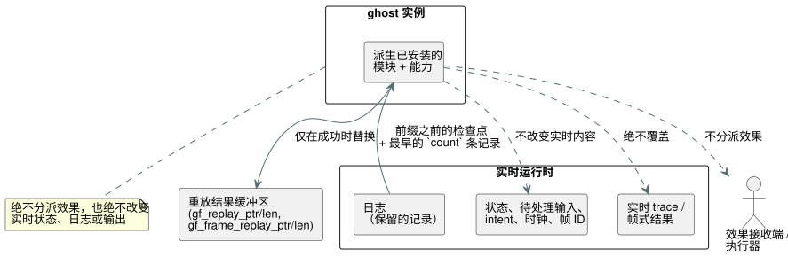

<!-- translation-source: tasks/temporal-adapter-replay-design.md -->
[英文原文](temporal-adapter-replay-design.md)

# 通过 WASM 适配器进行时间重放

**状态：已实现。** 聚焦的 Rust 测试和实际 WASM 重放验收均已通过。Batch14 包含这些测试且没有新的回归。其中 27 个无关的 Reference 失败和 164 个 TODO 用例仍然阻碍整体目标的完成。

**基本事实依据。** Reference §6.8 要求重放：

- 在独立的 ghost（影子运行）实例中运行；
- 以原始逻辑时间重放原始输入；并且
- 保持实时时间线及其效果接收端（effect sink）不变。

经测量的嵌套 window 验收还要求在日志（journal）翻转之后，通过两个 WASM 适配器都能重放。用 `rewind` 修改实时运行时并不满足这一契约。

## API 与职责

下图展示 ghost 从实时运行时读取什么，以及它被允许写入什么。



**Rust 入口点。**
`Runtime::replay_current_with_temporal(count, activation, max_peak_temporal_bytes)` 派生（fork）已安装的模块和能力（capability）。调用方提供时间激活 profile，以及原始运行加 ghost 合计的时间峰值预算。

**帧式运行中的扫描 ID。** `ScanDriver` 在创建时记录底层运行时的第一个 tick。

- 只有来自该帧式运行的日志记录才符合条件。
- 保留记录的扫描 ID 为 `tick - first_scan_tick`。
- 其逻辑时间来自其记录的时钟输入。
- 包装了已经执行过 tick 的运行时的驱动程序，仍必须从扫描 ID 0 开始。

**count 规则。** count 为正数，且不能超过符合条件的保留记录数。重放选取其中最早的前缀，并从紧接该前缀之前的检查点开始。count 绝不会被静默截断，缺失的输入也绝不会被捏造。

**WASM 导出。**

- `gf_replay_temporal` 和 `gf_frame_replay_temporal` 接收未经修改的 GFTA 激活数据包、count、时间峰值预算和 JSON 预算。
- 单独的 `gf_replay_ptr/len` 和 `gf_frame_replay_ptr/len` 暴露最后一次成功的重放。它们绝不会覆盖实时 trace 或帧式结果。

**JavaScript 适配器。** 两者都暴露 `replayTemporal({ count, profile, maxPeakTemporalBytes, maxJsonBytes })`。count 和预算必须是正的 u32 整数；现有的 profile 编码器校验 profile 字段。该方法返回解析后的重放 JSON。

信封结构：

```text
{ format: "GhostFlow/temporal-replay-v1",
  mode: "legacy" | "framed",
  checkpointTick,
  records: [TickRecord | { format: "GhostFlow/scan-outcome-v1",
                          scanId, logicalTimeMs, trace: TickRecord }] }
```

## 原子性与内存

**隔离。** ghost 拥有自己的状态和证据。它绝不分派执行器效果，也绝不改变实时的待处理输入、状态、日志、intent、帧序列、时钟或上一次结果。

- 成功的重放只替换其独立的结果缓冲区。
- 被拒绝的请求会同时保留之前的重放和实时执行。只有其错误诊断可能改变。

**两个独立的预算：**

| 预算 | 覆盖 | 不含 |
| --- | --- | --- |
| `maxPeakTemporalBytes` | 核心显式的时间 arena/检查点/证明以及 trace 核算 | 标量/模块克隆和分配器元数据。不得将其描述为进程内存总上限。 |
| `maxJsonBytes` | 之前保留的重放缓冲区加上候选缓冲区 | JavaScript 复制的文本和解析后的对象（由调用方拥有的分配） |

**JSON 写入。** 序列化必须以流式方式处理借用的记录，不得构建无界的中间记录字符串。在分配之前先计算转义后的 UTF-8 字节数，然后写入候选缓冲区，不做几何式扩容。

## 必需的测试

1. 经测量的嵌套重放在两个适配器中都保留聚合值、自有证明身份标识和原始逻辑 tick，包括日志翻转的情况。
2. 在 legacy tick 之后创建的帧式驱动程序报告正确的扫描 ID。
3. 被拒绝的延迟求值和重试不会产生重复准入。
4. 重放使实时的待处理输入、trace/结果、状态、intent、帧 ID 和时钟保持不变；随后的实时步骤沿原始时间线继续。
5. 无效的 count、profile、时间预算和 JSON 预算会同时保留之前的重放和实时状态。大小边界单独测试。
6. 由实际重新构建的 WASM 执行 JavaScript 用例；仅使用 mock 是不够的。

## Reference 中的剩余范围

这一针对已安装程序的适配器操作提供了执行证据。仅凭它本身**并不能**完成 §6.8 的以下部分：

- 持久化的 Program/源闭包/设置/绑定/运行（run）以及分支身份标识；
- 候选程序的 what-if 重放；
- 外部检查点恢复；
- 环境仿真。

这些仍是完整目标中明确的工作。本切片没有削弱任何语言预期，也没有削弱任何现有的 Reference 测试。

## 聚焦证据

| 日志 | 结果 |
| --- | --- |
| `build/temporal-replay-rust-final.log` | Core 139 和 WASM ABI 8 个测试通过。 |
| `build/temporal-replay-wasm-build.log` | Release WASM 构建成功。 |
| `build/temporal-replay-wasm.log` | 27/27 通过，包括实时记录与重放记录完全相等、嵌套 20/3、失败 tick 的重试、保留待处理输入、保留最后一次成功的重放，以及两个适配器中的 1024 条记录翻转。 |
| `build/scan-frame-wasm-temporal-replay.log` | 现有帧式套件 17/17 通过。 |
| `build/temporal-replay-catalog.log` | 在迁移未修改的 Rust 输出原子性测试主体之后 5/5 通过；其记录的摘要未变。 |

**共享 JSON 写入器。** 普通 trace 和重放共用一个借用式的核心 JSON 写入器。测试覆盖转义 UTF-8、被拒绝的接收端写入、精确的 JSON N/N-1 边界以及保留缓冲区容量。帧式结果转换在创建 ghost 之前就计入其输出向量，包括它与核心返回的 trace 存储之间的重叠。

**完整闸门。** 证据：`build/compiler-runtime-batch14-full.log` 和 `build/compiler-runtime-batch14-verification.json`。Node：1900 通过，27 个已有的 Reference 失败，164 个 TODO。闸门结束时验证源哈希一致。

**字节阈值的注意事项。** 原生核心测试证明了精确的时间总字节 N/N-1 核算。两条实际 WASM 路径目前会拒绝不足的峰值预算并验证翻转，但它们并不独立测量自身精确的总字节阈值。这一特定于目标的资源报告和边界证据，已由聚焦的[时间规划证据](temporal-resource-plan-design.zh.md)解决。持久化的外部恢复、热替换以及完整的 §6.8 身份标识仍待解决。
