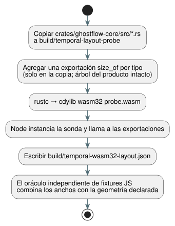

<!-- translation-source: tasks/temporal-layout-evidence.md -->
[Original en inglés](temporal-layout-evidence.md)

# Evidencia del diseño de memoria del destino temporal

Este registro explica de dónde provienen los anchos de tipos wasm32 que usa el
oráculo del plan de recursos temporales y cómo reproducirlos.

**Reglas clave:**

- El oráculo usa los **anchos de tipos del destino**. No usa un total de
  recursos devuelto y no hace búsqueda binaria sobre la guarda de presupuesto.
- La sonda compila un árbol de fuentes **copiado** en un artefacto separado.
  Nunca modifica el árbol del producto y nunca agrega exportaciones ABI al
  producto.
- La compilación WASM de release ordinaria no incluye la sonda.

El pipeline siguiente copia las fuentes, agrega una exportación `size_of` por
tipo, compila una sonda wasm32 y lee los anchos de vuelta en Node.



Ejecute esto desde el repositorio del lenguaje con su cadena de herramientas de
Rust instalada:

```sh
python3 - <<'PY'
from pathlib import Path
import shutil, json
src = Path('crates/ghostflow-core/src')
dst = Path('build/temporal-layout-probe')
dst.mkdir(parents=True, exist_ok=True)
for file in src.glob('*.rs'):
    shutil.copyfile(file, dst / file.name)
rows = {
    'temporal.rs': ['Window', 'WindowCheckpoint', 'RootDensity', 'RootState', 'Observation'],
    'temporal_evidence.rs': ['EvidenceWindow', 'EvidenceCheckpoint', 'EvidencePoint', 'ProofNode'],
    'temporal_runtime.rs': ['TemporalRuntime', 'TemporalPlan', 'WindowPlan', 'Slot',
                            'Snapshot', 'WindowTrace', 'TemporalResourceReport'],
    'lib.rs': ['Value', 'ResultTraceEvent', 'temporal::RootInput', 'scan::ScanOutcomeV1',
               'Vec<u64>', 'VecDeque<u64>', 'usize'],
}
exports = {}
for file, names in rows.items():
    with (dst / file).open('a') as out:
        for name in names:
            export = 'layout_' + str(len(exports))
            exports[export] = name
            out.write('\n#[no_mangle]\npub extern "C" fn ' + export
                      + '()->u32 {std::mem::size_of::<' + name + '>() as u32}\n')
(dst / 'exports.json').write_text(json.dumps(exports))
PY
rustc --edition=2021 --crate-name ghostflow_layout_probe --crate-type cdylib \
  --target wasm32-unknown-unknown -C opt-level=0 \
  build/temporal-layout-probe/lib.rs -o build/temporal-layout-probe/probe.wasm
node --input-type=module <<'JS'
import fs from 'node:fs';
const { instance } = await WebAssembly.instantiate(
  fs.readFileSync('build/temporal-layout-probe/probe.wasm'));
const names = JSON.parse(fs.readFileSync('build/temporal-layout-probe/exports.json'));
const widths = Object.fromEntries(Object.entries(names)
  .map(([key, name]) => [name, instance.exports[key]()]));
fs.writeFileSync('build/temporal-wasm32-layout.json',
  JSON.stringify(widths, null, 2) + '\n');
console.log(widths);
JS
```

Anchos wasm32 observados para esta implementación:

| Tipo | Bytes |
| --- | ---: |
| Window / WindowCheckpoint | 416 / 232 |
| RootDensity / RootState / Observation | 16 / 56 / 40 |
| EvidenceWindow / EvidenceCheckpoint | 936 / 512 |
| EvidencePoint / ProofNode | 64 / 72 |
| TemporalRuntime / TemporalPlan / WindowPlan | 120 / 64 / 32 |
| Slot / Snapshot / WindowTrace | 952 / 48 / 224 |
| TemporalResourceReport | 48 |
| Value / ResultTraceEvent / RootInput | 16 / 12 / 40 |
| ScanOutcomeV1 | 152 |
| Vec / VecDeque / usize | 12 / 16 / 4 |

**Cómo los usa el oráculo.** El oráculo independiente de fixtures en JavaScript
combina estos anchos con:

- las densidades de raíz declaradas;
- los horizontes acumulados;
- la geometría de las pruebas;
- la capacidad del journal;
- la capacidad de marcadores;
- el almacenamiento de retorno del adaptador.

**Cuando un tipo cambia,** inspeccione el nuevo diseño de memoria del destino y
la fórmula de contabilización antes de actualizar los anchos esperados. No
copie al oráculo un umbral de presupuesto que pasa.

**Qué significan los números.** Estos anchos excluyen los metadatos del
asignador. El informe temporal es una cota superior contabilizada que incluye
capacidad de traza futura reservada y metadatos de construcción. No es una
medición del heap del proceso en vivo.
