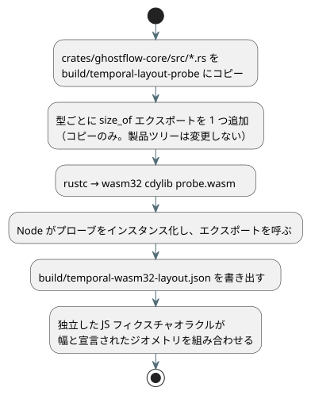

<!-- translation-source: tasks/temporal-layout-evidence.md -->
[英語の原文](temporal-layout-evidence.md)

# 時間的ターゲットのレイアウト証拠

この記録では、時間的リソース計画のオラクルが使う wasm32 の型幅がどこから来ているか、そしてそれをどのように再現するかを説明します。

**主な規則:**

- オラクルは**ターゲットの型幅**を使います。返されたリソース合計は使わず、予算ガードを二分探索することもしません。
- プローブは、**コピーした**ソースツリーを別個のアーティファクトにコンパイルします。製品ツリーにパッチを当てることも、製品の ABI エクスポートを追加することも決してありません。
- 通常のリリース WASM ビルドにはプローブは含まれません。

以下のパイプラインは、ソースをコピーし、型ごとに `size_of` エクスポートを 1 つ追加し、wasm32 のプローブをビルドし、Node で幅を読み戻します。



言語リポジトリで、インストール済みの Rust ツールチェーンを使って次を実行します。

```sh
python3 - <<'PY'
from pathlib import Path
import shutil, json
src = Path('crates/ghostflow-core/src')
dst = Path('build/temporal-layout-probe')
dst.mkdir(parents=True, exist_ok=True)
for file in src.glob('*.rs'):
    shutil.copyfile(file, dst / file.name)
rows = {
    'temporal.rs': ['Window', 'WindowCheckpoint', 'RootDensity', 'RootState', 'Observation'],
    'temporal_evidence.rs': ['EvidenceWindow', 'EvidenceCheckpoint', 'EvidencePoint', 'ProofNode'],
    'temporal_runtime.rs': ['TemporalRuntime', 'TemporalPlan', 'WindowPlan', 'Slot',
                            'Snapshot', 'WindowTrace', 'TemporalResourceReport'],
    'lib.rs': ['Value', 'ResultTraceEvent', 'temporal::RootInput', 'scan::ScanOutcomeV1',
               'Vec<u64>', 'VecDeque<u64>', 'usize'],
}
exports = {}
for file, names in rows.items():
    with (dst / file).open('a') as out:
        for name in names:
            export = 'layout_' + str(len(exports))
            exports[export] = name
            out.write('\n#[no_mangle]\npub extern "C" fn ' + export
                      + '()->u32 {std::mem::size_of::<' + name + '>() as u32}\n')
(dst / 'exports.json').write_text(json.dumps(exports))
PY
rustc --edition=2021 --crate-name ghostflow_layout_probe --crate-type cdylib \
  --target wasm32-unknown-unknown -C opt-level=0 \
  build/temporal-layout-probe/lib.rs -o build/temporal-layout-probe/probe.wasm
node --input-type=module <<'JS'
import fs from 'node:fs';
const { instance } = await WebAssembly.instantiate(
  fs.readFileSync('build/temporal-layout-probe/probe.wasm'));
const names = JSON.parse(fs.readFileSync('build/temporal-layout-probe/exports.json'));
const widths = Object.fromEntries(Object.entries(names)
  .map(([key, name]) => [name, instance.exports[key]()]));
fs.writeFileSync('build/temporal-wasm32-layout.json',
  JSON.stringify(widths, null, 2) + '\n');
console.log(widths);
JS
```

この実装で観測された wasm32 の幅:

| 型 | バイト |
| --- | ---: |
| Window / WindowCheckpoint | 416 / 232 |
| RootDensity / RootState / Observation | 16 / 56 / 40 |
| EvidenceWindow / EvidenceCheckpoint | 936 / 512 |
| EvidencePoint / ProofNode | 64 / 72 |
| TemporalRuntime / TemporalPlan / WindowPlan | 120 / 64 / 32 |
| Slot / Snapshot / WindowTrace | 952 / 48 / 224 |
| TemporalResourceReport | 48 |
| Value / ResultTraceEvent / RootInput | 16 / 12 / 40 |
| ScanOutcomeV1 | 152 |
| Vec / VecDeque / usize | 12 / 16 / 4 |

**オラクルでの使い方。** 独立した JavaScript のフィクスチャオラクルは、これらの幅を次のものと組み合わせます。

- 宣言されたルート密度
- 累積されたホライズン
- 証明のジオメトリ
- ジャーナルの容量
- マーカーの容量
- アダプタの戻り値用ストレージ

**型が変わったときは、** 期待される幅を更新する前に、新しいターゲットレイアウトと計上式を確認してください。合格した予算のしきい値をオラクルにコピーしてはなりません。

**数値の意味。** これらの幅にはアロケータのメタデータは含まれません。時間的レポートは、将来のトレース用に予約された容量と構築時のメタデータを含む、計上上の上限です。ライブのプロセスヒープを測定したものではありません。
