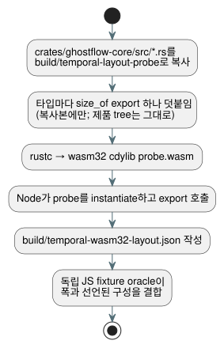

<!-- translation-source: tasks/temporal-layout-evidence.md -->
[영문 원문](temporal-layout-evidence.md)

# Temporal 대상 배치 증거

이 기록은 temporal resource-plan oracle이 사용하는 wasm32 타입 폭이 어디에서
오는지, 그리고 그것을 어떻게 재현하는지 설명합니다.

**핵심 규칙:**

- Oracle은 **대상 타입 폭**을 사용합니다. 반환된 자원 합계를 사용하지 않으며,
  예산 guard를 이진 탐색하지도 않습니다.
- Probe는 **복사한** source tree를 별도 산출물로 컴파일합니다. 제품 tree를 절대
  수정하지 않으며, 제품 ABI export를 절대 추가하지 않습니다.
- 일반 release WASM build에는 probe가 포함되지 않습니다.

아래 pipeline은 source를 복사하고, 타입마다 `size_of` export를 하나씩 덧붙이고,
wasm32 probe를 build한 뒤, Node에서 폭을 읽어 옵니다.



설치된 Rust toolchain을 사용해 언어 repository에서 다음을 실행합니다:

```sh
python3 - <<'PY'
from pathlib import Path
import shutil, json
src = Path('crates/ghostflow-core/src')
dst = Path('build/temporal-layout-probe')
dst.mkdir(parents=True, exist_ok=True)
for file in src.glob('*.rs'):
    shutil.copyfile(file, dst / file.name)
rows = {
    'temporal.rs': ['Window', 'WindowCheckpoint', 'RootDensity', 'RootState', 'Observation'],
    'temporal_evidence.rs': ['EvidenceWindow', 'EvidenceCheckpoint', 'EvidencePoint', 'ProofNode'],
    'temporal_runtime.rs': ['TemporalRuntime', 'TemporalPlan', 'WindowPlan', 'Slot',
                            'Snapshot', 'WindowTrace', 'TemporalResourceReport'],
    'lib.rs': ['Value', 'ResultTraceEvent', 'temporal::RootInput', 'scan::ScanOutcomeV1',
               'Vec<u64>', 'VecDeque<u64>', 'usize'],
}
exports = {}
for file, names in rows.items():
    with (dst / file).open('a') as out:
        for name in names:
            export = 'layout_' + str(len(exports))
            exports[export] = name
            out.write('\n#[no_mangle]\npub extern "C" fn ' + export
                      + '()->u32 {std::mem::size_of::<' + name + '>() as u32}\n')
(dst / 'exports.json').write_text(json.dumps(exports))
PY
rustc --edition=2021 --crate-name ghostflow_layout_probe --crate-type cdylib \
  --target wasm32-unknown-unknown -C opt-level=0 \
  build/temporal-layout-probe/lib.rs -o build/temporal-layout-probe/probe.wasm
node --input-type=module <<'JS'
import fs from 'node:fs';
const { instance } = await WebAssembly.instantiate(
  fs.readFileSync('build/temporal-layout-probe/probe.wasm'));
const names = JSON.parse(fs.readFileSync('build/temporal-layout-probe/exports.json'));
const widths = Object.fromEntries(Object.entries(names)
  .map(([key, name]) => [name, instance.exports[key]()]));
fs.writeFileSync('build/temporal-wasm32-layout.json',
  JSON.stringify(widths, null, 2) + '\n');
console.log(widths);
JS
```

이 구현에서 관측된 wasm32 폭:

| 타입 | 바이트 |
| --- | ---: |
| Window / WindowCheckpoint | 416 / 232 |
| RootDensity / RootState / Observation | 16 / 56 / 40 |
| EvidenceWindow / EvidenceCheckpoint | 936 / 512 |
| EvidencePoint / ProofNode | 64 / 72 |
| TemporalRuntime / TemporalPlan / WindowPlan | 120 / 64 / 32 |
| Slot / Snapshot / WindowTrace | 952 / 48 / 224 |
| TemporalResourceReport | 48 |
| Value / ResultTraceEvent / RootInput | 16 / 12 / 40 |
| ScanOutcomeV1 | 152 |
| Vec / VecDeque / usize | 12 / 16 / 4 |

**Oracle이 이 값을 쓰는 방식.** 독립 JavaScript fixture oracle은 이 폭을 다음과
결합합니다:

- 선언된 root density;
- 누적 horizon;
- proof 구성;
- journal 용량;
- marker 용량;
- adapter 반환 저장소.

**타입이 바뀌면** 기대 폭을 갱신하기 전에 새 대상 배치와 집계 공식을 검사합니다.
통과한 예산 임계값을 oracle에 복사하지 마세요.

**수치의 의미.** 이 폭은 allocator metadata를 제외합니다. Temporal 보고는 향후
trace를 위해 예약된 용량과 생성 metadata를 포함한 집계 상한입니다. Live process
heap을 측정한 값이 아닙니다.
