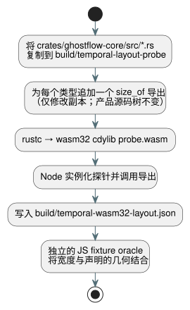

<!-- translation-source: tasks/temporal-layout-evidence.md -->
[英文原文](temporal-layout-evidence.md)

# 时间目标布局证据

本记录说明时间资源规划 oracle 所用的 wasm32 类型宽度从何而来，以及如何复现它们。

**关键规则：**

- oracle 使用**目标类型宽度**。它不使用返回的资源总量，也不对预算保护做二分查找。
- 探针（probe）将一份**复制的**源码树编译为独立的制品。它绝不修改产品源码树，也绝不添加产品 ABI 导出。
- 普通的 release WASM 构建不包含该探针。

下面的流水线复制源码，为每个类型追加一个 `size_of` 导出，构建 wasm32 探针，并在 Node 中读回宽度。



在语言仓库中使用其已安装的 Rust 工具链运行以下命令：

```sh
python3 - <<'PY'
from pathlib import Path
import shutil, json
src = Path('crates/ghostflow-core/src')
dst = Path('build/temporal-layout-probe')
dst.mkdir(parents=True, exist_ok=True)
for file in src.glob('*.rs'):
    shutil.copyfile(file, dst / file.name)
rows = {
    'temporal.rs': ['Window', 'WindowCheckpoint', 'RootDensity', 'RootState', 'Observation'],
    'temporal_evidence.rs': ['EvidenceWindow', 'EvidenceCheckpoint', 'EvidencePoint', 'ProofNode'],
    'temporal_runtime.rs': ['TemporalRuntime', 'TemporalPlan', 'WindowPlan', 'Slot',
                            'Snapshot', 'WindowTrace', 'TemporalResourceReport'],
    'lib.rs': ['Value', 'ResultTraceEvent', 'temporal::RootInput', 'scan::ScanOutcomeV1',
               'Vec<u64>', 'VecDeque<u64>', 'usize'],
}
exports = {}
for file, names in rows.items():
    with (dst / file).open('a') as out:
        for name in names:
            export = 'layout_' + str(len(exports))
            exports[export] = name
            out.write('\n#[no_mangle]\npub extern "C" fn ' + export
                      + '()->u32 {std::mem::size_of::<' + name + '>() as u32}\n')
(dst / 'exports.json').write_text(json.dumps(exports))
PY
rustc --edition=2021 --crate-name ghostflow_layout_probe --crate-type cdylib \
  --target wasm32-unknown-unknown -C opt-level=0 \
  build/temporal-layout-probe/lib.rs -o build/temporal-layout-probe/probe.wasm
node --input-type=module <<'JS'
import fs from 'node:fs';
const { instance } = await WebAssembly.instantiate(
  fs.readFileSync('build/temporal-layout-probe/probe.wasm'));
const names = JSON.parse(fs.readFileSync('build/temporal-layout-probe/exports.json'));
const widths = Object.fromEntries(Object.entries(names)
  .map(([key, name]) => [name, instance.exports[key]()]));
fs.writeFileSync('build/temporal-wasm32-layout.json',
  JSON.stringify(widths, null, 2) + '\n');
console.log(widths);
JS
```

本实现观测到的 wasm32 宽度：

| 类型 | 字节 |
| --- | ---: |
| Window / WindowCheckpoint | 416 / 232 |
| RootDensity / RootState / Observation | 16 / 56 / 40 |
| EvidenceWindow / EvidenceCheckpoint | 936 / 512 |
| EvidencePoint / ProofNode | 64 / 72 |
| TemporalRuntime / TemporalPlan / WindowPlan | 120 / 64 / 32 |
| Slot / Snapshot / WindowTrace | 952 / 48 / 224 |
| TemporalResourceReport | 48 |
| Value / ResultTraceEvent / RootInput | 16 / 12 / 40 |
| ScanOutcomeV1 | 152 |
| Vec / VecDeque / usize | 12 / 16 / 4 |

**oracle 如何使用它们。** 独立的 JavaScript fixture oracle 将这些宽度与以下内容结合：

- 声明的 root 密度；
- 累积的时间范围（horizon）；
- 证明几何；
- 日志（journal）容量；
- 标记容量；
- 适配器返回存储。

**当某个类型发生变化时，**先检查新的目标布局和核算公式，再更新期望宽度。不要把一个能通过的预算阈值复制进 oracle。

**这些数字的含义。** 这些宽度不含分配器元数据。时间报告是一个经核算的上限，包含预留的未来 trace 容量和构造元数据。它不是对实时进程堆的测量。
