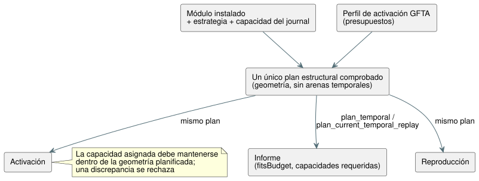

<!-- translation-source: tasks/temporal-resource-plan-design.md -->
[Original en inglés](temporal-resource-plan-design.md)

# Planificación estática de recursos temporales

**Estado: la implementación enfocada está aceptada; la aceptación más amplia de recursos/puntos de control sigue pendiente.**

**Por qué se necesita la planificación.** La Referencia §4 exige límites finitos
de estado y memoria *antes* de la ejecución. Batch14 comprobó los presupuestos
de activación y de reproducción (replay) temporales, pero sus pruebas nativas de
bytes exactos no demuestran de forma independiente los umbrales de wasm32.
Informar los bytes contabilizados de un runtime ya activado no satisfaría por sí
solo la planificación previa a la activación.

## Geometría autorizada

**Un único plan estructural.** Extraiga un único plan estructural comprobado que
abarque las ventanas físicas, la evidencia derivada y el runtime temporal.
Calcula:

- anillos de densidad y observaciones retenidas;
- capacidades de prueba/marca de agua máxima;
- bancos de candidatos y consolidados;
- puntos de control y proyecciones;
- límites de trazas/marcadores;
- espacio de trabajo de construcción.

La planificación puede asignar metadatos acotados O(windows + roots). Nunca
asigna las arenas temporales de muestras/pruebas/puntos de control.

**Todos usan el mismo plan.** La activación y la reproducción consumen ese
mismo plan, como muestra el diagrama. No mantenga un segundo estimador de
producción.



- Las capacidades realmente asignadas deben mantenerse dentro de la geometría
  planificada. Una discrepancia de asignación se rechaza; nunca supera en
  silencio el límite informado.
- Los metadatos del plan y el solapamiento de construcción forman parte del pico
  contabilizado.
- Cuando sea práctico, reutilice o mueva los metadatos al almacenamiento
  existente en lugar de mantener grafos duplicados solo por comodidad de
  contabilización.

**Qué es el informe.** El informe es una **cota superior contabilizada**
específica del destino, no el uso actual del heap. Quedan explícitamente fuera
del límite temporal: los metadatos del asignador, el almacenamiento de
escalares/módulos, la salida del informe/JSON y las copias de quien llama.

## Interfaz nativa

| Llamada | Devuelve |
| --- | --- |
| `Runtime::plan_temporal(&activation)` | Los requisitos para el módulo instalado, la estrategia seleccionada y la capacidad del journal, sin activar. |
| `Runtime::temporal_resource_report()` | El informe activo, cuando está disponible. |
| `Runtime` y `ScanDriver::plan_current_temporal_replay(count, &activation)` | El límite combinado en vivo/ghost, sin ejecutar la reproducción. |

**Resultados del presupuesto.**

- Un presupuesto de perfil positivo pero insuficiente produce
  `fitsBudget: false` y aun así informa las capacidades requeridas.
- Los hechos inválidos o las vinculaciones de reproducción incompatibles siguen
  rechazándose.
- Los conteos mantienen la regla estricta de prefijo retenido positivo.

**Campos del informe inicial:** `format`, huella del `module` instalado,
`strategy`, `targetPointerBytes`, `journalCapacity`, `windowCount`,
`retainedSamples`, `accountedTemporalBytes`, `fitsBudget`.

**Campos del informe de reproducción:** `eligibleCount`, `count`, `liveBytes`,
`ghostBytes`, `returnHeaderBytes`, `frameHeaderBytes`,
`requiredPeakTemporalBytes` y `ghostFitsBudget`. La suma contabiliza tanto los
registros del núcleo devueltos como los resultados encuadrados mientras se
solapan. La geometría del ghost usa una capacidad de journal igual al conteo.

**Formatos:** `GhostFlow/temporal-resources-v1` y
`GhostFlow/temporal-replay-resources-v1`.

## Interfaz WASM y JavaScript

Ambos adaptadores exponen métodos síncronos:

```js
runtime.planTemporal({ profile, maxJsonBytes });
runtime.planTemporalReplay({ count, profile, maxJsonBytes });
runtime.resourcePlan; // last successful plan, initially null
```

Exportaciones WASM:

- `gf_plan_temporal(handle, profilePtr, profileLen, maxJsonBytes)` y su
  equivalente encuadrado.
- `gf_plan_temporal_replay(handle, profilePtr, profileLen, count, maxJsonBytes)`
  y su equivalente encuadrado.
- `gf_resource_plan_ptr/len` y `gf_frame_resource_plan_ptr/len`.

**Reglas del búfer.**

- Cada handle posee un búfer del último plan, compartido por ambos tipos de
  plan.
- Solo el éxito lo reemplaza. Un rechazo preserva el plan anterior, la
  reproducción anterior, la ejecución en vivo, la secuencia de tramas y el
  resultado.
- El escritor JSON acotado contabiliza las capacidades del búfer anterior más
  las del candidato.
- La planificación antes de la activación encuadrada usa el Runtime de
  configuración. La planificación de la reproducción requiere el ScanDriver
  activo.

## Aceptación independiente

1. Un fixture fijo de ventanas anidadas tiene una tabla de anchos de diseño de
   memoria wasm32 y una fórmula de capacidad revisadas por separado. Derive los
   anchos del destino a partir de evidencia aislada del diseño de memoria del
   compilador (consulte la [evidencia del diseño de memoria temporal](temporal-layout-evidence.es.md)),
   nunca de un presupuesto exitoso copiado ni de una exportación del producto
   solo para pruebas.
2. El oráculo calcula la capacidad retenida C y el límite de bytes N. Active con
   C/N y rechace C-1/N-1 en ambos adaptadores WASM reales. Compare los informes
   como evidencia adicional.
3. Calcule el pico de reproducción a partir de la geometría independiente en
   vivo/ghost, los encabezados de retorno del núcleo y los encabezados
   encuadrados. Acepte N y rechace N-1 sin alterar el estado en vivo ni los
   búferes de reproducción/plan anteriores. No use la búsqueda binaria como
   oráculo.
4. Antes de la activación, los presupuestos positivos insuficientes siguen
   informando los requisitos. Demuestre que la planificación ni asigna las
   arenas de datos temporales ni ejecuta un tick.
5. Preserve el comportamiento existente nativo, de puntos de control, de
   reproducción, de trazas y de paquetes.

**No cubierto por este trabajo:** la evidencia estimada, otros operadores
temporales, los puntos de control externos y las identidades completas de
rama/cierre de fuentes de la Referencia §6.8.

## Evidencia enfocada

| Evidencia | Resultado |
| --- | --- |
| `build/temporal-plan-rust-final.log` | Pasan 142 pruebas del núcleo y 10 de la ABI. |
| `build/temporal-resource-plan-wasm-green.log` | La suite de recursos WASM pasa 22/22. |
| `build/scan-frame-wasm-temporal-plan.log` | La suite encuadrada pasa 17/17. |
| `build/temporal-plan-catalog.log` | El catálogo pasa 5/5. |
| Oráculo independiente | En vivo C14 = 9,424,375 bytes; ghost con conteo 3 = 47,511; pico de reproducción heredada = 9,471,958; pico de reproducción encuadrada = 9,472,414. |

Artefactos de la compuerta completa de Batch15:
`build/compiler-runtime-batch15-full.log`,
`build/compiler-runtime-batch15-verification.json` y
`build/compiler-runtime-batch15-reference-results.json`. Node: 1,923 aprobadas,
27 fallos de la Referencia, 164 TODO, con hashes de las fuentes que coinciden
con la compuerta.
