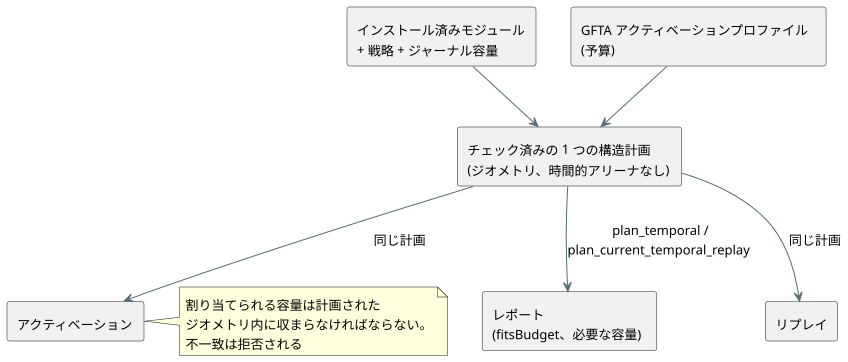

<!-- translation-source: tasks/temporal-resource-plan-design.md -->
[英語の原文](temporal-resource-plan-design.md)

# 静的な時間的リソース計画

**ステータス: 焦点を絞った実装は受け入れ済みです。より広いリソース/チェックポイントの受け入れは未完了です。**

**計画が必要な理由。** Reference §4 は、実行の*前に*有限の状態とメモリの上限を要求しています。Batch14 は時間的なアクティベーションとリプレイの予算をチェックしましたが、そのネイティブの厳密なバイトテストは wasm32 のしきい値を独立して証明していません。すでにアクティベートされたランタイムの計上バイトを報告するだけでは、それ単独でアクティベーション前の計画を満たすことにはなりません。

## 権威あるジオメトリ

**1 つの構造計画。** 物理的な window、派生した証拠、時間的ランタイムにまたがる、チェック済みの構造計画を 1 つ抽出します。この計画は次を計算します。

- 密度リングと保持される観測
- 証明/ハイウォーターの容量
- 候補バンクと確定済みバンク
- チェックポイントと射影
- トレース/マーカーの上限
- 構築用のスクラッチ領域

計画では、有界な O(windows + roots) のメタデータを割り当ててもかまいません。時間的なサンプル/証明/チェックポイントのアリーナを割り当てることは決してありません。

**全員が同じ計画を使う。** 図に示すように、アクティベーションとリプレイは同じ計画を使います。2 つ目の本番用の見積もり器を維持してはなりません。



- 実際に割り当てられる容量は、計画されたジオメトリの範囲内に収まらなければなりません。割り当ての不一致は拒否され、報告された上限を暗黙に超えることは決してありません。
- 計画のメタデータと構築時の重なりは、計上されたピークに含めます。
- 現実的な場合は、計上の都合のためだけに重複したグラフを保持するのではなく、メタデータを既存のストレージで再利用するか、そこへ移動してください。

**レポートとは何か。** レポートはターゲット固有の**計上上の上限**であり、現在のヒープ使用量ではありません。次のものは明示的に時間的上限の外にあります: アロケータのメタデータ、スカラー/モジュールのストレージ、レポート/JSON の出力、呼び出し元のコピー。

## ネイティブインターフェース

| 呼び出し | 戻り値 |
| --- | --- |
| `Runtime::plan_temporal(&activation)` | アクティベートせずに、インストール済みモジュール、選択された戦略、ジャーナル容量に対する要件を返します。 |
| `Runtime::temporal_resource_report()` | 利用可能な場合、アクティブなレポートを返します。 |
| `Runtime` と `ScanDriver::plan_current_temporal_replay(count, &activation)` | リプレイを実行せずに、ライブとゴーストを合わせた上限を返します。 |

**予算の結果。**

- 正だが不十分なプロファイル予算は `fitsBudget: false` となり、それでも必要な容量を報告します。
- 無効な事実や互換性のないリプレイのバインディングは、引き続き拒否されます。
- カウントは、厳密に正で保持プレフィックスに収まるという規則を維持します。

**初期レポートのフィールド:** `format`、インストール済みの `module` フィンガープリント、`strategy`、`targetPointerBytes`、`journalCapacity`、`windowCount`、`retainedSamples`、`accountedTemporalBytes`、`fitsBudget`。

**リプレイレポートのフィールド:** `eligibleCount`、`count`、`liveBytes`、`ghostBytes`、`returnHeaderBytes`、`frameHeaderBytes`、`requiredPeakTemporalBytes`、`ghostFitsBudget`。合計は、返されるコアのレコードとフレーム化された結果が重なっている間の両方を計上します。ゴーストのジオメトリは、カウントに等しいジャーナル容量を使います。

**形式:** `GhostFlow/temporal-resources-v1` と `GhostFlow/temporal-replay-resources-v1`。

## WASM と JavaScript のインターフェース

両方のアダプタが同期メソッドを公開します。

```js
runtime.planTemporal({ profile, maxJsonBytes });
runtime.planTemporalReplay({ count, profile, maxJsonBytes });
runtime.resourcePlan; // last successful plan, initially null
```

WASM のエクスポート:

- `gf_plan_temporal(handle, profilePtr, profileLen, maxJsonBytes)` とそのフレーム化版。
- `gf_plan_temporal_replay(handle, profilePtr, profileLen, count, maxJsonBytes)` とそのフレーム化版。
- `gf_resource_plan_ptr/len` と `gf_frame_resource_plan_ptr/len`。

**バッファの規則。**

- 各ハンドルは最新の計画用バッファを 1 つ所有し、両方の計画の種類で共有します。
- それを置き換えるのは成功だけです。拒否された場合は、以前の計画、以前のリプレイ、ライブの実行、フレームシーケンス、結果が保持されます。
- 有界な JSON ライターは、古いバッファと候補バッファの容量を合わせて計上します。
- フレーム化されたアクティベーションの前の計画には、設定中の Runtime を使います。リプレイの計画にはアクティブな ScanDriver が必要です。

## 独立した受け入れ

1. 固定の入れ子 window フィクスチャには、別途レビューされた wasm32 のレイアウト幅の表と容量の式があります。ターゲットの幅は、隔離されたコンパイラのレイアウト証拠（[時間的レイアウトの証拠](temporal-layout-evidence.ja.md)を参照）から導出し、コピーした成功時の予算や、製品のテスト専用エクスポートから導出しては決してなりません。
2. オラクルは保持容量 C とバイト上限 N を計算します。実際の両方の WASM アダプタで、C/N ではアクティベートし、C-1/N-1 では拒否します。レポートの比較は追加の証拠として行います。
3. 独立したライブ/ゴーストのジオメトリ、コアの戻り値ヘッダー、フレーム化ヘッダーから、リプレイのピークを計算します。ライブの状態や以前のリプレイ/計画のバッファを変更せずに、N を受け入れ、N-1 を拒否します。二分探索をオラクルとして使ってはなりません。
4. アクティベーションの前でも、不十分な正の予算は要件を報告します。計画が時間的データのアリーナを割り当てず、tick も実行しないことを示します。
5. 既存のネイティブ、チェックポイント、リプレイ、トレース、パッケージの振る舞いを維持します。

**この作業の対象外:** 推定された証拠、その他の時間演算子、外部チェックポイント、Reference §6.8 の完全なブランチ/ソースクロージャの同一性。

## 焦点を絞った証拠

| 証拠 | 結果 |
| --- | --- |
| `build/temporal-plan-rust-final.log` | Core 142 と ABI 10 のテストが合格。 |
| `build/temporal-resource-plan-wasm-green.log` | WASM リソーススイート 22/22 合格。 |
| `build/scan-frame-wasm-temporal-plan.log` | フレーム化スイート 17/17 合格。 |
| `build/temporal-plan-catalog.log` | カタログ 5/5 合格。 |
| 独立したオラクル | ライブ C14 = 9,424,375 バイト、ゴーストのカウント 3 = 47,511、レガシーなリプレイのピーク = 9,471,958、フレーム化されたリプレイのピーク = 9,472,414。 |

Batch15 の完全ゲートのアーティファクト: `build/compiler-runtime-batch15-full.log`、`build/compiler-runtime-batch15-verification.json`、`build/compiler-runtime-batch15-reference-results.json`。Node: 合格 1,923、Reference の失敗 27、TODO 164。ソースハッシュはゲートと一致しています。
