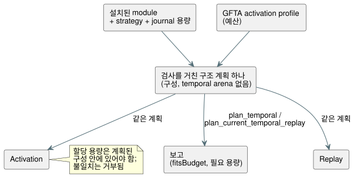

<!-- translation-source: tasks/temporal-resource-plan-design.md -->
[영문 원문](temporal-resource-plan-design.md)

# 정적 temporal 자원 계획

**상태: 집중 구현은 수용되었고, 더 넓은 자원/checkpoint 수용은 아직 남아 있습니다.**

**계획이 필요한 이유.** Reference §4는 실행 *전에* 유한한 상태와 메모리 상한을
요구합니다. Batch14는 temporal activation과 replay 예산을 검사했지만, native
정확한 바이트 테스트가 wasm32 임계값을 독립적으로 증명하지는 않습니다. 이미 활성화된
runtime의 집계 바이트를 보고하는 것만으로는 activation 전 계획을 충족하지
못합니다.

## 권위 있는 구성

**하나의 구조 계획.** 물리 window, 파생 증거, temporal runtime 전반을 아우르는,
검사를 거친 구조 계획 하나를 추출합니다. 이 계획은 다음을 계산합니다:

- density ring과 보존되는 관측;
- proof/high-water 용량;
- 후보 bank와 commit된 bank;
- checkpoint와 projection;
- trace/marker 상한;
- 생성용 scratch.

계획은 제한된 O(windows + roots) metadata를 할당할 수 있습니다. Temporal
sample/proof/checkpoint arena는 절대 할당하지 않습니다.

**모두가 같은 계획을 사용합니다.** 다이어그램에서 보듯이 activation과 replay는 같은
계획을 소비합니다. 두 번째 production estimator를 유지하지 마세요.



- 실제로 할당된 용량은 계획된 구성 안에 있어야 합니다. 할당 불일치는 거부되며,
  보고된 상한을 조용히 넘는 일은 절대 없습니다.
- 계획 metadata와 생성 중의 중첩은 집계 peak에 포함됩니다.
- 실용적인 경우, 집계 편의만을 위해 graph를 중복 보관하기보다는 metadata를 기존
  저장소에 재사용하거나 옮깁니다.

**보고의 성격.** 보고는 대상별 **집계 상한**이며, 현재 heap 사용량이 아닙니다.
다음은 명시적으로 temporal 상한 밖에 있습니다: allocator metadata, scalar/module
저장소, report/JSON 출력, 호출자 복사본.

## 네이티브 인터페이스

| 호출 | 반환 |
| --- | --- |
| `Runtime::plan_temporal(&activation)` | 활성화하지 않고, 설치된 module·선택된 strategy·journal 용량에 대한 요구량. |
| `Runtime::temporal_resource_report()` | 가능한 경우 활성 보고. |
| `Runtime`과 `ScanDriver::plan_current_temporal_replay(count, &activation)` | Replay를 실행하지 않고, live/ghost를 합친 상한. |

**예산 결과.**

- 양수이지만 부족한 profile 예산은 `fitsBudget: false`를 내며, 필요한 용량은
  여전히 보고합니다.
- 잘못된 fact나 호환되지 않는 replay binding은 여전히 거부됩니다.
- Count는 엄격한 양수 보존 prefix 규칙을 유지합니다.

**최초 보고 필드:** `format`, 설치된 `module` fingerprint, `strategy`,
`targetPointerBytes`, `journalCapacity`, `windowCount`, `retainedSamples`,
`accountedTemporalBytes`, `fitsBudget`.

**Replay 보고 필드:** `eligibleCount`, `count`, `liveBytes`, `ghostBytes`,
`returnHeaderBytes`, `frameHeaderBytes`, `requiredPeakTemporalBytes`,
`ghostFitsBudget`. 합계는 반환된 core 기록과 framed outcome이 겹치는 동안의 둘을
모두 집계합니다. Ghost 구성은 count와 같은 journal 용량을 사용합니다.

**형식:** `GhostFlow/temporal-resources-v1`와
`GhostFlow/temporal-replay-resources-v1`.

## WASM과 JavaScript 인터페이스

두 adapter 모두 동기 메서드를 제공합니다:

```js
runtime.planTemporal({ profile, maxJsonBytes });
runtime.planTemporalReplay({ count, profile, maxJsonBytes });
runtime.resourcePlan; // last successful plan, initially null
```

WASM export:

- `gf_plan_temporal(handle, profilePtr, profileLen, maxJsonBytes)`와 framed 대응 함수.
- `gf_plan_temporal_replay(handle, profilePtr, profileLen, count, maxJsonBytes)`와
  framed 대응 함수.
- `gf_resource_plan_ptr/len`과 `gf_frame_resource_plan_ptr/len`.

**Buffer 규칙.**

- 각 handle은 두 plan 종류가 공유하는 최신 plan buffer 하나를 소유합니다.
- 성공한 경우에만 이를 교체합니다. 거부는 이전 plan, 이전 replay, live 실행, frame
  순서, outcome을 보존합니다.
- 제한된 JSON writer는 이전 buffer와 후보 buffer의 용량을 합쳐서 집계합니다.
- Framed activation 전의 계획은 설정 중인 Runtime을 사용합니다. Replay 계획에는
  활성 ScanDriver가 필요합니다.

## 독립 수용 기준

1. 고정된 nested-window fixture에는 별도로 검토된 wasm32 배치 폭 표와 용량 공식이
   있습니다. 대상 폭은 격리된 컴파일러 배치 증거([temporal 배치
   증거](temporal-layout-evidence.ko.md) 참고)에서 도출하며, 복사한 성공 예산이나
   제품의 test-only export에서 도출해서는 절대 안 됩니다.
2. Oracle은 보존 용량 C와 바이트 상한 N을 계산합니다. 두 실제 WASM adapter 모두에서
   C/N으로 활성화하고 C-1/N-1은 거부합니다. 보고 비교는 추가 증거로 씁니다.
3. 독립적인 live/ghost 구성, core 반환 header, framed header로 replay peak를
   계산합니다. Live 상태나 이전 replay/plan buffer를 바꾸지 않고 N은 받고 N-1은
   거부합니다. 이진 탐색을 oracle로 쓰지 마세요.
4. Activation 전에도, 부족한 양수 예산은 요구량을 보고합니다. 계획이 temporal
   데이터 arena를 할당하지도, tick을 실행하지도 않음을 보입니다.
5. 기존 native, checkpoint, replay, trace, package 동작을 보존합니다.

**이 작업이 다루지 않는 것:** 추정 증거, 다른 temporal 연산자, 외부 checkpoint,
전체 Reference §6.8 branch/source-closure 식별자.

## 집중 증거

| 증거 | 결과 |
| --- | --- |
| `build/temporal-plan-rust-final.log` | Core 142건과 ABI 10건 테스트 통과. |
| `build/temporal-resource-plan-wasm-green.log` | WASM resource suite 22/22 통과. |
| `build/scan-frame-wasm-temporal-plan.log` | Framed suite 17/17 통과. |
| `build/temporal-plan-catalog.log` | Catalog 5/5 통과. |
| 독립 oracle | Live C14 = 9,424,375바이트; ghost count 3 = 47,511; legacy replay peak = 9,471,958; framed replay peak = 9,472,414. |

Batch15 전체 gate 산출물: `build/compiler-runtime-batch15-full.log`,
`build/compiler-runtime-batch15-verification.json`,
`build/compiler-runtime-batch15-reference-results.json`. Node: 1,923 pass,
Reference 실패 27건, 164 TODO이며, source hash는 gate와 일치합니다.
