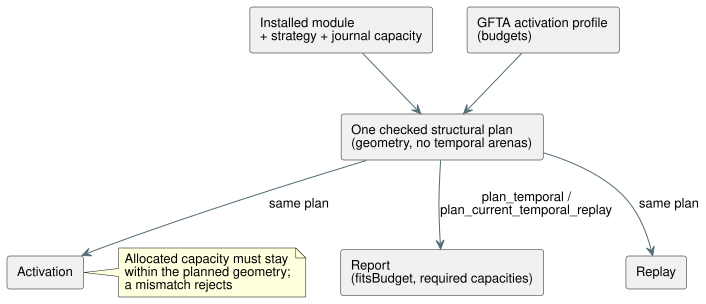

# Static temporal resource planning

**Status: focused implementation accepted; broader resource/checkpoint acceptance remains pending.**

**Why planning is needed.** Reference §4 requires finite state and memory bounds
*before* execution. Batch14 checked temporal activation and replay budgets, but
its native exact-byte tests do not independently prove the wasm32 thresholds.
Reporting the accounted bytes of an already activated runtime would not satisfy
pre-activation planning on its own.

## Authoritative geometry

**One structural plan.** Extract one checked structural plan that spans physical
windows, derived evidence and the temporal runtime. It calculates:

- density rings and retained observations;
- proof/high-water capacities;
- candidate and committed banks;
- checkpoints and projections;
- trace/marker bounds;
- construction scratch.

Planning may allocate bounded O(windows + roots) metadata. It never allocates
the temporal sample/proof/checkpoint arenas.

**Everyone uses the same plan.** Activation and replay consume that same plan, as
the diagram shows. Do not maintain a second production estimator.



- Actual allocated capacities must stay within the planned geometry. An
  allocation mismatch rejects; it never silently exceeds the reported bound.
- Plan metadata and construction overlap belong in the accounted peak.
- Where practical, reuse or move metadata into existing storage rather than
  keeping duplicate graphs just for accounting convenience.

**What the report is.** The report is a target-specific **accounted upper
bound**, not current heap usage. These stay explicitly outside the temporal
bound: allocator metadata, scalar/module storage, report/JSON output, and caller
copies.

## Native interface

| Call | Returns |
| --- | --- |
| `Runtime::plan_temporal(&activation)` | Requirements for the installed module, selected strategy and journal capacity, without activating. |
| `Runtime::temporal_resource_report()` | The active report, when available. |
| `Runtime` and `ScanDriver::plan_current_temporal_replay(count, &activation)` | The combined live/ghost bound, without executing replay. |

**Budget outcomes.**

- A positive but insufficient profile budget yields `fitsBudget: false` and still
  reports the required capacities.
- Invalid facts or incompatible replay bindings still reject.
- Counts keep the strict positive retained-prefix rule.

**Initial report fields:** `format`, installed `module` fingerprint, `strategy`,
`targetPointerBytes`, `journalCapacity`, `windowCount`, `retainedSamples`,
`accountedTemporalBytes`, `fitsBudget`.

**Replay report fields:** `eligibleCount`, `count`, `liveBytes`, `ghostBytes`,
`returnHeaderBytes`, `frameHeaderBytes`, `requiredPeakTemporalBytes` and
`ghostFitsBudget`. The sum accounts for both the returned core records and the
framed outcomes while they overlap. The ghost geometry uses a journal capacity
equal to count.

**Formats:** `GhostFlow/temporal-resources-v1` and
`GhostFlow/temporal-replay-resources-v1`.

## WASM and JavaScript interface

Both adapters expose synchronous methods:

```js
runtime.planTemporal({ profile, maxJsonBytes });
runtime.planTemporalReplay({ count, profile, maxJsonBytes });
runtime.resourcePlan; // last successful plan, initially null
```

WASM exports:

- `gf_plan_temporal(handle, profilePtr, profileLen, maxJsonBytes)` and framed peer.
- `gf_plan_temporal_replay(handle, profilePtr, profileLen, count, maxJsonBytes)`
  and framed peer.
- `gf_resource_plan_ptr/len` and `gf_frame_resource_plan_ptr/len`.

**Buffer rules.**

- Each handle owns one latest-plan buffer, shared by both plan types.
- Only success replaces it. A rejection preserves the previous plan, the
  previous replay, live execution, the frame sequence and the outcome.
- The bounded JSON writer charges the old plus the candidate buffer capacities.
- Planning before framed activation uses the configuring Runtime. Replay
  planning requires the active ScanDriver.

## Independent acceptance

1. A fixed nested-window fixture has a separately reviewed wasm32 layout-width
   table and capacity formula. Derive target widths from isolated compiler layout
   evidence (see [temporal layout evidence](temporal-layout-evidence.md)), never
   from a copied successful budget or a product test-only export.
2. The oracle computes the retained capacity C and the byte bound N. Activate at
   C/N and reject C-1/N-1 in both actual WASM adapters. Compare reports as extra
   evidence.
3. Compute the replay peak from the independent live/ghost geometry, core return
   headers and framed headers. Accept N and reject N-1 without altering the live
   state or the previous replay/plan buffers. Do not use binary search as the
   oracle.
4. Before activation, insufficient positive budgets still report requirements.
   Show that planning neither allocates the temporal data arenas nor executes a
   tick.
5. Preserve existing native, checkpoint, replay, trace and package behavior.

**Not covered by this work:** estimated evidence, other temporal operators,
foreign checkpoints, and full Reference §6.8 branch/source-closure identities.

## Focused evidence

| Evidence | Result |
| --- | --- |
| `build/temporal-plan-rust-final.log` | Core 142 and ABI 10 tests pass. |
| `build/temporal-resource-plan-wasm-green.log` | WASM resource suite 22/22 pass. |
| `build/scan-frame-wasm-temporal-plan.log` | Framed suite 17/17 pass. |
| `build/temporal-plan-catalog.log` | Catalog 5/5 pass. |
| Independent oracle | Live C14 = 9,424,375 bytes; ghost count 3 = 47,511; legacy replay peak = 9,471,958; framed replay peak = 9,472,414. |

Batch15 full-gate artifacts: `build/compiler-runtime-batch15-full.log`,
`build/compiler-runtime-batch15-verification.json`, and
`build/compiler-runtime-batch15-reference-results.json`. Node: 1,923 pass,
27 Reference failures, 164 TODO, with source hashes matching the gate.
