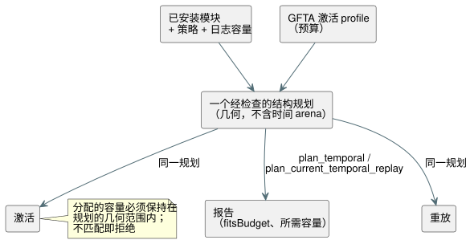

<!-- translation-source: tasks/temporal-resource-plan-design.md -->
[英文原文](temporal-resource-plan-design.md)

# 静态时间资源规划

**状态：聚焦实现已验收；更广泛的资源/检查点验收仍待完成。**

**为什么需要规划。** Reference §4 要求在执行*之前*就有有限的状态和内存上限。Batch14 检查了时间激活和重放预算，但其原生精确字节测试并不能独立证明 wasm32 的阈值。仅报告已激活运行时的已核算字节数，本身并不满足激活前规划的要求。

## 权威几何

**一个结构规划。** 提取一个经检查的结构规划，覆盖物理 window、派生证据和时间运行时。它计算：

- 密度环和保留的观测；
- 证明/高水位容量；
- 候选与已提交的存储库（bank）；
- 检查点和投影；
- trace/标记的上限；
- 构造时的临时空间（scratch）。

规划可以分配有界的 O(windows + roots) 元数据。它绝不分配时间样本/证明/检查点 arena。

**所有方使用同一个规划。** 如图所示，激活和重放都使用同一个规划。不要维护第二个生产用估算器。



- 实际分配的容量必须保持在规划的几何范围内。分配不匹配即拒绝；绝不会悄悄超出报告的上限。
- 规划元数据和构造时的重叠都计入已核算的峰值。
- 在可行的情况下，复用元数据或将其移入现有存储，而不是仅为了核算方便而保留重复的图。

**报告是什么。** 报告是特定于目标的**已核算上限**，而不是当前的堆使用量。以下内容明确不计入时间上限：分配器元数据、标量/模块存储、报告/JSON 输出以及调用方的副本。

## 原生接口

| 调用 | 返回 |
| --- | --- |
| `Runtime::plan_temporal(&activation)` | 已安装模块、所选策略和日志（journal）容量的需求，不进行激活。 |
| `Runtime::temporal_resource_report()` | 当前活动的报告（如有）。 |
| `Runtime` 和 `ScanDriver::plan_current_temporal_replay(count, &activation)` | 实时/ghost 的合计上限，不执行重放。 |

**预算结果。**

- 为正但不足的 profile 预算会得到 `fitsBudget: false`，并仍报告所需容量。
- 无效的事实或不兼容的重放绑定仍会被拒绝。
- count 保持严格的“正值保留前缀”规则。

**初始报告字段：**`format`、已安装 `module` 的指纹、`strategy`、`targetPointerBytes`、`journalCapacity`、`windowCount`、`retainedSamples`、`accountedTemporalBytes`、`fitsBudget`。

**重放报告字段：**`eligibleCount`、`count`、`liveBytes`、`ghostBytes`、`returnHeaderBytes`、`frameHeaderBytes`、`requiredPeakTemporalBytes` 和 `ghostFitsBudget`。该总和同时计入返回的核心记录和帧式结果在重叠期间的占用。ghost 几何使用等于 count 的日志容量。

**格式：**`GhostFlow/temporal-resources-v1` 和 `GhostFlow/temporal-replay-resources-v1`。

## WASM 与 JavaScript 接口

两个适配器都暴露同步方法：

```js
runtime.planTemporal({ profile, maxJsonBytes });
runtime.planTemporalReplay({ count, profile, maxJsonBytes });
runtime.resourcePlan; // last successful plan, initially null
```

WASM 导出：

- `gf_plan_temporal(handle, profilePtr, profileLen, maxJsonBytes)` 及其帧式对应项。
- `gf_plan_temporal_replay(handle, profilePtr, profileLen, count, maxJsonBytes)` 及其帧式对应项。
- `gf_resource_plan_ptr/len` 和 `gf_frame_resource_plan_ptr/len`。

**缓冲区规则。**

- 每个句柄拥有一个最新规划缓冲区，由两种规划类型共用。
- 只有成功才会替换它。拒绝会保留之前的规划、之前的重放、实时执行、帧序列和结果。
- 有界 JSON 写入器计入旧缓冲区加候选缓冲区的容量。
- 帧式激活之前的规划使用正在配置的 Runtime。重放规划需要活动的 ScanDriver。

## 独立验收

1. 一个固定的嵌套 window fixture 拥有经单独审阅的 wasm32 布局宽度表和容量公式。目标宽度应从隔离的编译器布局证据中推导（参见[时间布局证据](temporal-layout-evidence.zh.md)），绝不能来自复制的成功预算或产品中仅用于测试的导出。
2. oracle 计算保留容量 C 和字节上限 N。在两个实际 WASM 适配器中，以 C/N 激活成功，以 C-1/N-1 被拒绝。将报告比较作为额外证据。
3. 根据独立的实时/ghost 几何、核心返回头部和帧头部计算重放峰值。接受 N 并拒绝 N-1，且不改变实时状态或之前的重放/规划缓冲区。不要把二分查找用作 oracle。
4. 在激活之前，不足的正值预算仍报告需求。证明规划既不分配时间数据 arena，也不执行 tick。
5. 保留现有的原生、检查点、重放、trace 和包行为。

**本工作未覆盖：**估计证据、其他时间运算符、外部检查点，以及完整的 Reference §6.8 分支/源闭包身份标识。

## 聚焦证据

| 证据 | 结果 |
| --- | --- |
| `build/temporal-plan-rust-final.log` | Core 142 和 ABI 10 个测试通过。 |
| `build/temporal-resource-plan-wasm-green.log` | WASM 资源套件 22/22 通过。 |
| `build/scan-frame-wasm-temporal-plan.log` | 帧式套件 17/17 通过。 |
| `build/temporal-plan-catalog.log` | Catalog 5/5 通过。 |
| 独立 oracle | 实时 C14 = 9,424,375 字节；ghost count 3 = 47,511；legacy 重放峰值 = 9,471,958；帧式重放峰值 = 9,472,414。 |

Batch15 完整闸门制品：`build/compiler-runtime-batch15-full.log`、`build/compiler-runtime-batch15-verification.json` 和 `build/compiler-runtime-batch15-reference-results.json`。Node：1,923 通过，27 个 Reference 失败，164 个 TODO，源哈希与闸门一致。
