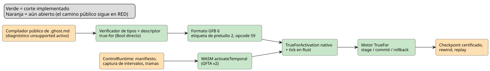
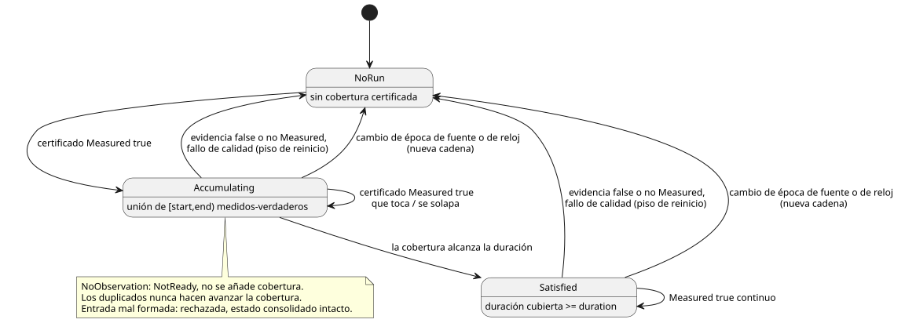

<!-- translation-source: tasks/true-for-driver-contract.md -->
[Original en inglés](true-for-driver-contract.md)

# Requisito previo de intervalo del driver para `true_for`

**Estado:** el compilador público de `.ghost.md` todavía rechaza `true_for` con
un diagnóstico "unsupported" localizado. Existen varios cortes internos (motor
en Rust, verificación de tipos, formato GFB 6, activación y tick nativos,
activación WASM de bajo nivel), pero `REF-04-025` **no** está cumplido. No se
afirma ninguna verificación en dispositivo.

En este documento:

- Por qué las muestras puntuales actuales no pueden sustentar `true_for`.
- El motor de requisito previo en Rust y nativo (`TrueFor`).
- El plan de integración: transporte del driver, artefacto/lowering, una única
  transacción en Rust y la secuencia de aceptación TDD.
- El fixture de integración RED y los cortes implementados hasta ahora.

**El problema.** El descriptor actual de una muestra `Result` medida lleva una
identidad *puntual*: `sourceTag`, `present`, `epoch`, `id`, `timestamp` y
`quality`. No lleva un *intervalo* que un driver certifique haber observado de
forma continua.

La Reference §4.4 prohíbe derivar la continuidad de cualquiera de estos:

- dos muestras puntuales;
- la cadencia esperada o la cadencia de escaneo;
- duplicados;
- ticks (pasos de decisión lógica) solo de reloj.

Por eso el compilador rechaza `true_for` con un diagnóstico específico y
localizado. Lo seguirá haciendo hasta que se definan cuatro cosas: un hecho de
intervalo del driver acotado, su vinculación (binding) de confianza, una
representación para checkpoint/replay y una regla de admisión en el runtime.
Aceptar la sintaxis con los campos de muestra actuales fabricaría la evidencia
que exige `quality: measured`.

El temporizador existente `continuous_true(Bool)` es un temporizador
independiente en tiempo de escaneo. **No** es un respaldo (fallback) de
implementación para `true_for`.

El siguiente diagrama resume qué partes del camino de extremo a extremo existen
(verde) y cuáles siguen abiertas (naranja).

## Corte de requisito previo en Rust

`crates/ghostflow-core::true_for::TrueFor` ahora admite un contrato
`CertifiedBoolInterval` acotado y de una sola fuente. Sin asignación de memoria
en tiempo de escaneo, valida:

- épocas de fuente y de tiempo;
- límites futuros e invertidos;
- calidad medida/verdadera;
- identidades duplicadas;
- unión de solapamientos;
- pisos de reinicio tras fallos o evidencia falsa;
- consolidación/reversión (commit/rollback) por etapas.

La prueba focalizada es `build/true-for-interval-green5.log` (5/5).

Este corte **no** hace que el compilador ni el runtime GFB/WASM acepten
`true_for`. Siguen abiertos el transporte del intervalo del driver, la
vinculación de confianza, la representación para checkpoint/replay y el
lowering del compilador.

## Requisito previo de admisión nativa de intervalos

`crates/ghostflow-core/src/true_for.rs` ahora proporciona un motor nativo
`TrueFor` de almacenamiento fijo. Es un requisito previo de admisión, no
soporte del compilador ni de la VM.

**Aserción del driver.** Cada aserción contiene:

- una etiqueta de fuente vinculada;
- una época de fuente;
- una época de reloj monotónico;
- un ID de certificado;
- milisegundos de inicio y de fin;
- un Bool;
- una calidad de evidencia.

La instalación debe autorizar al driver a afirmar esta cobertura continua. La
mera presencia de estos campos no establece confianza en la medición.

**Reglas de cobertura.**

- La cobertura usa intervalos semiabiertos `[start,end)`.
- Los intervalos medidos-verdaderos que se tocan o se solapan acumulan su
  unión. Los puntos de ancho cero aportan tiempo cero.
- El orden de inicio/fin debe ser monotónico dentro de las épocas de fuente y
  de reloj.
- Se rechazan *antes* de que cambie el estado consolidado: solapamientos en
  conflicto, identidades duplicadas modificadas, identidades antiguas,
  intervalos invertidos o futuros y discrepancias de época.
- La evidencia falsa y la evidencia no medida reinician la continuidad.
- Un fallo de calidad aguas arriba fija un límite de reinicio que un relleno
  posterior (backfill) no puede cruzar.
- Un cambio de época de fuente o de reloj inicia una nueva cadena.
- La duración, las épocas, los ID y las marcas de tiempo usan el dominio
  temporal de enteros exactos existente (`0..2^53-1`). La duración debe ser
  positiva.

**Ausencia y evidencia tardía.**

- `NoObservation` devuelve NotReady y no extiende la cobertura. Su tramo
  almacenado puede unirse a un certificado real posterior solo si ese
  certificado llena la brecha.
- El resultado informa los extremos certificados y la duración cubierta,
  incluso cuando la evidencia llega después de su extremo. **No** certifica el
  intervalo no observado desde ese extremo hasta el reloj de evaluación.
- Los duplicados no pueden hacer avanzar la cobertura ni restaurar un resultado
  reiniciado.

El diagrama de estados siguiente muestra cómo los certificados mueven el motor
entre "sin tramo", cobertura en acumulación y una duración satisfecha.

**Almacenamiento y transacciones.** El motor posee un estado consolidado de
tamaño fijo y un candidato. `stage`, `commit` y `rollback` no realizan
asignaciones en el heap ni operaciones atómicas. Una preparación (staging) mal
formada y una reversión explícita conservan el estado consolidado anterior.

**Evidencia.** `cargo test -p ghostflow-core --test true_for`: cinco pruebas
superadas en `build/true-for-interval-green4.log`. La evidencia RED está en
`build/true-for-interval-red.log`, `-red2.log`, `-red3.log` y `-red4.log`.

**Aún se requiere:**

- tipado/lowering en el compilador;
- wire acotado y vinculación de confianza del driver;
- procedencia de expresiones a través de predicados Bool derivados;
- ejecución del preludio en la VM;
- entradas WASM/host;
- codificación de traza/replay/checkpoint;
- contabilidad de recursos del objetivo.

`REF-04-025` sigue sin cumplirse hasta que el camino público del compilador
literate/runtime implemente esos contratos. El diagnóstico "unsupported" del
compilador sigue activo.

**Contrato RED de extremo a extremo.** Lo registran
`tests/true-for-integration.test.mjs` junto con
`tests/fixtures/true-for-certified.ghost.md`. La prueba fija el manifiesto de
intervalo certificado previsto, el perfil temporal, el límite exacto de
duración y el rechazo de muestras puntuales. El compilador actual rechaza los
tres casos en el diagnóstico explícito "unsupported";
`build/true-for-integration-red.log` registra esta línea base. No se afirma
ninguna aceptación hasta que exista el camino completo.

## Auditoría de integración y siguiente corte ejecutable

La primera vertical es el programa existente de REF-04-025:

- un sensor Bool vinculado directamente;
- una duración constante positiva;
- `quality: measured`;
- un `Result<Bool, SensorFault>` ordinario consumido por `recover(false)`.

Esto es un hito. El soporte de predicados derivados sigue formando parte del
objetivo general de la Reference. Ninguna nueva cuestión de política de
producto bloquea esta vertical de fuente directa.

Las cuatro subsecciones siguientes son contratos de implementación por
integrar, no afirmaciones sobre una ABI implementada. No elimine el diagnóstico
"unsupported" ni su prueba de regresión hasta que la vertical completa tenga
evidencia de ejecución nativa **y** WASM.

### 1. Transporte y activación del driver

- **Capacidad (capability).** Extender el perfil de instalación con un
  conjunto explícito de raíces físicas autorizadas a suministrar intervalos
  Bool certificados. Validar las raíces exactas que requiere el módulo
  compilado. Una muestra de sensor normal o un límite de densidad no otorgan
  esta capacidad. El host instala esta vinculación; no calcula resultados de
  `true_for`. Este contrato de capacidad local no requiere firma ni servicio
  remoto.
- **Hecho por tick.** Capturar un hecho de intervalo separado por cada raíz
  vinculada en cada tick: presencia, época de fuente, ID de certificado,
  milisegundos de inicio y de fin, valor Bool y calidad de evidencia. La tabla
  de raíces aporta la etiqueta de fuente; el tick aporta la época de tiempo.
  Mantener estas identidades independientes de las identidades de muestras
  puntuales. Transportar explícitamente los fallos de calidad no disponibles.
  La ausencia significa `NoObservation`.
- **Wire y replay.** Usar campos de wire de ancho fijo y el dominio de tiempo
  de enteros exactos existente. Rechazar los hechos mal formados antes de
  cualquier mutación. No derivar extremos de las marcas de tiempo de las
  muestras, de los intervalos entre muestras ni del escaneo anterior. Conservar
  cada hecho admitido en las tramas de replay, incluidas las épocas de
  fuente/tiempo y las entradas no disponibles.

Puntos de cambio actuales: `runtimes/wasm/temporal-profile.mjs`, el código de
captura/validación/tramas de replay de `runtimes/wasm/control-runtime.mjs` y
`runtimes/wasm/src/lib.rs`. El perfil GFTA v1 actual solo tiene época de
tiempo, densidad de raíz y presupuesto. Su esquema estricto necesita una
extensión versionada.

### 2. Artefacto verificado y lowering del compilador

- **Descriptor.** Añadir un descriptor de preludio `true_for` distinto: sitio,
  nombre, raíz de fuente, duración positiva y vinculaciones de entradas
  certificadas. Sus proyecciones de salida son el payload Bool, ok/fault/origin,
  los extremos certificados y la duración cubierta. No codificarlo como una
  operación de ventana numérica ni como estados de `continuous_true`.
- **Formato.** Extender a la vez el escritor GFB y el cargador en Rust, con una
  decisión explícita de versión de formato. Las raíces GFB4 existentes vinculan
  cuatro entradas de metadatos puntuales; el GFB5 existente tiene etiquetas de
  preludio de ventana/programación horaria. Ninguno describe hoy un intervalo
  certificado. Los lectores antiguos deben rechazar el nuevo formato en lugar
  de interpretar mal una etiqueta nueva. El dimensionamiento del wire debe
  imponer los límites existentes de entradas/estado/módulo antes de asignar
  memoria.
- **Lowering.** Bajar (lower) el sensor Bool directo al nuevo preludio y a
  proyecciones de Result ordinarias. Verificar tipos: una sola fuente,
  argumentos `duration` y `quality` únicos, calidad medida y una Duration
  constante positiva. Conservar las ubicaciones en el código fuente de cada
  rechazo. Emitir las mismas identidades de sitio y de raíz en el manifiesto y
  en el bytecode; rechazar artefactos discordantes en la activación.

Puntos de cambio actuales: `addSignal`, la construcción del manifiesto y la
emisión del preludio en `tools/control.mjs`; `tools/gfb1.mjs`; el
cargador/verificador de proyecciones en `crates/ghostflow-core/src/lib.rs`;
`temporal_vm.rs`; y la validación del manifiesto en
`runtimes/wasm/control-runtime.mjs`.

### 3. Una única transacción en Rust, plan de checkpoint y de recursos

- **Transacción.** Hacer que el estado de TrueFor forme parte del runtime
  temporal instalado. Prepararlo (stage) antes de las expresiones dependientes;
  consolidarlo solo cuando el tick se complete con éxito. Un fallo posterior de
  una expresión lo revierte junto con el estado de ventana existente.
- **Checkpoint.** Guardar en el checkpoint el estado consolidado, la
  vinculación de la fuente, la duración y los metadatos de duplicados/reinicio.
  La restauración debe rechazar identidades incompatibles de
  módulo/configuración/vinculación. El estado candidato nunca entra en un
  checkpoint. El replay evalúa los hechos de intervalo capturados mediante el
  mismo motor en Rust.
- **Recursos.** Contabilizar el motor, el candidato, la retención de
  checkpoints y el almacenamiento de trazas en los presupuestos de activación y
  de replay, con el ancho de puntero del objetivo. El motor autónomo tiene
  tamaño fijo, pero añadir un Vec no contabilizado de motores/checkpoints
  seguiría violando el contrato de recursos temporales instalado.
- **Traza.** Trazar la identidad del intervalo efectivamente usado, sus
  extremos, su calidad, su cobertura y su resultado/fallo, con el sitio de la
  declaración. No fabricar una muestra puntual y no marcar un valor
  recuperado/predeterminado como evidencia medida.

Puntos de cambio actuales: la interfaz de checkpoint/estado de `true_for.rs`;
la planificación de recursos/stage/commit/rollback/restore de
`temporal_runtime.rs`; los registros de tick y el replay de `lib.rs`; además de
la serialización de trazas nativa/WASM.

### 4. Secuencia de aceptación (TDD)

1. Añadir una prueba pública de compilador a runtime sobre `.ghost.md` que
   inicialmente falle en el diagnóstico "unsupported". Vincular explícitamente
   la capacidad del driver y suministrar los hechos medidos-verdaderos
   `[0,299999)` y luego `[299999,300000)`. La salida es falsa antes de
   300000 ms y verdadera en el límite exacto de la duración. Ejecutar el mismo
   artefacto y la misma secuencia de entradas en los runtimes nativo y WASM.
2. Añadir controles negativos: solo lecturas puntuales ordinarias, ticks solo
   de reloj, certificados duplicados, una brecha sin cubrir de un milisegundo,
   evidencia falsa, calidad Held/recuperada, cambio de época de fuente, fuente
   no vinculada/ajena, límites invertidos/futuros e identidad duplicada
   modificada. Ninguno debe fabricar continuidad; una entrada mal formada deja
   intacto el estado consolidado.
3. Forzar un fallo de una expresión aguas abajo después de preparar el
   intervalo. Reintentar el mismo tick válido y comparar con una ejecución sin
   interrupciones. Repetir tras restaurar un checkpoint retenido y tras un
   replay nativo/WASM. Comparar la salida y la procedencia del intervalo, no
   solo que la ejecución haya tenido éxito.
4. Probar los límites exactos de presupuesto de activación/replay y
   vinculaciones de artefacto corruptas. Registrar las pruebas explícitamente
   en `tools/verify-language.mjs`. Solo entonces reemplazar la regresión del
   diagnóstico "unsupported" y aceptar REF-04-025.

**Los predicados derivados son un corte posterior y obligatorio.** Un selector
de linaje puntual no certifica una expresión sobre un intervalo:

- los predicados unarios/puros necesitan cobertura certificada del payload;
- los predicados de varias fuentes necesitan la intersección de coberturas;
- los predicados que dependen del estado o de la configuración también
  necesitan sus límites de cambio.

Rechace explícitamente las derivaciones no soportadas hasta que exista su
construcción de prueba.

### Por qué `after_event` viene después de este trabajo

Sus bloqueos de integración adicionales se enumeran en `after-event-design.md`:

- Los resultados de eventos independientes necesitan una proyección escalar
  definida y una interfaz de retención.
- El requisito previo actual en Rust acepta una entrada por etapa. Un evento y
  un predicado verdadero en el mismo tick deben prepararse juntos, para que el
  límite de inicio inclusivo funcione sin consolidar parte de un tick de la VM.
- La observación de su predicado carece hoy de una identidad de fuente, por lo
  que aún no puede sustentar linaje medido, deduplicación ni procedencia en el
  replay.

Esto debe resolverse antes de reutilizar el transporte temporal. REF-04-026
sigue sin cumplirse.

## Primer fixture RED de integración

`tests/fixtures/true-for-certified.ghost.md` es un documento canónico completo.
`tests/true-for-integration.test.mjs` fija el contrato de la siguiente
implementación propuesta:

- formato GFB 6;
- un descriptor de manifiesto `true-for` con fuente/sitio/slot, duración e
  `intervalInputs` explícitos;
- `certifiedBoolRoots` en la activación;
- certificados separados en `step.intervals`;
- identidad/cobertura en `vm.trueForTrace`.

Son objetivos de implementación ejecutables, no una ABI soportada existente.

| Dato del fixture | Valor |
|---|---|
| Certificados exitosos | 2 |
| Época de fuente | 11 |
| Época de tiempo | 7 |
| ID de certificado (independientes) | 1 y 2 |
| Intervalos (ms) | `[0,299999)` y `[299999,300000)` |
| Alarma esperada | false, luego true |
| Controles solo puntuales y solo de reloj | deben permanecer en false |

Las pruebas importan y usan el compilador literate público y el
ControlRuntime de WASM; no contienen ningún evaluador de host sustituto.

Ejecución: `node --test tests/true-for-integration.test.mjs`.

`build/true-for-integration-red.log` registrado: exit 1, 3 pruebas, 0 pass,
3 fail, 0 skip/TODO. Las tres se detienen en el diagnóstico actual esperado del
compilador, `true-for-certified.ghost.md:10:22: true_for requires Driver-certified observed
interval evidence, which is not yet supported`. No se llega a las aserciones de
descriptor/runtime; esto demuestra la vertical faltante, no la ABI propuesta.
La prueba está registrada explícitamente en `tools/verify-language.mjs`. Las
expectativas existentes del diagnóstico "unsupported" y de la Reference no
cambian.

## Cortes implementados de compilador/artefacto y de ejecución nativa

**Verificación de tipos.** El verificador de tipos ahora valida la fuente Bool
directa, la duración constante positiva y la calidad medida, y emite el
descriptor anterior. Las fuentes derivadas siguen rechazadas. El compilador
público ejecutable mantiene deliberadamente su diagnóstico "unsupported"
localizado hasta que se completen la integración de traza de fuente, host/WASM
y replay. La verificación interna de tipos no constituye la aceptación de
REF-04-025.

**Formato GFB 6.** El escritor GFB en JS y el cargador en Rust ahora comparten
el formato 6. Conserva el encabezado temporal de reloj/raíces puntuales y la
secuencia etiquetada del preludio.

- La nueva etiqueta de preludio 2 codifica, en orden: sitio `u32`, nombre de la
  señal, etiqueta de fuente `u32`, nombre de la fuente, duración `u64` y luego
  ocho índices de entrada `u16` (present, epoch, ID, start, end, valor Bool,
  quality, fault).
- Las cadenas conservan el prefijo existente de longitud en bytes UTF-8 `u16`.
- El opcode 59 lee un slot true_for `u16` seguido de un campo `u8`:

| Campo | Significado |
|---|---|
| 0 | ok |
| 1 | valor Bool |
| 2 | fault |
| 3 | origin |
| 4 | inicio del tramo certificado |
| 5 | fin del tramo |
| 6 | duración cubierta |

Todos los campos numéricos usan los límites existentes de enteros exactos. Las
raíces compartidas deben conservar exactamente la misma identidad y
vinculaciones entre estrategias. Se rechazan relojes con alias, metadatos
puntuales, otras raíces, entradas desconocidas y tipos incorrectos.

**Activación y tick nativos.**
`Runtime::activate_with_certified_intervals(TrueForActivation)` solo acepta:

- módulos exclusivamente de true_for;
- un conjunto `certified_bool_roots` exacto y ordenado;
- `time_epoch`;
- `max_bytes` explícito.

La activación ordinaria sigue cerrada, y las combinaciones con
ventanas/programaciones horarias siguen cerradas. Su tick en Rust prepara cada
certificado, proyecta el resultado, evalúa las transiciones escalares/intenciones
y consolida solo tras una evaluación exitosa. Un fallo aguas abajo revierte el
estado del intervalo. `TickRecord.true_for_trace` y `trueForTrace` en JSON
conservan la identidad de la entrada, la calidad, los límites del intervalo,
los límites agregados certificados, la cobertura y el resultado/fallo.

**Códigos nativos de calidad de entrada.**

| Código | Calidad |
|---|---|
| 0 | Constructed |
| 1 | Measured |
| 2 | Held |
| 3 | Constructed (evidencia derivada/no física) |
| 4 | Unavailable |

Unavailable consume los códigos SensorFault existentes 0 Disconnected,
1 Stale, 2 Invalid, 3 NotReady. Una presencia false significa NoObservation.
Las muestras puntuales no generan estas entradas. La época de fuente, la
identidad y los extremos se mantienen explícitos incluso cuando una
observación no aporta cobertura. Solo los certificados Measured verdaderos se
acumulan.

**Límite de recursos.** El límite nativo contabiliza el estado del
motor/candidato, el almacenamiento de proyecciones y los búferes máximos
retenidos de trazas de true_for/resultado, incluido el tick actual. Los
vectores de traza asignan una capacidad acotada por tick; este corte no afirma
ticks de VM sin asignación de memoria. El almacenamiento del módulo
compilado/escalares, los metadatos del asignador, la serialización y los clones
propiedad del llamador quedan fuera de ese límite de bytes temporal. La
admisión con presupuesto exacto y el rechazo con un byte de menos tienen
pruebas nativas. El rebobinado (rewind) se rechaza explícitamente hasta que
existan checkpoints certificados; el replay y el reemplazo en caliente
(hot swap) siguen cerrados.

Evidencia:

- `build/true-for-lowering-red.log`: 15 pruebas objetivo de compilador/escritor
  fallidas.
- `build/true-for-lowering-green3.log`: 58/58 pruebas JS focalizadas y
  afectadas.
- `build/true-for-module-red.log`: la API objetivo del cargador nativo
  inicialmente ausente.
- `build/true-for-module-green.log`: 3/3 pruebas estructurales nativas.
- `build/gfb6-native-green.log`: 25/25 pruebas de JS a nativo y afectadas.
- `build/true-for-native-tick-red.log`: la API/traza del tick nativo
  inicialmente ausente.
- `build/true-for-native-rewind-red.log`: detectó un rewind solo escalar de una
  ejecución certificada; el rewind nativo ahora rechaza antes de la mutación.
- `build/true-for-native-core-green2.log`: pasan todas las pruebas de
  ghostflow-core, incluidas 9 pruebas estructurales/nativas del módulo
  true_for.

**Aún se requiere antes de la aceptación pública:**

- soporte del formato 6 en la traza de fuente/decodificador de artefactos del
  compilador;
- eliminación de la barrera del compilador ejecutable, solo con evidencia
  completa;
- validación del manifiesto en el host y tramas de captura/replay de
  intervalos;
- despacho de la activación WASM hacia la API nativa certificada;
- checkpoints certificados y recursos/procedencia del replay;
- ejecución de preludios mixtos y cobertura de predicados derivados.

Las pruebas públicas de integración siguen en RED. No se afirma ninguna
verificación en dispositivo.

## Corte de activación certificada en WASM

El camino GFTA v2 de bajo nivel `GhostFlowRuntime.activateTemporal` ahora
despacha raíces certificadas explícitas hacia el mismo motor nativo de
`TrueForActivation` y de tick. Los perfiles de densidad puntual combinados con
raíces certificadas se rechazan hasta que se implementen los preludios mixtos.
Rust sigue validando la autoridad de las raíces y los presupuestos de
almacenamiento temporal antes de la activación. La activación de ventanas
GFTA v1 no cambia.

`tests/true-for-wasm.test.mjs` cubre: duración exacta e identidad de traza,
ausencia con ticks solo de reloj, puntos de ancho cero, brechas sin cubrir,
calidad Held, reinicio por época de fuente, capacidad de raíz incorrecta,
presupuesto insuficiente, certificados mal formados/duplicados y reversión por
fallo de una expresión aguas abajo. El rewind y el replay se rechazan
explícitamente y conservan el estado en vivo hasta que existan checkpoints
certificados. Esta prueba está registrada en `tools/verify-language.mjs`.

Esto es solo evidencia de ejecución WASM de bajo nivel. La compilación pública
de `.ghost.md` y `ControlRuntime` siguen rechazando true_for. Sigue pendiente:
decodificación de traza de fuente/artefactos, validación del manifiesto,
transporte separado de instantáneas de intervalos, ejecución por tramas,
checkpoint/replay, preludios mixtos y cobertura de predicados derivados.
