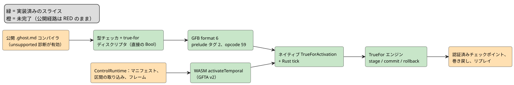
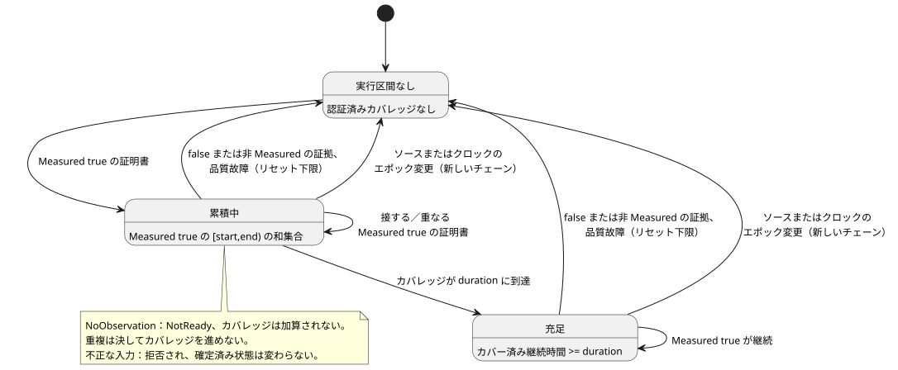

<!-- translation-source: tasks/true-for-driver-contract.md -->
[英語の原文](true-for-driver-contract.md)

# `true_for` の Driver 区間前提条件

**状況：** 公開 `.ghost.md` コンパイラは、現在も `true_for` を位置情報付きの「unsupported」診断で拒否します。内部スライスはいくつか存在します（Rust エンジン、型チェック、GFB format 6、ネイティブの activation と tick、低レベル WASM の activation）が、`REF-04-025` は**満たされていません**。デバイス上での検証も主張しません。

この文書の内容：

- 現在のポイントサンプルでは `true_for` を支えられない理由。
- Rust とネイティブの前提条件エンジン（`TrueFor`）。
- 統合計画：Driver の伝送、成果物/lowering、1 つの Rust トランザクション、TDD の受け入れ手順。
- RED の統合フィクスチャと、これまでに実装されたスライス。

**問題点。** 現在の測定 `Result` サンプルのディスクリプタは、*ポイント*の同一性、すなわち `sourceTag`、`present`、`epoch`、`id`、`timestamp`、`quality` を運びます。Driver が連続して観測したと証明する*区間*は運びません。

Reference §4.4 は、次のいずれからも連続性を導出することを禁じています。

- 2 つのポイントサンプル
- 想定される周期やスキャン周期
- 重複
- クロックだけの tick

そのため、コンパイラは `true_for` を具体的で位置情報付きの診断で拒否します。この拒否は、次の 4 つが定義されるまで続きます：有界な Driver 区間ファクト、その信頼バインディング、チェックポイント/リプレイ表現、そしてランタイムの受け入れ（アドミッション）規則です。現在のサンプルフィールドのままで構文を受け入れると、`quality: measured` が要求する証拠を捏造することになります。

既存の `continuous_true(Bool)` タイマーは、別個のスキャン時間タイマーです。`true_for` の実装上のフォールバックでは**ありません**。

下の図は、エンドツーエンドの経路のうち、存在する部分（緑）と未完了の部分（橙）をまとめたものです。

## Rust の前提条件スライス

`crates/ghostflow-core::true_for::TrueFor` は、有界で単一ソースの `CertifiedBoolInterval` 契約を受け入れるようになりました。スキャン時のアロケーションなしで、次を検証します。

- ソースと時間のエポック
- 未来の境界と逆転した境界
- measured/true の品質
- 重複した同一性
- 重なりの和集合
- 故障や false の証拠の後のリセット下限
- ステージした確定/ロールバック

焦点を絞った証明は `build/true-for-interval-green5.log`（5/5）です。

このスライスは、コンパイラや GFB/WASM ランタイムに `true_for` を受け入れさせるもの**ではありません**。Driver 区間の伝送、信頼バインディング、チェックポイント/リプレイ表現、コンパイラの lowering は未完了のままです。

## ネイティブの区間受け入れ前提条件

`crates/ghostflow-core/src/true_for.rs` は、固定ストレージのネイティブ `TrueFor` エンジンを提供するようになりました。これは受け入れの前提条件であり、コンパイラ/VM のサポートではありません。

**Driver のアサーション。** 各アサーションには次が含まれます。

- バインドされたソースタグ
- ソースエポック
- 単調クロックのエポック
- 証明書 ID
- 開始と終了のミリ秒
- Bool
- 証拠の品質

設備は、Driver がこの連続カバレッジをアサートすることを許可しなければなりません。これらのフィールドが存在するだけでは、測定の信頼は確立されません。

**カバレッジ規則。**

- カバレッジは半開区間 `[start,end)` を使います。
- 接する、または重なる measured-true の区間は、その和集合を累積します。幅ゼロの点は時間に寄与しません。
- 開始/終了の順序は、ソースエポックとクロックエポックの中で単調でなければなりません。
- 次のものは、確定済み状態が変わる*前に*拒否されます：矛盾する重なり、変更された重複同一性、古い同一性、逆転した区間や未来の区間、エポックの不一致。
- false の証拠と、measured でない証拠は連続性をリセットします。
- 上流の品質故障はリセット境界を設定し、後からのバックフィルはそれを越えられません。
- ソースまたはクロックのエポック変更は、新しいチェーンを開始します。
- 継続時間、エポック、ID、タイムスタンプは、既存の厳密な整数の時間領域（`0..2^53-1`）を使います。継続時間は正でなければなりません。

**欠落と遅れて届く証拠。**

- `NoObservation` は NotReady を返し、カバレッジを延長しません。保存された実行区間は、後の実際の証明書がそのギャップを埋める場合に限り、その証明書とつながることができます。
- 結果は、証拠がその終点より遅れて届いた場合でも、認証された終点とカバー済みの継続時間を報告します。その終点から評価クロックまでの観測されていない区間は認証**しません**。
- 重複はカバレッジを進めることも、リセットされた結果を復元することもできません。

下の状態図は、証明書によってエンジンが「実行区間なし」、カバレッジの累積中、継続時間の充足の間をどう遷移するかを示します。

**ストレージとトランザクション。** エンジンは固定サイズの確定済み状態を 1 つと候補を 1 つ所有します。`stage`、`commit`、`rollback` はヒープアロケーションもアトミック操作も行いません。不正なステージングと明示的なロールバックは、以前の確定済み状態を保持します。

**証拠。** `cargo test -p ghostflow-core --test true_for` — `build/true-for-interval-green4.log` に 5 件の成功テストがあります。RED の証拠は `build/true-for-interval-red.log`、`-red2.log`、`-red3.log`、`-red4.log` にあります。

**まだ必要なもの：**

- コンパイラの型付け/lowering
- 有界なワイヤと Driver の信頼バインディング
- 派生 Bool 述語を通した式の来歴
- VM の prelude 実行
- WASM/ホストの入力
- トレース/リプレイ/チェックポイントのエンコーディング
- ターゲットのリソース計上

公開の literate コンパイラ/ランタイム経路がこれらの契約を実装するまで、`REF-04-025` は満たされないままです。unsupported のコンパイラ診断は有効なままです。

**エンドツーエンドの RED 契約。** `tests/true-for-integration.test.mjs` と `tests/fixtures/true-for-certified.ghost.md` がこれを記録しています。このテストは、意図した認証済み区間のマニフェスト、時間プロファイル、厳密な継続時間の境界、ポイントサンプルの拒否を固定します。現在のコンパイラは、3 つのケースすべてを明示的な unsupported 診断で拒否します。`build/true-for-integration-red.log` がこのベースラインを記録しています。完全な経路が存在するまで、受け入れは主張しません。

## 統合監査と次の実行可能スライス

最初の垂直スライスは、既存の REF-04-025 プログラムです。

- 直接バインドされた Bool センサ
- 正の定数の継続時間
- `quality: measured`
- `recover(false)` で消費される通常の `Result<Bool, SensorFault>`

これはマイルストーンです。派生述語のサポートは、引き続き Reference 全体の目標の一部です。この直接ソースの垂直スライスを妨げる新しいプロダクトポリシー上の問題はありません。

以下の 4 つの小節は、統合すべき実装契約であり、実装済みの ABI についての主張ではありません。完全な垂直スライスがネイティブ**と** WASM の両方で実行証拠を得るまで、unsupported 診断とその回帰テストを削除してはなりません。

### 1. Driver の伝送と activation

- **ケイパビリティ。** 設備プロファイルを拡張し、認証済み Bool 区間の供給を許可された物理ルートの明示的な集合を持たせます。コンパイル済みモジュールが必要とするルートを正確に検証します。通常のセンササンプルや密度の上限は、このケイパビリティを付与しません。ホストはこのバインディングをインストールしますが、`true_for` の結果は計算しません。このローカルなケイパビリティ契約には、署名もリモートサービスも必要ありません。
- **tick ごとのファクト。** バインドされたルートごと、tick ごとに、別個の区間ファクトを取り込みます：存在、ソースエポック、証明書 ID、開始と終了のミリ秒、Bool 値、証拠の品質。ソースタグはルート表が、時間エポックは tick が提供します。これらの同一性は、ポイントサンプルの同一性から独立させます。unavailable の品質故障は明示的に運びます。欠落は `NoObservation` を意味します。
- **ワイヤとリプレイ。** 固定幅のワイヤフィールドと、既存の厳密な整数の時間領域を使います。不正なファクトは変更の前に拒否します。終点をサンプルのタイムスタンプ、サンプル間隔、前回のスキャンから導出しません。受け入れたすべてのファクトを、ソース/時間エポックと unavailable な入力を含め、リプレイフレームに保持します。

現在の変更箇所：`runtimes/wasm/temporal-profile.mjs`、`runtimes/wasm/control-runtime.mjs` の取り込み/検証/リプレイフレームのコード、`runtimes/wasm/src/lib.rs`。現在の GFTA v1 プロファイルは、時間エポック、ルート密度、予算しか持ちません。その厳格なスキーマには、バージョン付きの拡張が必要です。

### 2. 検証済み成果物とコンパイラの lowering

- **ディスクリプタ。** 別個の `true_for` prelude ディスクリプタを追加します：site、名前、ソースルート、正の継続時間、認証済み入力のバインディング。その出力の射影は、Bool ペイロード、ok/fault/origin、認証済みの終点、カバー済みの継続時間です。数値ウィンドウ演算としても、`continuous_true` の状態としてもエンコードしません。
- **フォーマット。** GFB ライターと Rust ローダーを、明示的なフォーマットバージョンの決定とともに一緒に拡張します。既存の GFB4 のルートは 4 つのポイントメタデータ入力をバインドし、既存の GFB5 はウィンドウ/スケジュールの prelude タグを持ちます。どちらも現在は認証済み区間を記述しません。古いリーダーは、新しいタグを誤読するのではなく、新しいフォーマットを拒否しなければなりません。ワイヤのサイズ計算は、アロケーションの前に既存の入力/状態/モジュールの上限を強制しなければなりません。
- **Lowering。** 直接の Bool センサを、新しい prelude と通常の Result 射影へ lowering します。型チェックの内容：1 つのソース、一意な `duration` と `quality` 引数、measured の品質、正の定数 Duration。それぞれの拒否についてソース位置を保持します。マニフェストとバイトコードに同じ site とルートの同一性を出力し、activation で不一致の成果物を拒否します。

現在の変更箇所：`tools/control.mjs` の `addSignal`、マニフェストの構築と prelude の出力、`tools/gfb1.mjs`、`crates/ghostflow-core/src/lib.rs` のローダー/射影検証器、`temporal_vm.rs`、そして `runtimes/wasm/control-runtime.mjs` のマニフェスト検証。

### 3. 1 つの Rust トランザクション、チェックポイント、リソース計画

- **トランザクション。** TrueFor の状態を、インストールされた時間ランタイムの一部にします。依存する式より前にステージし、tick が正常に完了したときにのみ確定します。後の式が失敗した場合は、既存のウィンドウ状態と一緒にロールバックします。
- **チェックポイント。** 確定済み状態、ソースバインディング、継続時間、重複/リセットのメタデータをチェックポイントします。復元は、互換性のないモジュール/設定/バインディングの同一性を拒否しなければなりません。候補状態は決してチェックポイントに入りません。リプレイは、取り込んだ区間ファクトを同じ Rust エンジンで評価します。
- **リソース。** エンジン、候補、チェックポイントの保持、トレースのストレージを、ターゲットのポインタ幅で、activation とリプレイの予算に計上します。単体のエンジンは固定サイズですが、計上されないエンジン/チェックポイントの Vec を追加すると、インストールされた時間リソース契約に違反することに変わりはありません。
- **トレース。** 実際に使用した区間の同一性、その終点、品質、カバレッジ、結果/故障を、宣言の site とともにトレースします。ポイントサンプルを作り出してはならず、復旧値/既定値を測定の証拠としてマークしてはなりません。

現在の変更箇所：`true_for.rs` のチェックポイント/状態インターフェース、`temporal_runtime.rs` のリソース計画/stage/commit/rollback/restore、`lib.rs` の tick レコードとリプレイ、そしてネイティブ/WASM のトレースのシリアライズ。

### 4. 受け入れ手順（TDD）

1. 最初は unsupported 診断で失敗する、公開 `.ghost.md` のコンパイラからランタイムまでのテストを追加します。Driver のケイパビリティを明示的にバインドし、`[0,299999)`、続いて `[299999,300000)` の measured-true ファクトを供給します。出力は 300000 ms より前は false で、厳密な継続時間の境界で true になります。同じ成果物と入力列を、ネイティブと WASM の両ランタイムで実行します。
2. 否定的な対照ケースを追加します：通常のポイント読み取りのみ、クロックだけの tick、重複した証明書、1 ミリ秒のカバーされないギャップ、false の証拠、Held/復旧済みの品質、ソースエポックの変更、バインドされていない/外部のソース、逆転した/未来の境界、変更された重複同一性。どれも連続性を捏造してはならず、不正な入力は確定済み状態を変更しません。
3. 区間のステージング後に、下流の式を強制的に失敗させます。同じ有効な tick を再試行し、中断のない実行と比較します。保持されたチェックポイントからの復元と、ネイティブ/WASM のリプレイの後にも繰り返します。単に実行が成功したかではなく、出力と区間の来歴を比較します。
4. activation/リプレイ予算の厳密な境界と、破損した成果物バインディングをテストします。テストは `tools/verify-language.mjs` に明示的に登録します。その後で初めて、unsupported 診断の回帰テストを置き換え、REF-04-025 を受け入れます。

**派生述語は、後続の必須スライスです。** ポイントの系譜セレクタは、区間にわたる式を認証しません。

- 単項/純粋な述語には、認証済みのペイロードカバレッジが必要です。
- 複数ソースの述語には、カバレッジの積集合が必要です。
- 状態/設定に依存する述語には、さらにそれらの変化境界が必要です。

証明の構成が存在するまで、サポートされていない派生は明示的に拒否します。

### `after_event` がこの作業の後になる理由

その追加の統合ブロッカーは `after-event-design.md` に列挙されています。

- 独立したイベント結果には、定義されたスカラー射影と保持インターフェースが必要です。
- 現在の Rust の前提条件は、ステージごとに 1 つの入力しか受け付けません。同じ tick のイベントと true の述語は一緒にステージしなければならず、そうすることで、VM tick の一部だけを確定することなく、開始境界を含む扱いが機能します。
- その述語の観測には現在ソースの同一性がないため、測定の系譜、重複排除、リプレイの来歴をまだサポートできません。

時間の伝送を再利用する前に、これらを解決しなければなりません。REF-04-026 は満たされないままです。

## 最初の統合 RED フィクスチャ

`tests/fixtures/true-for-certified.ghost.md` は、完全な正本の文書です。`tests/true-for-integration.test.mjs` は、提案する次の実装契約を固定します。

- GFB format 6
- source/site/slot、継続時間、明示的な `intervalInputs` を持つ `true-for` マニフェストディスクリプタ
- activation の `certifiedBoolRoots`
- 別個の `step.intervals` 証明書
- `vm.trueForTrace` の同一性/カバレッジ

これらは実行可能な実装目標であり、既存のサポート済み ABI ではありません。

| フィクスチャのファクト | 値 |
|---|---|
| 成功する証明書 | 2 |
| ソースエポック | 11 |
| 時間エポック | 7 |
| 証明書 ID（独立） | 1 と 2 |
| 区間（ms） | `[0,299999)` と `[299999,300000)` |
| 期待されるアラーム | false、その後 true |
| ポイントのみ、クロックのみの対照ケース | false のままでなければならない |

テストは公開の literate コンパイラと WASM の ControlRuntime をインポートして使い、代替のホスト評価器は含みません。

実行：`node --test tests/true-for-integration.test.mjs`。

記録された `build/true-for-integration-red.log`：終了コード 1、3 テスト、成功 0、失敗 3、skip/TODO 0。3 つすべてが、期待どおりの現在のコンパイラ診断 `true-for-certified.ghost.md:10:22: true_for requires Driver-certified observed
interval evidence, which is not yet supported` で停止します。ディスクリプタ/ランタイムのアサーションには到達しません。これは垂直スライスが欠けていることを証明するものであり、提案する ABI を証明するものではありません。このテストは `tools/verify-language.mjs` に明示的に登録されています。既存の unsupported 診断と Reference の期待値は変更されていません。

## 実装済みのコンパイラ/成果物とネイティブ実行のスライス

**型チェック。** 型チェッカは、直接の Bool ソース、正の定数の継続時間、measured の品質を検証し、上記のディスクリプタを出力するようになりました。派生ソースは引き続き拒否されます。実行可能な公開コンパイラは、ソーストレース、ホスト/WASM、リプレイの統合が完了するまで、位置情報付きの unsupported 診断を意図的に維持します。内部の型チェックは REF-04-025 の受け入れではありません。

**GFB format 6。** JS の GFB ライターと Rust ローダーは、format 6 を共有するようになりました。時間クロック/ポイントルートのヘッダと、タグ付き prelude の並びを維持します。

- 新しい prelude タグ 2 は、次の順序でエンコードします：site `u32`、信号名、ソースタグ `u32`、ソース名、継続時間 `u64`、続いて 8 つの `u16` 入力インデックス（present、epoch、ID、start、end、Bool 値、quality、fault）。
- 文字列は、既存の `u16` UTF-8 バイト長プレフィックスを維持します。
- Opcode 59 は、`u16` の true_for スロットに続いて `u8` のフィールドを読み取ります。

| フィールド | 意味 |
|---|---|
| 0 | ok |
| 1 | Bool 値 |
| 2 | fault |
| 3 | origin |
| 4 | 認証済み実行区間の開始 |
| 5 | 実行区間の終了 |
| 6 | カバー済みの継続時間 |

すべての数値フィールドは、既存の厳密な整数の上限を使います。共有ルートは、戦略をまたいで完全に同じ同一性とバインディングを保たなければなりません。別名化されたクロック、ポイントメタデータ、他のルート、未知の入力、誤った型は拒否されます。

**ネイティブの activation と tick。**
`Runtime::activate_with_certified_intervals(TrueForActivation)` は次のみを受け付けます。

- true_for のみのモジュール
- 厳密でソート済みの `certified_bool_roots` 集合
- `time_epoch`
- 明示的な `max_bytes`

通常の activation は閉じたままで、ウィンドウ/スケジュールとの混在も閉じたままです。その Rust の tick は、すべての証明書をステージし、結果を射影し、スカラーの遷移/意図を評価し、評価が成功した後にのみ確定します。下流の失敗は区間状態をロールバックします。`TickRecord.true_for_trace` と JSON の `trueForTrace` は、入力の同一性、品質、区間の境界、認証済みの集約境界、カバレッジ、結果/故障を保持します。

**ネイティブ入力の品質コード。**

| コード | 品質 |
|---|---|
| 0 | Constructed |
| 1 | Measured |
| 2 | Held |
| 3 | Constructed (derived/nonphysical evidence) |
| 4 | Unavailable |

Unavailable は、既存の SensorFault コード 0 Disconnected、1 Stale、2 Invalid、3 NotReady を消費します。present が false の場合は NoObservation を意味します。ポイントサンプルはこれらの入力を生成しません。観測がカバレッジに寄与しない場合でも、ソースエポック、同一性、終点は明示的なままです。累積するのは Measured の true の証明書だけです。

**リソースの上限。** ネイティブの上限は、エンジン/候補の状態、射影のストレージ、そして現在の tick を含む、保持される true_for/結果トレースバッファの最大量を計上します。トレースのベクタは tick ごとに有界な容量をアロケートします。このスライスは、アロケーションのない VM tick を主張しません。コンパイル済みモジュール/スカラーのストレージ、アロケータのメタデータ、シリアライズ、呼び出し側が所有するクローンは、その時間バイト上限の対象外です。予算ちょうどでの受け入れと、1 バイト不足での拒否にはネイティブテストがあります。認証済みチェックポイントが存在するまで、巻き戻しは明示的に拒否され、リプレイとホットスワップは閉じたままです。

証拠：

- `build/true-for-lowering-red.log`：失敗するコンパイラ/ライターの目標テスト 15 件。
- `build/true-for-lowering-green3.log`：焦点を絞った/影響を受ける JS テスト 58/58。
- `build/true-for-module-red.log`：ネイティブローダーの目標 API が当初は存在しない。
- `build/true-for-module-green.log`：ネイティブの構造テスト 3/3。
- `build/gfb6-native-green.log`：JS からネイティブへのテストと影響を受けるテスト 25/25。
- `build/true-for-native-tick-red.log`：ネイティブ tick の API/トレースが当初は存在しない。
- `build/true-for-native-rewind-red.log`：認証済み実行に対するスカラーのみの巻き戻しを検出。ネイティブの巻き戻しは、変更の前に拒否するようになりました。
- `build/true-for-native-core-green2.log`：9 件の構造/ネイティブ true_for モジュールテストを含め、ghostflow-core の全テストが成功。

**公開の受け入れ前にまだ必要なもの：**

- コンパイラのソーストレース/成果物デコーダの format 6 対応
- 完全な証拠がそろったときに限った、実行可能コンパイラのゲートの削除
- ホストのマニフェスト検証と、区間の取り込み/リプレイフレーム
- WASM activation からネイティブ認証済み API へのディスパッチ
- 認証済みチェックポイントと、リプレイのリソース/来歴
- 混在した prelude の実行と、派生述語のカバレッジ

公開の統合テストは RED のままです。デバイス上での検証は主張しません。

## WASM の認証済み activation スライス

低レベルの `GhostFlowRuntime.activateTemporal` GFTA v2 経路は、明示的な認証済みルートを、同じネイティブの `TrueForActivation` と tick エンジンへディスパッチするようになりました。認証済みルートと混在したポイント密度プロファイルは、混在 prelude が実装されるまで拒否されます。Rust は引き続き、activation の前にルートの権限と時間ストレージの予算を検証します。GFTA v1 のウィンドウ activation は変更されていません。

`tests/true-for-wasm.test.mjs` がカバーする内容：厳密な継続時間とトレースの同一性、クロックだけの欠落、幅ゼロの点、カバーされないギャップ、Held 品質、ソースエポックのリセット、誤ったルートケイパビリティ、不十分な予算、不正/重複した証明書、下流の式のロールバック。認証済みチェックポイントが存在するまで、巻き戻しとリプレイは明示的に拒否し、ライブ状態を保持します。このテストは `tools/verify-language.mjs` に登録されています。

これは低レベル WASM の実行証拠にすぎません。公開 `.ghost.md` のコンパイルと `ControlRuntime` は、引き続き true_for を拒否します。未完了のもの：ソーストレース/成果物のデコード、マニフェストの検証、別個の区間スナップショットの伝送、フレーム化された実行、チェックポイント/リプレイ、混在 prelude、派生述語のカバレッジ。
