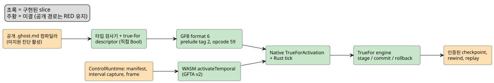
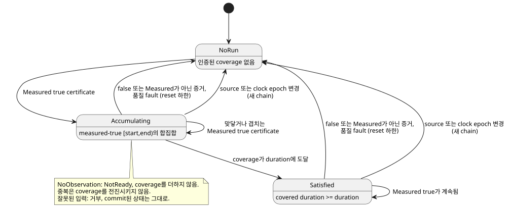

<!-- translation-source: tasks/true-for-driver-contract.md -->
[영문 원문](true-for-driver-contract.md)

# `true_for` Driver interval 선행 조건

**상태:** 공개 `.ghost.md` 컴파일러는 여전히 위치 정보가 있는 "미지원" 진단으로
`true_for`를 거부합니다. 여러 내부 slice(Rust engine, 타입 검사, GFB format 6,
native activation과 tick, 저수준 WASM activation)는 존재하지만 `REF-04-025`는
**충족되지 않았습니다**. 장치 검증은 주장하지 않습니다.

이 문서의 내용:

- 현재 point sample로는 왜 `true_for`를 지원할 수 없는가.
- Rust와 native 선행 engine(`TrueFor`).
- 통합 계획: Driver transport, 산출물/lowering, 하나의 Rust 트랜잭션,
  TDD 수용 순서.
- RED 통합 fixture와 지금까지 구현된 slice.

**문제.** 현재 measured `Result` sample descriptor는 *point* 식별자인
`sourceTag`, `present`, `epoch`, `id`, `timestamp`, `quality`를 담습니다.
Driver가 연속으로 관측했다고 인증하는 *interval*은 담지 않습니다.

Reference §4.4는 다음 어느 것으로도 연속성을 도출하지 못하게 합니다.

- point sample 두 개
- 예상 cadence 또는 scan cadence
- 중복
- clock-only tick

따라서 컴파일러는 위치 정보가 있는 구체적인 진단으로 `true_for`를 거부합니다.
네 가지가 정의될 때까지 계속 거부합니다. 제한된 Driver interval fact,
그 trust binding, checkpoint/replay 표현, runtime admission 규칙입니다.
현재 sample 필드로 이 문법을 받아들이면 `quality: measured`가 요구하는 증거를
꾸며내게 됩니다.

기존 `continuous_true(Bool)` timer는 별도의 scan-time timer입니다.
`true_for`의 구현 fallback이 **아닙니다**.

아래 다이어그램은 종단 간 경로 중 이미 존재하는 부분(초록)과 아직 미결인
부분(주황)을 요약합니다.

## Rust 선행 slice

`crates/ghostflow-core::true_for::TrueFor`는 이제 제한된 단일 소스
`CertifiedBoolInterval` 계약을 받아들입니다. scan-time 할당 없이 다음을
검증합니다.

- source epoch와 time epoch
- 미래 경계와 역전된 경계
- measured/true 품질
- 중복 식별자
- overlap 합집합
- fault 또는 false 증거 이후의 reset 하한
- 단계적(staged) commit/rollback

집중 proof는 `build/true-for-interval-green5.log`(5/5)입니다.

이 slice는 컴파일러나 GFB/WASM runtime이 `true_for`를 받아들이게 하지
**않습니다**. Driver interval transport, trust binding, checkpoint/replay 표현,
컴파일러 lowering은 여전히 미결입니다.

## Native interval admission 선행 조건

`crates/ghostflow-core/src/true_for.rs`는 이제 고정 저장소를 쓰는 native
`TrueFor` engine을 제공합니다. 이는 admission 선행 조건이며 컴파일러/VM 지원이
아닙니다.

**Driver assertion.** 각 assertion에는 다음이 들어 있습니다.

- 연결된(bound) source tag
- source epoch
- 단조 clock epoch
- certificate ID
- 시작/끝 밀리초
- Bool
- 증거 품질

설비는 Driver에게 이 연속 coverage를 주장할 권한을 부여해야 합니다.
이 필드들이 존재한다는 사실만으로 측정 신뢰가 확립되지는 않습니다.

**Coverage 규칙.**

- Coverage는 반열린 구간 `[start,end)`를 사용합니다.
- 맞닿거나 겹치는 measured-true interval은 그 합집합을 누적합니다.
  폭이 0인 point는 시간 0을 기여합니다.
- source epoch와 clock epoch 안에서 시작/끝 순서는 단조적이어야 합니다.
- 다음은 commit된 상태가 바뀌기 *전에* 거부합니다. 충돌하는 overlap,
  변경된 중복 식별자, 이전 식별자, 역전되거나 미래인 interval, epoch 불일치.
- false 증거와 measured가 아닌 증거는 연속성을 초기화합니다.
- 상류 품질 fault는 이후 backfill이 넘을 수 없는 reset 경계를 설정합니다.
- source epoch나 clock epoch가 바뀌면 새 chain이 시작됩니다.
- Duration, epoch, ID, 타임스탬프는 기존의 정확한 정수 temporal 영역
  (`0..2^53-1`)을 사용합니다. Duration은 양수여야 합니다.

**부재와 늦게 도착한 증거.**

- `NoObservation`은 NotReady를 반환하며 coverage를 늘리지 않습니다. 저장된
  run은 이후의 실제 certificate가 gap을 메울 때에만 그 certificate와 합쳐질 수
  있습니다.
- Outcome은 증거가 끝점보다 늦게 도착해도 인증된 끝점과 covered duration을
  보고합니다. 그 끝점부터 평가 clock까지의 관측되지 않은 구간은 인증하지
  **않습니다**.
- 중복은 coverage를 전진시키거나 reset된 결과를 복원할 수 없습니다.

아래 상태 다이어그램은 certificate가 engine을 "run 없음", coverage 누적,
duration 충족 상태 사이에서 어떻게 이동시키는지 보여 줍니다.

**저장소와 트랜잭션.** Engine은 고정 크기의 commit된 상태 하나와 후보 상태
하나를 소유합니다. `stage`, `commit`, `rollback`은 heap 할당도 atomic 연산도
하지 않습니다. 잘못된 staging과 명시적 rollback은 이전 commit 상태를
보존합니다.

**증거.** `cargo test -p ghostflow-core --test true_for` —
`build/true-for-interval-green4.log`에 통과 테스트 5건이 있습니다. RED 증거는
`build/true-for-interval-red.log`, `-red2.log`, `-red3.log`, `-red4.log`에
있습니다.

**여전히 필요한 것:**

- 컴파일러 typing/lowering
- 제한된 wire와 Driver trust binding
- derived Bool 술어를 거치는 식 provenance
- VM prelude 실행
- WASM/host 입력
- trace/replay/checkpoint encoding
- 대상 자원 집계

공개 literate 컴파일러/runtime 경로가 이 계약들을 구현할 때까지
`REF-04-025`는 미충족 상태입니다. 미지원 컴파일러 진단은 계속 활성입니다.

**종단 간 RED 계약.** `tests/true-for-integration.test.mjs`와
`tests/fixtures/true-for-certified.ghost.md`가 이를 기록합니다. 이 테스트는
의도한 certified interval manifest, temporal profile, 정확한 duration 경계,
point-sample 거부를 고정합니다. 현재 컴파일러는 세 사례를 모두 명시적인 미지원
진단에서 거부하며, `build/true-for-integration-red.log`가 이 기준선을
기록합니다. 완전한 경로가 생기기 전까지는 수용을 주장하지 않습니다.

## 통합 audit와 다음 실행 가능한 slice

첫 수직 통합은 기존 REF-04-025 프로그램입니다.

- 직접 연결된 Bool 센서
- 양의 상수 duration
- `quality: measured`
- `recover(false)`가 소비하는 일반 `Result<Bool, SensorFault>`

이는 하나의 milestone입니다. derived 술어 지원은 전체 Reference 목표의 일부로
남아 있습니다. 이 직접 소스 수직 통합을 막는 새로운 제품 정책 질문은 없습니다.

아래 네 하위 절은 통합해야 할 구현 계약이며, 구현된 ABI에 대한 주장이
아닙니다. 완전한 수직 통합에 native **와** WASM 실행 증거가 생기기 전까지
미지원 진단이나 그 회귀 테스트를 제거하지 마십시오.

### 1. Driver transport와 activation

- **Capability.** 인증된 Bool interval을 공급하도록 허가된 물리 root의 명시적
  집합으로 설비 profile을 확장합니다. 컴파일된 module이 요구하는 정확한 root를
  검증합니다. 일반 센서 sample이나 density 상한은 이 capability를 부여하지
  않습니다. 호스트는 이 binding을 설치할 뿐 `true_for` 결과를 계산하지
  않습니다. 이 local capability 계약에는 서명도 원격 서비스도 필요하지
  않습니다.
- **Tick별 fact.** tick마다, 연결된 root마다 별도의 interval fact를
  capture합니다. 존재 여부, source epoch, certificate ID, 시작/끝 밀리초,
  Bool 값, 증거 품질입니다. root 표가 source tag를, tick이 time epoch를
  공급합니다. 이 식별자들은 point-sample 식별자와 독립적으로 유지합니다.
  unavailable 품질 fault는 명시적으로 담습니다. 부재는 `NoObservation`을
  뜻합니다.
- **Wire와 replay.** 고정 폭 wire 필드와 기존의 정확한 정수 시간 영역을
  사용합니다. 잘못된 fact는 변경 전에 거부합니다. sample 타임스탬프, sample
  간격, 이전 scan에서 끝점을 도출하지 않습니다. source/time epoch와 unavailable
  입력을 포함해 admit된 모든 fact를 replay frame에 보존합니다.

현재 변경 위치: `runtimes/wasm/temporal-profile.mjs`,
`runtimes/wasm/control-runtime.mjs`의 capture/validation/replay frame 코드,
`runtimes/wasm/src/lib.rs`. 현재 GFTA v1 profile에는 time epoch, root density,
budget만 있습니다. 그 엄격한 schema에는 버전이 지정된 확장이 필요합니다.

### 2. 검증된 산출물과 컴파일러 lowering

- **Descriptor.** 별도의 `true_for` prelude descriptor를 추가합니다. site,
  name, source root, 양의 duration, certified-input binding을 담습니다. 출력
  projection은 Bool payload, ok/fault/origin, 인증된 끝점, covered duration
  입니다. 수치 window 연산이나 `continuous_true` 상태로 encoding하지 않습니다.
- **Format.** 명시적인 format 버전 결정과 함께 GFB writer와 Rust loader를
  함께 확장합니다. 기존 GFB4 root는 point-metadata 입력 4개를 연결하고, 기존
  GFB5에는 window/schedule prelude tag가 있습니다. 현재 어느 쪽도 인증된
  interval을 기술하지 않습니다. 옛 reader는 새 tag를 잘못 읽지 말고 새 format을
  거부해야 합니다. wire 크기 산정은 할당 전에 기존 input/state/module 상한을
  강제해야 합니다.
- **Lowering.** 직접 Bool 센서를 새 prelude와 일반 Result projection으로
  lowering합니다. 소스 하나, 고유한 `duration`과 `quality` 인자, measured 품질,
  양의 상수 Duration을 타입 검사합니다. 각 거부의 소스 위치를 보존합니다.
  manifest와 bytecode에 같은 site/root 식별자를 내보내고, activation에서
  불일치하는 산출물을 거부합니다.

현재 변경 위치: `tools/control.mjs`의 `addSignal`, manifest 생성과 prelude
생성; `tools/gfb1.mjs`; `crates/ghostflow-core/src/lib.rs`의
loader/projection verifier; `temporal_vm.rs`;
`runtimes/wasm/control-runtime.mjs`의 manifest 검증.

### 3. 하나의 Rust 트랜잭션, checkpoint, 자원 계획

- **트랜잭션.** TrueFor 상태를 설치된 temporal runtime의 일부로 만듭니다.
  의존하는 식보다 먼저 stage하고, tick이 성공적으로 끝날 때에만 commit합니다.
  이후 식이 실패하면 기존 window 상태와 함께 rollback합니다.
- **Checkpoint.** commit된 상태, source binding, duration, 중복/reset
  metadata를 checkpoint합니다. restore는 호환되지 않는 module/config/binding
  식별자를 거부해야 합니다. 후보 상태는 절대 checkpoint에 들어가지 않습니다.
  replay는 capture된 interval fact를 같은 Rust engine으로 평가합니다.
- **자원.** engine, 후보, checkpoint 보존, trace 저장소를 대상 pointer 폭
  기준으로 activation 및 replay 예산에 집계합니다. 독립 engine은 고정
  크기이지만, 집계되지 않은 engine/checkpoint Vec를 추가하면 여전히 설치된
  temporal 자원 계약을 위반합니다.
- **Trace.** 실제로 사용한 interval 식별자, 그 끝점, 품질, coverage,
  result/fault를 선언 site와 함께 trace합니다. point sample을 만들어 내지 말고,
  recovered/default 값을 measured 증거로 표시하지 마십시오.

현재 변경 위치: `true_for.rs`의 checkpoint/state interface,
`temporal_runtime.rs`의 resource planning/stage/commit/rollback/restore,
`lib.rs`의 tick 기록과 replay, native/WASM trace 직렬화.

### 4. 수용 순서 (TDD)

1. 처음에는 미지원 진단에서 실패하는 공개 `.ghost.md` 컴파일러-runtime 테스트를
   추가합니다. Driver capability를 명시적으로 연결하고 `[0,299999)`, 이어서
   `[299999,300000)` measured-true fact를 공급합니다. 출력은 300000 ms 전에는
   false이고 정확한 duration 경계에서 true입니다. 같은 산출물과 입력 순서를
   native와 WASM runtime에서 실행합니다.
2. 부정 대조군을 추가합니다. 일반 point reading만 있는 경우, clock-only tick,
   중복 certificate, 1밀리초의 덮이지 않은 gap, false 증거, Held/recovered
   품질, source epoch 변경, 연결되지 않았거나 외부의 source, 역전/미래 경계,
   변경된 중복 식별자입니다. 어느 것도 연속성을 꾸며낼 수 없으며, 잘못된 입력은
   commit된 상태를 바꾸지 않습니다.
3. interval staging 뒤 하류 식 실패를 강제합니다. 같은 유효 tick을 재시도하고
   중단 없는 실행과 비교합니다. 보존된 checkpoint restore 이후와 native/WASM
   replay 이후에도 반복합니다. 단순히 실행 성공 여부가 아니라 출력과 interval
   provenance를 비교합니다.
4. 정확한 activation/replay 예산 경계와 손상된 산출물 binding을 테스트합니다.
   테스트를 `tools/verify-language.mjs`에 명시적으로 등록합니다. 그 뒤에만 미지원
   진단 회귀를 대체하고 REF-04-025를 수용합니다.

**derived 술어는 이후의 필수 slice입니다.** point 계보 selector는 interval에
걸친 식을 인증하지 않습니다.

- 단항/순수 술어에는 인증된 payload coverage가 필요합니다.
- 다중 소스 술어에는 교집합 coverage가 필요합니다.
- state/config에 의존하는 술어에는 그 변경 경계도 필요합니다.

proof 구성이 마련되기 전까지 지원하지 않는 derivation은 명시적으로 거부합니다.

### `after_event`가 이 작업 뒤에 오는 이유

추가 통합 차단 요인은 `after-event-design.md`에 정리되어 있습니다.

- 독립 event 결과에는 정의된 scalar projection과 보존 interface가 필요합니다.
- 현재 Rust 선행 구현은 stage마다 입력 하나만 받습니다. 같은 tick의 event와
  true 술어는 함께 stage되어야 VM tick의 일부만 commit하지 않고 포함적인 시작
  경계를 처리할 수 있습니다.
- 현재 술어 관측에는 source 식별자가 없어서 measured 계보, 중복 제거, replay
  provenance를 아직 지원할 수 없습니다.

temporal transport를 재사용하기 전에 이 문제들을 해결해야 합니다.
REF-04-026은 미충족 상태로 남습니다.

## 첫 통합 RED fixture

`tests/fixtures/true-for-certified.ghost.md`는 완전한 정본 문서입니다.
`tests/true-for-integration.test.mjs`는 제안된 다음 구현 계약을 고정합니다.

- GFB format 6
- source/site/slot, duration, 명시적 `intervalInputs`를 갖춘 `true-for`
  manifest descriptor
- activation `certifiedBoolRoots`
- 별도의 `step.intervals` certificate
- `vm.trueForTrace` 식별자/coverage

이들은 실행 가능한 구현 목표이며, 이미 지원되는 ABI가 아닙니다.

| Fixture 사실 | 값 |
|---|---|
| 성공 certificate | 2 |
| Source epoch | 11 |
| Time epoch | 7 |
| Certificate ID (독립) | 1과 2 |
| Interval (ms) | `[0,299999)`와 `[299999,300000)` |
| 기대 alarm | false, 이어서 true |
| Point-only 및 clock-only 대조군 | false로 남아야 함 |

테스트는 공개 literate 컴파일러와 WASM ControlRuntime을 import해서 사용하며,
대체 host evaluator는 포함하지 않습니다.

실행: `node --test tests/true-for-integration.test.mjs`.

기록된 `build/true-for-integration-red.log`: 종료 코드 1, 테스트 3건, 0 pass,
3 fail, 0 skip/TODO. 세 테스트 모두 기대한 현재 컴파일러 진단
`true-for-certified.ghost.md:10:22: true_for requires Driver-certified observed
interval evidence, which is not yet supported`에서 멈춥니다. descriptor/runtime
assertion에는 도달하지 않습니다. 이는 누락된 수직 통합을 증명할 뿐 제안된 ABI를
증명하지는 않습니다. 테스트는 `tools/verify-language.mjs`에 명시적으로
등록되어 있습니다. 기존 미지원 진단과 Reference 기대값은 바뀌지 않았습니다.

## 구현된 컴파일러/산출물 및 native 실행 slice

**타입 검사.** 타입 검사기는 이제 직접 Bool 소스, 양의 상수 duration, measured
품질을 검증하고 위 descriptor를 내보냅니다. derived 소스는 계속 거부합니다.
실행 가능한 공개 컴파일러는 source-trace, host/WASM, replay 통합이 완료될
때까지 위치 정보가 있는 미지원 진단을 의도적으로 유지합니다. 내부 타입 검사는
REF-04-025 수용이 아닙니다.

**GFB format 6.** JS GFB writer와 Rust loader는 이제 format 6을 공유합니다.
temporal clock/point-root header와 tag가 붙은 prelude 순서를 유지합니다.

- 새 prelude tag 2는 순서대로 site `u32`, signal 이름, source tag `u32`,
  source 이름, duration `u64`, 그리고 `u16` 입력 index 8개(present, epoch, ID,
  start, end, Bool value, quality, fault)를 encoding합니다.
- 문자열은 기존 `u16` UTF-8 byte 길이 prefix를 유지합니다.
- Opcode 59는 `u16` true_for slot과 그 뒤의 `u8` field를 읽습니다.

| Field | 의미 |
|---|---|
| 0 | ok |
| 1 | Bool 값 |
| 2 | fault |
| 3 | origin |
| 4 | 인증된 run 시작 |
| 5 | run 끝 |
| 6 | covered duration |

모든 수치 필드는 기존의 정확한 정수 한계를 사용합니다. 공유 root는 strategy
전반에서 정확히 같은 식별자와 binding을 유지해야 합니다. alias된 clock, point
metadata, 다른 root, 알 수 없는 입력, 잘못된 타입은 거부합니다.

**Native activation과 tick.**
`Runtime::activate_with_certified_intervals(TrueForActivation)`은 다음만
받아들입니다.

- true_for 전용 module
- 정확히 정렬된 `certified_bool_roots` 집합
- `time_epoch`
- 명시적 `max_bytes`

일반 activation은 계속 닫혀 있고, window/schedule 혼합도 계속 닫혀 있습니다.
Rust tick은 모든 certificate를 stage하고, 결과를 투영하고, scalar
transition/intent를 평가한 뒤 평가가 성공했을 때에만 commit합니다. 하류
실패는 interval 상태를 rollback합니다. `TickRecord.true_for_trace`와 JSON
`trueForTrace`는 입력 식별자, 품질, interval 경계, 인증된 aggregate 경계,
coverage, result/fault를 보존합니다.

**Native 입력 품질 code.**

| Code | 품질 |
|---|---|
| 0 | Constructed |
| 1 | Measured |
| 2 | Held |
| 3 | Constructed (derived/nonphysical 증거) |
| 4 | Unavailable |

Unavailable은 기존 SensorFault code 0 Disconnected, 1 Stale, 2 Invalid,
3 NotReady를 사용합니다. presence false는 NoObservation을 뜻합니다. point
sample은 이 입력들을 생성하지 않습니다. 관측이 coverage에 기여하지 않을 때에도
source epoch, 식별자, 끝점은 명시적으로 유지됩니다. Measured true
certificate만 누적됩니다.

**자원 상한.** Native 상한은 engine/후보 상태, projection 저장소, 그리고 현재
tick을 포함한 최대 보존 true_for/result trace buffer를 집계합니다. trace
vector는 tick마다 제한된 용량을 할당하므로, 이 slice는 할당 없는 VM tick을
주장하지 않습니다. 컴파일된 module/scalar 저장소, allocator metadata, 직렬화,
호출자 소유 clone은 그 temporal byte 상한 밖에 있습니다. 정확한 예산
admission과 1바이트 부족 시 거부에는 native 테스트가 있습니다. 인증된
checkpoint가 생기기 전까지 rewind는 명시적으로 거부하며, replay와 hot swap은
계속 닫혀 있습니다.

증거:

- `build/true-for-lowering-red.log`: 실패하는 컴파일러/writer 목표 테스트 15건.
- `build/true-for-lowering-green3.log`: 집중 및 영향받은 JS 테스트 58/58.
- `build/true-for-module-red.log`: native loader 목표 API가 처음에는 없음.
- `build/true-for-module-green.log`: native 구조 테스트 3/3.
- `build/gfb6-native-green.log`: JS-to-native 및 영향받은 테스트 25/25.
- `build/true-for-native-tick-red.log`: native tick API/trace가 처음에는 없음.
- `build/true-for-native-rewind-red.log`: 인증된 실행에 대한 scalar 전용
  rewind를 잡아냈습니다. native rewind는 이제 변경 전에 거부합니다.
- `build/true-for-native-core-green2.log`: ghostflow-core 테스트가 모두
  통과하며, 구조/native true_for module 테스트 9건을 포함합니다.

**공개 수용 전에 여전히 필요한 것:**

- 컴파일러 source-trace/산출물 decoder의 format 6 지원
- 실행 가능한 컴파일러 gate 제거(완전한 증거가 있을 때에만)
- 호스트 manifest 검증과 interval capture/replay frame
- native 인증 API로의 WASM activation dispatch
- 인증된 checkpoint와 replay 자원/provenance
- 혼합 prelude 실행과 derived 술어 coverage

공개 통합 테스트는 RED로 남아 있습니다. 장치 검증은 주장하지 않습니다.

## WASM 인증 activation slice

저수준 `GhostFlowRuntime.activateTemporal` GFTA v2 경로는 이제 명시적 인증
root를 같은 native `TrueForActivation` 및 tick engine으로 dispatch합니다. 혼합
prelude가 구현되기 전까지 point-density profile과 인증 root의 혼합은
거부합니다. Rust는 activation 전에 여전히 root 권한과 temporal 저장소 예산을
검증합니다. GFTA v1 window activation은 바뀌지 않았습니다.

`tests/true-for-wasm.test.mjs`가 다루는 내용: 정확한 duration과 trace 식별자,
clock-only 부재, 폭이 0인 point, 덮이지 않은 gap, Held 품질, source epoch
reset, 잘못된 root capability, 부족한 예산, 잘못된/중복 certificate, 하류 식
rollback. 인증된 checkpoint가 생기기 전까지 rewind와 replay는 명시적으로
거부하며 live 상태를 보존합니다. 이 테스트는 `tools/verify-language.mjs`에
등록되어 있습니다.

이는 저수준 WASM 실행 증거일 뿐입니다. 공개 `.ghost.md` 컴파일과
`ControlRuntime`은 여전히 true_for를 거부합니다. 미결 항목:
source-trace/산출물 decoding, manifest 검증, 별도 interval snapshot transport,
framed 실행, checkpoint/replay, 혼합 prelude, derived 술어 coverage.
