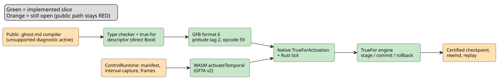
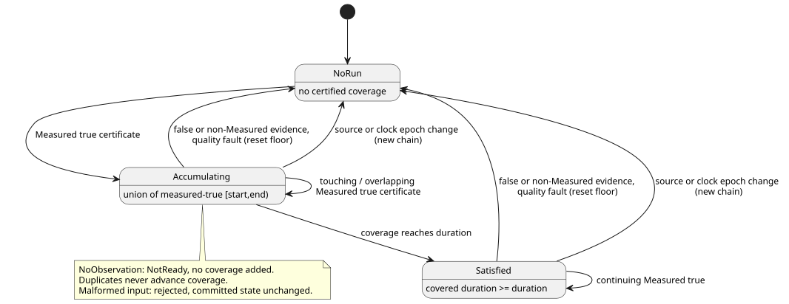

# `true_for` Driver interval prerequisite

**Status:** the public `.ghost.md` compiler still rejects `true_for` with a
located "unsupported" diagnostic. Several internal slices exist (Rust engine,
type checking, GFB format 6, native activation and tick, low-level WASM
activation), but `REF-04-025` is **not** fulfilled. No device verification is
claimed.

In this document:

- Why the current point samples cannot support `true_for`.
- The Rust and native prerequisite engine (`TrueFor`).
- The integration plan: Driver transport, artifact/lowering, one Rust
  transaction, and the TDD acceptance sequence.
- The RED integration fixture and the slices implemented so far.

**The problem.** Today's measured `Result` sample descriptor carries a *point*
identity: `sourceTag`, `present`, `epoch`, `id`, `timestamp`, and `quality`.
It does not carry an *interval* that a Driver certifies it observed
continuously.

Reference §4.4 forbids deriving continuity from any of these:

- two point samples;
- expected cadence or scan cadence;
- duplicates;
- clock-only ticks.

The compiler therefore rejects `true_for` with a specific, located diagnostic.
It keeps doing so until four things are defined: a bounded Driver interval
fact, its trust binding, a checkpoint/replay representation, and a runtime
admission rule. Accepting the syntax with the current sample fields would
fabricate the evidence that `quality: measured` requires.

The existing `continuous_true(Bool)` timer is a separate scan-time timer. It is
**not** an implementation fallback for `true_for`.

The diagram below summarizes which parts of the end-to-end path exist (green)
and which remain open (orange).

## Rust prerequisite slice

`crates/ghostflow-core::true_for::TrueFor` now admits a bounded, single-source
`CertifiedBoolInterval` contract. Without scan-time allocation, it validates:

- source and time epochs;
- future and reversed bounds;
- measured/true quality;
- duplicate identities;
- overlap union;
- reset floors after faults or false evidence;
- staged commit/rollback.

The focused proof is `build/true-for-interval-green5.log` (5/5).

This slice does **not** make the compiler or the GFB/WASM runtime accept
`true_for`. The Driver interval transport, trust binding, checkpoint/replay
representation, and compiler lowering remain open.

## Native interval admission prerequisite

`crates/ghostflow-core/src/true_for.rs` now provides a fixed-storage native
`TrueFor` engine. It is an admission prerequisite, not compiler/VM support.

**Driver assertion.** Each assertion contains:

- a bound source tag;
- a source epoch;
- a monotonic clock epoch;
- a certificate ID;
- start and end milliseconds;
- a Bool;
- an evidence quality.

The installation must authorize the Driver to assert this continuous coverage.
The presence of these fields alone does not establish measurement trust.

**Coverage rules.**

- Coverage uses half-open intervals `[start,end)`.
- Touching or overlapping measured-true intervals accumulate their union.
  Zero-width points contribute zero time.
- Start/end order must be monotonic within the source and clock epochs.
- These are rejected *before* committed state changes: conflicting overlaps,
  changed duplicate identities, old identities, reversed or future intervals,
  and epoch mismatches.
- False evidence and non-measured evidence reset continuity.
- An upstream quality fault sets a reset boundary that later backfill cannot
  cross.
- A source or clock epoch change starts a new chain.
- Duration, epochs, IDs and timestamps use the existing exact integer temporal
  domain (`0..2^53-1`). Duration must be positive.

**Absence and late evidence.**

- `NoObservation` returns NotReady and does not extend coverage. Its stored run
  may join a later actual certificate only if that certificate fills the gap.
- The outcome reports the certified endpoints and the covered duration, even
  when evidence arrives later than its endpoint. It does **not** certify the
  unobserved interval from that endpoint to the evaluation clock.
- Duplicates cannot advance coverage or restore a reset result.

The state diagram below shows how certificates move the engine between "no
run", accumulating coverage, and a satisfied duration.

**Storage and transactions.** The engine owns one fixed-size committed state
and one candidate. `stage`, `commit`, and `rollback` perform no heap allocation
and no atomic operations. Malformed staging and explicit rollback preserve the
previous committed state.

**Evidence.** `cargo test -p ghostflow-core --test true_for` — five passing
tests in `build/true-for-interval-green4.log`. RED evidence is in
`build/true-for-interval-red.log`, `-red2.log`, `-red3.log`, and `-red4.log`.

**Still required:**

- compiler typing/lowering;
- bounded wire and Driver trust binding;
- expression provenance through derived Bool predicates;
- VM prelude execution;
- WASM/host inputs;
- trace/replay/checkpoint encoding;
- target resource accounting.

`REF-04-025` remains unfulfilled until the public literate compiler/runtime
path implements those contracts. The unsupported compiler diagnostic remains
active.

**End-to-end RED contract.** `tests/true-for-integration.test.mjs` with
`tests/fixtures/true-for-certified.ghost.md` records it. The test pins the
intended certified interval manifest, temporal profile, exact duration
boundary, and point-sample rejection. The current compiler rejects all three
cases at the explicit unsupported diagnostic;
`build/true-for-integration-red.log` records this baseline. No acceptance is
claimed until the complete path exists.

## Integration audit and next executable slice

The first vertical is the existing REF-04-025 program:

- a directly bound Bool sensor;
- a positive constant duration;
- `quality: measured`;
- an ordinary `Result<Bool, SensorFault>` consumed by `recover(false)`.

This is a milestone. Support for derived predicates remains part of the
overall Reference goal. No new product-policy question blocks this
direct-source vertical.

The four subsections below are implementation contracts to integrate, not
claims about an implemented ABI. Do not remove the unsupported diagnostic or
its regression test until the complete vertical has native **and** WASM
execution evidence.

### 1. Driver transport and activation

- **Capability.** Extend the installation profile with an explicit set of
  physical roots authorized to supply certified Bool intervals. Validate the
  exact roots that the compiled module requires. A normal sensor sample or a
  density bound does not grant this capability. The host installs this
  binding; it does not calculate `true_for` results. This local capability
  contract requires no signature and no remote service.
- **Per-tick fact.** Capture a separate interval fact per bound root per tick:
  presence, source epoch, certificate ID, start and end milliseconds, Bool
  value, and evidence quality. The root table supplies the source tag; the tick
  supplies the time epoch. Keep these identities independent of point-sample
  identities. Carry unavailable quality faults explicitly. Absence means
  `NoObservation`.
- **Wire and replay.** Use fixed-width wire fields and the existing exact
  integer time domain. Reject malformed facts before mutation. Do not derive
  endpoints from sample timestamps, sample intervals, or the previous scan.
  Retain every admitted fact in replay frames, including source/time epochs and
  unavailable inputs.

Current change sites: `runtimes/wasm/temporal-profile.mjs`,
`runtimes/wasm/control-runtime.mjs` capture/validation/replay frame code, and
`runtimes/wasm/src/lib.rs`. The current GFTA v1 profile has only time epoch,
root density and budget. Its strict schema needs a versioned extension.

### 2. Verified artifact and compiler lowering

- **Descriptor.** Add a distinct `true_for` prelude descriptor: site, name,
  source root, positive duration, and certified-input bindings. Its output
  projections are the Bool payload, ok/fault/origin, certified endpoints, and
  covered duration. Do not encode it as a numeric window operation or as
  `continuous_true` states.
- **Format.** Extend the GFB writer and the Rust loader together, with an
  explicit format-version decision. Existing GFB4 roots bind four
  point-metadata inputs; existing GFB5 has window/schedule prelude tags.
  Neither describes a certified interval today. Old readers must reject the new
  format rather than misread a new tag. Wire sizing must enforce the existing
  input/state/module bounds before allocation.
- **Lowering.** Lower the direct Bool sensor to the new prelude and to ordinary
  Result projections. Type-check: one source, unique `duration` and `quality`
  arguments, measured quality, and a positive constant Duration. Preserve
  source locations for each rejection. Emit the same site and root identities
  in the manifest and the bytecode; reject mismatched artifacts at activation.

Current change sites: `tools/control.mjs` `addSignal`, manifest construction
and prelude emission; `tools/gfb1.mjs`; `crates/ghostflow-core/src/lib.rs`
loader/projection verifier; `temporal_vm.rs`; and manifest validation in
`runtimes/wasm/control-runtime.mjs`.

### 3. One Rust transaction, checkpoint and resource plan

- **Transaction.** Make TrueFor state part of the installed temporal runtime.
  Stage it before dependent expressions; commit only when the tick completes
  successfully. A later expression failure rolls it back together with the
  existing window state.
- **Checkpoint.** Checkpoint the committed state, source binding, duration and
  duplicate/reset metadata. Restore must reject incompatible
  module/config/binding identities. Candidate state never enters a checkpoint.
  Replay evaluates captured interval facts through the same Rust engine.
- **Resources.** Account for the engine, candidate, checkpoint retention and
  trace storage in activation and replay budgets, on the target pointer width.
  The standalone engine is fixed size, but adding an unaccounted Vec of
  engines/checkpoints would still violate the installed temporal resource
  contract.
- **Trace.** Trace the interval identity actually used, its endpoints, quality,
  coverage and result/fault, with the declaration site. Do not manufacture a
  point sample, and do not mark a recovered/default value as measured evidence.

Current change sites: `true_for.rs` checkpoint/state interface,
`temporal_runtime.rs` resource planning/stage/commit/rollback/restore,
`lib.rs` tick records and replay, plus native/WASM trace serialization.

### 4. Acceptance sequence (TDD)

1. Add a public `.ghost.md` compiler-to-runtime test that initially fails at
   the unsupported diagnostic. Explicitly bind the Driver capability and
   supply `[0,299999)` then `[299999,300000)` measured-true facts. Output is
   false before 300000 ms and true at the exact duration boundary. Run the
   same artifact and input sequence in native and WASM runtimes.
2. Add negative controls: ordinary point readings alone, clock-only ticks,
   duplicate certificates, a one-millisecond uncovered gap, false evidence,
   Held/recovered quality, source epoch change, unbound/foreign source,
   reversed/future bounds, and changed duplicate identity. None may fabricate
   continuity; malformed input leaves committed state unchanged.
3. Force a downstream expression failure after interval staging. Retry the
   same valid tick and compare with an uninterrupted run. Repeat after a
   retained checkpoint restore and native/WASM replay. Compare output and
   interval provenance, not merely successful execution.
4. Test exact activation/replay budget boundaries and corrupt artifact
   bindings. Register tests explicitly in `tools/verify-language.mjs`. Only
   then replace the unsupported-diagnostic regression and accept REF-04-025.

**Derived predicates are a later, required slice.** A point lineage selector
does not certify an expression over an interval:

- unary/pure predicates need certified payload coverage;
- multi-source predicates need intersected coverage;
- state/config-dependent predicates also need their change boundaries.

Reject unsupported derivations explicitly until their proof construction
exists.

### Why `after_event` follows this work

Its additional integration blockers are listed in `after-event-design.md`:

- Independent event results need a defined scalar projection and retention
  interface.
- The current Rust prerequisite accepts one input per stage. An event and a
  true predicate at the same tick must be staged together, so that the
  inclusive start boundary works without committing part of a VM tick.
- Its predicate observation currently lacks a source identity, so it cannot
  yet support measured lineage, deduplication or replay provenance.

These must be resolved before reusing the temporal transport. REF-04-026
remains unfulfilled.

## First integration RED fixture

`tests/fixtures/true-for-certified.ghost.md` is a complete canonical document.
`tests/true-for-integration.test.mjs` pins the proposed next implementation
contract:

- GFB format 6;
- a `true-for` manifest descriptor with source/site/slot, duration and
  explicit `intervalInputs`;
- activation `certifiedBoolRoots`;
- separate `step.intervals` certificates;
- `vm.trueForTrace` identity/coverage.

These are executable implementation targets, not an existing supported ABI.

| Fixture fact | Value |
|---|---|
| Successful certificates | 2 |
| Source epoch | 11 |
| Time epoch | 7 |
| Certificate IDs (independent) | 1 and 2 |
| Intervals (ms) | `[0,299999)` and `[299999,300000)` |
| Expected alarm | false, then true |
| Point-only and clock-only controls | must remain false |

The tests import and use the public literate compiler and the WASM
ControlRuntime; they contain no replacement host evaluator.

Run: `node --test tests/true-for-integration.test.mjs`.

Recorded `build/true-for-integration-red.log`: exit 1, 3 tests, 0 pass, 3 fail,
0 skip/TODO. All three stop at the expected current compiler diagnostic,
`true-for-certified.ghost.md:10:22: true_for requires Driver-certified observed
interval evidence, which is not yet supported`. Descriptor/runtime assertions
are not reached; this proves the missing vertical, not the proposed ABI.
The test is explicitly registered in `tools/verify-language.mjs`. Existing
unsupported-diagnostic and Reference expectations are unchanged.

## Implemented compiler/artifact and native execution slices

**Type checking.** The type checker now validates the direct Bool source,
positive constant duration and measured quality, and emits the descriptor
above. Derived sources remain rejected. The executable public compiler
deliberately keeps its located unsupported diagnostic until source-trace,
host/WASM, and replay integration are complete. Internal type checking is not
REF-04-025 acceptance.

**GFB format 6.** The JS GFB writer and the Rust loader now share format 6. It
keeps the temporal clock/point-root header and the tagged prelude sequence.

- New prelude tag 2 encodes, in order: site `u32`, signal name, source tag
  `u32`, source name, duration `u64`, then eight `u16` input indices (present,
  epoch, ID, start, end, Bool value, quality, fault).
- Strings keep the existing `u16` UTF-8 byte-length prefix.
- Opcode 59 reads a `u16` true_for slot followed by a `u8` field:

| Field | Meaning |
|---|---|
| 0 | ok |
| 1 | Bool value |
| 2 | fault |
| 3 | origin |
| 4 | certified run start |
| 5 | run end |
| 6 | covered duration |

All numeric fields use the existing exact-integer limits. Shared roots must
keep exactly the same identity and bindings across strategies. Aliased clocks,
point metadata, other roots, unknown inputs and wrong types are rejected.

**Native activation and tick.**
`Runtime::activate_with_certified_intervals(TrueForActivation)` accepts only:

- true_for-only modules;
- an exact sorted `certified_bool_roots` set;
- `time_epoch`;
- explicit `max_bytes`.

Ordinary activation remains closed, and mixed windows/schedules remain closed.
Its Rust tick stages every certificate, projects the result, evaluates scalar
transitions/intents, and commits only after successful evaluation. A
downstream failure rolls back interval state. `TickRecord.true_for_trace` and
JSON `trueForTrace` keep the input identity, quality, interval bounds, certified
aggregate bounds, coverage and result/fault.

**Native input quality codes.**

| Code | Quality |
|---|---|
| 0 | Constructed |
| 1 | Measured |
| 2 | Held |
| 3 | Constructed (derived/nonphysical evidence) |
| 4 | Unavailable |

Unavailable consumes the existing SensorFault codes 0 Disconnected, 1 Stale,
2 Invalid, 3 NotReady. Presence false means NoObservation. Point samples do not
generate these inputs. Source epoch, identity and endpoints stay explicit even
when an observation does not contribute coverage. Only Measured true
certificates accumulate.

**Resource bound.** The native bound accounts for engine/candidate state,
projection storage, and the maximum retained true_for/result trace buffers,
including the current tick. Trace vectors allocate bounded capacity per tick;
this slice does not claim allocation-free VM ticks. Compiled-module/scalar
storage, allocator metadata, serialization and caller-owned clones are outside
that temporal byte bound. Exact-budget admission and one-byte-short rejection
have native tests. Rewind explicitly rejects until certified checkpoints exist;
replay and hot swap remain closed.

Evidence:

- `build/true-for-lowering-red.log`: 15 failing compiler/writer target tests.
- `build/true-for-lowering-green3.log`: 58/58 focused and affected JS tests.
- `build/true-for-module-red.log`: native loader target API initially absent.
- `build/true-for-module-green.log`: 3/3 native structural tests.
- `build/gfb6-native-green.log`: 25/25 JS-to-native and affected tests.
- `build/true-for-native-tick-red.log`: native tick API/trace initially absent.
- `build/true-for-native-rewind-red.log`: caught scalar-only rewind of a
  certified execution; native rewind now rejects before mutation.
- `build/true-for-native-core-green2.log`: all ghostflow-core tests pass,
  including 9 structural/native true_for module tests.

**Still required before public acceptance:**

- compiler source-trace/artifact decoder format 6 support;
- removal of the executable compiler gate, only with full evidence;
- host manifest validation and interval capture/replay frames;
- WASM activation dispatch into the native certified API;
- certified checkpoints and replay resource/provenance;
- mixed prelude execution and derived predicate coverage.

The public integration tests remain RED. No device verification is claimed.

## WASM certified activation slice

The low-level `GhostFlowRuntime.activateTemporal` GFTA v2 path now dispatches
explicit certified roots into the same native `TrueForActivation` and tick
engine. Point-density profiles mixed with certified roots are rejected until
mixed preludes are implemented. Rust still validates root authority and
temporal storage budgets before activation. GFTA v1 window activation is
unchanged.

`tests/true-for-wasm.test.mjs` covers: exact duration and trace identity,
clock-only absence, zero-width points, uncovered gaps, Held quality, source
epoch reset, wrong root capability, insufficient budget, malformed/duplicate
certificates and downstream expression rollback. Rewind and replay explicitly
reject and preserve live state until certified checkpoints exist. This test is
registered in `tools/verify-language.mjs`.

This is low-level WASM execution evidence only. Public `.ghost.md` compilation
and `ControlRuntime` still reject true_for. Still open: source-trace/artifact
decoding, manifest validation, separate interval snapshot transport, framed
execution, checkpoint/replay, mixed preludes and derived-predicate coverage.
