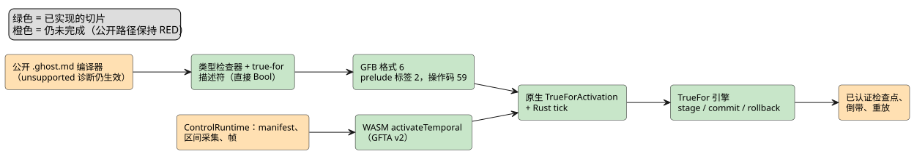
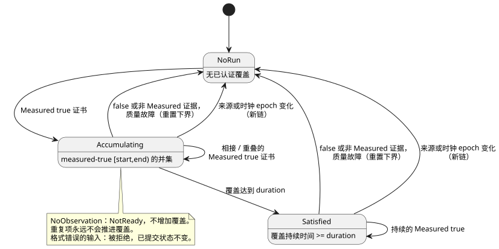

<!-- translation-source: tasks/true-for-driver-contract.md -->
[英文原文](true-for-driver-contract.md)

# `true_for` 的驱动程序区间前提

**状态：** 公开的 `.ghost.md` 编译器仍然以带位置的“unsupported”诊断拒绝
`true_for`。若干内部切片已经存在（Rust 引擎、类型检查、GFB 格式 6、原生激活与
tick、低层 WASM 激活），但 `REF-04-025` **尚未**满足。不声称任何设备验证。

本文内容：

- 为什么当前的点样本无法支持 `true_for`。
- Rust 与原生前提引擎（`TrueFor`）。
- 集成计划：驱动程序传输、产物/lowering、单一 Rust 事务，以及 TDD 验收顺序。
- RED 集成夹具（fixture）以及迄今已实现的切片。

**问题所在。** 当前测量得到的 `Result` 样本描述符携带的是*点*身份标识：
`sourceTag`、`present`、`epoch`、`id`、`timestamp` 和 `quality`。它不携带由驱动程序
（Driver）证明其连续观测过的*区间*。

参考手册 §4.4 禁止从以下任何一项推导连续性：

- 两个点样本；
- 预期节拍或扫描节拍；
- 重复项；
- 仅由时钟触发的 tick。

因此，编译器以一条具体的、带位置的诊断拒绝 `true_for`。在以下四件事得到定义之前，
它会一直这样做：有界的驱动程序区间事实、其信任绑定、检查点/重放表示，以及运行时准入
规则。如果用当前的样本字段接受该语法，就会伪造 `quality: measured` 所要求的证据。

现有的 `continuous_true(Bool)` 定时器是一个独立的扫描时间定时器。它**不是**
`true_for` 的实现回退（fallback）。

下图概括了端到端路径中哪些部分已经存在（绿色），哪些仍未完成（橙色）。

## Rust 前提切片

`crates/ghostflow-core::true_for::TrueFor` 现在准入一个有界的、单一来源的
`CertifiedBoolInterval` 契约。它在不进行扫描时分配的情况下验证：

- 来源 epoch 与时间 epoch；
- 未来边界与反向边界；
- measured/true 质量；
- 重复的身份标识；
- 重叠区间的并集；
- 故障或 false 证据之后的重置下界；
- 暂存的提交/回滚。

聚焦的证明是 `build/true-for-interval-green5.log`（5/5）。

这个切片**不会**让编译器或 GFB/WASM 运行时接受 `true_for`。驱动程序区间传输、
信任绑定、检查点/重放表示以及编译器 lowering 仍未完成。

## 原生区间准入前提

`crates/ghostflow-core/src/true_for.rs` 现在提供一个固定存储的原生 `TrueFor`
引擎。它是准入前提，而不是编译器/VM 支持。

**驱动程序断言。** 每个断言包含：

- 一个已绑定的来源标签；
- 一个来源 epoch；
- 一个单调时钟 epoch；
- 一个证书 ID；
- 起始与结束毫秒数；
- 一个 Bool；
- 一个证据质量。

安装必须授权该驱动程序断言这种连续覆盖。仅凭这些字段的存在并不能建立测量信任。

**覆盖规则。**

- 覆盖使用半开区间 `[start,end)`。
- 相接或重叠的 measured-true 区间累积为它们的并集。零宽度的点贡献零时间。
- 在来源 epoch 与时钟 epoch 内，起止顺序必须单调。
- 以下情况会在已提交状态发生变化*之前*被拒绝：冲突的重叠、身份标识重复但内容改变、
  旧的身份标识、反向或未来的区间，以及 epoch 不匹配。
- false 证据和非 measured 证据会重置连续性。
- 上游质量故障会设置一个重置边界，之后的回填不能越过它。
- 来源 epoch 或时钟 epoch 变化会开始一条新链。
- 持续时间、epoch、ID 和时间戳使用现有的精确整数时间域（`0..2^53-1`）。持续时间
  必须为正。

**缺失与迟到的证据。**

- `NoObservation` 返回 NotReady，且不延长覆盖。它所存储的运行段只有在之后的实际
  证书填补了间隙时，才能与该证书衔接。
- 即使证据晚于其结束点到达，结果仍报告已认证的端点和已覆盖的持续时间。它**不会**
  认证从该结束点到求值时钟之间未被观测的区间。
- 重复项不能推进覆盖，也不能恢复已重置的结果。

下面的状态图展示了证书如何使引擎在“无运行段”、累积覆盖和已满足持续时间之间转换。

**存储与事务。** 引擎拥有一个固定大小的已提交状态和一个候选状态。`stage`、`commit`
和 `rollback` 不执行堆分配，也不执行原子操作。格式错误的暂存和显式回滚会保留之前的
已提交状态。

**证据。** `cargo test -p ghostflow-core --test true_for` —— 五个通过的测试，见
`build/true-for-interval-green4.log`。RED 证据见 `build/true-for-interval-red.log`、
`-red2.log`、`-red3.log` 和 `-red4.log`。

**仍然需要：**

- 编译器类型检查/lowering；
- 有界的传输线格式与驱动程序信任绑定；
- 经由派生 Bool 谓词的表达式来源（provenance）；
- VM prelude 执行；
- WASM/宿主输入；
- 追踪/重放/检查点编码；
- 目标资源核算。

在公开的 literate 编译器/运行时路径实现这些契约之前，`REF-04-025` 仍未满足。
unsupported 编译器诊断保持生效。

**端到端 RED 契约。** 由 `tests/true-for-integration.test.mjs` 配合
`tests/fixtures/true-for-certified.ghost.md` 记录。该测试固定了预期的已认证区间
manifest、时间配置档（temporal profile）、精确的持续时间边界以及点样本拒绝。当前
编译器在显式的 unsupported 诊断处拒绝全部三个用例；`build/true-for-integration-red.log`
记录了这一基线。在完整路径存在之前，不声称任何验收。

## 集成审计与下一个可执行切片

第一个纵向切片是现有的 REF-04-025 程序：

- 一个直接绑定的 Bool 传感器；
- 一个正的常量持续时间；
- `quality: measured`；
- 一个由 `recover(false)` 消费的普通 `Result<Bool, SensorFault>`。

这是一个里程碑。对派生谓词的支持仍是参考手册整体目标的一部分。没有新的产品策略问题
阻碍这一直接来源的纵向切片。

下面四个小节是需要集成的实现契约，而不是关于已实现 ABI 的声明。在完整的纵向切片同时
具备原生**和** WASM 执行证据之前，不要移除 unsupported 诊断及其回归测试。

### 1. 驱动程序传输与激活

- **能力（capability）。** 在安装 profile 中扩展一个显式集合，列出被授权提供已认证
  Bool 区间的物理根。验证已编译模块所需的确切根。普通传感器样本或密度上界不会授予这种
  能力。宿主安装这一绑定；它不计算 `true_for` 结果。这个本地能力契约不需要签名，也不
  需要远程服务。
- **每个 tick 的事实。** 每个 tick 为每个已绑定的根采集一个独立的区间事实：存在标志、
  来源 epoch、证书 ID、起始与结束毫秒数、Bool 值以及证据质量。根表提供来源标签；tick
  提供时间 epoch。使这些身份标识独立于点样本的身份标识。显式携带 unavailable 质量故障。
  缺失意味着 `NoObservation`。
- **传输线格式与重放。** 使用固定宽度的传输线字段和现有的精确整数时间域。在变更之前
  拒绝格式错误的事实。不要从样本时间戳、样本间隔或上一次扫描推导端点。在重放帧中保留
  每一个被准入的事实，包括来源/时间 epoch 和不可用的输入。

当前的修改位置：`runtimes/wasm/temporal-profile.mjs`、`runtimes/wasm/control-runtime.mjs`
中的采集/验证/重放帧代码，以及 `runtimes/wasm/src/lib.rs`。当前的 GFTA v1 profile 只有
时间 epoch、根密度和预算。其严格模式需要一个带版本的扩展。

### 2. 已验证产物与编译器 lowering

- **描述符。** 添加一个独立的 `true_for` prelude 描述符：site、名称、来源根、正的持续
  时间以及已认证输入绑定。它的输出投影是 Bool 载荷、ok/fault/origin、已认证端点和已
  覆盖的持续时间。不要把它编码为数值窗口操作或 `continuous_true` 状态。
- **格式。** 同时扩展 GFB 写入器和 Rust 加载器，并显式决定格式版本。现有的 GFB4 根绑定
  四个点元数据输入；现有的 GFB5 有窗口/调度计划的 prelude 标签。目前两者都不描述已认证
  区间。旧的读取器必须拒绝新格式，而不是误读新标签。传输线大小计算必须在分配之前强制
  执行现有的输入/状态/模块上界。
- **Lowering。** 将直接 Bool 传感器 lowering 为新的 prelude 和普通的 Result 投影。类型
  检查：单一来源、唯一的 `duration` 和 `quality` 参数、measured 质量，以及正的常量
  Duration。为每一项拒绝保留源位置。在 manifest 和字节码中输出相同的 site 和根身份标识；
  在激活时拒绝不匹配的产物。

当前的修改位置：`tools/control.mjs` 的 `addSignal`、manifest 构造和 prelude 输出；
`tools/gfb1.mjs`；`crates/ghostflow-core/src/lib.rs` 的加载器/投影验证器；
`temporal_vm.rs`；以及 `runtimes/wasm/control-runtime.mjs` 中的 manifest 验证。

### 3. 单一 Rust 事务、检查点与资源计划

- **事务。** 使 TrueFor 状态成为已安装时间运行时的一部分。在依赖它的表达式之前暂存它；
  仅当 tick 成功完成时才提交。之后的表达式失败会把它与现有的窗口状态一起回滚。
- **检查点。** 为已提交状态、来源绑定、持续时间以及重复/重置元数据创建检查点。恢复必须
  拒绝不兼容的模块/配置/绑定身份标识。候选状态永远不会进入检查点。重放通过同一个 Rust
  引擎对采集到的区间事实求值。
- **资源。** 在激活和重放预算中，按目标指针宽度核算引擎、候选状态、检查点保留和追踪
  存储。独立引擎是固定大小的，但添加一个未核算的引擎/检查点 Vec 仍会违反已安装的时间
  资源契约。
- **追踪。** 连同声明位置一起，追踪实际使用的区间身份标识、其端点、质量、覆盖和
  结果/故障。不要制造点样本，也不要把已恢复/默认值标记为测量证据。

当前的修改位置：`true_for.rs` 的检查点/状态接口，`temporal_runtime.rs` 的资源规划/
stage/commit/rollback/restore，`lib.rs` 的 tick 记录与重放，以及原生/WASM 追踪序列化。

### 4. 验收顺序（TDD）

1. 添加一个公开的 `.ghost.md` 从编译器到运行时的测试，它最初在 unsupported 诊断处失败。
   显式绑定驱动程序能力，并依次提供 `[0,299999)` 和 `[299999,300000)` 两个
   measured-true 事实。输出在 300000 ms 之前为 false，并在精确的持续时间边界处为 true。
   在原生和 WASM 运行时中运行同一个产物和输入序列。
2. 添加负向对照：仅有普通点读数、仅由时钟触发的 tick、重复证书、一毫秒未覆盖的间隙、
   false 证据、Held/已恢复质量、来源 epoch 变化、未绑定/外来来源、反向/未来边界，以及
   身份标识重复但内容改变。它们都不得伪造连续性；格式错误的输入不改变已提交状态。
3. 在区间暂存之后强制一次下游表达式失败。重试同一个有效 tick，并与不间断的运行比较。
   在恢复一个保留的检查点以及原生/WASM 重放之后重复此过程。比较输出和区间来源，而不仅
   仅是执行成功。
4. 测试精确的激活/重放预算边界以及损坏的产物绑定。在 `tools/verify-language.mjs` 中
   显式注册测试。只有到那时，才替换 unsupported 诊断回归测试并接受 REF-04-025。

**派生谓词是之后必需的切片。** 点谱系选择器不能认证区间上的表达式：

- 一元/纯谓词需要已认证的载荷覆盖；
- 多来源谓词需要求交后的覆盖；
- 依赖状态/配置的谓词还需要它们的变化边界。

在其证明构造存在之前，显式拒绝不受支持的派生。

### 为什么 `after_event` 排在这项工作之后

它额外的集成阻碍列在 `after-event-design.md` 中：

- 独立的事件结果需要定义好的标量投影和保留接口。
- 当前的 Rust 前提每个暂存只接受一个输入。同一 tick 中的事件和为 true 的谓词必须一起
  暂存，这样包含式起始边界才能在不提交 VM tick 一部分的情况下工作。
- 它的谓词观测目前缺少来源身份标识，因此还无法支持测量谱系、去重或重放来源。

在复用时间传输之前必须解决这些问题。REF-04-026 仍未满足。

## 第一个集成 RED 夹具

`tests/fixtures/true-for-certified.ghost.md` 是一份完整的规范文档。
`tests/true-for-integration.test.mjs` 固定了所提议的下一个实现契约：

- GFB 格式 6；
- 一个 `true-for` manifest 描述符，带有 source/site/slot、持续时间以及显式的
  `intervalInputs`；
- 激活参数 `certifiedBoolRoots`；
- 独立的 `step.intervals` 证书；
- `vm.trueForTrace` 身份标识/覆盖。

这些是可执行的实现目标，而不是已存在并受支持的 ABI。

| 夹具事实 | 值 |
|---|---|
| 成功的证书 | 2 |
| 来源 epoch | 11 |
| 时间 epoch | 7 |
| 证书 ID（相互独立） | 1 和 2 |
| 区间（ms） | `[0,299999)` 和 `[299999,300000)` |
| 预期报警 | 先 false，后 true |
| 仅点样本与仅时钟的对照 | 必须保持 false |

这些测试导入并使用公开的 literate 编译器和 WASM ControlRuntime；它们不包含替代的宿主
求值器。

运行：`node --test tests/true-for-integration.test.mjs`。

已记录的 `build/true-for-integration-red.log`：退出码 1，3 个测试，0 通过，3 失败，
0 跳过/TODO。三个测试都停在预期的当前编译器诊断处，
`true-for-certified.ghost.md:10:22: true_for requires Driver-certified observed
interval evidence, which is not yet supported`。描述符/运行时断言没有被执行到；这证明的
是缺失的纵向切片，而不是所提议的 ABI。该测试已在 `tools/verify-language.mjs` 中显式注册。
现有的 unsupported 诊断和参考手册预期均未改变。

## 已实现的编译器/产物与原生执行切片

**类型检查。** 类型检查器现在验证直接 Bool 来源、正的常量持续时间和 measured 质量，并
输出上述描述符。派生来源仍被拒绝。可执行的公开编译器有意保留其带位置的 unsupported
诊断，直到源追踪、宿主/WASM 和重放集成完成为止。内部类型检查不等于 REF-04-025 验收。

**GFB 格式 6。** JS GFB 写入器和 Rust 加载器现在共享格式 6。它保留时间时钟/点根头部和
带标签的 prelude 序列。

- 新的 prelude 标签 2 依次编码：site `u32`、信号名称、来源标签 `u32`、来源名称、持续时间
  `u64`，然后是八个 `u16` 输入索引（present、epoch、ID、start、end、Bool 值、quality、
  fault）。
- 字符串保留现有的 `u16` UTF-8 字节长度前缀。
- 操作码 59 读取一个 `u16` true_for slot，后跟一个 `u8` 字段：

| 字段 | 含义 |
|---|---|
| 0 | ok |
| 1 | Bool 值 |
| 2 | fault |
| 3 | origin |
| 4 | 已认证运行段起点 |
| 5 | 运行段终点 |
| 6 | 已覆盖的持续时间 |

所有数值字段都使用现有的精确整数限制。共享的根在各策略之间必须保持完全相同的身份标识
和绑定。别名时钟、点元数据、其他根、未知输入和错误类型都会被拒绝。

**原生激活与 tick。**
`Runtime::activate_with_certified_intervals(TrueForActivation)` 只接受：

- 仅包含 true_for 的模块；
- 一个精确且已排序的 `certified_bool_roots` 集合；
- `time_epoch`；
- 显式的 `max_bytes`。

普通激活保持关闭，混合窗口/调度计划也保持关闭。它的 Rust tick 暂存每个证书、投影结果、
对标量转移/意图求值，并且只在求值成功后提交。下游失败会回滚区间状态。
`TickRecord.true_for_trace` 和 JSON `trueForTrace` 保留输入身份标识、质量、区间边界、
已认证的聚合边界、覆盖以及结果/故障。

**原生输入质量代码。**

| 代码 | 质量 |
|---|---|
| 0 | Constructed |
| 1 | Measured |
| 2 | Held |
| 3 | Constructed（派生/非物理证据） |
| 4 | Unavailable |

Unavailable 使用现有的 SensorFault 代码：0 Disconnected、1 Stale、2 Invalid、
3 NotReady。存在标志为 false 意味着 NoObservation。点样本不会生成这些输入。即使某个观测
不贡献覆盖，来源 epoch、身份标识和端点也保持显式。只有 Measured 的 true 证书会累积。

**资源上界。** 原生上界核算引擎/候选状态、投影存储，以及保留的 true_for/结果追踪缓冲区的
最大值（包括当前 tick）。追踪向量每个 tick 分配有界容量；这个切片不声称 VM tick 无分配。
已编译模块/标量存储、分配器元数据、序列化以及调用方拥有的克隆不在这个时间字节上界之内。
精确预算准入和差一字节的拒绝都有原生测试。在已认证检查点存在之前，倒带会显式拒绝；重放
和热替换保持关闭。

证据：

- `build/true-for-lowering-red.log`：15 个失败的编译器/写入器目标测试。
- `build/true-for-lowering-green3.log`：58/58 个聚焦及受影响的 JS 测试。
- `build/true-for-module-red.log`：原生加载器目标 API 最初不存在。
- `build/true-for-module-green.log`：3/3 个原生结构测试。
- `build/gfb6-native-green.log`：25/25 个 JS 到原生及受影响的测试。
- `build/true-for-native-tick-red.log`：原生 tick API/追踪最初不存在。
- `build/true-for-native-rewind-red.log`：捕获了对已认证执行的仅标量倒带；原生倒带现在会
  在变更之前拒绝。
- `build/true-for-native-core-green2.log`：所有 ghostflow-core 测试通过，包括 9 个
  结构/原生 true_for 模块测试。

**公开验收之前仍然需要：**

- 编译器源追踪/产物解码器对格式 6 的支持；
- 移除可执行编译器的关卡，且仅在证据完整时进行；
- 宿主 manifest 验证以及区间采集/重放帧；
- WASM 激活分派到原生已认证 API；
- 已认证检查点以及重放的资源/来源；
- 混合 prelude 执行与派生谓词覆盖。

公开集成测试仍为 RED。不声称任何设备验证。

## WASM 已认证激活切片

低层的 `GhostFlowRuntime.activateTemporal` GFTA v2 路径现在会把显式的已认证根分派到同一个
原生 `TrueForActivation` 和 tick 引擎。在实现混合 prelude 之前，与已认证根混合的点密度
profile 会被拒绝。Rust 仍在激活之前验证根权限和时间存储预算。GFTA v1 窗口激活保持不变。

`tests/true-for-wasm.test.mjs` 覆盖：精确持续时间与追踪身份标识、仅时钟情况下的缺失、
零宽度点、未覆盖的间隙、Held 质量、来源 epoch 重置、错误的根能力、预算不足、格式错误/
重复的证书，以及下游表达式回滚。在已认证检查点存在之前，倒带和重放会显式拒绝并保留实时
状态。该测试已在 `tools/verify-language.mjs` 中注册。

这只是低层 WASM 执行证据。公开的 `.ghost.md` 编译和 `ControlRuntime` 仍然拒绝 true_for。
仍未完成：源追踪/产物解码、manifest 验证、独立的区间快照传输、带帧执行、检查点/重放、
混合 prelude 以及派生谓词覆盖。
