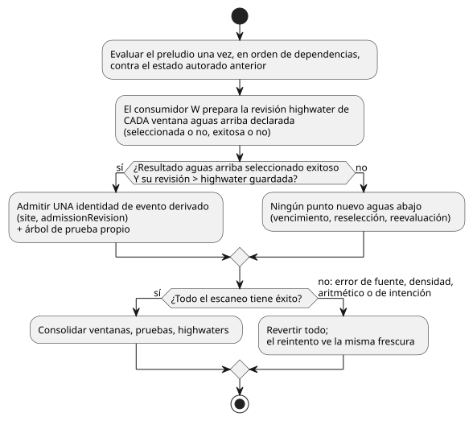
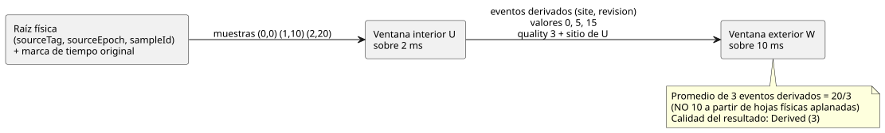

<!-- translation-source: tasks/window-derived-design.md -->
[Original en inglés](window-derived-design.md)

# Propuesta de evidencia de ventanas derivadas

**Estado:** el camino de compilador/núcleo/prueba/paquete para ventanas
anidadas medidas está implementado e incluido en batch13. La aceptación
completa del replay temporal/de adaptadores sigue abierta; consulte la
evidencia de ejecución al final. Las ventanas anidadas son un comportamiento
obligatorio del lenguaje.

En este documento:

- la verdad de referencia de la Reference y las cuatro decisiones semánticas
  que aprobó Root;
- cómo se identifican, admiten y califican los eventos derivados;
- por qué basta el wire GFB4 existente, usando un marcador de evidencia
  explícito;
- fórmulas de capacidad finita y de almacenamiento propio de pruebas;
- reglas de transacción, traza y reproducción (replay);
- seis escenarios de aceptación discriminantes y la evidencia actual.

Un **evento derivado** es un resultado exitoso de una ventana aguas arriba que
una ventana aguas abajo admite como punto de entrada. Una **observación
física** es una muestra original de un sensor.

## Verdad de referencia y decisiones semánticas aprobadas

La [Reference §4.4](../docs/reference/04-sensors-constraints-control.es.md)
exige:

- identidades de observación originales;
- ninguna contribución por retransmisión o reevaluación;
- procedencia distinta para los resultados agregados;
- conservación a través de transformaciones y ramas;
- ventanas aguas abajo que distingan las identidades agregadas de las
  observaciones físicas.

También fija la ventana abierta por la izquierda, el `max_age` estricto, la
retención de fallos y la invalidación por época de fuente. El
[plan de evidencia](window-evidence-design.es.md) existente aporta hechos
explícitos de densidad física; la cadencia de adquisición esperada no aporta
ningún límite.

La Reference **no** decide tres cosas:

- si un cambio de valor aguas arriba debido solo a vencimiento es una nueva
  observación aguas abajo;
- qué marca de tiempo identifica una observación derivada;
- si las entradas agregadas que se solapan reciben un peso cada una.

Estas elecciones cambian los resultados numéricos. Root aprobó las siguientes
decisiones de lenguaje no operativas. No se introduce ninguna cadencia,
densidad ni valor predeterminado de instalación de dispositivos.

Interpretación aprobada:

1. **Cadencia de eventos.** Un resultado exitoso de una **nueva admisión aguas
   arriba** crea un evento derivado. La mera evaluación, el vencimiento de
   contribuyentes, los cambios de selector, los cambios de fallo y los cambios
   de estado no crean una nueva observación. Se conserva el significado
   existente de `admissionRevision`; no se convierte discretamente en un
   contador de escaneos.
2. **Marca de tiempo.** La marca de tiempo de observación de un evento
   derivado es la marca de tiempo de observación del contribuyente más reciente
   del resultado aguas arriba, heredada recursivamente de la evidencia real. El
   tiempo de evaluación consolidado se guarda por separado como `evaluatedAt`.
   Recalcular una observación retrasada no debe renovar la frescura de su
   medición. Ninguno de los dos tiempos es una identidad física fabricada.
3. **Peso.** Cada evento derivado distinto recibe un peso en un promedio aguas
   abajo. Las identidades agregadas se deduplican en esa capa. No se aplanan
   los promedios anidados, y no se deduplican las hojas físicas compartidas al
   hacer su aritmética. Las hojas compartidas son procedencia, no puntos de
   entrada adicionales aguas abajo.
4. **Invalidación por época.** Invalidar una época de fuente física invalida
   cualquier evento derivado retenido cuya prueba dependa de esa época
   antigua. Un agregado mixto A+B no puede conservar su antiguo valor escalar
   mientras elimina A en silencio. Se descarta ese evento dependiente; se
   conservan los eventos independientes solo de B. Esto es invalidación
   transitiva por dependencia.

**Alternativas rechazadas.**

- *Tiempo de evaluación como tiempo de observación.* Es una alternativa real:
  mide la frescura de la publicación de un agregado en lugar de la de su
  medición más reciente. Mantendría fresco un resultado tardío bajo un
  max_age aguas abajo más corto. La Reference nombra tanto el tiempo de
  evaluación como las observaciones originales, pero no resuelve esta marca de
  tiempo aguas abajo. Root eligió la regla de tiempo de observación anterior.
- *Emisión de eventos por vencimiento.* Requeriría un nuevo contador de
  generación de resultados, un límite para los eventos disparados por
  vencimiento en cada nivel de profundidad y una definición de su marca de
  tiempo.
- *Emisión en cada escaneo.* No tiene un límite derivado de la densidad física
  y daría un peso excesivo a la evidencia en caché.
- *Aplanar las hojas originales.* Cambia el significado de la composición de
  funciones.

Ninguna de estas alternativas es el valor predeterminado propuesto.

## Admisión ejecutable y calidad

Se usan dos espacios de nombres de identidad disjuntos:

| Espacio de nombres | Identidad | También lleva |
|---|---|---|
| Físico | `(sourceTag, sourceEpoch, sampleId)` | marca de tiempo original |
| Derivado | `(site, admissionRevision)`, con ámbito en el módulo instalado, la estrategia seleccionada y la sesión de ejecución en vivo | marca de tiempo de observación separada, tiempo de evaluación y una prueba acotada de las entradas |

**Ámbito de las identidades derivadas.** El Runtime/arena en vivo aporta ese
ámbito. La época de tiempo fija participa en la validación de continuidad, pero
no es un ID de sesión globalmente único. Las huellas actuales de módulo en las
trazas del núcleo no son identidades criptográficas de artefacto. Los
registros persistidos o ajenos deben transportarse en el sobre (envelope)
autoritativo de artefacto/fuente existente; la frontera consumidora verifica
esa identidad antes de resolver claves locales de sitio/revisión. No se debe
inventar un ID global ni una nueva infraestructura de hash para el
anidamiento. La restauración duradera de un sobre adquirido de forma
independiente sigue siendo un trabajo separado sin terminar. Todos los enteros
expuestos a las expresiones siguen siendo exactamente representables,
incluidas las revisiones. Los índices de slot no son etiquetas de fuente
físicas.

**Evaluación del preludio.** El preludio se evalúa en orden de dependencias una
vez por escaneo, contra el estado autorado anterior. Un payload de fuente
exitoso se evalúa de forma ansiosa aunque su evidencia sea antigua; los fallos
aritméticos seleccionados aún deben rechazar el escaneo. fault/origin se
evalúan solo cuando la fuente no tiene éxito. Se conserva la transacción
atómica actual del preludio.

**Marcas de agua altas (highwaters).** Cada consumidor registra la revisión
highwater de **cada ventana aguas arriba declarada** en cada escaneo
consolidado, incluidas las fuentes no seleccionadas y las no exitosas. Admite
como máximo el evento exitoso fresco seleccionado.

- Volver a una ventana en caché no puede reintroducir su resultado anterior.
- La reversión (rollback) restaura estas highwaters, de modo que reintentar un
  escaneo fallido no pierde el evento.
- Las entradas físicas conservan su manejo existente de highwaters para todas
  las raíces.
- Una nueva admisión que produce NotReady (por ejemplo, el primer punto de una
  tasa) hace avanzar el historial de observaciones, pero no aporta ningún
  evento exitoso.

El flujo siguiente muestra la decisión de admisión de un consumidor dentro de
un escaneo y cómo la tratan la consolidación (commit) o la reversión.

**Activación, frescura y reintento.**

- En una activación nueva, cada highwater aguas arriba empieza en la
  revisión 0. Ninguna ventana en revisión 0 ha admitido evidencia, por lo que no puede
  aportar un evento derivado exitoso.
- Una revisión candidata aguas arriba mayor que su highwater guardada es
  fresca.
- El consumidor prepara (stage) la revisión candidata aunque no esté
  seleccionada, o aunque alguno de los Result no sea exitoso.
- Solo un escaneo completamente exitoso consolida estas highwaters. Cualquier
  error de expresión de fuente, de densidad, aritmético o de intención
  posterior las descarta junto con todos los candidatos de ventana. El
  reintento ve exactamente la misma frescura que el intento fallido.
- El replay de checkpoints restaura las highwaters guardadas; no las
  reinicializa a 0 mientras conserva los historiales.

**Ordenamiento.** El orden de revisiones no implica marcas de tiempo de
observación derivadas monotónicas. Por ejemplo, invalidar la raíz que antes
era la más reciente puede exponer evidencia válida más antigua. Las entradas
derivadas se ordenan por tiempo de observación e identidad; no se aplica al
orden de revisiones derivadas la protección física de fuente única contra
marcas de tiempo regresivas.

**Cambios solo por vencimiento.** El valor actual aguas arriba puede cambiar
por vencimiento sin cambiar su revisión de admisión. Las expresiones ordinarias
pueden seguir leyendo ese valor, pero no crea un nuevo punto aguas abajo. El
historial existente aguas abajo puede seguir siendo exitoso durante un
NotReady aguas arriba; ese fallo aguas arriba se conserva en su traza.

**Calidad.** `quality: measured` acepta evidencia física Measured y una prueba
derivada verificada cuyas hojas sean evidencia Measured admisible. Su resultado
sigue siendo Derived (3), nunca Measured (1).

- Held (2) y Constructed (0) no pueden volverse admisibles por pasar a través
  de una ventana, map, case, recover o constructor.
- map/and_then puros conservan la referencia de evidencia entrante; las ramas
  de Result seleccionan una referencia.
- recover seguido de un nuevo constructor no tiene prueba de medición.
- Una transformación puede cambiar el payload de un evento sin cambiar su
  identidad, como en el camino existente de expresiones físicas.

## El wire GFB4 existente basta con un marcador de evidencia explícito

Se conservan las seis expresiones de fuente existentes: ok, payload, fault,
origin, quality y referencia de evidencia. Se generaliza el significado del
sexto campo usando quality:

| Quality | Significado del sexto campo (referencia de evidencia) |
|---|---|
| 1 | etiqueta de raíz física positiva, como hoy |
| 3 | sitio de una ventana previa, en un espacio de nombres separado |
| 0 / 2 | ninguna evidencia admisible |

**Emisión.** Para cada hoja de linaje derivada, el compilador emite
`(window-read U quality)` en el quinto blob y el sitio de U en el sexto blob.
Las ramas los seleccionan en paralelo. Un map puro constante sigue conservando
la proyección de quality. Por tanto, el campo 7 del opcode 57 existente en el
blob de quality sirve como marcador explícito de dependencia.

**Decodificación y verificación.**

- El decodificador recoge esas referencias del campo 7 en una lista interna de
  dependencias ordenada y sin repeticiones. Deben ser slots previos, algo que
  la verificación de expresiones ya impone.
- Las lecturas ordinarias de value/ok de una ventana en la condición de una
  rama no son marcadores de evidencia.
- Los rootRefs existentes pasan a ser el conjunto transitivo completo de raíces
  físicas; se verifica que las raíces de cada dependencia de evidencia estén
  incluidas.
- Con quality 3, el Runtime exige que el sitio seleccionado pertenezca a esa
  lista y exige la prueba candidata exitosa real de esa ventana aguas arriba.
  Un quality 3 constante por sí solo no puede nombrar una ventana aguas arriba
  no declarada.
- Las etiquetas de fuente físicas dinámicas siguen funcionando sin cambios.

**Por qué este marcador.** Recoger indiscriminadamente todas las lecturas del
opcode 57 confundiría las dependencias de control con la evidencia. Una tabla
de descriptores añadida podría expresar la misma declaración, pero requeriría
un nuevo layout/perfil. El marcador en la proyección de quality aporta el
límite estático necesario con los seis blobs existentes. Root aprobó este
contrato GFB4: ningún opcode ni campo de wire nuevo. Los metadatos del
manifiesto/fuente registran las vinculaciones de evidencia correspondientes a
ventanas previas, y el replay canónico comprueba su selección exacta. Los
techos estáticos de número de estados/ventanas, módulo, expresiones y pila no
cambian.

## Capacidad finita y almacenamiento propio de pruebas

**Horizonte acumulado.** Para cada ventana W, en orden topológico, se define un
horizonte acumulado conservador:

`H(W) = over(W) + max({0} ∪ {H(U): U is an evidence dependency of W})`.

**Capacidad lógica.** Dados límites de raíz explícitos `(M_r, I_r)`, se reserva
la capacidad lógica de entrada:

`C(W) = sum over transitive roots r of M_r * ceil(H(W) / I_r)`.

Por qué se cumple este límite:

- Cada nuevo punto derivado retenido tiene un ancestro físico fresco, admitido
  a través de su cadena seleccionada. Ese ancestro está dentro de la
  retrospectiva acumulada detrás de la marca de tiempo de observación más
  reciente del punto.
- Cada ventana emite como máximo un evento por escaneo consolidado. Las
  highwaters de todas las fuentes impiden volver a emitir por la misma
  admisión causal en un escaneo posterior solo de selector o solo de reloj.
- Por tanto, la retención de pruebas necesita retrospectiva acumulada, no un
  límite de densidad supuesto sobre las marcas de tiempo de evaluación.
- Varias actualizaciones de raíz en un mismo escaneo solo sobreestiman esta
  capacidad.
- El reemplazo de época de fuente elimina las pruebas dependientes antiguas
  antes de la admisión.

Los eventos retenidos no deben desalojarse en silencio si esta prueba o un
límite comprobado fallan: se rechaza todo el escaneo/activación.

**Marcas de tiempo más recientes repetidas.** Varias admisiones pueden
compartir la misma marca de tiempo más reciente. Un ancla en la marca de tiempo
100 puede seguir siendo la más reciente mientras muestras retrasadas y
distintas en 90 y 95 hacen avanzar cada una la revisión aguas arriba. No se
deduplican esas revisiones por marca de tiempo, y no se aplica directamente la
densidad física a las marcas de tiempo derivadas. Las muestras causales
distintas están acotadas sobre H(W), que incluye la retrospectiva aguas arriba
detrás del ancla.

**Pruebas propias.** Los payloads retenidos por sí solos no bastan. Cada punto
derivado debe conservar la prueba completa del agregado aguas arriba en el
momento de la admisión, incluso después de que venzan las entradas aguas
arriba. Una primera implementación sencilla almacena esa prueba como un árbol
plano y propio en una arena preasignada; se permiten subárboles solapados
copiados, totalmente presupuestados. No requiere un grafo Arc sin límite,
identidad por hash ni un subsistema de internado.

Sea `P(W)` el límite de nodos de una prueba completa de salida de W, donde una
hoja física cuesta 1:

`P(W) = 1 + C(W) * max({1} ∪ {P(U): U is an evidence dependency of W})`.

- Cada nodo del árbol incluye su tipo, identidad de evidencia, marca de tiempo,
  payload y un rango acotado de hijos.
- Los nodos derivados conservan la identidad de declaración/operación/
  evaluación; las hojas físicas conservan la identidad original.
- Los payloads de las aristas deben conservar las transformaciones; nunca se
  reconstruyen números transformados en JavaScript.
- Esta recurrencia puede crecer rápido en un grafo ramificado, pero es finita
  y se comprueba. Una optimización con compartición de DAG es opcional más
  adelante; es preferible el rechazo por presupuesto del objetivo a un
  almacenamiento no contabilizado.

**Presupuesto de activación.** La activación comprueba cada suma, producto y
asignación de memoria.

- `maxRetainedSamples` sigue siendo la suma de los C(W) lógicos.
- `maxBytes` incluye las copias de pruebas, las highwaters aguas arriba, dos
  bancos candidato/consolidado, J+1 checkpoints, J+1 árboles de traza
  independientes, espacio de trabajo de copia acotado y el pico de en
  vivo más espacio de trabajo del replay.
- Los techos de presupuesto suficientes más grandes son compatibles; la
  topología, el perfil y la geometría de asignación forman parte de la
  identidad del checkpoint.
- No hay un nuevo ajuste de densidad física ni un valor predeterminado de
  frecuencia de escaneo.

## Transacción, traza y replay

- **Representación de la evidencia.** Se añade un enum interno de evidencia en
  Rust en lugar de adaptar los datos derivados a
  `Observation {source_tag, Identity}`. Los motores de fuentes físicas pueden
  conservar su representación actual; las entradas retenidas generalizadas
  llevan identidades físicas o derivadas y rangos de prueba.
- **Preparación (staging).** La admisión, la invalidación por época y las
  highwaters de fuente se preparan junto con los payloads de ventana. Todos los
  cambios preparados se revierten ante cualquier fallo posterior de
  fuente/intención.
- **Checkpoint y rebobinado (rewind)** incluyen las arenas de pruebas, las
  highwaters derivadas, las marcas de tiempo de observación de los eventos y
  los tiempos de evaluación.
- **El replay** exige layouts de entrada/estado coincidentes, además de la
  topología de descriptores, las vinculaciones de fuente, la época de tiempo
  fija y la prueba de densidad.
- **Traza.** Los registros de traza poseen sus árboles de prueba con
  independencia del tiempo de vida del Runtime. El observador de fuentes
  valida/mapea esos hechos sin calcular un promedio. Se mantienen separados los
  contribuyentes inmediatos y las hojas físicas; informar el número de hojas
  como número de muestras aguas abajo es incorrecto.
- El reemplazo de sesión y la migración por reemplazo en caliente temporal
  siguen siendo trabajo explícito.

## Seis escenarios de aceptación discriminantes

El escenario 1 es el caso central de composición. El diagrama muestra por qué
el promedio exterior es 20/3 y no el 10 aplanado.

1. **Composición y hojas solapadas.** Promedio interior sobre 2 ms, exterior
   sobre 10 ms; físicas `(t,value)=(0,0),(1,10),(2,20)`. Los resultados
   interiores son 0, 5, 15; el resultado exterior es 20/3 con 3 contribuyentes
   derivados. Su conjunto único de hojas físicas tiene 3 identidades; promediar
   ese conjunto aplanado produciría incorrectamente 10. La densidad debe
   permitir estas muestras reales. El replay produce las mismas identidades y
   números.
2. **Sin fabricación por escaneo/vencimiento.** Se continúa el escenario 1 en
   t3 sin nueva muestra. El interior pasa a 20 por vencimiento, pero no emite
   un evento nuevo. El exterior sigue en 20/3, con recuento 3. La entrega de
   muestras duplicadas y la reevaluación de la expresión seleccionada también
   dejan sin cambios su recuento/revisión. Esto discrimina la decisión de
   cadencia de eventos de la raíz.
3. **Tiempo de observación frente a tiempo de evaluación.** Una observación
   interior con marca de tiempo 0 se admite por primera vez en la evaluación
   9; interior over/maxAge 10; exterior over 10/maxAge 2. La marca de tiempo
   de observación derivada propuesta, 0, hace que el exterior quede en
   NotReady inmediatamente; el resultado interior es exitoso, con
   evaluatedAt 9. La regla alternativa de tiempo de publicación mantendría fresco el
   exterior hasta 11. Esto distingue una renovación de frescura de registrar el
   tiempo de evaluación sin refrescar la evidencia.
4. **Marca de tiempo más reciente repetida, selectores y calidad.**
   - El interior over 20 ms admite primero A(ts100, value100) en now100, luego
     B(ts90, value0) en 101 y luego B(ts95, value20) en 102. Sus valores
     derivados 100, 50, 40 tienen todos marca de tiempo de observación 100. El
     exterior over/maxAge 5 ms retiene los 3, lo que da 190/3. Los perfiles
     A=1/1000ms y B=1/5ms permiten esta secuencia: una capacidad 2 basada en el
     horizonte exterior directo fallaría; el horizonte acumulado de 25 ms, con
     capacidad 6, basta.
   - Por separado, dos ventanas aguas arriba producen A=2 y B=8 en un mismo
     escaneo; el exterior selecciona A. Cambiar a B en caché sin una nueva
     observación no debe sumar 8. Una admisión posterior de B realmente nueva
     puede sumar su resultado una vez.
   - Mapear un valor Held o construir ok nunca crea una hoja medida.
5. **Invalidación por época y empates de tasa.** Se mantienen un punto derivado
   de A+B y un punto separado solo de B. Un cambio de época de A descarta solo
   el punto mixto dependiente. Una tasa sobre identidades derivadas distintas
   con la misma marca de tiempo de observación es NotReady; con valores 5 en
   t1000 y 9 en t3000, su valor canónico es 2/segundo.
6. **Presupuestos de prueba, reversión y rollover.** Se activa en los límites
   exactos calculados de bytes y de capacidad lógica; uno menos se rechaza.
   Tras un nuevo evento anidado, un fallo de división posterior deja sin
   cambios el estado escalar/de ventana/de prueba/de highwater/de journal; un
   reintento idéntico admite una sola vez. Con J2, el replay tras el rollover
   restaura la prueba anterior al escaneo retenido más antiguo, incluso cuando
   las hojas originales del interior ya han vencido. La misma prueba debe
   ejecutarse en nativo y en ambos adaptadores WASM.

Root aprobó las decisiones semánticas, la invalidación transitiva de pruebas
mixtas y el contrato del marcador en la proyección de quality. No se necesita
ningún número operativo específico del usuario.

## Evidencia de ejecución y aceptación pendiente

| Área | Prueba(s) | Resultado / log |
|---|---|---|
| Núcleo nativo en Rust | `tests/temporal_derived.rs` | Once pruebas independientes cubren los seis escenarios, la verificación de marcadores/raíces, los índices de extremos compactados y la evaluación ansiosa del payload/perezosa del fallo. La prueba unitaria de asignación ejecuta 200 ciclos de transacción, checkpoint y restauración sin asignaciones de memoria. Núcleo completo: 136 pass, `build/temporal-derived-core-final.log`; también pasó batch13. |
| Compilador/codificador | `tests/window-derived-control.test.mjs` | Ejecución agregada focalizada: 38 pass junto con las suites de ventanas físicas y GFB; luego pasó batch13. |
| Ambos caminos reales de host WASM | `tests/window-derived-host.test.mjs` | Inicialmente seis pass en batch13: composición 20/3, ninguna admisión por vencimiento, frescura original y valores de prueba de agregados transformados, incluida la observación de la fuente. Tras la barrera se añadieron dos pruebas de fallo tardío/reintento con el mismo ID: host ocho/ocho pass en `build/window-derived-host-retry.log`. La traza pública consolidada no cambia ante el fallo, y la revisión 3 se admite exactamente una vez en el reintento. |
| Validación de metadatos/pruebas de fuente | `tests/window-derived-provenance.test.mjs` | Cinco pass. Los casos de árbol/identidad propios mal formados y de sustitución de dependencias canónicas complementan las observaciones WASM reales. |
| Paquetes JS firmados | `tests/window-derived-package.test.mjs` | Once casos hoja (doce incluyendo el padre) pass. |
| Verificador nativo de paquetes | — | 28 pruebas pass, incluido el rechazo por omisión/revinculación/tipo/índice de dependencias anidadas antes del cargador del objetivo. El verificador nativo no recompila el código fuente JavaScript. |

**Evidencia de replay y de recursos.** Pasan las pruebas nativas de
checkpoint/rewind y de rollover J2 del escenario 6. Batch14 añade replay de
checkpoints de solo lectura a través de ambos adaptadores WASM con sus journals
J1024 reales: igualdad exacta con el registro original, 20/3 anidado,
identidad de pruebas propias, fallo tardío/reintento, rollover del prefijo
retenido y conservación del estado en vivo. Consulte
`tests/temporal-replay-wasm.test.mjs` y `temporal-adapter-replay-design.md`.
Las pruebas WASM reales y las suites del plan de recursos temporales ahora
demuestran el oráculo exacto de límites específico del objetivo. Consulte
`build/temporal-resource-plan-wasm-green.log`,
`build/scan-frame-wasm-temporal-plan.log` y los valores del oráculo en
`tasks/temporal-resource-plan-design.md`. No generalice esta evidencia a otros
operadores temporales ni a la restauración duradera.

**Pendiente:** la restauración duradera de checkpoints ajenos, el reemplazo en
caliente temporal y la evidencia estimada quedan fuera de este incremento
medido de sesión en vivo y siguen sin terminar.
